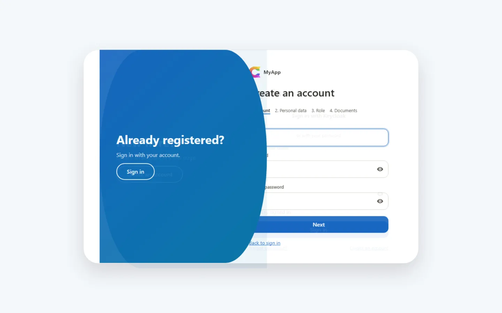

# Blazor-Admin-Oberfläche auf MudBlazor

Die ersten Monate einer Geschäftsanwendung gehen oft in den Rahmen um die eigentlichen Funktionen: ein Layout, ein Menü, das Berechtigungen beachtet, Seiten für Benutzer und Rollen, Einstellungen, eine Tabelle, die filtern und exportieren kann, eine Anmeldeseite, die nicht nach Standardvorlage aussieht. Nichts davon ist der Grund, warum es die App gibt, und alles muss funktionieren, bevor der erste Kunde etwas sieht.

`Coworkee.Client.Blazor` liefert diesen Rahmen als Paket. Es ist eine Blazor-WebAssembly-Oberfläche auf MudBlazor und MudBlazor.Extensions, mit den Admin-Seiten bereits an Ort und Stelle. Die App registriert ihre eigenen Seiten und Menüeinträge und ersetzt, was anders aussehen soll.

{ .shot loading=lazy }

## Eine Blazor-WebAssembly-Oberfläche in wenigen Zeilen

```csharp
var builder = WebAssemblyHostBuilder.CreateDefault(args);
builder.Services.AddCoworkeeClient(new Uri(builder.HostEnvironment.BaseAddress), options =>
{
    options.AppTitle = "MyApp";
    options.AppLogo = "logo.svg";
});
builder.Services.AddSingleton<INavigationContributor, MyAppNavigation>();
var host = builder.Build();
await host.Services.InitializeCoworkeeClientAsync();
await host.RunAsync();
```

Der Router verwendet `CoworkeeLayout` als Standardlayout. Damit hat die App eine App-Leiste mit Theme-Menü, Dunkelmodus, Umschalter für Rechts-nach-links, Benachrichtigungen und Benutzermenü, eine Profilseite und Admin-Seiten für Benutzer, Gruppen, Rollen, Einstellungen, Dienste, Themes, Mailvorlagen, Sprachen, Übersetzungen und das Audit-Log.

## Navigation, die Berechtigungen folgt

Menüeinträge kommen aus Implementierungen von `INavigationContributor`. Jeder Eintrag nennt seine Berechtigung, das Menü zeigt also nur, was der Benutzer öffnen darf. `NavigationMenuOptions` ordnet Gruppen, blendet Einträge aus oder verschiebt eine eingebaute Admin-Seite in eine andere Gruppe.

```csharp
public IEnumerable<CoworkeeNavItem> Items =>
[
    new("Products", "/catalog/products", Icons.Material.Outlined.ViewCarousel, CatalogPermissions.Products.View, Group: "Catalog"),
    new("Brands", "/catalog/brands", Icons.Material.Outlined.Sell, CatalogPermissions.Brands.View, Group: "Catalog", Order: 1),
];
```

Das Menü ist ein `MudExTreeView` mit einem Filterfeld, das Treffer hervorhebt. Benutzer wechseln zwischen Baum, Liste und flacher Liste und heften die Leiste als Symbolstreifen an oder lassen sie als Overlay aufklappen. Ändern sich Rollen oder Freigaben, lädt der Client seine Berechtigungen neu, und das Menü passt sich ohne Neuladen der Seite an.

## Eine Datentabelle für OData-Sets

`CoworkeeDataTable<T>` ist ein MudBlazor-Datagrid auf einem [OData-Set](data.md). Der Server blättert, sortiert, filtert und zählt. Die Tabelle ergänzt, was Benutzer von Listenansichten erwarten:

- **Facetten** aus `[ProvideFacet]` an der Entity, als Pillen über den Zeilen oder in einer Seitenleiste, mit Ansichten passend zu den Werten: Checklisten, Chips, Bereichsregler über einem Histogramm, Datumsvorgaben.
- **Spaltenfilter** in jeder Kopfzeile, mit Editoren für Text, Zahlen, Datum und Enums. Eine Spalte mit Facette zeigt deren Optionen und Anzahlen.
- **Erweiterter Filter** mit dem Abfrage-Editor: verschachtelte Gruppen aus *alle / irgendeine*.
- **Gruppierung** durch Ziehen einer Kopfzeile in die Gruppierungszone, verschachtelt über mehrere Spalten, mit Aggregaten je Gruppe.
- **Gespeicherte Ansichten**: Suche, Facetten, Filter, Spaltenreihenfolge und -breiten, Gruppierung, Sortierung und Dichte unter einem Namen, abgelegt in den Benutzereinstellungen und damit auf jedem Gerät verfügbar. Ein Link-Knopf kopiert eine Adresse, die die Tabelle genau so öffnet.
- **Seiten oder endloses Scrollen**, je Tabelle festgelegt oder über eine Einstellung, die Administratoren für alle setzen und Benutzer überschreiben können.
- **Export** als CSV, JSON und Excel mit allen Zeilen des aktuellen Filters, Excel-Import mit `Importable="true"`.

```razor
<CoworkeeDataTable T="ProductDto" EntitySet="Products" Expand="Brand" SearchFields="SearchFields"
                   CreatePermission="@CatalogPermissions.Products.Create" OnCreate="CreateAsync" OnEdit="EditAsync">
    <Columns>
        <PropertyColumn Property="p => p.Name" />
        <PropertyColumn Property="p => p.Brand!.Name" Title="Brand" />
    </Columns>
</CoworkeeDataTable>
```

Tabellen über `[Realtime]`-Entities laden neu, sobald jemand anderes eine Zeile ändert.

## Formulare mit MudEx Object Edit und einfahrenden Dialogen

Für einfache Modelle erzeugt `Dialogs.ShowEditAsync(title, model, save)` das Formular mit `MudExObjectEditForm`. Es öffnet sich als Seitenblatt in voller Höhe, das von der Seite einfährt, auf die der Benutzer geklickt hat, auf breiten Bildschirmen zweispaltig. Mit einer Speicherfunktion bleibt der Dialog offen und zeigt die Validierungsmeldungen der API, wenn das Speichern fehlschlägt. Editoren wie `ODataPicker` für einen Fremdschlüssel werden pro Eigenschaft in der Meta-Konfiguration gesetzt.

## Themes: Ocean als Standard, pro Benutzer, mit eigenem Logo

Themes sind Daten: Paletten für hellen und dunklen Modus, Typografie, Eckenradius, Breite der Navigation, Dichte, Logo und eigenes CSS. Sieben Themes sind eingebaut, Ocean ist der Standard. Administratoren bearbeiten sie mit Live-Vorschau, veröffentlichen sie und wählen den Standard der Organisation; jeder Benutzer wählt in den Kontoeinstellungen ein veröffentlichtes Theme und hellen, dunklen oder System-Modus. Eine App ergänzt ihre eigenen Farben mit `ThemingOptions`:

```csharp
context.Services.Configure<ThemingOptions>(themes =>
{
    themes.DefaultTheme = "Shop";
    themes.Themes.Add(new AppTheme("Shop", "Ocean", new Dictionary<string, string> { ["Primary"] = "#0a7d5a" }));
});
```

{ .shot loading=lazy }

Während die WebAssembly-App lädt, zeigt `CoworkeeLoadingScreen` einen vom Server gerenderten Ladebildschirm in den Farben und mit dem Logo des Standard-Themes. Der Ring um das Logo zeigt den echten Downloadfortschritt; scheitert der Start, wird daraus eine Fehlermeldung mit *Neu laden*.

## Anmeldedesigns: Card, Split und Slide

Die Kontoseiten des Auth-Servers übernehmen Farben, Schrift und Logo des Standard-Themes. Drei Layouts sind dabei: `Card`, `Split` mit Bild oder Video neben dem Formular und `Slide`, der Standard, bei dem ein farbiges Feld zwischen Anmeldung und Registrierung auf die andere Seite wandert. Administratoren der Systemorganisation wählen das Layout auf der Themes-Seite; ein eigenes Layout ist eine Razor-Datei im Auth-Host.

{ .shot loading=lazy }

## Jede Komponente ersetzen

Jede Komponente der Oberfläche lässt sich austauschen, ohne das Layout zu kopieren:

```csharp
builder.Services.ReplaceComponent<CoworkeeUserMenu, MyUserMenu>();
```

Das Layout ist in Teile zerlegt (`CoworkeeAppBar`, `CoworkeeBrand`, `CoworkeeNavMenu`, `CoworkeeUserMenu`, `NotificationBell`, ...), eine Änderung ersetzt also einen Teil statt des ganzen Rahmens. Für Menüeinträge und Elemente der App-Leiste reichen meist die Erweiterungspunkte `INavigationContributor` und `IAppBarContributor`.

## AirWorks: ein Web-Desktop als zweiter Client

Neben der Blazor-App ergänzt `coworkee new Shop --airworks` einen Web-Desktop-Client auf Basis von AirWorks, mit Fenstern, Taskleiste und mehreren Desktops. Er meldet sich über denselben Auth-Server an, spricht mit derselben API und bringt die meisten Funktionen der Blazor-App mit: Einstellungen, Dateien, Datentabellen, Chat, Berichte, den KI-Assistenten und die Administration.

## Weiterlesen

- [Client und Layout](../ui/client.md): Einrichtung, Navigation, App-Leiste, Bausteine
- [Datentabellen](../ui/data-table.md): Parameter, Facetten, Spaltenfilter, Ansichten und Bearbeitungsdialoge
- [Komponenten ersetzen](../ui/customizing.md): Teile des Layouts und der Über-Dialog
- [Themes](../modules/theming.md): eingebaute Themes, Themes der App, Logo und Ladebildschirm
- [Anmeldeseiten und Designs](../security/sign-in-pages.md): Layouts, Konfiguration und eigene Designs
- [AirWorks-Client](../web/airworks.md): der Web-Desktop und eigene AirWorks-Apps
