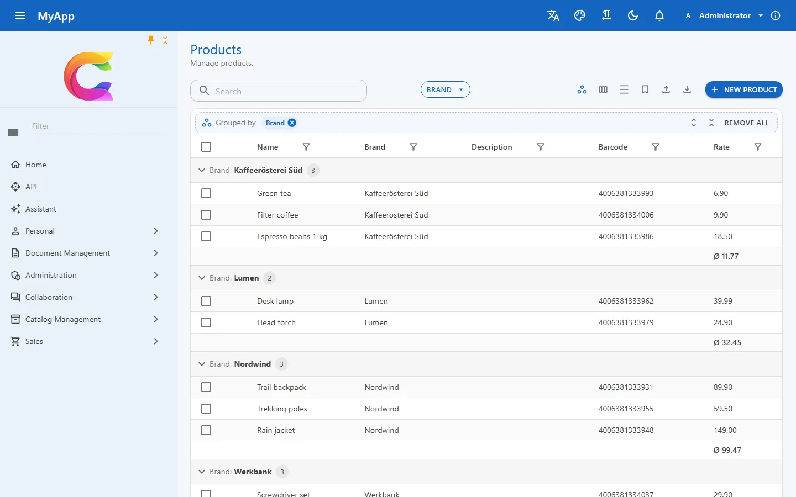

# Blazor-Admin-Oberfläche

{ .shot loading=lazy }

Die Produktliste der Demo, nach Marke gruppiert, unter jeder Gruppe der Durchschnitt. Gruppieren kann jede Tabelle von Haus aus; selbst angegeben hat die Seite nur den Durchschnitt, als Aggregat an der Preisspalte.

`Coworkee.Client.Blazor` ist eine Blazor-WebAssembly-Oberfläche auf MudBlazor und MudBlazor.Extensions. Layout, ein Menü, das Berechtigungen beachtet, und die Admin-Seiten (Benutzer, Rollen, Einstellungen, Themes, Übersetzungen, Audit-Log und noch ein paar mehr) sind dabei. Deine App hängt ihre eigenen Seiten daneben.

```csharp
builder.Services.AddCoworkeeClient(new Uri(builder.HostEnvironment.BaseAddress), options =>
{
    options.AppTitle = "MyApp";
    options.AppLogo = "logo.svg";
});
builder.Services.AddSingleton<INavigationContributor, MyAppNavigation>();
```

## Menü und Formulare

Jedes `CoworkeeNavItem` aus einem `INavigationContributor` nennt seine Berechtigung. Im Menü taucht also nur auf, was der Benutzer öffnen darf. Ändert sich eine Rolle, lädt der Client die Berechtigungen neu, und das Menü zieht ohne Neuladen der Seite nach.

```csharp
public IEnumerable<CoworkeeNavItem> Items =>
[
    new("Products", "/catalog/products", Icons.Material.Outlined.ViewCarousel, CatalogPermissions.Products.View, Group: "Catalog"),
];
```

Das Menü selbst ist ein `MudExTreeView` mit Filterfeld. Wer mag, heftet es als schmale Symbolleiste an.

Formulare für einfache Modelle kommen aus `Dialogs.ShowEditAsync(title, model, save)`: ein `MudExObjectEditForm` in einem Seitenblatt über die volle Höhe, das von der Seite hereinfährt, auf die geklickt wurde. Lehnt die API das Speichern ab, bleibt der Dialog offen und zeigt die Validierungsmeldungen. Ein Fremdschlüssel bekommt mit einer Zeile Meta-Konfiguration einen `ODataPicker`.

## Die Datentabelle

`CoworkeeDataTable<T>` ist ein MudBlazor-Grid über einem [OData-Set](data.md). Blättern, Sortieren und Zählen erledigt der Server.

```razor
<CoworkeeDataTable T="ProductDto" EntitySet="Products" Expand="Brand" SearchFields="SearchFields"
                   CreatePermission="@CatalogPermissions.Products.Create" OnCreate="CreateAsync" OnEdit="EditAsync">
    <Columns>
        <PropertyColumn Property="p => p.Name" />
        <PropertyColumn Property="p => p.Brand!.Name" Title="Brand" />
    </Columns>
</CoworkeeDataTable>
```

Aus diesem Markup bekommen Benutzer Facetten (als Pillen über den Zeilen oder in einer Seitenleiste), einen Filter in jeder Spaltenüberschrift, den Abfrage-Editor als *Erweiterten Filter* und Gruppierung per Ziehen einer Überschrift. Hat eine Spalte eine Facette, zeigt ihr Filter deren Optionen samt Anzahl. Die beiden können sich also nie widersprechen.

Gespeicherte Ansichten merken sich die ganze Anordnung unter einem Namen: Filter, Reihenfolge und Breite der Spalten, Gruppierung, Sortierung. Sie liegen in den Benutzereinstellungen und sind damit auch auf dem nächsten Gerät da. Der Link-Knopf kopiert eine Adresse, die die Tabelle genau so öffnet, wie sie gerade aussieht.

Geblättert wird mit Pager oder per endlosem Scrollen; den Standard legen Administratoren fest, Benutzer können ihn überschreiben. Der Export liefert CSV, JSON und Excel mit dem ganzen gefilterten Ergebnis, in einem Dialog mit Fortschritt und *Abbrechen*; *Export planen* verschickt ihn regelmäßig per Mail. `RowHref` oder `OnRowClick` öffnen eine Zeile per Klick. Tabellen über `[Realtime]`-Entities laden neu, sobald jemand anderes eine Zeile ändert. Meistens praktisch, manchmal überraschend.

## Weitere Bausteine

Strg+K öffnet auf jeder Seite die [Befehlspalette](../ui/command-palette.md): Seiten, Datensätze aus der globalen Suche, Aktionen und den Assistenten als Rückfall. `CoworkeeDetailPanel` zeigt die Details eines Listen- oder Board-Eintrags in einer Schublade, gebunden an `?item={id}` ([Detailbereich](../ui/detail-panel.md)). `ResourceCalendar` stellt Ressourcen Tagen gegenüber, mit Balken, halben Tagen, Feiertagen und Tagesauswahl ([Ressourcenkalender](../ui/resource-calendar.md)), und `CoworkeeBarChart`, `CoworkeeDonut` und `CoworkeeSparkline` zeichnen [kleine Diagramme](../ui/charts.md) ohne das Berichtsmodul.

## Themes, Anmeldung und Ladebildschirm

{ .shot loading=lazy }

Einundzwanzig Themes sind eingebaut, Standard ist Ocean. Administratoren bearbeiten sie mit Live-Vorschau und veröffentlichen sie; danach sucht sich jeder Benutzer eins aus, dazu hellen oder dunklen Modus. Eigene Farben bringt die App so mit:

```csharp
context.Services.Configure<ThemingOptions>(themes =>
{
    themes.DefaultTheme = "Shop";
    themes.Themes.Add(new AppTheme("Shop", "Ocean", new Dictionary<string, string> { ["Primary"] = "#0a7d5a" }));
});
```

Die Anmeldeseiten des Auth-Servers übernehmen Farben, Schrift und Logo des Standard-Themes. Zur Wahl stehen `Card`, `Split` (Bild oder Video neben dem Formular) und `Slide`, bei dem ein farbiges Feld zwischen Anmeldung und Registrierung die Seite wechselt. Ein eigenes Layout ist eine einzelne Razor-Datei im Auth-Host.

Solange WebAssembly lädt, zeigt `CoworkeeLoadingScreen` einen vom Server gerenderten Bildschirm in den Farben des Themes, mit dem echten Downloadfortschritt als Ring ums Logo. Klappt der Start nicht, wird daraus eine Fehlermeldung mit *Neu laden*.

Alles in der Oberfläche lässt sich mit `builder.Services.ReplaceComponent<CoworkeeUserMenu, MyUserMenu>()` austauschen. Das Layout ist in Teile wie `CoworkeeAppBar` und `CoworkeeNavMenu` zerlegt, du ersetzt also nur das Stück, das anders sein soll.

Dieselben Apps laufen auf Wunsch auch in einem Web-Desktop: `coworkee new Shop --airworks` legt einen [AirWorks](../web/airworks.md)-Client mit Fenstern und Taskleiste an, der sich am selben Auth-Server anmeldet und mit derselben API spricht.

## Systemstatus

*Administration → Überwachung → Systemstatus* (`/cw/admin/system-status`, Berechtigung `Settings.Manage`, nur in der Systemorganisation) zeigt die Installation auf einen Blick: Versionen von Bibliothek, App und .NET, die Datenbank mit ausstehenden Migrationen und dem Outbox-Rückstand, Hintergrundjobs mit den letzten Fehlern und einem Link aufs Job-Dashboard, wartende und in den letzten sieben Tagen fehlgeschlagene Mails, Echtzeit-Verbindungen, Redis, Dateispeicher, maschinelle Übersetzung und den KI-Assistenten. Jedes Modul steuert seine eigene Karte über `ISystemStatusContributor` bei (`services.AddSystemStatus<T>()`), deine App kann das auch.

**Stand:** Die Admin-Seiten der Bibliothek liegen unter `/cw/admin/...` (siehe [Seiten der Bibliothek](../ui/customizing.md#seiten-der-bibliothek)). Gruppierte Zeilen lassen sich nicht virtualisieren, eine gruppierte Tabelle fällt deshalb auf den Pager zurück.

Referenz: [Client und Layout](../ui/client.md), [Datentabellen](../ui/data-table.md), [Smartphones, installierbare App und Push](../ui/phones-and-pwa.md), [Komponenten ersetzen](../ui/customizing.md), [Themes](../modules/theming.md), [Anmeldeseiten](../security/sign-in-pages.md).
