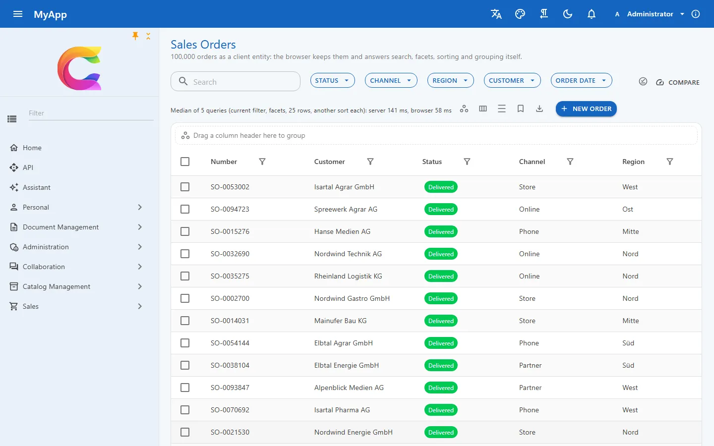

# Daten und Abfragen

{ .shot loading=lazy }

Das ist die Auftragsliste der Demo: 100.000 Zeilen, und die Zeile unter den Facetten zeigt, wie die Tabelle ihre eigene Abfrage auf beiden Seiten gemessen hat. Hier: Server 141 ms, Browser 58 ms. Der Browser gewinnt, weil die Zeilen schon bei ihm liegen. (Der Screenshot stammt aus einem älteren, leichteren Lauf; die gemessene Tabelle mit 39-56 ms im Browser gegen 216-236 ms auf dem Server steht bei den [Client-Entities](../ui/client-entities.md).)

Darunter steckt ganz normales EF Core. Handler bekommen `CoworkeeDbContext` injiziert und rufen `db.Set<T>()` auf, ohne Repository-Schicht dazwischen (EF Core ist ja schon eine).

## Ein DbContext, Marker an den Entities

Die App leitet genau einen Kontext ab. Module bringen ihre Entities mit, die Bibliothek die Tabellen für Identität, Einstellungen, Audit und Outbox.

```csharp
public sealed class MyAppDbContext(DbContextOptions<MyAppDbContext> options, ICurrentUser currentUser, IEnumerable<IModelContributor> contributors)
    : CoworkeeDbContext(options, currentUser, contributors);

context.Services.AddCoworkeeDbContext<MyAppDbContext>((provider, options) =>
    options.UseCoworkeeDatabase(provider.GetRequiredService<IConfiguration>(), "myapp"));
```

Was eine Entity bekommt, hängt davon ab, was sie implementiert. `IMultiTenant` filtert Abfragen auf den aktuellen Mandanten und setzt `TenantId` beim Einfügen. Mit `ISoftDelete` setzt `Remove` nur ein Flag, und Abfragen blenden die Zeile aus. `AuditedEntity` füllt die Spalten für Anlage und Änderung, und `[Realtime(permission)]` schickt jede gespeicherte Änderung per SignalR an alle Clients mit dieser Berechtigung.

Änderungen an auditierten Entities landen außerdem Feld für Feld im Audit, mit Benutzer, Zeitpunkt, altem und neuem Wert, in derselben Transaktion. In der Admin-Oberfläche siehst du sie im globalen *Audit-Log* und pro Datensatz über `AuditTimeline`. `[Sensitive]` hält fest, dass sich etwas geändert hat, aber nicht den Wert.

Domain Events (`Raise(...)` an einem `AggregateRoot`) und Integration Events laufen über eine Outbox in genau dieser Transaktion. Zu einer zurückgerollten Änderung wird also nichts verschickt.

`Coworkee:Database:Provider` wählt PostgreSQL (Standard), SQL Server oder SQLite. Was je Datenbank anders ist, etwa die Zeilensperren der Outbox oder wo Hangfire seine Jobs ablegt, steckt in kleinen Nahtstellen der Bibliothek. SQLite ist für Demos und Installationen auf einem Rechner gedacht: ein Schreiber zur Zeit, Hintergrundjobs nur im Speicher.

## OData-Sets mit Facetten

```csharp
context.Services.AddODataEntity<Product>("Products", CatalogPermissions.Products.View);
```

Mit dieser Zeile bekommt die Entity ein Set mit `$filter`, `$orderby`, `$expand`, Blättern und Zählen. Die Berechtigung wird bei jedem Aufruf geprüft, Mandanten- und Soft-Delete-Filter greifen wie überall. Zeilen, die nur manche Benutzer sehen dürfen, schränkst du mit einem `IODataEntityFilter<T>` ein; der wirkt auf Listen, Zählungen und Facetten gleichermaßen.

Eigenschaften mit `[ProvideFacet]` kommen als Facettengruppen zurück: jede Option mit Beschriftung, Anzahl und dem Filterstück, das sie anwendet. Die Zahlen richten sich nach dem aktuellen Filter, wie man es aus Online-Shops kennt. Zahlen- und Datumsfacetten bringen ein Histogramm mit.

Dieselben Sets bedienen auch Excel. Der Export übernimmt Filter und Sortierung der Liste (höchstens 100.000 Zeilen, `Coworkee:OData:MaxExportRows`), und `AddODataImport` macht aus jeder hochgeladenen Zeile ein Command. Validiert wird also pro Zeile, und fehlerhafte Zeilen kommen mit ihrer Nummer zurück.

Für Bedingungen, die Benutzer selbst zusammenklicken, gibt es den `QueryBuilder` mit verschachtelten *alle / irgendeine*-Gruppen. `ODataQueryTranslator.ToFilter` macht daraus `$filter`-Text, `LinqQueryTranslator.ToExpression<T>` einen Ausdruck, den EF Core ausführt, und die Tests prüfen, dass beide dieselben Zeilen liefern.

## Client-Entities: der Browser antwortet

Setz `[ClientEntity]` an eine Entity, und der Blazor-Client hält eine Kopie ihres OData-Sets. Solange die Kopie lädt, gehen Abfragen an den Server. Ist sie vollständig, laufen Filter, Suche, Sortierung und Facettenzählung lokal, und Änderungen kommen als Deltas nach.

Die Kopie ist ein kleiner Spaltenspeicher mit Indizes pro Spalte und liegt in IndexedDB. Bei den 100.000 Aufträgen dauert der erste Download etwa 14,5 s; nach einem Neuladen der Seite laufen Abfragen 0,3 s nach den ersten Zeilen wieder lokal. Ohne Filter brauchte die Tabellenabfrage auf dem Server 216 bis 236 ms, im Browser 39 bis 56 ms.

Jede Tabelle über so einem Set hat einen Schalter mit *Vergleichen und das Schnellere wählen*: Er führt die aktuelle Abfrage auf jeder Seite dreimal aus und behält die schnellere. In der Kopie steht nur, was der Benutzer per OData ohnehin lesen dürfte. Verschlüsselt ist sie auf dem Gerät allerdings nicht, Sets mit sensiblen Daten lässt du also besser auf dem Server.

## Attribute und Sicherungen

Mit `AddExtendedAttributes<T>` hängen Benutzer Schlüssel-Wert-Paare (Text, Dezimalzahl, Datum oder JSON) an jede Entity, ganz ohne Migration. `CoworkeeBackupModule` schreibt die ganze Datenbank als eine ZIP-Datei in den Dateispeicher und spielt sie in einer Transaktion zurück; eine Sicherung aus einem anderen Migrationsstand lehnt es ab.

**Stand:** Sicherungen brauchen PostgreSQL. MySQL und MariaDB gibt es nicht, weil Pomelo noch kein Release für EF Core 10 hat. Facetten über `bool`-Spalten scheitern auf SQL Server und SQLite bis zum nächsten Nextended-Release. Der Abfrage-Editor kann noch keinen OData-Text importieren, und Regeln lassen sich nicht per Drag and Drop umsortieren.

- [Persistenz](../fundamentals/persistence.md): Provider, Basisklassen, Migrationen und Seed
- [OData und Facetten](../web/odata.md), [Abfrage-Editor](../ui/query-builder.md) und [Client-Entities](../ui/client-entities.md) mit allen Messungen
- [Audit](../modules/auditing.md), [erweiterte Attribute](../modules/extended-attributes.md) und [Datenbanksicherungen](../modules/backups.md)
