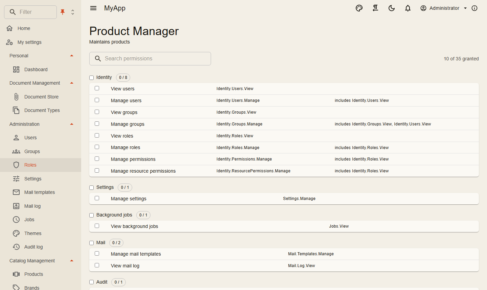

# Identität und Berechtigungen

Die Anmeldung läuft auf einem eigenen Host, einem OpenID-Connect-Server auf Basis von OpenIddict. Der Web-Host arbeitet als Backend for Frontend: Er wickelt den Code-Flow mit PKCE ab, hält die Tokens in einer serverseitigen Sitzung und gibt dem Browser nur ein Cookie. Die API prüft Bearer-Tokens. Ein Access Token bekommt der Browser nie zu sehen.

Eine neue Installation bekommt Mandant, Administrator und Rollen entweder per Seed aus dem Migrationsdienst (so macht es das Template) oder fragt sie beim ersten Start in einem Einrichtungsassistenten ab. Sharemee startet auf diese Weise.

{ .shot loading=lazy }

## Wer was darf

Berechtigungen sind Strings, die die Module festlegen. Vergeben werden sie an Rollen, Gruppen oder einen einzelnen Benutzer, und der Rolleneditor zeigt sie als Matrix mit einem Schalter pro Gruppe. Ein Request sagt mit `[RequiresPermission]`, was er braucht, und der Dispatcher prüft das, bevor der Handler läuft.

Freigaben gehen auch auf eine einzelne Ressource, etwa einen Ordner, und vererben sich entlang einer Hierarchie, die du mit `IResourceHierarchy` beschreibst. Blazor-Seiten blenden Schaltflächen und Menüeinträge aus, die der Benutzer nicht nutzen darf, aber das ist Kosmetik. Entscheiden tut der Server.

Auf der Seite eines Benutzers bearbeiten Administratoren alles, von der E-Mail-Adresse bis zur Sperre und zum Zurücksetzen der Zwei-Schritt-Verifizierung. *Überall abmelden* und *Sperren* greifen sofort: Tokens enthalten einen Hash des Security Stamps, die API vergleicht ihn bei jedem Request, und mit Redis erfahren es die anderen Instanzen ohne Verzögerung.

## Als anderer Benutzer anmelden

Der Support sieht, was ein Benutzer sieht, ohne sein Passwort zu kennen: *Anmelden als* in der Benutzerliste und auf der Seite des Benutzers braucht `Identity.Users.Impersonate` („Sign in as other users“, enthält `Users.View`, ist nicht Teil von `Users.Manage`). Ziel ist ein anderer aktiver, nicht gesperrter Benutzer derselben Organisation, und wer schon als jemand anderes angemeldet ist, kann das nicht noch einmal. Das Ziel hat **keine Berechtigung, die dem Aufrufer fehlt**: effektive Berechtigungen aller Rollen auf beiden Seiten, gleich welche Rolle einer als aktive Rolle gewählt hat. Eine Berechtigung auf eine einzelne Ressource (`ResourcePermission`) zählt, es sei denn, der Aufrufer hat sie global oder auf derselben Ressource. Jede Gruppe, in der das Ziel direkt Mitglied ist, muss in den Gruppen des Aufrufers oder ihren Teilbäumen liegen, wie `IGroupScope` sie berechnet; `Identity.Groups.ScopeAll` hebt das auf. Ein Support-Benutzer einer Kundengruppe meldet sich also nicht als Benutzer einer anderen an, ein Mitglied einer übergeordneten Gruppe aber als Mitglieder ihrer Untergruppen. Die API prüft das beim Ausstellen des Tickets (`POST /api/v1/identity/users/{id}/impersonation`, `ICoworkeeApi.StartImpersonationAsync`), der Auth-Server noch einmal beim Einlösen und bei jeder Autorisierung und jedem Token-Refresh der Übernahme.

Das Ticket gilt eine Minute und nur für den angemeldeten Benutzer, der es angefordert hat. Es steht im Query-String (`/bff/impersonate?ticket=...` zur Auth-Server-Seite `/Account/Impersonate`), Request-Logs und der Browserverlauf können es also enthalten; außerhalb der Anmeldung des Aufrufers ist es wertlos, nach einer Minute ohnehin. Der Auth-Server meldet den Browser als Zielbenutzer an und kehrt über `/bff/login` zurück, sodass auch die Sitzung der App wechselt. Ab dann hat jedes Token den Zielbenutzer als `sub` und dazu `impersonator` (Benutzer-ID) und `impersonator_name`, das Access Token außerdem `impersonator_stamp` (ein Hash des Security Stamps des Aufrufers) und `impersonation_started`. `ICurrentUser.ImpersonatorId` liest das in der API, und das Änderungsprotokoll hält es neben dem Benutzer fest (`AuditEntry.ImpersonatorId`, „angemeldet durch“ auf der Protokollseite, `GET /api/v1/audit?impersonatorId=...`). Hintergrundjobs, Outbox-Nachrichten, Integrationsereignisse und vom Benutzer gestartete Elsa-Workflows tragen es weiter (`JobEnvelope`, `OutboxMessage`, `IntegrationMessage`, `ImpersonatedUser(userId, tenantId, impersonatorId)`), sodass auch ihre Änderungen den Aufrufer nennen. Die App-Leiste zeigt, wer als der Benutzer angemeldet ist; *Zurück zu meinem Konto* im Benutzermenü (`/bff/stop-impersonation` zu `/Account/StopImpersonation`) widerruft die Refresh Tokens der Übernahme und meldet den ursprünglichen Benutzer wieder an, dauerhaft, wenn seine eigene Anmeldung dauerhaft war. Beginn und Ende werden geloggt.

Die Übernahme endet bei der nächsten Autorisierung oder dem nächsten Token-Refresh, ihre Tokens werden widerrufen und der Browser abgemeldet, wenn:

- der Aufrufer sich überall abmeldet, ein neues Passwort bekommt, gesperrt oder deaktiviert wird (sein Security Stamp passt nicht mehr zu `impersonator_stamp`); *Zurück zu meinem Konto* meldet den Browser dann ab statt an;
- die Regeln nicht mehr gelten: der Aufrufer hat `Identity.Users.Impersonate` verloren, das Ziel hat eine Berechtigung, Gruppe oder Ressourcen-Berechtigung bekommen, die dem Aufrufer fehlt, oder wurde gesperrt;
- sie länger dauert als `Coworkee:Auth:MaxImpersonationDuration` (`AuthServerOptions.MaxImpersonationDuration`, standardmäßig 8 Stunden).

Die Regeln laufen bei jeder Autorisierung und jedem Refresh erneut: ein paar Abfragen je Refresh einer übernommenen Sitzung, nichts für andere Sitzungen.

Nur Clients mit `AllowImpersonation` (`Coworkee:Auth:Clients:<n>:AllowImpersonation`, standardmäßig aus) bedienen eine Übernahme, auch beim Refresh; die anderen, etwa Grafana, Kibana oder AirWorks, antworten mit `access_denied`. Im App-Host schaltet `AddWeb` es für den Web-Client ein. Ein Aufrufer stimmt nie für den Benutzer zu: Ein Client mit expliziter Zustimmung, die der Benutzer nicht selbst erteilt hat, antwortet mit `consent_required`, und die Zustimmungsseite mit 403.

Währenddessen antworten die Kontoseiten des Auth-Servers (Passwort, Zwei-Schritt-Verifizierung, Passkeys, Anwendungen, die erzwungene Passwortänderung und die Zustimmungsseite) mit 403, Abmelden am Auth-Server (`/Account/Logout`, End Session) widerruft die Tokens der Übernahme, und mit `[NotWhileImpersonating]` markierte Requests werden abgelehnt (`auth.impersonating`): die eigene E-Mail-Adresse ändern, API-Schlüssel anlegen, persönliche Daten exportieren, das Konto löschen, die aktive Rolle wählen sowie Webhooks und Bericht-Abonnements anlegen oder ändern. Die Prüfung gilt auch in Jobs und Handlern, die für den Benutzer handeln. Eigene Requests dieser Art markierst du genauso. Access Tokens aus der Übernahme bleiben bis zu ihrem Ablauf gültig (`AccessTokenLifetime`, standardmäßig 15 Minuten), also höchstens so lange nach *Zurück zu meinem Konto*, der BFF hält sie aber nicht mehr. Die Übernahme bleibt innerhalb einer Organisation. Ressourcen-Einschränkungen (`IResourceRestriction`), die dem Aufrufer Zugriff wieder nehmen, werden nicht verglichen: Als der Benutzer sieht er, was der Benutzer sieht. Mit `ISystemDispatcher` ausgelöste Arbeit läuft als System und nennt den Aufrufer nicht.

## Gruppenbaum und Geltungsbereich

Gruppen bilden pro Mandant einen Baum und können so Organisationseinheiten sein: Kunden, Tochtergesellschaften, Filialen. Eine Gruppe hat eine optionale übergeordnete Gruppe und einen `Code`, einen Pfad aus 5-stelligen Segmenten (`00001.00003`), den nur die Handler pflegen. Du legst eine Gruppe unter einer übergeordneten an, verschiebst sie (`PUT /api/v1/identity/groups/{id}/parent`, der Teilbaum zieht mit) oder löschst sie, womit auch ihre Untergruppen verschwinden. Namen sind unter Geschwistern eindeutig, die Tiefe ist auf 16 begrenzt. Gruppen einer bestehenden App werden zu Wurzeln; der Migrationshost vergibt ihre Codes beim nächsten Lauf.

Benutzer sind Mitglied in beliebig vielen Gruppen. **Einheiten vergeben von sich aus nichts**: Eine Gruppe bestimmt nur, was ein Benutzer sieht. Gruppen können weiterhin Rollen tragen (Reiter Rollen), aber die Rolle einer übergeordneten Gruppe erben ihre Untergruppen nicht. Mitglieder werden mit `Identity.Groups.ManageMembers` (in `Identity.Groups.Manage` enthalten) hinzugefügt, entfernt oder alle auf einmal in eine andere Gruppe verschoben. `Identity.Groups.ScopeAll` („Work in any group") macht jede Gruppe des Mandanten zugänglich, für Operatoren ohne eigene Einheit; Administratoren mit allen Berechtigungen haben sie. Die Baum-Endpunkte (`/groups/children`, `/groups/tree`) akzeptieren `Groups.View` oder `ScopeAll`.

Auf der Gruppenseite lädt der Baum bei Bedarf nach, mit Suche, Zählern und den Reitern Allgemein, Mitglieder und Rollen. `?group={id}` springt direkt zu einer Gruppe. Apps ergänzen eigene Reiter:

```csharp
services.AddGroupDetailTab<OrganisationCodes>("Organisation codes", ShipmentPermissions.Shipments.View);
// die Komponente hat [Parameter] public Guid GroupId { get; set; }
```

### Welche Gruppen ein Benutzer sieht

`IGroupScope` (Namespace `Coworkee.Application.Groups`, ohne Identity-Referenz nutzbar) antwortet pro Request:

| Methode | Ergebnis |
|---|---|
| `MembershipsAsync` | die Gruppen, in denen der Benutzer direkt Mitglied ist |
| `AccessibleAsync` | Mitgliedschaften samt aller Untergruppen; mit `ScopeAll` jede Gruppe des Mandanten |
| `SelectedAsync` | die Auswahl des Benutzers, begrenzt auf das Zugängliche |
| `ActiveAsync` | die Auswahl samt Untergruppen; `AccessibleAsync`, wenn nichts ausgewählt ist |
| `NodesAsync`, `AncestorsAsync` | `GroupNode(Id, ParentId, Code, Name)` von Gruppen oder der Pfad über einer Gruppe (Wurzel zuerst) |

Die Auswahl im Picker der App-Leiste speichert der Server pro Benutzer (`cw.GroupSelections`): Nichts ausgewählt heißt alles, was der Benutzer erreicht; einzelne Gruppen ausgewählt heißt diese samt Untergruppen. Eine Auswahl erweitert nie den Zugriff, und eine veraltete (Mitgliedschaft entfernt) wird ignoriert. Sie gilt nur für interaktive Anmeldungen; persönliche API-Schlüssel, MCP, Service-Clients und Hintergrundjobs sehen `AccessibleAsync`. Ohne Benutzer sind alle Listen leer; Ausnahmen (etwa eine Berechtigung „alles sehen") regelt die App.

Apps schränken ihre Zeilen mit einem Filter ein, der einmal gegen `ActiveAsync` geschrieben wird:

```csharp
using Coworkee.Application.Groups;
using Coworkee.OData;
using Microsoft.EntityFrameworkCore;

internal sealed class ShipmentFilter(IGroupScope scope) : IODataEntityFilter<Shipment>
{
    public async Task<IQueryable<Shipment>> ApplyAsync(IQueryable<Shipment> query, CancellationToken ct)
    {
        var ids = (await scope.ActiveAsync(ct)).ToList();
        return query.Where(s => EF.Parameter(ids).Contains(s.GroupId));
    }
}

// im Modul
services.AddScoped<IODataEntityFilter<Shipment>, ShipmentFilter>();
```

`EF.Parameter` ist auf SQL Server wichtig, das bei einem einfachen `Contains` mehr als 2100 Parameter ablehnt.

Die Auswahl bestimmt, was **Listen** zeigen, nicht, was ein Benutzer öffnen darf. Die Bibliothek schränkt Collections, `$count`, Facetten, Suche, Export, `QueryData`, Client-Entitäten und Berichte nach der Auswahl ein. Lesezugriffe per Schlüssel, die Prüfungen für Anhänge und Social-Funktionen (`VisibleIdsAsync`, also auch die Tag-Verknüpfungszähler), Verlauf, Import-Abgleich, Workflow-Sichtbarkeit und Webhooks laufen ohne Einschränkung, ein Link auf einen Datensatz einer anderen Einheit öffnet sich also weiter. Eigener Code, der Zugriff statt Auflistung meint, wird in `using (GroupScope.Unnarrowed())` gepackt. In der Oberfläche gestartete Exporte halten die Auswahl zum Zeitpunkt der Anforderung fest und der Job läuft unter `GroupScope.Selection(ids)`; sind bis dahin alle festgehaltenen Gruppen veraltet, fällt die Datei auf alles Zugängliche zurück. Der Client-Entity-Spiegel folgt der Auswahl (`IClientEntityPartitionPart`), eine Änderung synchronisiert also die Browser-Kopie neu.

`<GroupScopePicker />` setzt du selbst in die App-Leiste; das Template-Layout enthält ihn nicht, und er blendet sich für Benutzer ohne zugängliche Gruppen aus. Datentabellen laden bei einer Änderung der Auswahl neu (`GroupScopeState`), und `IClientDataCache` ist die Schnittstelle für eigene clientseitige Caches.

Der Gruppenimport (`Groups.Manage`) nimmt `Name`, `Description` und `ParentPath` („Kunde A/Hamburg") und ist ein Upsert über den Pfad: Eine Gruppe dieses Namens an diesem Pfad bekommt ihre Beschreibung aktualisiert, sonst wird sie angelegt. Fehlende Eltern werden nicht implizit angelegt (eine frühere Zeile derselben Datei kann sie anlegen); ein unbekanntes Elternteil ist eine Fehlerzeile. Ein `/` im Namen ist per Pfad nicht ansprechbar, leere Pfadsegmente werden ignoriert, eine leere Beschreibung löscht eine vorhandene nicht, und ein Probelauf kann unbekannte Pfade nicht melden (der echte Lauf schon). Die Gruppenseite hat Schaltflächen für Import und Export; das Set `Groups` hat ein berechnetes `ParentPath`, und der Export schreibt `Name`, `Description` und `ParentPath` in Baumreihenfolge, so dass sich ein Export wieder importieren lässt, etwa in einen anderen Mandanten. Das Users-OData-Set liefert `Groups` für Filter wie `Groups/any(m: m/GroupId eq {id})`.

!!! warning "Echtzeit und Einheiten als Kunden"
    `[Realtime]` sendet `type:X` weiterhin an alle mit der Ansichts-Berechtigung. Sind Einheiten Kunden in einem Mandanten, sehen Clients anderer Einheiten die IDs und geänderten Eigenschaftsnamen von Datensätzen, die sie nicht öffnen dürfen (und laden neu). Themen pro Gruppe sind ein Folgeschritt.

Workflow-Genehmiger, Mail an eine Gruppe, Ressourcenberechtigungen und Gruppenrollen verwenden die **direkte** Mitgliedschaft, nicht den Baum.

## Keycloak und andere Anbieter

Jeder OpenID-Connect-Anbieter kann Benutzer anmelden, jeder bekommt einen Abschnitt unter `Coworkee:Auth:External:Providers`. Mit einem bestehenden Konto verknüpft wird eine externe Anmeldung nur, wenn der Anbieter die E-Mail-Adresse als bestätigt meldet (oder mit `TrustEmail` konfiguriert ist). In der Entwicklung startet `options.UseKeycloak()` im Aspire-App-Host ein Keycloak mit einem Realm, der dieselben Benutzer und Passwörter hat wie die Anwendung.

Ob man sich per Passwort, über einen Anbieter oder auf beiden Wegen anmeldet, regelt die Einstellung `Auth.LoginMode`, auch im laufenden Betrieb. Die Selbstregistrierung (aus, solange `Account.AllowRegistration` nicht gesetzt ist) kann eine Freischaltung durch einen Administrator verlangen, dazu eine bestätigte Adresse, erlaubte Adressmuster und hochgeladene Dokumente. Auch die Passwortregeln sind Einstellungen, bis hin zu einem Verlauf von 24 Passwörtern, und jedes Passwortfeld nennt die gerade geltenden Regeln.

## Schlüssel und persönliche Daten

Skripte und KI-Clients nutzen persönliche API-Schlüssel: `cwk_` plus 64 Hex-Zeichen, einmal angezeigt, als SHA-256-Hash gespeichert, 7 bis 365 Tage gültig. Ein Schlüssel hat nie mehr Rechte als sein Benutzer im Moment; nimmst du dem Benutzer eine Rolle weg, ist sie beim nächsten Request auch beim Schlüssel weg.

Module, die Daten über eine Person speichern, implementieren `IPersonalDataContributor`. Über den Reiter *Datenschutz* der Kontoseite lädt man dann alles als `personal-data.json` herunter oder löscht das Konto.

**Stand:** Version 0.0.1.x, Namen können sich hier zwischen Releases noch ändern; was anzupassen ist, steht im [Änderungsprotokoll](../reference/changelog.md).

Referenz: [Anmeldung und Keycloak](../security/authentication.md), [Berechtigungen](../security/permissions.md), [Registrierung und Anmelderegeln](../security/registration.md), [Clients, Sitzungen und Passwortregeln](../security/clients.md), [Anmeldeseiten](../security/sign-in-pages.md), [API-Schlüssel](../security/api-keys.md), [Datenschutz](../security/privacy.md).
