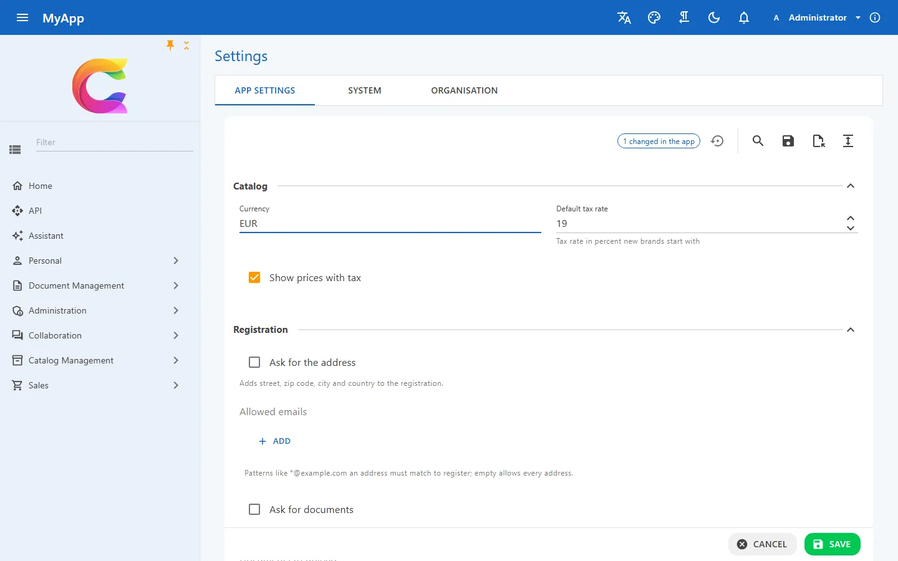
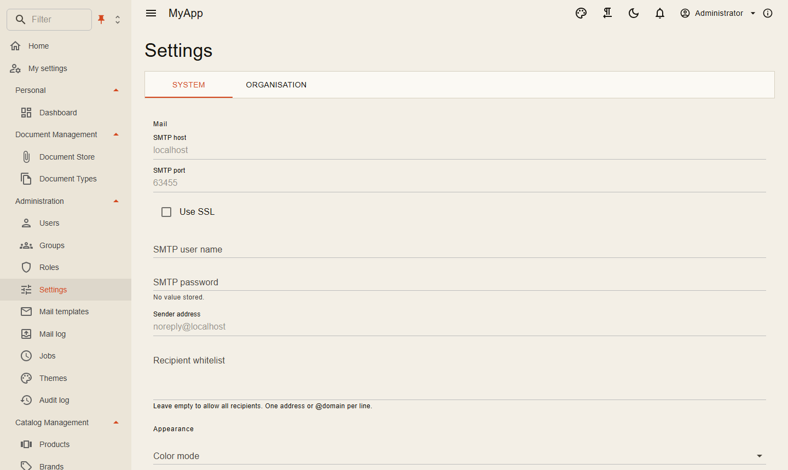

# Eine mandantenfähige SaaS-Basis für .NET

Ein SaaS-Produkt bedient viele Kunden aus einer Installation. Jeder Kunde erwartet, nur seine eigenen Daten zu sehen, die Anwendung nach eigenen Vorstellungen einzustellen und die Funktionen des Tarifs zu bekommen, den er bezahlt. Ein einziger Fehler bei der Mandantentrennung genügt, um einen Kunden zu verlieren, und eine bestehende Anwendung nachträglich mandantenfähig zu machen heißt, jede Abfrage anzufassen.

In Coworkee gehört der Mandant zum Fundament. Jeder Request kennt Benutzer und Mandant, EF Core filtert Mandantendaten von selbst, Einstellungen werden von der Installation bis zum einzelnen Benutzer aufgelöst, und das Features-Modul schaltet Teile der Anwendung pro Mandant über Editionen an und aus. Derselbe Code läuft als Anwendung für ein Unternehmen oder als Plattform für Hunderte Organisationen.

{ .shot loading=lazy }

## Mandanten und Organisationen

Ein Mandant ist eine Organisation mit Namen, Kennung und Aktiv-Status. Benutzer, Rollen, Gruppen, Berechtigungsfreigaben und die Daten Ihrer Module gehören zu genau einem Mandanten. Eine Organisation ist die Systemorganisation: Sie beherbergt die installationsweite Verwaltung. Ihre Administratoren legen unter *Administration > Mandanten* Organisationen an (auf Wunsch mit einem ersten Administrator), aktivieren und deaktivieren sie und weisen eine Edition zu. Eine deaktivierte Organisation sperrt auch die API-Schlüssel ihrer Benutzer.

Manche Berechtigungen ergeben nur für den Host Sinn, etwa `Features.Tenants`, `Features.Editions` und `Identity.Clients.Manage`. Jeder Administrator hat sie, nutzen können sie aber nur Administratoren der Systemorganisation.

## Mandantenfilter in EF Core

Eine Entität macht mit einem Marker-Interface mit:

```csharp
public sealed class Order : AuditedAggregateRoot, IMultiTenant
{
    public Guid TenantId { get; set; }
    public required string Number { get; set; }
}
```

`CoworkeeDbContext` legt dann einen benannten Query-Filter auf den aktuellen Mandanten an, sodass `db.Set<Order>()` nur die Zeilen der Organisation des Aufrufers liefert. Beim Einfügen wird `TenantId` aus dem aktuellen Benutzer gesetzt; eine Zeile in einen fremden Mandanten zu speichern löst eine Exception aus. Von `coworkee entity add` erzeugter Code nutzt `IMultiTenant` standardmäßig, und seine eindeutigen Indizes gelten pro Mandant.

`ICurrentUser` trägt Benutzer-Id, Mandanten-Id und Berechtigungen des Requests. Hintergrundjobs und die Outbox stellen Benutzer und Mandanten wieder her, die sie gestartet haben, und Code, der für einen anderen Mandanten handeln muss, etwa ein Seed, öffnet einen Scope:

```csharp
using (CurrentUserScope.Begin(new ImpersonatedUser(adminId, tenantId)))
{
    // queries and inserts run as this user and tenant
}
```

Gecachte Queries werden standardmäßig pro Mandant geteilt (`CacheScope.Tenant`), das Dashboard eines Kunden beantwortet also nie die Anfrage eines anderen.

## Einstellungen pro Installation, Mandant und Benutzer

Einstellungen sind einzelne Werte mit einem Typ und einem oder mehreren Gültigkeitsbereichen: `Global`, `Tenant` und `User`. Der spezifischste Wert gewinnt, eine Organisation kann also die Standardsprache der Installation überschreiben und ein Benutzer beide.

```csharp
context.Group("Billing", "Billing")
    .Add("Billing.Currency", "Currency", SettingType.Choice, [SettingScope.Tenant], "EUR", choices: ["EUR", "USD", "CHF"])
    .Add("Billing.ApiKey", "API key", SettingType.Secret, [SettingScope.Global]);
```

Eine Einstellung erscheint auf der Admin-Seite, sobald ihr `ISettingDefinitionContributor` registriert ist: *System* für globale Werte, *Organisation* für Mandantenwerte, *Meine Einstellungen* für den Benutzer. Formularcode pro Einstellung gibt es nicht. Geheimnisse werden mit ASP.NET Core Data Protection verschlüsselt und nie an den Client geschickt. Code liest Werte mit `ISettingProvider.GetAsync<T>`.

{ .shot loading=lazy }

## Typisierte App-Konfiguration mit Lock und Protect

Für größere Konfigurationsblöcke beschreibt die Anwendung ihre Einstellungen als C#-Klasse. Die Werte kommen aus appsettings und der Umgebung; was Administratoren in der Anwendung ändern, liegt in der Datenbank und für jeden Dienst obendrauf, gelesen über `IOptionsMonitor<T>`. Regeln legen fest, was der Browser anfassen darf:

```csharp
context.Services.AddCoworkeeSettings<MyAppSettings>(context.Configuration, rules => rules
    .Lock(s => s.Billing.Currency)          // shown disabled, never changed
    .Protect(s => s.Billing.WebhookUrl)     // editable once its lock button is pressed
    .Hide(s => s.Billing.WebhookSecret));   // never leaves the server
```

Typisierte Einstellungen gelten für die ganze Installation und werden in der Systemorganisation bearbeitet; Werte pro Mandant und pro Benutzer sind Einstellungen.

## Features und Editionen

`Coworkee.Features` schaltet Teile der Anwendung pro Mandant an und aus. Module definieren Features vom Typ `Bool`, `Int` oder `String`, Editionen bündeln Feature-Werte, und jeder Mandant bekommt eine Edition plus eigene Überschreibungen. Der Wert eines Mandanten kommt aus seiner Überschreibung, dann aus seiner Edition, dann aus dem Standardwert.

```csharp
[RequiresFeature("Reports.Enabled")]
public sealed record CreateReport(string Name) : ICommand<Result<Guid>>;
```

Solange das Feature aus ist, antwortet der Dispatcher mit `403` und dem Code `feature.disabled`; Minimal APIs nutzen `.RequireFeature(...)`, und `IFeatureChecker` beantwortet die Frage im Code. In Blazor blenden `FeatureGate` und Navigationseinträge mit `Feature` aus, was die Edition nicht enthält, und eine Änderung erreicht offene Clients über Realtime. Administratoren pflegen Editionen unter *Administration > Editionen* und Limits wie Berichte pro Monat und Mandant ohne Deployment.

## Weiterlesen

- [Persistenz](../fundamentals/persistence.md#mandanten-und-aktueller-benutzer): `IMultiTenant`, `ICurrentUser` und Benutzer-Scopes
- [Einstellungen und App-Konfiguration](../modules/settings.md): Bereiche, Typen, das Admin-Formular und typisierte App-Einstellungen
- [Typisierte App-Einstellungen](../modules/settings.md#typisierte-app-einstellungen): die eingebaute Konfigurationsklasse erweitern oder ersetzen
- [Features und Editionen](../modules/features.md): Definitionen, Prüfungen, Blazor und Mandantenverwaltung
- [Berechtigungen](../security/permissions.md#berechtigungen-nur-fur-den-host): Berechtigungen, die nur die Systemorganisation nutzen kann
- [Messaging und Pipeline](../fundamentals/messaging.md#caching): Cache-Bereiche pro Mandant, Benutzer oder Installation
