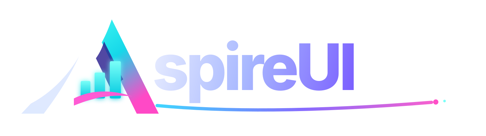

# Hosting and developer tools

```csharp title="MyApp.AppHost/AppHost.cs"
var builder = DistributedApplication.CreateBuilder(args);

builder.AddCoworkeeApp("myapp", options =>
{
    options.DisplayName = "MyApp";
    options.UseGrafana();
    options.UseWebDataStudio();
}).AddProjects();

builder.Build().Run();
```

That is the core of the app host in a generated app. `AddProjects()` finds the referenced projects by name (`*_Migrations`, `*_Auth`, `*_Api`, `*_Worker`, `*_Web`) and wires each in its role: the API gets its token authority, the web app its OIDC client at the auth server, and the migrations run before anything touches the database. Sharemee adds its processing worker, whose name fits no convention, with one more line: `app.AddWorker<Projects.Shareme_Processing_Host>("processing")`.

## Containers from the packages

Coworkee reads which packages each service uses and starts only the containers they need:

| Package in the service | It gets |
|---|---|
| `Coworkee.Infrastructure` | the app database; waits for the migrations |
| `Coworkee.Realtime` | Redis as SignalR backplane and for cache invalidation |
| `Coworkee.Mailing` | Mailpit with a web inbox |
| `Coworkee.Storage` | the shared folder `.data/blobs` |
| `Coworkee.Search.Elasticsearch` | Elasticsearch |

PostgreSQL is the default. `UseSqlServer()` swaps in SQL Server, `UseSqlite()` a file next to `src` and no container at all. `UseKeycloak(...)` adds Keycloak with a realm named after the app and a sign-in page in its colors. Anything can be tuned (`ConfigurePostgres`, `ConfigureRedis`) or replaced with your own resource (`UseDatabase`, `UseRedis`, `UseSearch`).

Two optional containers: `UseLibreTranslate([...])` for [machine translation](localization.md), and `coworkee new --ai-provider ollama` puts an Ollama container into the app host that pulls the model for the [assistant](../modules/ai.md). No API key needed.

## Grafana and WebDataStudio

{ .shot loading=lazy }

`UseGrafana()` brings Grafana with Prometheus, Loki, Tempo and an OpenTelemetry collector. The services keep reporting to the Aspire dashboard and send the same telemetry to the collector too. Six dashboards are provisioned on each start: Overview, .NET runtime, Database access (Entity Framework Core queries, connection pool, slowest spans), PostgreSQL server, App data (users, sign-ins, outbox, background jobs) and Logs and traces.

[{ .cw-product-logo }](https://fgilde.github.io/WebDataStudio/)

`UseWebDataStudio()` opens the app database in the browser, with tables, SQL, charts and exports. On SQLite it mounts the database file.

Both sign in with the app's administrator, or at the app's auth server as an administrator of the system organisation. Neither ends up in `aspire publish`, which is the point: a deployment should not ship a database studio holding the admin password.

## AspireUI and the Services page

[{ .cw-product-logo }](https://fgilde.github.io/AspireUI/)

AspireUI hosts further apps and stacks next to yours. The administrators of the system organisation sign in at the app's auth server and become AspireUI admins through one call:

```csharp
builder.AddAspireUI().WithCoworkeeSignOn(app).WithRetrieveApi();
```

Every service knows the addresses of the others, plus the Aspire and Hangfire dashboards, Mailpit and any container with a web endpoint. The admin page *Services* shows them as tiles and probes them every ten seconds; with `WithRetrieveApi()` the AspireUI apps join the list.

{ .shot loading=lazy }

**Status:** publishing with `aspire publish` to Docker Compose or Azure Container Apps is wired but not yet verified end to end. Running more than one instance needs Redis and a shared Data Protection key ring.

Reference: [Aspire app host](../hosting/aspire.md), [Grafana and WebDataStudio](../hosting/observability.md), [scaling out with Redis](../hosting/redis.md), [AspireUI](../hosting/aspire.md#aspireui).
