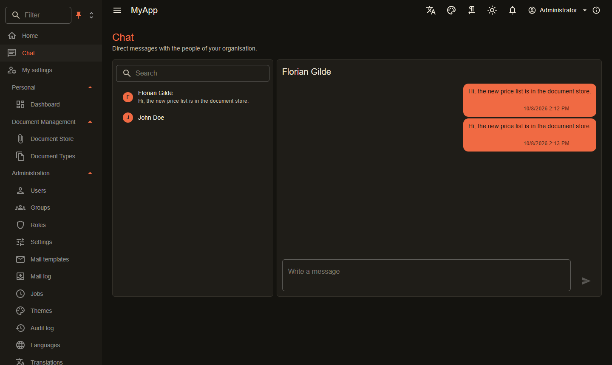

# Echtzeit-Zusammenarbeit mit ASP.NET Core und Blazor

Geschäftsanwendungen werden von mehreren Menschen gleichzeitig benutzt. Eine Kollegin ändert einen Auftrag, während Sie ihn ansehen, ein Administrator entzieht eine Rolle, ein Prüfer wartet auf eine Datei. Zeigt jede Seite nur den Stand beim Laden, arbeiten alle mit veralteten Daten, überschreiben sich gegenseitig und drücken ständig F5.

In einer Coworkee-App folgt jeder offene Tab diesen Änderungen über einen SignalR-Hub. Tabellen laden neu, wenn sich ihre Entity ändert, eine Detailseite bemerkt, dass ihr Eintrag gelöscht wurde, die Navigation passt sich an geänderte Berechtigungen an, und Nachrichten und Benachrichtigungen kommen an, während der Benutzer noch auf der Seite ist. Meist genügt dafür ein Attribut an der Entity, in der Seite ist nichts zu tun.

{ .shot loading=lazy }

## Entity-Änderungen per SignalR in der Oberfläche

Markieren Sie eine Entity mit `[Realtime]` und der Berechtigung, die zum Ansehen nötig ist. Jedes gespeicherte Anlegen, Ändern und Löschen (weiches Löschen zählt als Löschen) geht an die Benutzer des Mandanten, die diese Berechtigung haben:

```csharp
[Realtime(CatalogPermissions.Brands.View)]
public sealed class Brand : AuditedEntity, IMultiTenant { }
```

Eine `CoworkeeDataTable` von `BrandDto` folgt `Brand` von selbst und lädt einmal je Änderungsschub neu. Eine Detailseite beobachtet ihren Eintrag mit einer Komponente, alles andere abonniert ein Topic:

```razor
<EntityWatch EntityType="Brand" EntityId="Id" ReturnHref="/catalog/brands" OnChanged="LoadAsync" />
<RealtimeSubscription Topic="type:Brand" OnEvent="_ => LoadAsync()" />
```

Daten, die nur manche Benutzer sehen dürfen, bekommen eigene Topics, veröffentlicht mit `PublishAsync` des `IRealtimePublisher`. Massenänderungen über `ExecuteUpdate` oder `ExecuteDelete` umgehen den Change Tracker, auch die melden Sie selbst.

## Berechtigungen, die sich während der Anmeldung ändern

Das Speichern einer Rolle, eines Rechts oder einer Gruppenmitgliedschaft meldet eine Berechtigungsänderung. Der Server verwirft nach dem Commit seine zwischengespeicherten Berechtigungen, der Client lädt sie neu, und Navigation, `AuthorizeView` und Seitenschutz prüfen erneut. Eine Seite, die der Benutzer nicht mehr öffnen darf, wird ohne Neuladen zu „nicht erlaubt“. Außerdem nimmt der Server Topic-Abonnements zurück, denen ein Benutzer nicht mehr folgen darf: Wer das Recht zum Ansehen eines Entity-Typs verliert, bekommt auch keine Änderungsmeldungen dazu mehr.

## Aktive Rolle

Ein Benutzer mit mehreren Rollen kann in der App-Leiste eine davon wählen und nur in ihr handeln. Solange eine aktiv ist, zählen nur ihre Rechte, in der Oberfläche und bei jeder Berechtigungsprüfung der API. Ist eine Seite nicht erlaubt, listet die Komponente `NotAllowed` die anderen Rollen des Benutzers, die sie erlauben würden, und wechselt per Klick.

## Präsenz, Benachrichtigungen und Chat

- **Präsenz**: Wer mindestens eine offene Verbindung hat, ist online, sichtbar als grüner Punkt an jedem `UserAvatar`. Nach dem letzten geschlossenen Tab geht der Benutzer nach einigen Sekunden offline, ein Neuladen flackert also nicht.
- **Benachrichtigungen**: Module senden sie mit `NotifyAsync` oder, für jeden Leser übersetzt, mit `NotifyLocalizedAsync`. Sie erscheinen in der Glocke der App-Leiste und unter `/notifications`, live in jedem Tab, und eine tägliche Zusammenfassung verschickt die ungelesenen per Mail.
- **Chat**: `Coworkee.Chat` ergänzt Direktnachrichten zwischen den Personen einer Organisation. Eine neue Nachricht zeigt eine Snackbar mit Link, außer die Unterhaltung ist offen, und die Ungelesen-Zähler bleiben in allen Tabs gleich.

```csharp
await notifier.NotifyAsync([reviewerId], "review.requested", "Review requested",
    $"{asset.Name} waits for you", link: $"/assets/{asset.Id}", ct);
```

## Kommentare, Tags und Bewertungen an jeder Entity

`Coworkee.Social` hängt Kommentare mit Antworten, Tags und Bewertungen von 1 bis 5 Sternen an Entities, die Sie dafür freischalten. Jeder Baustein hat eigene Rechte zum Ansehen, Anlegen und Moderieren, Kommentar-Threads laden live über den Hub neu, und die Beteiligten werden bei einer Antwort benachrichtigt.

```csharp
context.Services.AddCoworkeeSocial(social => social
    .Comments<Product>("Products", id => $"/products/{id}")
    .Tags<Product>("Products")
    .Ratings<Product>("Products"));
```

In der Seite nehmen `CoworkeeComments`, `CoworkeeTags` und `CoworkeeRating` Entity-Typ und Id entgegen und blenden aus, was der Benutzer nicht darf. `CoworkeeTagCloud` macht aus einem gewählten Tag einen OData-Filter für eine Datentabelle.

## Mailing und Kampagnen

Mails sind Scriban-Vorlagen mit einem Modell und Vorgaben je Sprache. Administratoren überschreiben Betreff und Text im visuellen oder im Quelltext-Editor, legen eigene Vorlagen an und verschicken Kampagnen an intelligente Listen oder eine manuelle Auswahl von Benutzern, sofort oder geplant. Der Versand läuft über eine Warteschlange, wird wiederholt und protokolliert. Mails gehen über SMTP oder einen der HTTP-Anbieter hinaus, und eine Organisation kann ihren eigenen Server nutzen.

## Hintergrundjobs

Jobs laufen auf Hangfire mit dem Speicher des Datenbank-Providers. Ein eingereihter Job läuft als der Benutzer, der ihn eingereiht hat, Berechtigungen, Mandantenfilter und Audit greifen also wie in einer Anfrage. Wiederkehrende Jobs bekommen einen Cron-Ausdruck:

```csharp
jobs.Enqueue<RenderPreviewJob, RenderPreview>(new RenderPreview(asset.Id), queue: "processing");
services.AddRecurringJob<CleanupJob>("cleanup", "0 3 * * *");
```

Benutzer mit dem Job-Recht finden das Hangfire-Dashboard unter `/admin/jobs`.

## Skalierung mit Redis-Backplane

Eine einzelne Instanz braucht nichts weiter. Bei mehreren API-Instanzen schaltet ein Connection String `redis` die SignalR-Backplane ein, ein Ereignis erreicht dann die Verbindungen jeder Instanz. Dieselbe Verbindung sorgt dafür, dass die Präsenz einen Benutzer nur einmal zählt, dass Caches für Berechtigungen, Einstellungen und Texte auf allen Instanzen verworfen werden, und sie trägt Sitzungsänderungen weiter. Der Aspire-App-Host gibt jedem Dienst mit Realtime einen Redis-Container; `UseRedis(...)` verweist auf einen vorhandenen Server, `WithoutRedis()` lässt ihn weg. Antwortet Redis nicht, ist das nicht fatal: Die Dienste protokollieren eine Warnung und arbeiten mit dem lokalen Stand weiter.

## Weiterlesen

- [Realtime und Benachrichtigungen](../modules/realtime.md): Topics, aktive Rolle, Präsenz und die Endpunkte für Benachrichtigungen
- [Chat](../modules/chat.md): die Chatseite, ihre Endpunkte und Live-Nachrichten in eigenen Komponenten
- [Kommentare, Tags und Bewertungen](../modules/social.md): Registrierung, Berechtigungen und Client-Komponenten
- [Mailing](../modules/mailing.md): Vorlagen, Kampagnen und Mail-Anbieter
- [Hintergrundjobs](../modules/background-jobs.md): Jobs, Warteschlangen und wiederkehrende Jobs
- [Skalierung mit Redis](../hosting/redis.md): was Redis zwischen den Instanzen teilt
- [Clients und Sitzungen](../security/clients.md): wie beendete Sitzungen jeden Tab erreichen
