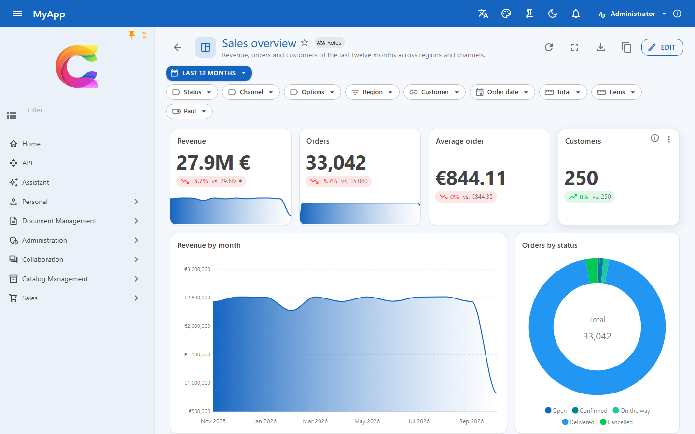
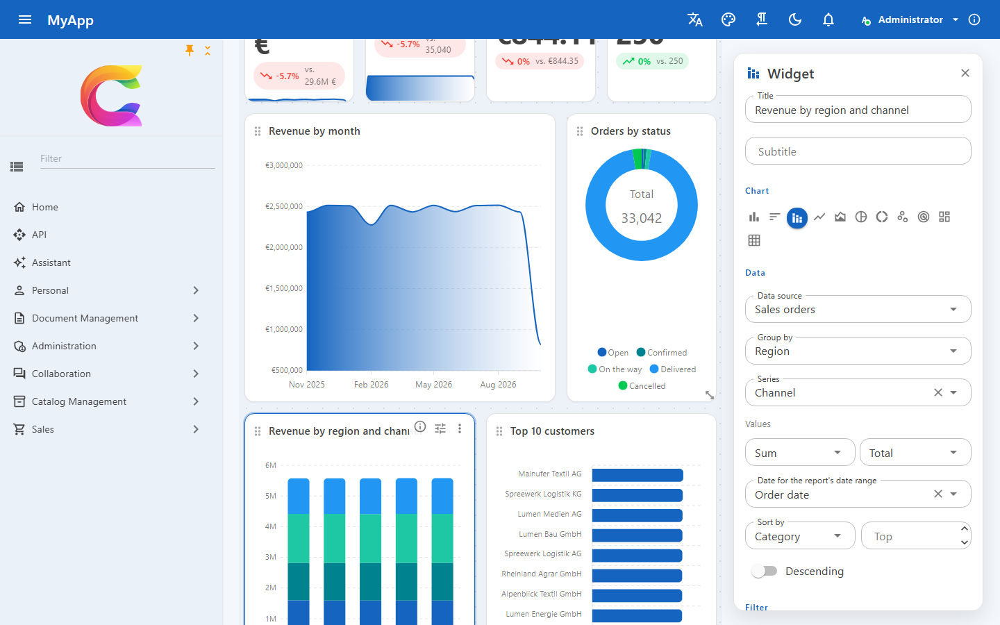
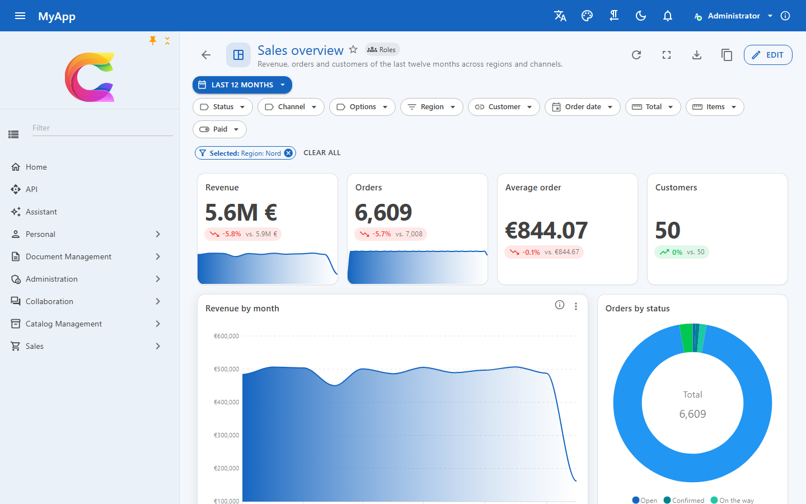

# Dashboards und Berichte in Ihrer Blazor-App

Früher oder später stellt jemand in jeder Geschäftsanwendung die Frage: „Wie viele Aufträge haben wir im letzten Quartal je Region ausgeliefert?“ Die üblichen Antworten sind ein Export in eine Tabellenkalkulation, ein eigenes BI-Werkzeug mit eigener Kopie der Daten und eigenem Rechtemodell, oder ein Entwickler, der noch eine handgebaute Diagrammseite schreibt.

Das Berichtsmodul von Coworkee bringt Dashboards in die App selbst. Benutzer ordnen Kennzahlen, Diagramme, Pivots und Tabellen auf einem Raster an, filtern sie gemeinsam und teilen das Ergebnis mit Rollen oder der ganzen Organisation. Die Daten kommen aus den OData-Entitätsmengen, die Sie ohnehin registriert haben, mit denselben Berechtigungen und Zeilenfiltern wie im Rest der App, und jede Zahl aggregiert die Datenbank.

{ .shot loading=lazy }

## Einrichtung

Das Server-Modul bringt Tabellen, Endpunkte, Berechtigungen und Live-Aktualisierung mit. Die Registrierung im Client ergänzt die Seiten unter `/reports` und einen Navigationseintrag und nennt die Seiten, auf denen der Drill-down landen soll:

```csharp
[DependsOn(typeof(CoworkeeReportingModule))]
public sealed class MyAppDatabaseModule : CoworkeeModule;

builder.Services.AddCoworkeeReporting(baseAddress, reports => reports
    .DrillDown("SalesOrders", "sales/orders")
    .DrillDown("Products", "catalog/products"));
```

Neue Apps bekommen das mit der Template-Option `--reports`, die standardmäßig eingeschaltet ist.

## Ihre OData-Entitätsmengen als Datenquellen

Berichte nutzen, was Sie für OData registriert haben, sonst nichts:

```csharp
services.AddODataEntity<SalesOrder>("SalesOrders", SalesPermissions.Orders.View);
services.AddODataEntity<Customer>("Customers", SalesPermissions.Orders.View);
```

Die Felder kommen aus dem EDM, Eigenschaften, die Sie vor OData verborgen haben, tauchen also nie auf, weder als Feld noch in einem Filter. Navigationseigenschaften zu einer anderen registrierten Menge ergänzen deren Felder, etwa `Customer/Name`, sofern der Benutzer auch diese Menge lesen darf. Beschriftungen kommen aus `[Display(Name = ...)]` oder `[ProvideFacet(Label = ...)]`, Enum-Werte zeigen ihre Anzeigenamen. Die Zeilen sind die, die auch die OData-Liste liefert: Mandantenfilter, weiches Löschen und jeder Zeilenfilter greifen. Wer das Recht für eine Menge nicht hat, bekommt an deren Widgets einen Fehler, der Rest des Berichts funktioniert weiter.

## Aggregation in der Datenbank

Widgets schicken ein Abfragemodell, nie einen Ausdruck. Der Server prüft jedes Feld gegen die Quelle, baut `GroupBy` und `Select` mit Expression Trees, und EF Core übersetzt sie in SQL, auf PostgreSQL, SQL Server und SQLite. Der Filter ist ein OData-`$filter`, gegen das EDM geparst wie am OData-Endpunkt.

```json
{
  "entitySet": "SalesOrders",
  "filter": "Region eq 'Nord' and Total gt 100",
  "groupBy": { "field": "OrderDate", "bucket": "Month" },
  "aggregates": [ { "function": "Sum", "field": "Total" }, { "function": "Count" } ],
  "sortBy": "Value", "descending": true, "top": 10
}
```

Gruppiert wird nach höchstens zwei Feldern, Datumswerte nach Tag, Woche, Monat, Quartal oder Jahr, mit bis zu 8 Werten aus `Count`, `Sum`, `Average`, `Min`, `Max` und `DistinctCount`. Eine Abfrage liefert höchstens 5.000 Gruppen.

Gemessen an den 100.000 Aufträgen der Demo (Postgres, warm): Anzahl nach Status 9 ms, Summe nach Monat 29 ms, Anzahl nach Woche 55 ms, Region nach Kanal 23 ms, Top 10 Kunden mit Join 30 ms, vier KPI-Werte 58 ms.

## Widget-Typen

| Widget | Zeigt |
|---|---|
| Kennzahl | einen Wert mit Trend gegenüber dem Zeitraum davor, einer Kurve über die Zeit und einem Tacho zum Ziel |
| Diagramm | Balken, liegende Balken, gestapelte Balken, Linie, Fläche, Torte, Ring, Streuung, Netz, Treemap, Heatmap |
| Tabelle | Zeilen der Menge mit endlosem Scrollen, als Tabelle, Karten oder Liste |
| Datentabelle | die vollständige `CoworkeeDataTable` mit Seiten, Gruppierung, Spaltenauswahl, Facetten und Suche |
| Pivot | Kategorien als Zeilen, Reihen als Spalten, nach Größe eingefärbt, mit Summen |
| Text, Bild, Webseite | Markdown, ein Bild oder eine abgeschottete Seite |

Farben, Schrift und Dunkelmodus kommen aus dem MudBlazor-Theme, ein eigenes Theme braucht also keine weitere Einrichtung.

## Ein GridStack-Designer für das Dashboard

{ .shot loading=lazy }

*Bearbeiten* schaltet das Raster in den Bearbeitungsmodus: Widgets am Titel ziehen, an den Rändern in der Größe ändern und neue hinzufügen. Das Layout nutzt GridStack mit 12 Spalten und fällt auf Telefonen auf eine Spalte zurück. Der Widget-Bereich bearbeitet Datenquelle, Gruppierung, Reihen, Werte, Sortierung, Top, Datumsfeld, Regeln des Query Builders, Zahlenformat und Ziel, und das Widget zeichnet sich neu, während Sie es ändern. Rückgängig und Wiederholen decken jede Änderung bis zum Speichern ab.

In der Ansicht gibt es einen Zeitraum für alle Widgets, Facetten je Entitätsmenge, Vollbild je Widget, einen Präsentationsmodus und Export als PNG, PDF, CSV und Excel.

## Kreuzfilter und Drill-down

Ein Klick auf einen Balken, ein Tortenstück oder eine Pivot-Zelle filtert die übrigen Widgets derselben Entitätsmenge. Jede Gruppe kommt vom Server mit einem OData-Filter für genau ihre Zeilen zurück, und dieser Filter treibt sowohl den Kreuzfilter als auch *Daten öffnen*: Der Drill-down öffnet die mit `DrillDown` registrierte Listenseite (oder eine eingebaute Datenseite), bereits gefiltert auf die Zeilen hinter der Zahl.

{ .shot loading=lazy }

## Freigabe und Berechtigungen

`Reports.View` öffnet Berichte, die mit Ihnen geteilt sind, `Reports.Manage` legt eigene an und bearbeitet sie, `Reports.Share` teilt sie mit Rollen oder der Organisation. Nur der Besitzer ändert einen Bericht, alle anderen duplizieren ihn in eine private Kopie. Änderungen an einem Bericht und an den Zeilen von `[Realtime]`-Entities erreichen geöffnete Dashboards über den Realtime-Hub.

## Weiterlesen

- [Berichte](../modules/reporting.md): Einrichtung, Abfragemodell, Widgets, Filter und Endpunkte
- [OData](../web/odata.md): Entitätsmengen registrieren, verborgene Eigenschaften und Zeilenfilter
- [Datentabelle](../ui/data-table.md): die Tabelle hinter dem Datentabellen-Widget
- [Query Builder](../ui/query-builder.md): der Regeleditor im Widget-Bereich
- [Realtime und Benachrichtigungen](../modules/realtime.md): wie Änderungen geöffnete Dashboards erreichen
