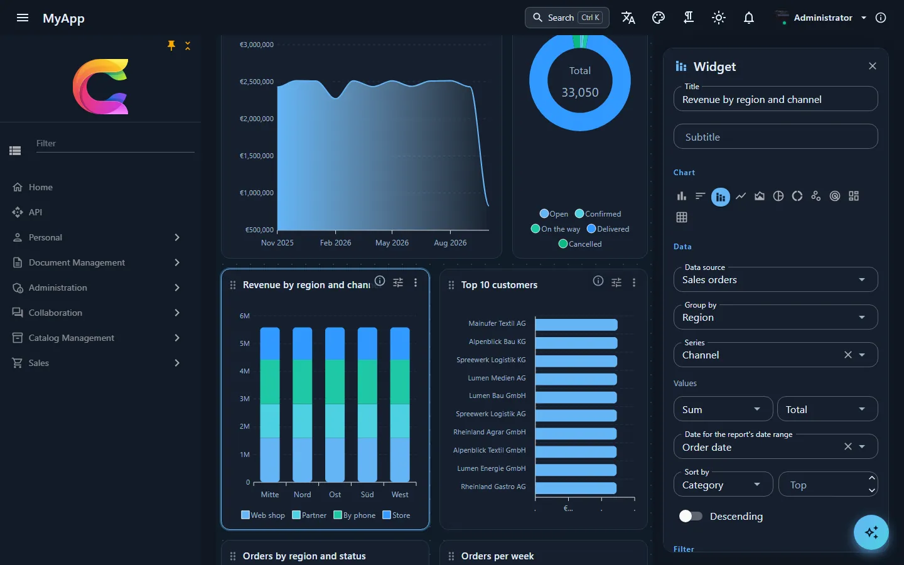

# Berichte und Dashboards

```csharp
[DependsOn(typeof(CoworkeeReportingModule))]
public sealed class MyAppDatabaseModule : CoworkeeModule;

builder.Services.AddCoworkeeReporting(baseAddress, reports => reports
    .DrillDown("SalesOrders", "sales/orders"));
```

Mehr Einrichtung ist es nicht (dazu eine Migration für die Tabellen des Moduls, `cw.Reports`, `cw.ReportFavorites`, `cw.ReportSubscriptions` und `cw.DashboardReports`; das Modul hängt vom Mailing-Modul ab, das die Abos verschickt). Neue Apps aus dem Template haben das schon, `--reports` ist standardmäßig an. Die Benutzer bekommen Seiten unter `/reports` und bauen dort Dashboards aus den Entitätsmengen, die du für OData registriert hast:

```csharp
services.AddODataEntity<SalesOrder>("SalesOrders", SalesPermissions.Orders.View);
```

Kein zweites Datenmodell, kein Export-Job. Die Felder kommen aus dem EDM, eine Eigenschaft, die du vor OData versteckst, taucht also auch im Bericht nicht auf. Die Zeilen sind die, die auch die OData-Liste liefern würde, mit Mandantenfilter und allen Zeilenfiltern. Fehlt jemandem das Recht für eine Menge, zeigen deren Widgets einen Fehler, der Rest des Dashboards läuft weiter.

{ .shot loading=lazy }

## Aggregiert in SQL

Ein Widget schickt ein kleines Abfragemodell an `POST /api/v1/reports/query`, nie einen Ausdruck:

```json
{
  "entitySet": "SalesOrders",
  "filter": "Region eq 'Nord' and Total gt 100",
  "groupBy": { "field": "OrderDate", "bucket": "Month" },
  "aggregates": [ { "function": "Sum", "field": "Total" }, { "function": "Count" } ],
  "top": 10
}
```

Der Server prüft jedes Feld gegen die Quelle, baut `GroupBy` und `Select` als Expression Trees und überlässt das SQL dem EF Core, auf PostgreSQL, SQL Server und SQLite gleichermaßen. Bis zu zwei Gruppierungsfelder (Datumswerte nach Tag, Woche, Monat, Quartal oder Jahr), bis zu 8 Werte aus `Count`, `Sum`, `Average`, `Min`, `Max` und `DistinctCount`, höchstens 5.000 Gruppen.

Gemessen an den 100.000 Aufträgen der Demo (Postgres, warm): Anzahl nach Status 9 ms, Summe nach Monat 29 ms, Anzahl nach Woche 55 ms, Region nach Kanal 23 ms, Top 10 Kunden mit Join 30 ms, vier KPI-Werte 58 ms.

**Stand:** Berichte haben noch keine Versionsgeschichte, keinen öffentlichen Link und kein Karten-Widget. Unter SQLite funktionieren Zeiträume auf `DateTimeOffset`-Feldern im eigenen DbContext der App (in UTC aus der gespeicherten Zahl berechnet); in einem [externen DbContext](../fundamentals/persistence.md#externe-datenbanken) werden sie abgelehnt.

## Designer, Kreuzfilter und Drill-down

{ .shot loading=lazy }

Das Raster ist GridStack mit 12 Spalten, auf dem Handy eine Spalte. Im Bearbeitungsmodus ziehst du Widgets am Titel, änderst ihre Größe an den Rändern und stellst jedes im Seitenbereich ein; es zeichnet sich neu, während du tippst. Rückgängig geht bis zum Speichern.

Widget-Typen: Kennzahl mit Trend und Ziel, Diagramme (Balken, Linie, Fläche, Torte, Ring, Streuung, Netz, Treemap, Heatmap und ein paar Varianten), eine scrollende Tabelle, die vollständige `CoworkeeDataTable`, ein Pivot, dazu Markdown, Bild oder eingebettete Seite für den Text rund um die Zahlen. Die Farben folgen dem MudBlazor-Theme, Dunkelmodus inklusive.

Jede Gruppe kommt vom Server mit einem OData-Filter für genau ihre Zeilen zurück. Ein Klick auf einen Balken oder ein Tortenstück grenzt damit die anderen Widgets derselben Menge ein; *Daten öffnen* springt auf die Seite, die du mit `DrillDown` registriert hast, schon gefiltert auf die Zeilen hinter der Zahl.

Ein Bericht ist privat, für Rollen, für Gruppen (deren Mitglieder und die der Gruppen darüber; eine Gruppenauswahl grenzt die Liste ein) oder für die ganze Organisation freigegeben (`Reports.Share`). Andere können ihn duplizieren, ändern darf ihn nur der Besitzer, und eine gespeicherte Änderung erreicht alle, die ihn gerade offen haben. Exportieren lässt er sich als PNG, als PDF über den Druckdialog oder je Widget als CSV und Excel.

## Mehr als der Designer

- **[Abos per Mail](../modules/reporting.md#abos-per-mail):** *Subscribe by mail* schickt einen Bericht täglich, wöchentlich oder monatlich zu einer Uhrzeit einer Zeitzone, mit Kennzahlen, den ersten Zeilen jedes Widgets und einer Excel-Mappe. Er läuft als der Abonnent, es gelten also dieselben Rechte und Zeilenfilter.
- **[Schwellenwerte](../modules/reporting.md#schwellenwerte)** färben Kennzahlen, Tachos, Pivot-Zellen, eine Tabellenspalte und Balken nach Bändern, mit Symbol und Beschriftung.
- **[Umschalter für Betrachter](../modules/reporting.md#umschalter-fur-betrachter):** andere Werte und Gruppierungen, die Betrachter im Kopf des Widgets wählen, je Benutzer gemerkt, ohne den Bericht zu ändern.
- **[Mit KI erstellen](../modules/reporting.md#einen-bericht-mit-ki-erstellen):** *Create with AI* und *Ask AI to change this report* machen aus einem Prompt eine Definition, die wie beim Speichern geprüft wird und ungespeichert im Designer aufgeht; der Assistent hat dasselbe als Tool `generate_report`.
- **[Eigene Datenquellen](../modules/reporting.md#eigene-datenquellen):** `AddReportSource<T>` stellt Zeilen eines einfachen Typs (eine Datenbankabfrage oder eine Liste) neben die Entitätsmengen.
- **[Ein Bericht als Dashboard](../modules/reporting.md#ein-bericht-als-dashboard):** jeder Benutzer kann einen Bericht zu seinem Dashboard machen, wer `Reports.Dashboard` hat, den Standard der Organisation.
- Ein Widget kann `AppData` tragen, JSON, das eine App oder ein zweiter Client mit ihm aufbewahrt; Berichte lesen und ändern es nicht.

## Der Vertriebsbericht der Demo, Schritt für Schritt

Die Demo-App bringt drei Berichte mit. Die Bilder unten stammen alle aus *Sales overview*, der die 100.000 Aufträge liest. Die Screenshots sind auf Englisch.

{ .shot loading=lazy }

`/reports` listet jeden Bericht, den der Benutzer öffnen darf. Jede Karte zeigt, wer ihn gebaut hat, mit wem er geteilt ist, wie viele Widgets er hat und welche Entitätsmengen er liest. *Import* nimmt einen Bericht, der in einer anderen Installation als JSON exportiert wurde.

{ .shot loading=lazy }

Im Bearbeitungsmodus bekommt jedes Widget einen Griff zum Verschieben und einen Einstellungsknopf. Der Bereich rechts ist die ganze Definition von *Revenue by region and channel*: Quelle *Sales orders*, gruppiert nach Region, eine Reihe pro Kanal, die Summe von `Total` und das Datumsfeld, auf das der Zeitraum *Last 12 months* des Berichts wirkt. Wählst du ein anderes Gruppierungsfeld, zeichnet sich das Diagramm sofort neu; gespeichert wird erst mit *Save*.

{ .shot loading=lazy }

Ein Klick auf den Balken *Nord*. Das Pivot darunter hat nur noch eine Zeile, die Top 10 sind jetzt Kunden aus Nord, und die Aufträge pro Woche fallen auf etwa 130. Ein zweiter Klick auf den Balken nimmt den Filter wieder weg.

{ .shot loading=lazy }

*Open the data* im Widget-Menü springt auf die Auftragsseite. Der Chip *Report: Revenue by region and channel* trägt den Filter des Widgets, Tabelle und Facetten links zeigen also die 33.050 Aufträge der letzten zwölf Monate statt aller 100.000. Nimmst du den Chip weg, siehst du wieder alles.

{ .shot loading=lazy }

*Latest orders* ist dieselbe Datentabelle wie auf den Listenseiten. Die Knöpfe im Kopf schalten die Ansicht um, hier von Zeilen auf Karten; Sortierung und Spalten funktionieren wie in jeder anderen Tabelle.

{ .shot loading=lazy }

Das Pivot stellt Regionen in die Zeilen und Status in die Spalten, mit Summen am Ende jeder Zeile und Spalte. Die größten Werte bekommen eine dunklere Zelle, deshalb sticht *Delivered* heraus.

{ .shot loading=lazy width=300 }

Auf dem Handy hat das Raster eine Spalte, und die Widgets kommen in der Reihenfolge des Desktop-Layouts.

Referenz: [Berichte](../modules/reporting.md), [OData](../web/odata.md), [Query Builder](../ui/query-builder.md).
