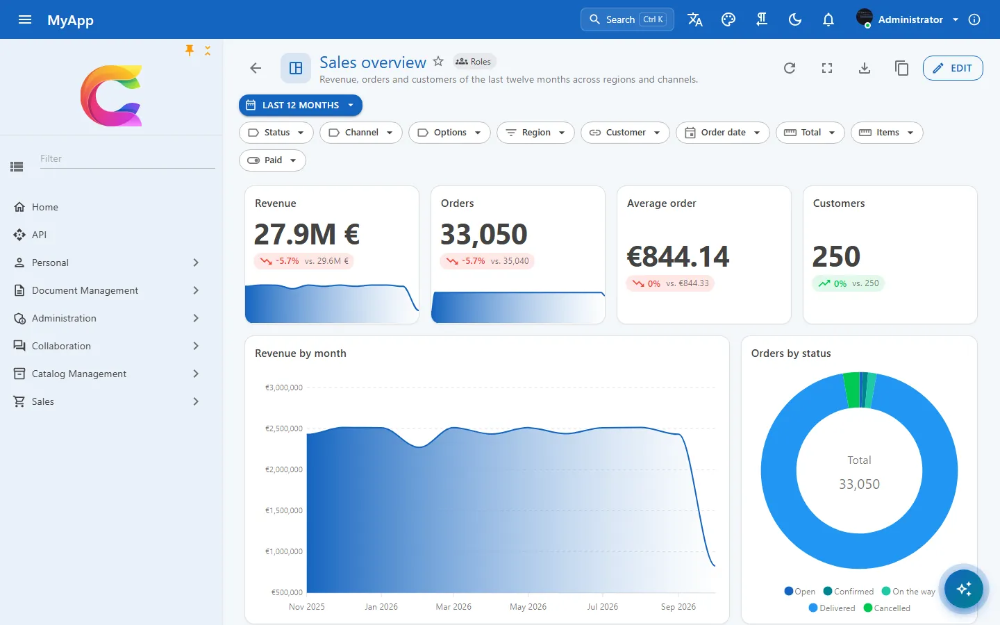
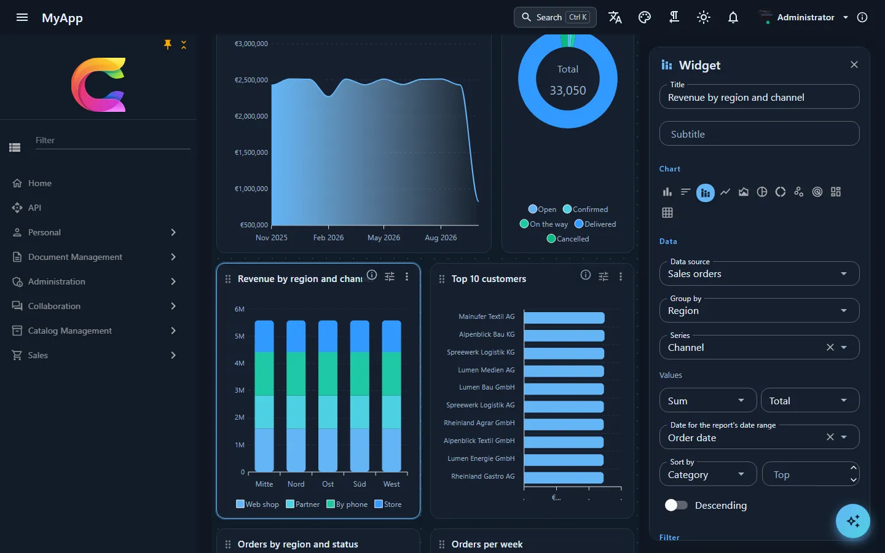
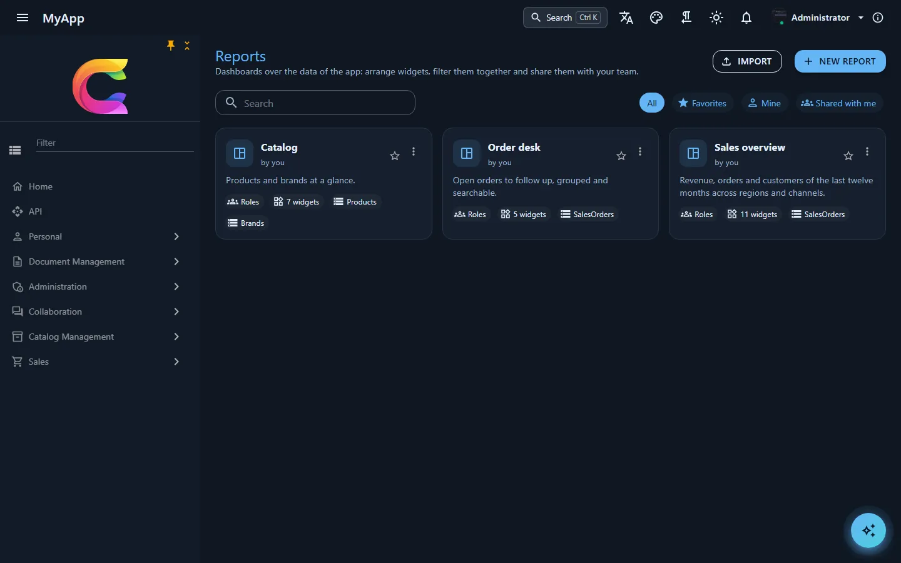
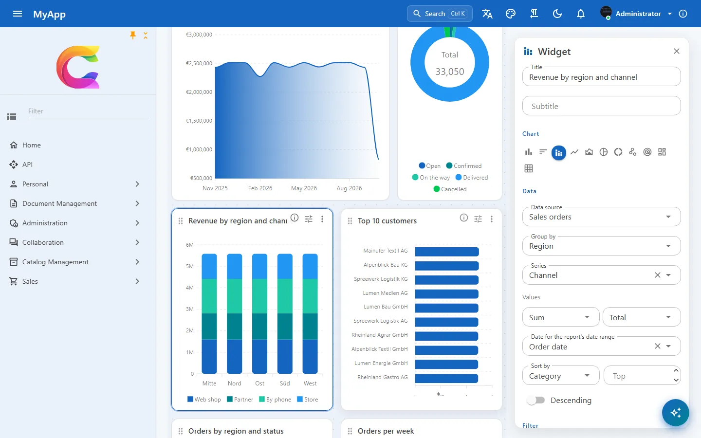
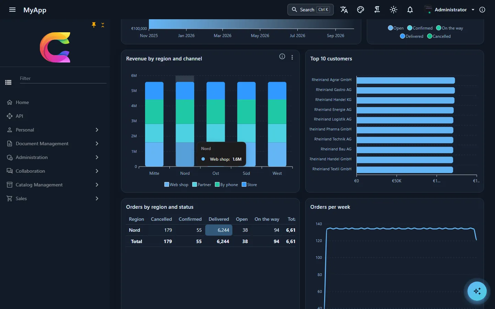
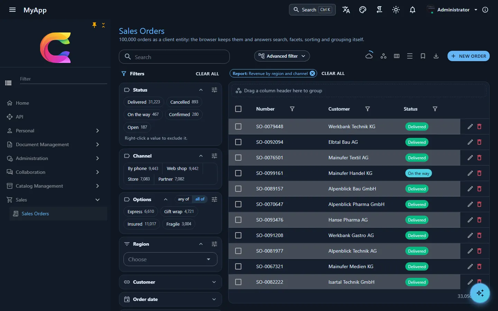
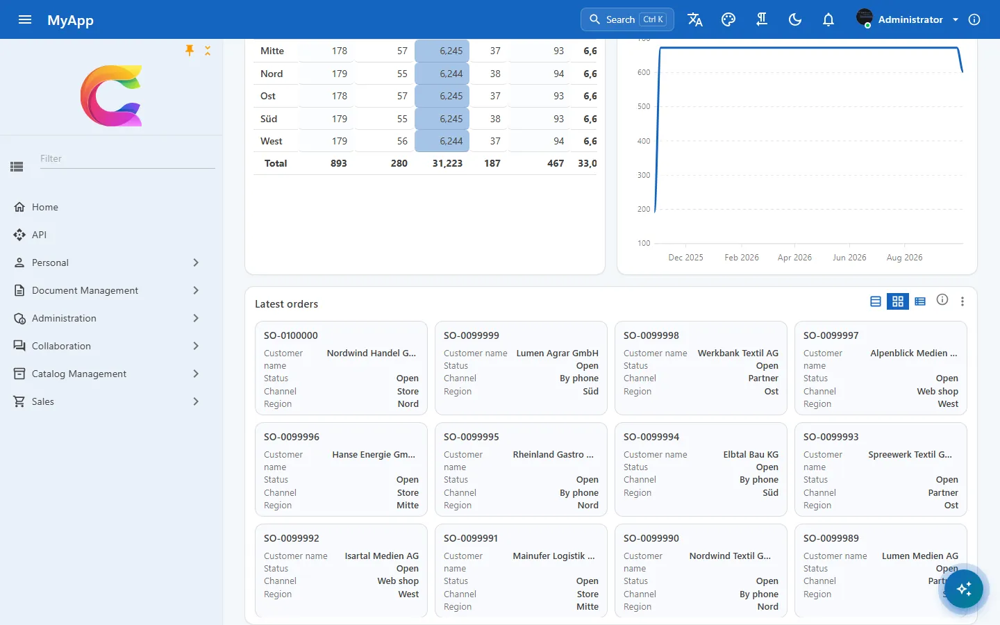
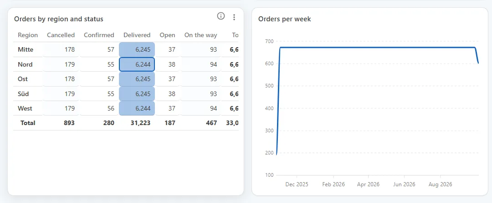
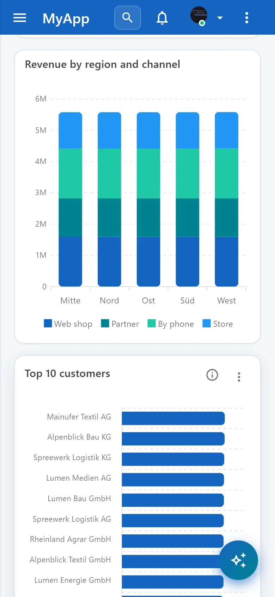

# Reporting and dashboards

```csharp
[DependsOn(typeof(CoworkeeReportingModule))]
public sealed class MyAppDatabaseModule : CoworkeeModule;

builder.Services.AddCoworkeeReporting(baseAddress, reports => reports
    .DrillDown("SalesOrders", "sales/orders"));
```

That is the setup (plus one migration for the module's tables, `cw.Reports`, `cw.ReportFavorites`, `cw.ReportSubscriptions` and `cw.DashboardReports`; the module depends on the mailing module, which sends the subscriptions). New apps from the template have it already, `--reports` is on by default. Users get pages under `/reports` where they build dashboards from the entity sets you registered for OData:

```csharp
services.AddODataEntity<SalesOrder>("SalesOrders", SalesPermissions.Orders.View);
```

No second data model, no export job. Fields come from the EDM, so a property you hid from OData is not offered in a report either. Rows are the ones the OData list would return, with the tenant filter and every row filter applied, and a user who lacks the permission for one set sees an error on those widgets while the rest of the dashboard works.

{ .shot loading=lazy }

## Aggregated in SQL

A widget sends a small query model to `POST /api/v1/reports/query`, never an expression:

```json
{
  "entitySet": "SalesOrders",
  "filter": "Region eq 'Nord' and Total gt 100",
  "groupBy": { "field": "OrderDate", "bucket": "Month" },
  "aggregates": [ { "function": "Sum", "field": "Total" }, { "function": "Count" } ],
  "top": 10
}
```

The server checks each field against the source, builds `GroupBy` and `Select` as expression trees and leaves the SQL to EF Core, on PostgreSQL, SQL Server and SQLite alike. Up to two group fields (dates by day, week, month, quarter or year), up to 8 values from `Count`, `Sum`, `Average`, `Min`, `Max` and `DistinctCount`, at most 5,000 groups.

Measured on the demo's 100,000 sales orders (Postgres, warm): count by status 9 ms, sum by month 29 ms, count by week 55 ms, region by channel 23 ms, top 10 customers with join 30 ms, four KPI values 58 ms.

**Status:** reports have no version history, no public link and no map widget yet. On SQLite, date buckets on `DateTimeOffset` fields work for the app's own DbContext (computed in UTC from the stored number); on an [external DbContext](../fundamentals/persistence.md#external-databases) they are refused.

## Designer, cross filter and drill-down

{ .shot loading=lazy }

The grid is GridStack with 12 columns, one column on phones. In edit mode you drag widgets by the title, resize them at the edges and set up each one in the side panel; it redraws while you type. Undo covers everything until you save.

Widget types: KPI with trend and target, charts (bar, line, area, pie, donut, scatter, radar, treemap, heatmap, chips and a few variants), a scrolling table, the full `CoworkeeDataTable`, a pivot, and Markdown, image or embedded page for the text around the numbers. Colours follow the MudBlazor theme, dark mode included.

Each group comes back from the server with an OData filter for exactly its rows. Click a bar or a pie slice and that filter narrows the other widgets on the same set; click *Open the data* and it lands on the page you registered with `DrillDown`, already filtered to the rows behind the number.

A report is private, shared with roles, with groups (their members and those of the groups above; a group selection narrows the list) or with the tenant (`Reports.Share`). Others can duplicate it, only the owner changes it, and a saved change reaches everyone who has it open. Export goes to PNG, PDF via the print dialog, or CSV and Excel per widget.

## Filters across data sets

A report that mixes data sets (an order set and two computed sources with the same shipment fields) filters them together. A facet chosen in the filter bar applies to every widget whose set has a field with the **same path and the same kind** (`ReportFieldKind`); the OData clause is reused as it is, so the sets must name the field alike. A facet that two sets share shows once, at the first set; a field whose kind differs between sets is not shared and shows per set (logged once at information level). The same holds for a click on a bar or slice: it narrows the widgets of other sets that have the grouped field. Subscription mails use the same rule (`ReportFilters.For(query, definition, fields, today, fieldsOf)`, `ReportFilters.Applying(values, entitySet, fieldsOf)`).

```csharp
// "TransportMode eq 'Air'" chosen on Orders also narrows a Costs widget whose set has TransportMode
var values = definition.Filters; // ReportFilterValue(..., Field: "TransportMode")
var applying = ReportFilters.Applying(values, "Costs", set => fieldsOfSet(set));
```

Stored definitions without `Field` keep working: the group key is the path then.

Facet counts narrow each other, also across data sets: the counts of a filter-bar group consider every other facet chosen on its set, the facets of other sets that apply to it (same rule as for the widgets) and the cross filters from clicks, but never the group's own choice. Choosing "North" at one group therefore leaves only the carriers that exist in the north, and a facet chosen at the first set narrows the counts of the second. A group without a field is shared by its key (the same fallback as stored values without `Field`), in the bar and in the filter.

## Date field

A report that has several date fields (an ETA and an ETD) offers the choice in the filter bar, left of the date range. `DateFields` lists the paths; the first is the default the widgets are designed with, fewer than two means no choice. The viewer's pick moves the date range and the date grouping of every widget that uses the default (`ReportViews.WithDateField(widget, defaultField, chosen)`: `DateField` and a `GroupBy`/`SplitBy` on that field, buckets stay) and is remembered per user and report under `ReportViews.DateKey(reportId)`; widgets bound to another date stay as they are. `RequireDate` on a widget query leaves out rows without a value in its date field (`{DateField} ne null`), so a widget grouped by month does not show an empty group; it follows the chosen field.

```json
{
  "dateFields": ["Eta", "Etd"],
  "widgets": [
    { "id": "perMonth", "type": "Chart",
      "query": { "entitySet": "Shipments", "dateField": "Eta", "requireDate": true,
                 "groupBy": { "field": "Eta", "bucket": "Month" } } }
  ]
}
```

In the designer, "Report settings" has "Date fields to choose from" (the date fields of the data sets the widgets use; the order of choosing is the order, the first is the default) and a widget with a date field has the switch "Only rows with a date".

A definition that names a date field no data set has (or one that is not a date) is refused when it is saved.

## Filter bar fields

`FacetFields` chooses the filter bar's groups and their order. Each entry is a field path: the set's facet on it shows as usual, a field without a facet gets its values from a report query (grouped by the field, count, the first 1000), counted with the other choices like any group. Choosing such a value is a normal report filter with the field's path, so other sets with the field share it. Fields a set does not have are skipped for that set; an empty list shows every facet. Unknown fields are refused when the report is saved.

In "Report settings" the "Filter bar fields" select chooses and orders them. A field whose values cannot be loaded stays in the bar with the hint "Values not available" (and is logged as a warning) instead of disappearing.

```json
{ "facetFields": ["Region", "Carrier", "Status"] }
```

## Beyond the designer

- **[Subscriptions by mail](../modules/reporting.md#subscriptions-by-mail):** *Subscribe by mail* sends a report daily, weekly or monthly at a time of a time zone, with KPIs, the first rows of each widget and an Excel workbook. It runs as the subscriber, so the same permissions and row filters apply.
- **[Thresholds](../modules/reporting.md#thresholds)** colour KPI values, gauges, pivot cells, a table column and bars by bands with an icon and a label.
- **[Switches for viewers](../modules/reporting.md#switches-for-viewers):** alternative values and groupings that viewers pick in the widget header, kept per user, without changing the report.
- **[Create with AI](../modules/reporting.md#create-a-report-with-ai):** *Create with AI* and *Ask AI to change this report* turn a prompt into a definition that is checked like a save and opens unsaved in the designer; the assistant has the same as the tool `generate_report`.
- **[Own data sources](../modules/reporting.md#own-data-sources):** `AddReportSource<T>` adds rows of a plain type (a database query or a list) next to the entity sets.
- **[A report as dashboard](../modules/reporting.md#a-report-as-dashboard):** every user can make a report their dashboard, holders of `Reports.Dashboard` the tenant's default.
- A widget can carry `AppData`, JSON an app or a second client keeps with it; reports neither read nor change it.

## The sales report of the demo, step by step

The demo app comes with three reports. The pictures below are all from *Sales overview*, which reads the 100,000 sales orders.

{ .shot loading=lazy }

`/reports` lists every report the user may open. Each card says who made it, who it is shared with, how many widgets it has and which entity sets it reads. *Import* takes a report that was exported as JSON from another installation.

{ .shot loading=lazy }

In edit mode every widget gets a grip to drag it and a settings button. The panel on the right is the whole definition of *Revenue by region and channel*: source *Sales orders*, grouped by region, one series per channel, the sum of `Total`, and the date field that the report's *Last 12 months* applies to. Pick another group field and the chart redraws right away; nothing is stored until *Save*.

{ .shot loading=lazy }

A click on the *Nord* bar. The pivot below keeps one row, the top 10 are now customers from Nord, and orders per week drop to around 130. A second click on the bar takes the filter away.

{ .shot loading=lazy }

*Open the data* in the widget menu lands on the sales orders page. The chip *Report: Revenue by region and channel* carries the widget's filter, so the table and the facet counts on the left show the 33,050 orders of the last twelve months instead of all 100,000. Remove the chip to see everything again.

{ .shot loading=lazy }

*Latest orders* is the same data table as on the list pages. The buttons in its header switch the view, here from rows to cards; sorting and columns work as on any other table.

{ .shot loading=lazy }

The pivot puts regions in rows and statuses in columns, with totals at the end of each row and column. The biggest values get a darker cell, which is why *Delivered* stands out.

{ .shot loading=lazy width=300 }

On a phone the grid has one column and the widgets follow the order of the desktop layout.

Reference: [Reporting](../modules/reporting.md), [OData](../web/odata.md), [Query builder](../ui/query-builder.md).
