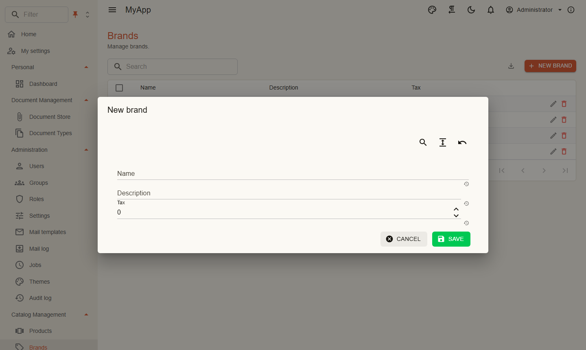

# Your first feature

This page builds the brands of the template from scratch: an entity, its table, permissions, a command with validation, an HTTP endpoint, an OData set with facets, the global search, the import and a Blazor page. Every snippet is the real code of the template, shortened to the brands where products share the file.

## 1. Contracts

Permission names and DTOs live in the contracts project, because the Blazor client needs them too.

```csharp title="MyApp.Contracts/Catalog/CatalogPermissions.cs"
public static class CatalogPermissions
{
    public const string GroupName = "Catalog";

    public static class Brands
    {
        public const string View = "Catalog.Brands.View";
        public const string Create = "Catalog.Brands.Create";
        public const string Edit = "Catalog.Brands.Edit";
        public const string Delete = "Catalog.Brands.Delete";
    }
}
```

```csharp title="MyApp.Contracts/Catalog/BrandDto.cs"
public sealed record BrandDto(Guid Id, string Name, string? Description, decimal Tax);
```

```csharp title="MyApp.Contracts/Catalog/AddEditBrandRequest.cs"
public sealed class AddEditBrandRequest
{
    public string Name { get; set; } = string.Empty;

    public string? Description { get; set; }

    public decimal Tax { get; set; }
}
```

The request is a class with setters on purpose: the edit dialog binds to it.

## 2. Entity and table

```csharp title="MyApp.Catalog/Domain/Brand.cs"
[Realtime(CatalogPermissions.Brands.View)]
public sealed class Brand : AuditedEntity, IMultiTenant
{
    public required string Name { get; set; }

    public string? Description { get; set; }

    public decimal Tax { get; set; }

    public Guid TenantId { get; set; }
}
```

- `AuditedEntity` brings `Id` (a version 7 GUID), `CreatedAt`, `CreatedBy`, `ModifiedAt`, `ModifiedBy`. The values are set on save.
- `IMultiTenant` adds a query filter on the tenant of the current user and fills `TenantId` on insert.
- `[Realtime]` publishes every change of a brand to clients that hold the permission; tables of `BrandDto` reload by themselves, see [Realtime](../modules/realtime.md).

Modules do not own a `DbContext`. They contribute to the one of the app:

```csharp title="MyApp.Catalog/Persistence/CatalogModelContributor.cs"
internal sealed class CatalogModelContributor : IModelContributor
{
    public void Apply(ModelBuilder modelBuilder) =>
        modelBuilder.Entity<Brand>(brand =>
        {
            brand.ToTable("Brands", "app");
            brand.Property(b => b.Name).HasMaxLength(200);
            brand.Property(b => b.Description).HasMaxLength(2000);
            brand.Property(b => b.Tax).HasPrecision(9, 4);
            brand.HasIndex(b => new { b.TenantId, b.Name }).IsUnique();
        });
}
```

Add a migration in the infrastructure project:

```bash
dotnet ef migrations add Brands --project src/MyApp.Infrastructure
# or
coworkee migrations add Brands
```

## 3. Permissions

```csharp title="MyApp.Catalog/Permissions/CatalogPermissionDefinitions.cs"
internal sealed class CatalogPermissionDefinitions : IPermissionDefinitionContributor
{
    public void Define(PermissionDefinitionContext context) =>
        context.Group(CatalogPermissions.GroupName, "Catalog")
            .Add(CatalogPermissions.Brands.View, "View brands")
            .Add(CatalogPermissions.Brands.Create, "Create brands", CatalogPermissions.Brands.View)
            .Add(CatalogPermissions.Brands.Edit, "Edit brands", CatalogPermissions.Brands.View)
            .Add(CatalogPermissions.Brands.Delete, "Delete brands", CatalogPermissions.Brands.View);
}
```

The third argument is the parent: granting *Create brands* in the role editor implies *View brands*.

The demo roles of a local run get their permissions in the seed, here the *Brand Manager*:

```csharp title="MyApp.Migrations/DemoSeed.cs"
seed.Roles.Add(new SeedRole("Brand Manager", "Maintains brands", [.. Shared, CatalogPermissions.Brands.View, CatalogPermissions.Brands.Create, CatalogPermissions.Brands.Edit, CatalogPermissions.Brands.Delete]));
```

## 4. The command

A use case is a request, a handler and, when there is input, a validator.

```csharp title="Features/Brands/Commands/AddEdit/AddEditBrandCommand.cs"
[AiTool("Creates a brand, or changes it when Id is given.")]
public sealed record AddEditBrandCommand(Guid? Id, AddEditBrandRequest Brand) : ICommand<Result<BrandDto>>, IInvalidatesCache
{
    public IReadOnlyList<string> CacheTags => [DashboardCache.Tag];
}
```

```csharp title="Features/Brands/Commands/AddEdit/AddEditBrandValidator.cs"
internal sealed class AddEditBrandValidator : AbstractValidator<AddEditBrandCommand>
{
    public AddEditBrandValidator()
    {
        RuleFor(c => c.Brand.Name).NotEmpty().MaximumLength(200);
        RuleFor(c => c.Brand.Description).MaximumLength(2000);
        RuleFor(c => c.Brand.Tax).InclusiveBetween(0, 100);
    }
}
```

```csharp title="Features/Brands/Commands/AddEdit/AddEditBrandHandler.cs"
internal sealed class AddEditBrandHandler(CoworkeeDbContext db, IPermissionChecker permissions) : IHandler<AddEditBrandCommand, Result<BrandDto>>
{
    public async Task<Result<BrandDto>> HandleAsync(AddEditBrandCommand command, CancellationToken cancellationToken)
    {
        var required = command.Id is null ? CatalogPermissions.Brands.Create : CatalogPermissions.Brands.Edit;
        if (!await permissions.IsGrantedAsync(required, cancellationToken))
        {
            return Error.Forbidden("catalog.forbidden", "You may not do this.");
        }

        var name = command.Brand.Name.Trim();
        if (await db.Set<Brand>().AnyAsync(b => b.Name == name && b.Id != command.Id, cancellationToken))
        {
            return BrandErrors.NameTaken;
        }

        var brand = command.Id is { } id ? await db.Set<Brand>().SingleOrDefaultAsync(b => b.Id == id, cancellationToken) : Add(name);
        if (brand is null)
        {
            return BrandErrors.NotFound;
        }

        brand.Name = name;
        brand.Description = command.Brand.Description;
        brand.Tax = command.Brand.Tax;
        return brand.ToDto();
    }

    private Brand Add(string name)
    {
        var brand = new Brand { Name = name };
        db.Add(brand);
        return brand;
    }
}
```

Note what the handler does not do: it does not call `SaveChangesAsync`, catch validation errors or write logs. The [pipeline](../fundamentals/messaging.md) does that around every request. When a request needs a single permission, an attribute is enough: `[RequiresPermission(CatalogPermissions.Brands.Delete)]` on the delete command. A request with neither the attribute nor a check in its handler is open to every signed-in user.

`IInvalidatesCache` drops the cached queries with these tags, here the dashboard counts ([caching](../fundamentals/messaging.md#caching)). `[AiTool]` offers the command to the [assistant and the MCP server](../modules/ai.md), with the same permission checks as for a person.

## 5. Endpoint and OData set

```csharp title="MyApp.Catalog/Endpoints/BrandEndpoints.cs"
internal static class BrandEndpoints
{
    public static void MapBrandEndpoints(this IEndpointRouteBuilder app)
    {
        var brands = app.MapCoworkeeApi("/api/v1/brands").WithTags("Brands").RequireAuthorization();
        brands.MapGet("/{id:guid}", (Guid id, IDispatcher d, CancellationToken ct) => d.SendAsync(new GetBrandByIdQuery(id), ct).ToHttpResult());
        brands.MapPost("/", (AddEditBrandRequest body, IDispatcher d, CancellationToken ct) => d.SendAsync(new AddEditBrandCommand(null, body), ct).ToHttpResult());
        brands.MapPut("/{id:guid}", (Guid id, AddEditBrandRequest body, IDispatcher d, CancellationToken ct) => d.SendAsync(new AddEditBrandCommand(id, body), ct).ToHttpResult());
        brands.MapPost("/delete", (IdsRequest body, IDispatcher d, CancellationToken ct) => d.SendAsync(new DeleteBrandsCommand(body.Ids), ct).ToHttpResult());
    }
}
```

`ToHttpResult` turns a `Result` into `200`, `204` or a problem details response with the right status (`400` for validation, `403`, `404`, `409`).

Reading needs no endpoint. Register the entity as an OData set and every table gets paging, sorting, filtering, search, export and facets:

```csharp title="MyApp.Catalog/CatalogModule.cs"
[DependsOn(typeof(CoworkeeODataModule))]
public sealed class MyAppCatalogModule : CoworkeeModule, IWebModule
{
    public override void ConfigureServices(ModuleServiceContext context)
    {
        context.Services.AddMessagingFromAssembly(typeof(MyAppCatalogModule).Assembly);
        context.Services.AddSingleton<IModelContributor, CatalogModelContributor>();
        context.Services.AddSingleton<IPermissionDefinitionContributor, CatalogPermissionDefinitions>();
        context.Services.AddODataEntity<Brand>("Brands", CatalogPermissions.Brands.View);
        context.Services.AddGlobalSearch<Brand>(s => s.Fields(b => b.Name, b => b.Description).Subtitle(b => b.Description).Page("/catalog/brands").Icon("Label"));
        context.Services.AddODataImport("Brands", (Guid? id, AddEditBrandRequest row) => new AddEditBrandCommand(id, row), id => new DeleteBrandsCommand([id]));
    }

    public void ConfigureApplication(WebApplication app) => app.MapBrandEndpoints();
}
```

`GET /odata/Brands?$filter=contains(Name,'a')&$orderby=Name&$count=true` now works for everyone with *View brands*. `AddGlobalSearch` lets Ctrl+K and `/search` find brands ([global search](../web/global-search.md)); `AddODataImport` opens the import wizard of the table, and every row runs through `AddEditBrandCommand` ([import and export](../web/import-export.md)).

## 6. The Blazor page

```razor title="MyApp.Web.Client/Pages/Catalog/Brands.razor"
@page "/catalog/brands"
@attribute [Authorize(Policy = PermissionPolicy.Prefix + CatalogPermissions.Brands.View)]

<PageHeader Title="Brands" Description="Manage brands." />
<CoworkeeDataTable @ref="_table" T="BrandDto" EntitySet="Brands" SearchFields="SearchFields" MultiSelection="true" Importable="true" ImportPermission="@CatalogPermissions.Brands.Create" ExportFileName="brands" DescribeItem="b => b.Name"
                   CreateText="New brand" CreatePermission="@CatalogPermissions.Brands.Create" EditPermission="@CatalogPermissions.Brands.Edit" DeletePermission="@CatalogPermissions.Brands.Delete"
                   OnCreate="CreateAsync" OnEdit="EditAsync" OnDelete="DeleteAsync">
    <Columns>
        <PropertyColumn Property="b => b.Name" Title="@L["Name"]" />
        <PropertyColumn Property="b => b.Description" Title="@L["Description"]" />
        <PropertyColumn Property="b => b.Tax" Title="@L["Tax"]" Format="0.##" />
    </Columns>
</CoworkeeDataTable>
```

```csharp title="MyApp.Web.Client/Pages/Catalog/Brands.razor.cs"
public partial class Brands
{
    [Inject] private CoworkeeLocalizer L { get; set; } = null!;

    private static readonly string[] SearchFields = [nameof(BrandDto.Name), nameof(BrandDto.Description)];
    private CoworkeeDataTable<BrandDto> _table = null!;

    [Inject] private ICatalogApi Api { get; set; } = null!;

    [Inject] private IDialogService Dialogs { get; set; } = null!;

    [Inject] private ISnackbar Snackbar { get; set; } = null!;

    private Task CreateAsync() => EditAsync(null, new AddEditBrandRequest());

    private Task EditAsync(BrandDto brand) =>
        EditAsync(brand.Id, new AddEditBrandRequest { Name = brand.Name, Description = brand.Description, Tax = brand.Tax });

    private async Task EditAsync(Guid? id, AddEditBrandRequest model)
    {
        if (await Dialogs.ShowEditAsync(L[id is null ? "New brand" : "Edit brand"], model, saved => Api.SaveBrandAsync(id, saved)))
        {
            Snackbar.Add(L["Brand saved"], Severity.Success);
        }
    }

    private Task DeleteAsync(IReadOnlyCollection<BrandDto> brands) => Snackbar.RunAsync(() => Api.DeleteBrandsAsync([.. brands.Select(b => b.Id)]));
}
```

{ .shot }

Buttons the user lacks the permission for are not rendered. `ShowEditAsync` builds the form from the request type with MudBlazor.Extensions; with a save function it saves inside the dialog and stays open with the messages of the API when saving fails. For anything special, write your own dialog like `ProductDialog` in the template. `PageHeader` and `CreateText` take text keys and translate them; other texts go through `L[...]`, with translations in `MyApp.Contracts/Localization/<culture>.json`.

Last step, the navigation entry:

```csharp title="MyApp.Web.Client/Navigation/MyAppNavigation.cs"
internal sealed class MyAppNavigation : INavigationContributor
{
    public IEnumerable<CoworkeeNavItem> Items =>
    [
        new("Brands", "/catalog/brands", Icons.Material.Outlined.Sell, CatalogPermissions.Brands.View, Group: "Catalog Management"),
    ];
}
```

## What you did not write

Logging, transactions, validation responses, permission checks for the list, paging and filtering on the server, export to Excel, CSV and JSON, the import wizard, the delete confirmation, live reload when someone else changes a brand, the audit trail. They come from the packages.

## Next steps

- [Application services](../web/application-services.md): instead of mapping endpoints and writing an API client, declare an interface in the contracts; the server endpoints and the Blazor client are generated. The *Sales Orders* of the [demo app](installation.md#the-demo-application) are built that way.
- [Client entities](../ui/client-entities.md): mark an entity `[ClientEntity]` and the browser keeps its rows, so the table filters, sorts and groups without a round trip. The demo app does it with 100,000 sales orders.
- [Testing](../testing.md): the template's `MyApp.Api.Tests` prove the permission checks of the brands against a real database (`Catalog_needs_its_permissions`: `200` with *View brands*, `403` without it).
- [Command line](cli.md): `coworkee entity add` writes entity, table, permissions, commands, endpoints, OData set and page of a new entity in one go.
