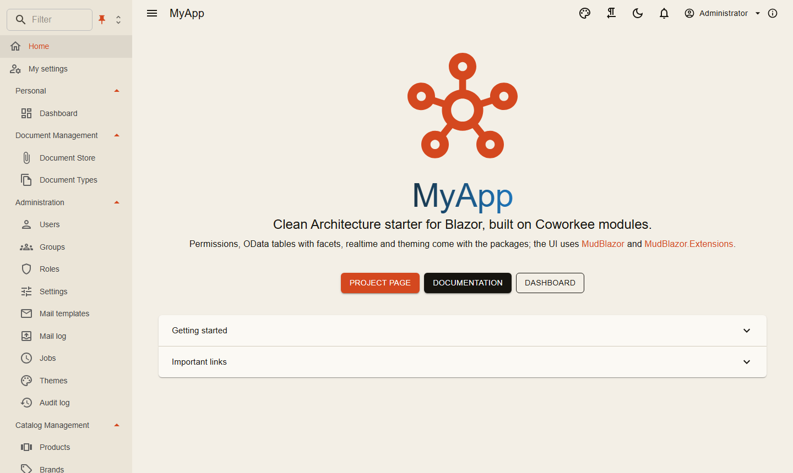
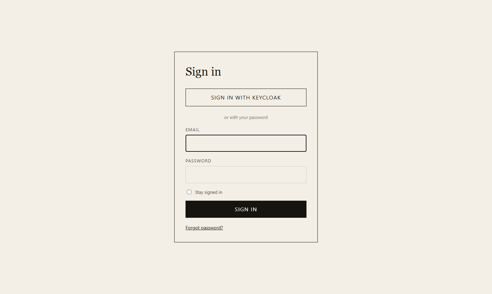

# Installation

## Voraussetzungen

- .NET SDK 10 (die `global.json` des Templates verlangt 10.0.300 oder ein späteres Feature-Band)
- Docker (Postgres, Redis, Mailpit und bei Bedarf Keycloak laufen als Container)
- Eine IDE mit Aspire-Unterstützung oder einfach die `dotnet`-CLI
- `dotnet-ef` für Migrationen, Node.js nur für den AirWorks-Client; `coworkee doctor` prüft die Werkzeuge und ihre Versionen

## Eine neue App in einer Minute

Die Coworkee-CLI legt eine vollständige Solution an, die die NuGet-Pakete nutzt: App-Host, API, Auth-Server, Blazor-Web-App, Migrationen, Beispielmodule.

```bash
dotnet tool install -g Coworkee.Cli
coworkee new Shop
cd Shop
coworkee run
```

Die Konsole zeigt die Adresse des Aspire-Dashboards; von dort öffnest du die Web-App. Die [CLI-Seite](cli.md) beschreibt die Optionen: Module an oder aus, Event-Bus, Speicher, Theme, Markenfarben, Logo, Anmeldedesign. Mit `coworkee new --spec app.json` kommt die App gleich mit eigenen Modulen und Entities, `coworkee ui` öffnet [Coworkee Studio](studio.md), einen Desktop-Assistenten dafür, und mit `coworkee mcp` erledigt das ein KI-Agent ([MCP-Server](mcp.md)).

Ohne CLI funktioniert dasselbe Template mit `dotnet new`:

```bash
dotnet new install Coworkee.Templates
dotnet new coworkee -n Shop
```

## Die Demo-Anwendung

Die [Coworkee-Demo-App](https://github.com/fgilde/Coworkee/tree/master) ist das vollständige Beispiel: Katalog, Dokumente, Dashboard, Administration, angelegte Benutzer und Keycloak, dazu ein [AirWorks-Client](../web/airworks.md#eine-eigene-airworks-app-schreiben) mit von Hand geschriebenen Apps (*myapp-airworks* im Aspire-Dashboard; zum Bauen braucht er Node.js).

```bash
git clone https://github.com/fgilde/Coworkee coworkee-demo
cd coworkee-demo
dotnet run --project src/MyApp.AppHost
```

{ .shot }

Der Migrations-Dienst spielt die Migrationen ein und legt die Benutzer an, bevor die anderen Dienste starten; Benutzer und Passwörter stehen in `LOGIN.md` der Solution (aus `src/MyApp.Migrations/DemoUsers.cs`). Die Anmeldeseite bietet zusätzlich **Sign in with Keycloak** an, mit denselben Benutzern und Passwörtern.

{ .shot }

## Von Hand

Ohne CLI und ohne Template: [Manuelle Einrichtung](manual-setup.md) legt die Solution mit `dotnet new` an, ergänzt Projekte, Verweise und Coworkee-Pakete, schreibt die wenigen Dateien, die jeder Host braucht, legt die erste Migration an und startet die App, auf der Kommandozeile oder in Rider oder Visual Studio.

## Weiter

[Aufbau der Solution](solution-structure.md) erklärt die Projekte, [Das erste Feature](first-feature.md) legt eine neue Entity von vorne bis hinten an.
