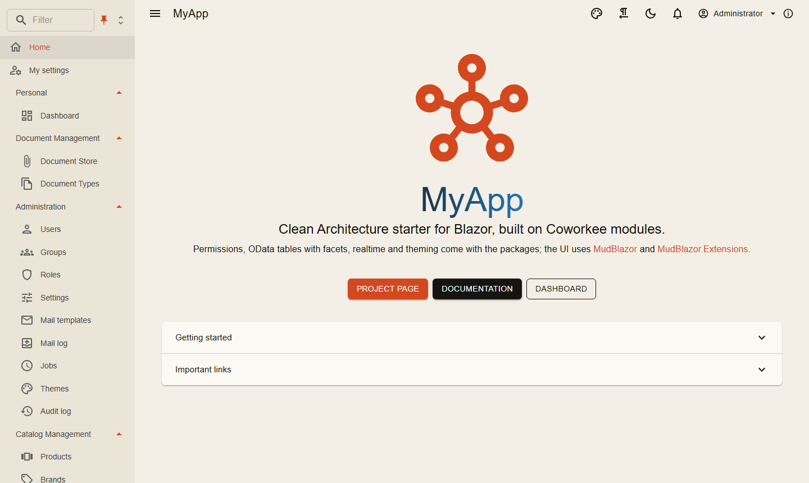
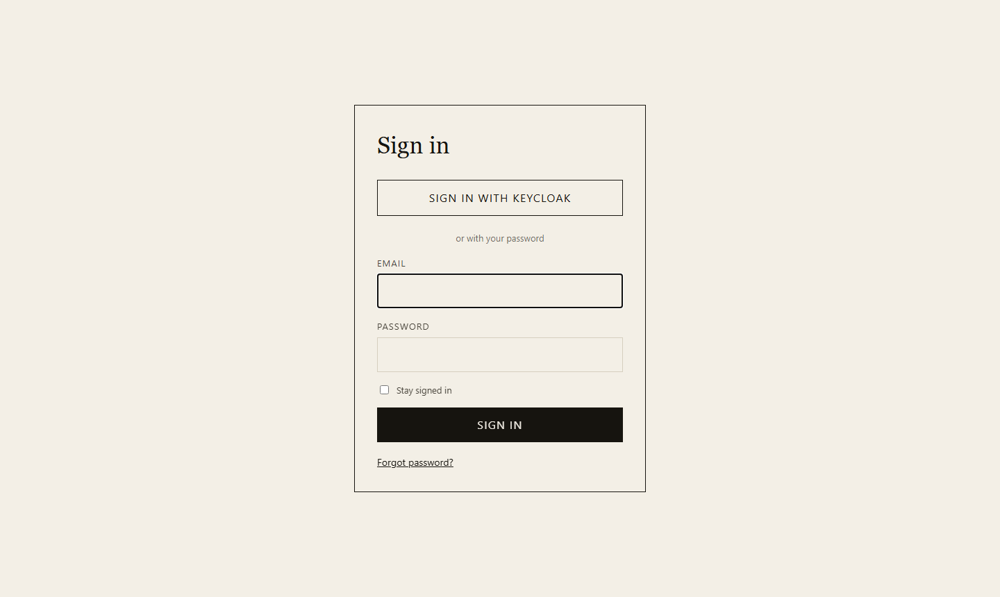

# Installation

## Prerequisites

- .NET SDK 10 (the template's `global.json` asks for 10.0.300 or a later feature band)
- Docker (Postgres, Redis, Mailpit and, if you want it, Keycloak run as containers)
- An IDE with Aspire support, or just the `dotnet` CLI
- `dotnet-ef` for migrations, Node.js only for the AirWorks client; `coworkee doctor` checks the tools and their versions

## A new app in one minute

The Coworkee CLI creates a complete solution that uses the NuGet packages: app host, API, auth server, Blazor web app, migrations, sample modules.

```bash
dotnet tool install -g Coworkee.Cli
coworkee new Shop
cd Shop
coworkee run
```

The console prints the URL of the Aspire dashboard; open the web app from there. The [CLI page](cli.md) lists the options: modules on or off, event bus, storage, theme, brand colors, logo, sign-in design. With `coworkee new --spec app.json` the app comes with its own modules and entities, `coworkee ui` opens [Coworkee Studio](studio.md), a desktop wizard for the same, and `coworkee mcp` lets an AI agent do it ([MCP server](mcp.md)).

Without the CLI, the same template works with `dotnet new`:

```bash
dotnet new install Coworkee.Templates
dotnet new coworkee -n Shop
```

## The demo application

The [Coworkee demo app](https://github.com/fgilde/Coworkee/tree/master) is the full sample: catalog, documents, dashboard, administration, seeded users and Keycloak, plus an [AirWorks client](../web/airworks.md#write-your-own-airworks-app) with hand-written apps (*myapp-airworks* in the Aspire dashboard; building it needs Node.js).

```bash
git clone https://github.com/fgilde/Coworkee coworkee-demo
cd coworkee-demo
dotnet run --project src/MyApp.AppHost
```

{ .shot }

The migration service applies the migrations and seeds the users before the other services start; users and passwords are in `LOGIN.md` of the solution (from `src/MyApp.Migrations/DemoUsers.cs`). The sign-in page also offers **Sign in with Keycloak**, with the same users and passwords.

{ .shot }

## By hand

Without the CLI and without the template: [Manual setup](manual-setup.md) creates the solution with `dotnet new`, adds the projects, references and Coworkee packages, writes the few files each host needs, adds the first migration and starts the app, from the command line or in Rider or Visual Studio.

## Next

[Solution structure](solution-structure.md) explains the projects, [Your first feature](first-feature.md) adds a new entity end to end.
