# Coworkee Studio

Coworkee Studio ist der Desktop-Assistent der [Kommandozeile](cli.md). Er führt Seite für Seite durch eine neue App, erklärt, was jede Entscheidung bringt und kostet, zeigt Logo, Theme und Anmeldedesign als Vorschau, nimmt Ihre Entities auf und lässt die CLI die Solution anlegen. Er läuft unter Windows, macOS und Linux.

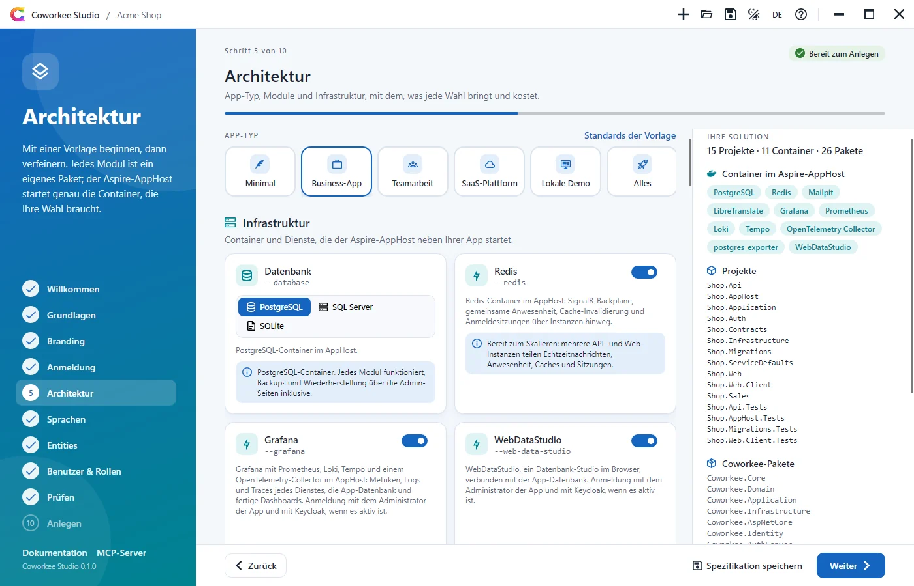

## Installieren und starten

```bash
dotnet tool install -g Coworkee.Cli
coworkee ui
```

Mehr braucht es nicht: `coworkee ui` installiert das Studio (globales Tool `Coworkee.Studio`, Befehl `coworkee-ui`) in der Version der CLI, wenn es fehlt, aktualisiert es, wenn es älter ist, und startet es. Weitere Argumente gehen an das Studio:

| Argument | |
|---|---|
| `--spec <datei>` | Öffnet eine [App-Spezifikation](cli.md#app-spezifikationen) |
| `--output <ordner>` | Ordner, in dem der Ordner der App angelegt wird |
| `--theme light` oder `dark` | Farbmodus (Standard: der des Systems) |
| `--lang en` oder `de` | Sprache (Standard: die des Systems) |

```bash
coworkee ui --spec shop.json
```

Für lokale Builds von Coworkee: `coworkee ui --add-source <ordner> --studio-version <version>`.

## Die Seiten

Das Panel links zeigt, wo Sie sind; jede Seite, die Sie schon gesehen haben, ist einen Klick entfernt. `Alt+→` und `Alt+←` blättern vor und zurück, `Strg+O` und `Strg+S` öffnen und speichern eine Spezifikation, `F1` öffnet die Hilfe. Das Abzeichen oben zeigt, ob die Spezifikation gültig ist; Probleme erscheinen auf der Seite, zu der sie gehören.

### Willkommen

Eine neue App beginnen, eine Spezifikation öffnen (`.json` aus der CLI, dem [MCP-Server](mcp.md) oder einer früheren Sitzung) oder eine der zuletzt geöffneten wählen.

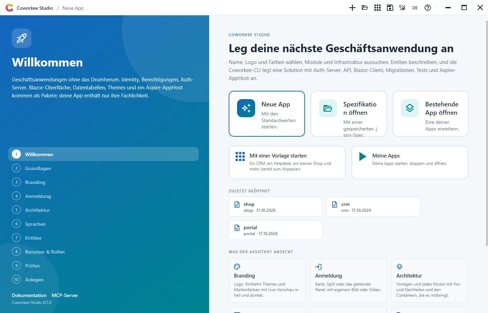

### Grundlagen

Der Name wird Präfix jedes Projekts und Namespaces (`Shop.Api`, `Shop.Web`) und wird deshalb wie in der CLI geprüft: ein Buchstabe, dann Buchstaben oder Ziffern. Den Titel lesen die Benutzer im Browser, in der App-Leiste, auf den Anmeldeseiten und im Aspire-Dashboard. Der Speicherort ist der Ordner, in dem der Ordner der App angelegt wird.

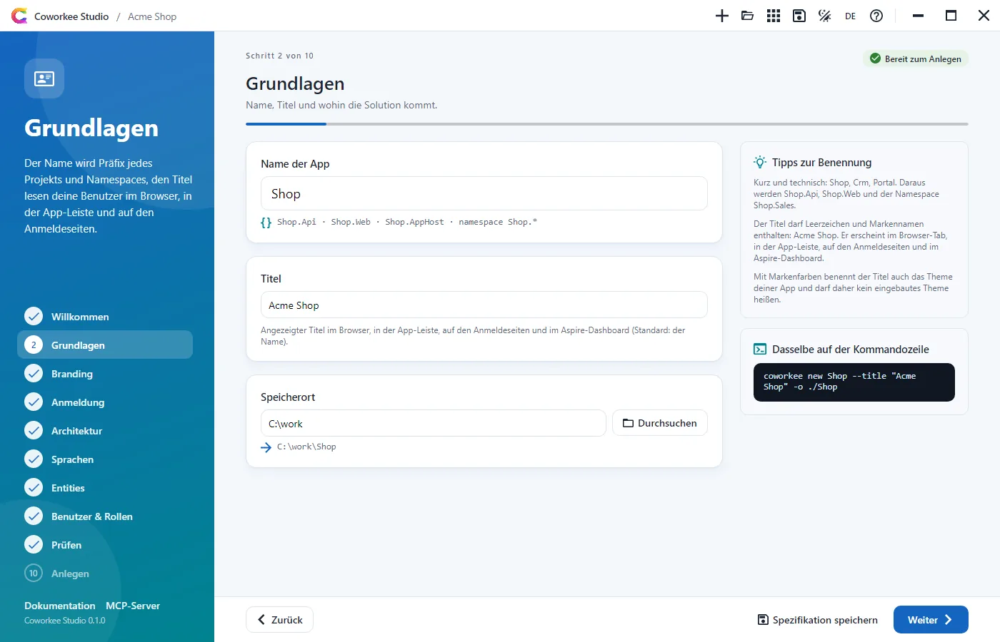

### Branding

Logo, die sieben [eingebauten Themes](../modules/theming.md) als Karten in hell und dunkel und Markenfarben mit Farbwähler. Die Live-Vorschau zeichnet die Oberfläche der App (App-Leiste, Navigation, Karten, Schaltflächen) in Farben, Schrift und Eckenradius des Themes, hell und dunkel nebeneinander. Mit Markenfarben bekommt die App ein eigenes Theme, benannt wie der Titel und basierend auf dem gewählten.

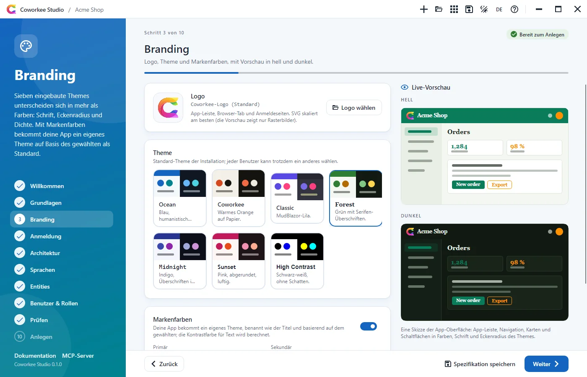

### Anmeldung

Karte, Split oder Slide, gezeichnet als kleine animierte Skizzen der echten [Anmeldeseiten](../security/sign-in-pages.md), mit Bild oder Video neben dem Formular und dessen Seite.

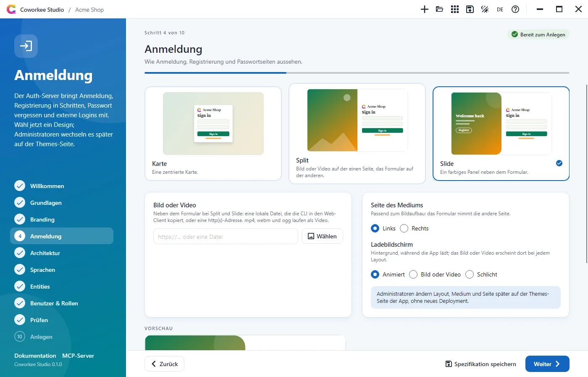

### Architektur

Eine kompakte Reihe von Vorlagen für den App-Typ setzt Module und Infrastruktur, jede mit ihrem Kompromiss im Tooltip:

| Vorlage | Datenbank | KI-Anbieter | Redis | Für |
|---|---|---|---|---|
| Minimal | Postgres | (kein Assistent) | aus | Die Oberfläche, eine Instanz; Module kommen später |
| Business-App | Postgres | (kein Assistent) | an | Audit-Log, Dateien, Backups, Client-Entities, CI |
| Teamarbeit | Postgres | Anthropic | an | Chat, Kommentare und der Assistent über Instanzen hinweg |
| SaaS-Plattform | Postgres | Azure OpenAI | an | Mandanten, Editionen, Keycloak, RabbitMQ, Azure Blob |
| Lokale Demo | SQLite | Ollama | aus | Offline auf einem Rechner ohne Schlüssel; nur ein Schreiber gleichzeitig, keine Backups |
| Alles | Postgres | Ollama | an | Jedes Modul und jeder Container |

Danach kommt **Infrastruktur**: zuerst die Entscheidungen, die bestimmen, wie die App läuft, jede mit ihrer Bedeutung direkt darunter, dann Keycloak und der Blob-Speicher, dann der KI-Anbieter:

- **Datenbank**: PostgreSQL (jedes Modul, Backups über die Admin-Seiten), SQL Server (keine Backups über die Admin-Seiten, ein schwerer Container) oder SQLite (kein Container, eine Datei unter `.data`, nur ein Schreiber gleichzeitig, Hintergrundjobs im Speicher, keine Backups). Ohne Postgres ist das Modul *Datenbank-Backups* ausgegraut und nicht Teil der App.
- **Redis**: SignalR-Backplane, gemeinsame Anwesenheit, Caches und Anmeldesitzungen über Instanzen hinweg; ohne bleibt alles im jeweiligen Prozess, was für eine Instanz reicht.
- **Grafana** und **WebDataStudio**: Dashboards über die Telemetrie jedes Dienstes und die App-Datenbank sowie die Datenbank im Browser, beide mit der Anmeldung des Administrators ([Grafana und WebDataStudio](../hosting/observability.md)).

**KI-Assistent**, die letzte Karte der Infrastruktur, wählt den [Modellanbieter](../modules/ai.md#anbieter) aus einem Raster mit Logos: Anthropic, OpenAI, Azure OpenAI, Gemini, OpenRouter, Mistral, Groq, DeepSeek, xAI, Together, Fireworks, Ollama, LM Studio oder einen beliebigen OpenAI-kompatiblen Server, mit Modell und Adresse (leer: die Standards des Anbieters). Er zählt nur mit dem Modul *KI-Assistent*; ohne ist die Karte ausgegraut. Ollama bringt einen Container mit, der das Modell lädt. Ein hier eingegebener API-Schlüssel kommt nie in die Spezifikation: Nach dem Anlegen schreibt das Studio ihn in die User Secrets des AppHosts (`dotnet user-secrets set Parameters:ai-apikey`), sodass der Assistent eingeschaltet startet. Alles bleibt auf der [KI-Seite](../modules/ai.md#die-ki-seite) der App änderbar.

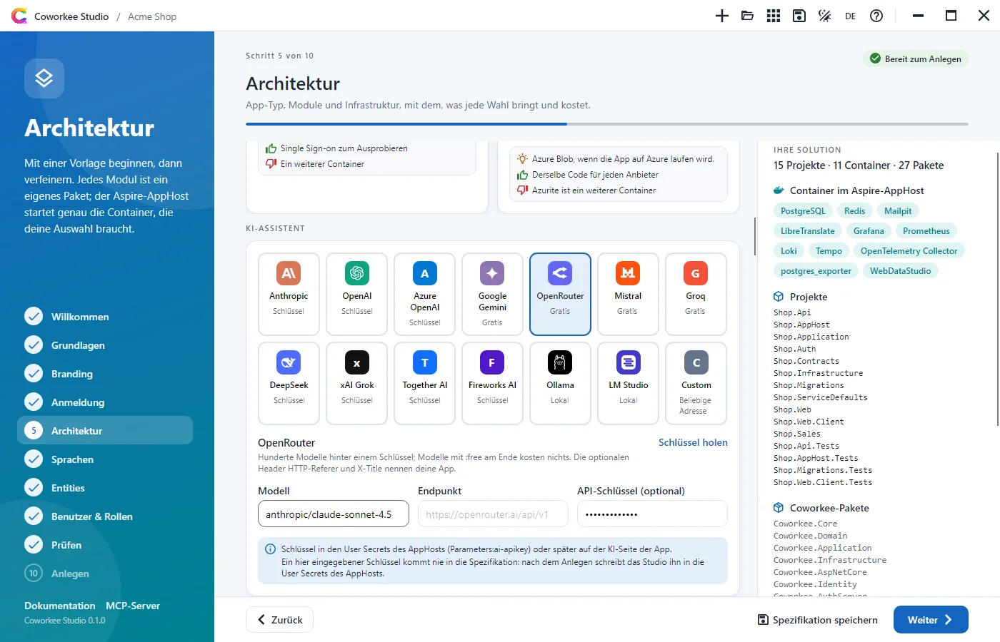

Darunter folgen die übrigen Gruppen (*Allgemein*, *Module*, *Code*, *Werkzeuge*) mit jeder weiteren Option von `coworkee options`: Beschreibung, Vor- und Nachteile, wann sie passt, das Paket und der Schalter von `coworkee new`. *Allgemein* enthält auch den Farbmodus, die Selbstregistrierung und das GitHub-Repository (`owner/repo`, für das [QuickRun](https://quickrun.org)-Badge in der README); *Werkzeuge* legt einen GitHub-Actions-Workflow und einen Dev-Container an. Das Panel rechts zeigt, was die Solution enthalten wird: Projekte, die Container des Aspire-AppHosts (PostgreSQL oder SQL Server, Redis, Mailpit, Elasticsearch, RabbitMQ, Azurite, Keycloak, Ollama, LibreTranslate, Grafana mit Prometheus, Loki, Tempo und Collector, WebDataStudio) und die Coworkee-Pakete.


### Sprachen

Die Sprachen der App in einem Raster, durchsuchbar nach Code, eigenem oder englischem Namen; 23 Sprachen liefert Coworkee mit (Englisch und Deutsch sind von Anfang an aktiv), jede andere wird beim ersten Start [maschinell übersetzt](../modules/localization.md#maschinelle-ubersetzung). Darunter: die Standardsprache (eine der gewählten), die Ausgangssprache der Übersetzungen und die Übersetzungsdienste als Karten mit dem, was jeder kostet, wohin die Texte gehen und was er braucht. LibreTranslate ist kostenlos, braucht kein Konto und läuft als Container des AppHosts; DeepL, Azure und Google nehmen ihren Schlüssel aus den User Secrets (`Parameters:translation-key`), KI nutzt das Modell des Assistenten.

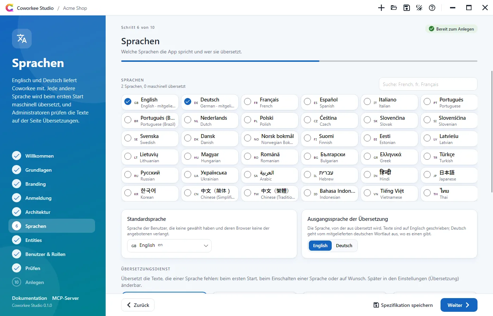

### Entities

Feature-Module mit ihren Entities: Name, Plural, Client-Entity, DTO-Mapping und ein Raster der Eigenschaften (Name, Typ, Pflicht, maximale Länge). Das Zahnrad einer Eigenschaft öffnet den Rest: Beschriftung, Standardwert, Suchfeld, eindeutig, Anzeigetext und Facette; bei einem Enum dessen Name, bei einer Referenz das Ziel (`Modul.Entity`, aus dem Designer vorgeschlagen), der angezeigte Text, das Löschverhalten und die Sammlung am Ziel; Stellen und Nachkommastellen bei Decimal und Money. Unter den Modulen stehen unter **Enums** die Wertelisten. Probleme erscheinen am Modul, an der Entity, Eigenschaft oder dem Enum, die sie betreffen. Das Panel rechts zeigt, was die CLI für die gewählte Entity erzeugt: Route der Seite, Route der API, Namen der Berechtigungen und Dateien. **Beispiel** fügt ein Sales-Modul mit Kunden und Aufträgen hinzu, mit einer Referenz dazwischen und einem Enum für den Auftragsstatus.

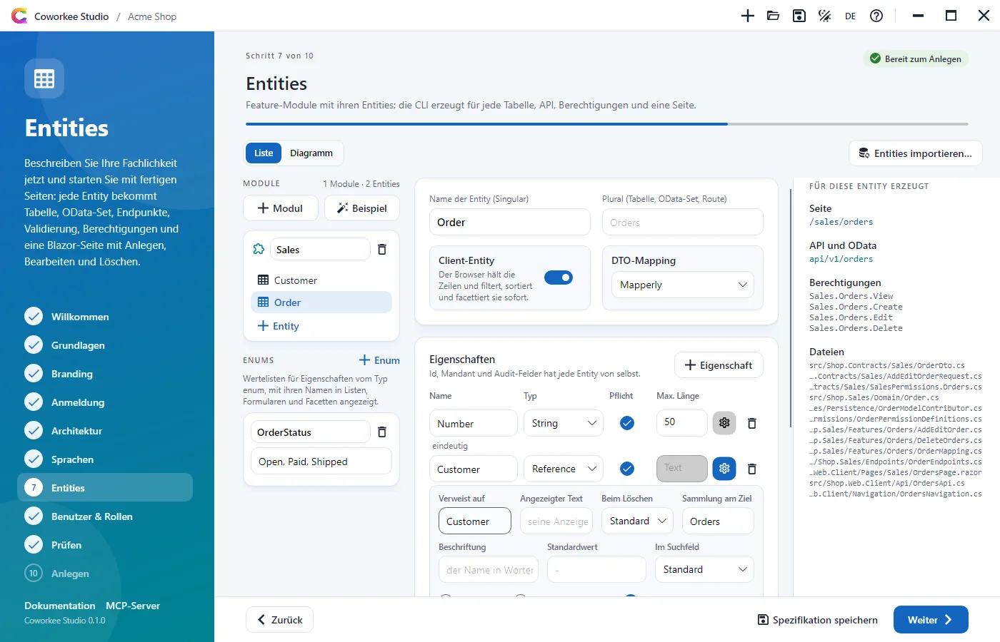

### Benutzer & Rollen

Benutzer und Rollen für die Entwicklung, mit denen die App angelegt wird. Jeder Benutzer hat eine E-Mail, einen Anzeigenamen (ohne Angabe aus der E-Mail), ein optionales Passwort (leer wird es erzeugt), einen Schalter für Administratoren und Kästchen für die Rollen; der Administrator `admin@<name>.local` ist immer dabei. Rollen haben einen Namen, eine Beschreibung und Kästchen für die Berechtigungen, die die App haben wird: die der gewählten Module, der Beispiele und Ihrer Entities. Mit Keycloak bekommt der Realm dieselben Benutzer mit denselben Passwörtern.

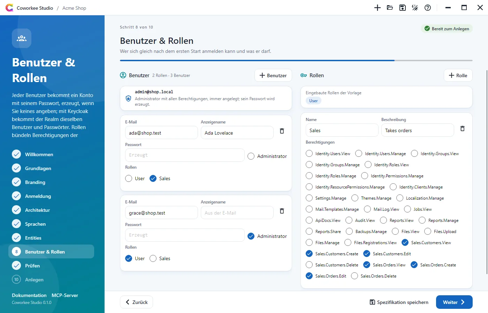

### Prüfen

Die Zusammenfassung (mit Datenbank, KI-Anbieter, Redis, den Containern, Farbmodus, Selbstregistrierung und Werkzeugen), die Prüfung nach den Regeln der CLI, die Spezifikation als JSON (kopieren oder speichern) und die passenden Befehlszeilen: `coworkee new --spec` mit allem und `coworkee new` mit Schaltern für dieselbe App ohne Entities. Logo und Medien aus anderen Ordnern werden beim Speichern neben die Spezifikation kopiert, denn die CLI liest Dateien einer Spezifikation nur aus deren Ordner.

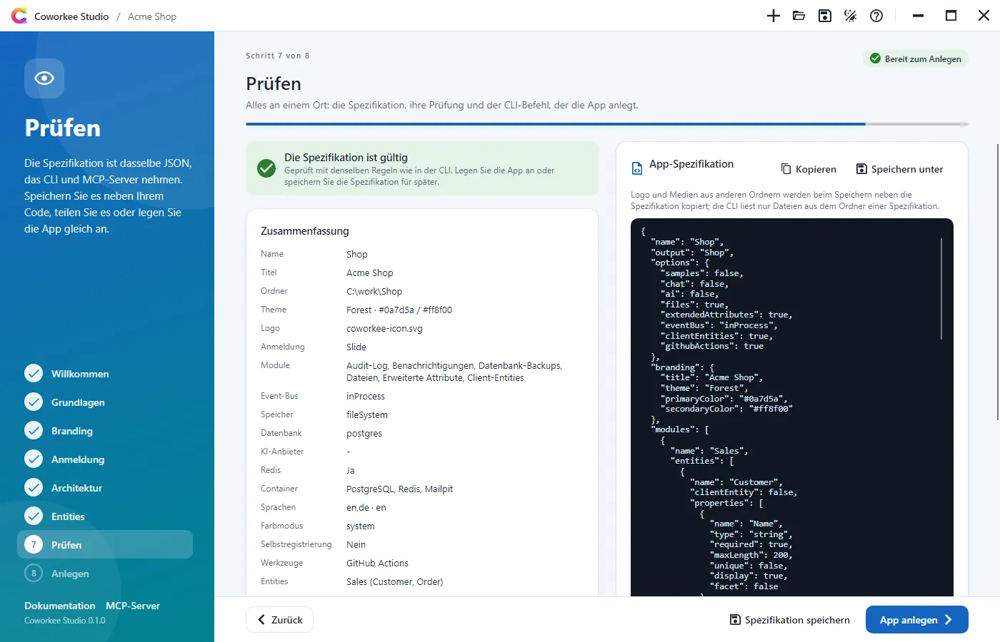

### Anlegen

Das Studio schreibt die Spezifikation, ruft `coworkee spec validate` und `coworkee new --spec` auf und zeigt jeden Schritt der CLI, sobald er beginnt, auf Wunsch mit der ganzen Ausgabe. Ausgabeordner, Logo und Medien gehen auf die Befehlszeile. Danach listet die Karte **Anmelden** jeden Benutzer mit Passwort und Rollen auf, mit Kopierknöpfen, und sagt, ob Keycloak sie ebenfalls annimmt (sie stehen auch in `LOGIN.md` der Solution). Dann: Ordner öffnen, in VS Code, Rider oder Visual Studio öffnen oder die App starten.

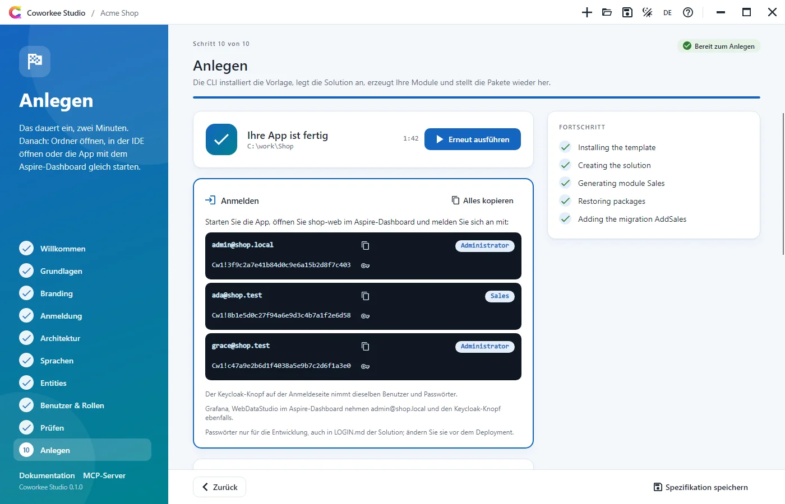

**App starten** führt `dotnet run --project <App-Host>` im Studio aus. Die Karte zeigt, ob der App-Host startet, läuft oder gescheitert ist, und im Fehlerfall die Zeile, die es erklärt (ein belegter Port, ein Build-Fehler). Sobald er läuft, verlinkt sie das Aspire-Dashboard (die Anmeldeadresse mit Token, aus der Ausgabe gelesen) und die Adressen von Web-App, API und Auth-Server (aus ihren Launch Settings). Die Ausgabe des App-Hosts ist einen Klick entfernt; **Stoppen** beendet den App-Host und alles, was er gestartet hat, ebenso das Schließen des Studios.

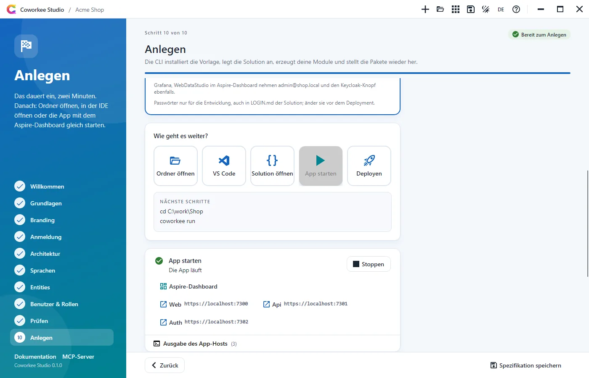

Ist die CLI nicht installiert, bietet das Studio an, `dotnet tool install -g Coworkee.Cli` auszuführen oder eine lokale CLI zu verwenden (`coworkee.exe` oder `Coworkee.Cli.dll`).

## Hilfe und der MCP-Server

Die Hilfe (`F1` oder das Fragezeichen) erklärt den Assistenten, die Befehle der CLI und den [MCP-Server](mcp.md): was `coworkee mcp` ist, seine Werkzeuge und die Registrierung für Claude Code, Claude Desktop und VS Code mit Kopierknöpfen.

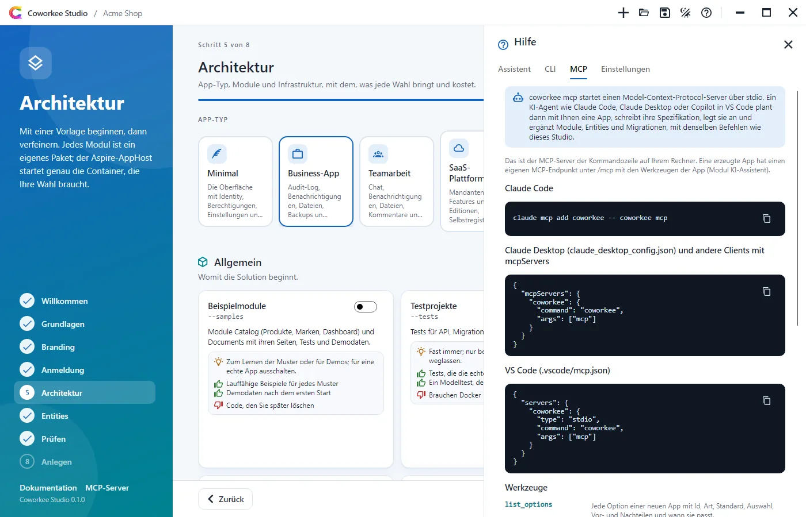

## Sprache und Updates

`DE`/`EN` in der Titelleiste wechselt die Sprache sofort und merkt sie sich in den Einstellungen. Hat nuget.org ein neueres Coworkee Studio (Vorabversionen nur, wenn das laufende Studio selbst eine ist), zeigt die Titelleiste **Update verfügbar: x.y.z**. Ein Klick speichert eine geöffnete Spezifikation, schließt das Studio, führt `dotnet tool update -g Coworkee.Cli` und `dotnet tool update -g Coworkee.Studio` auf diese Version aus (unter Windows in einem eigenen Fenster, weil ein laufendes Tool seine Dateien nicht ersetzen kann) und startet das Studio mit der Spezifikation neu. Von der Kommandozeile: [`coworkee self-update`](cli.md#weitere-befehle).

## Einstellungen

Die Einstellungen in der Hilfe: Sprache (System, Englisch, Deutsch), Farbmodus, die zu verwendende CLI (leer für das globale Tool, eine Programmdatei oder `Coworkee.Cli.dll`), eine Quelle der Vorlage (`.nupkg` oder Ordner, als `--template-source` übergeben) und ein lokaler Paket-Feed, den das Restore der neuen App neben nuget.org nutzt. Sie liegen pro Benutzer zusammen mit den zuletzt geöffneten Spezifikationen im Anwendungsdatenordner unter `Coworkee/Studio/settings.json`.
