# Coworkee Studio

Coworkee Studio is the desktop wizard of the [command line](cli.md). It walks through a new app page by page, explains what every choice brings and costs, previews logo, theme and sign-in design, lets you describe your entities and has the CLI create the solution. It runs on Windows, macOS and Linux.

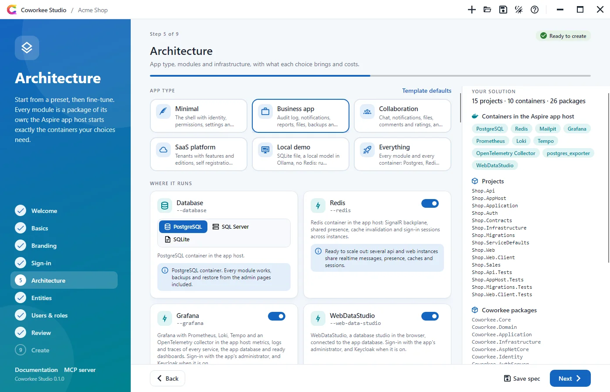

## Install and start

```bash
dotnet tool install -g Coworkee.Cli
coworkee ui
```

That is all: `coworkee ui` installs the Studio (global tool `Coworkee.Studio`, command `coworkee-ui`) in the version of the CLI when it is missing, updates it when it is older, and starts it. Further arguments go to the Studio:

| Argument | |
|---|---|
| `--spec <file>` | Opens an [app spec](cli.md#app-specs) |
| `--output <folder>` | Folder in which the app folder is created |
| `--theme light` or `dark` | Color mode (default: the system's) |
| `--lang en` or `de` | Language (default: the system's) |

```bash
coworkee ui --spec shop.json
```

For local builds of Coworkee: `coworkee ui --add-source <folder> --studio-version <version>`.

## The pages

The panel on the left shows where you are; every page you have seen is one click away. `Alt+→` and `Alt+←` go forward and back, `Ctrl+O` and `Ctrl+S` open and save a spec, `F1` opens the help. The badge at the top shows whether the spec is valid; problems appear on the page they belong to.

### Welcome

Start a new app, open a spec (`.json` from the CLI, the [MCP server](mcp.md) or an earlier session) or pick one of the recent specs.

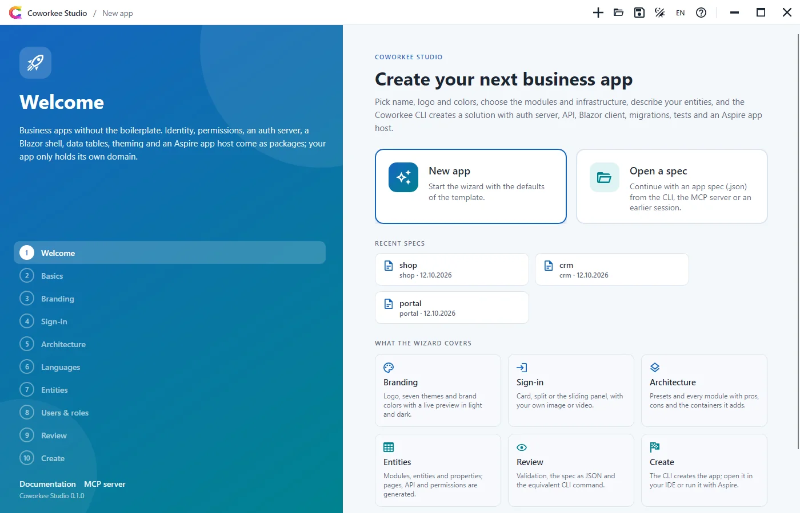

### Basics

The name becomes the prefix of every project and namespace (`Shop.Api`, `Shop.Web`), so it is checked like the CLI checks it: a letter, then letters or digits. The title is what users read in the browser, the app bar, on the sign-in pages and in the Aspire dashboard. The location is the folder in which the app folder is created.

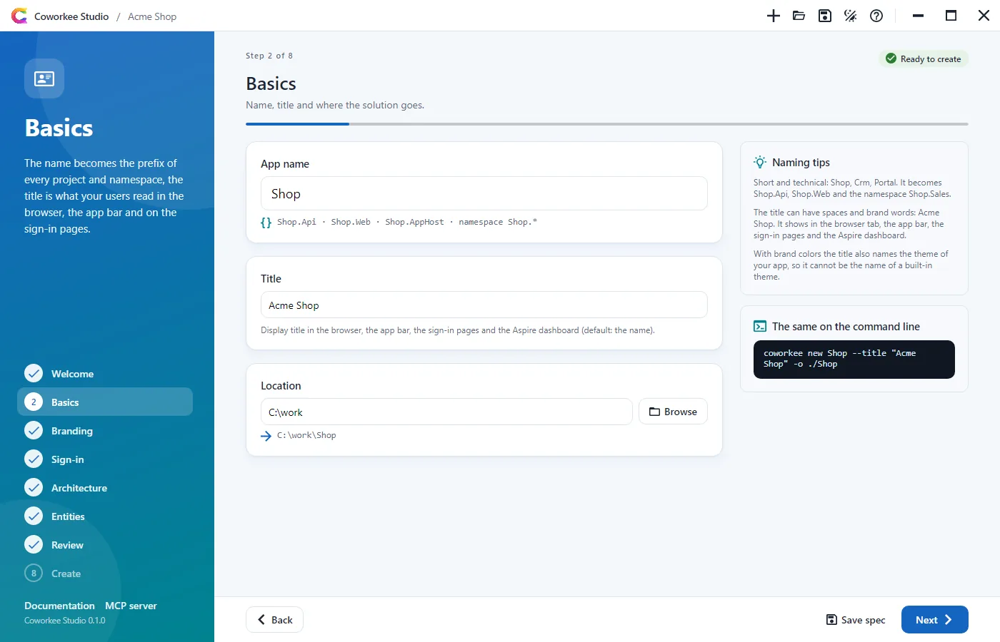

### Branding

Logo, the seven [built-in themes](../modules/theming.md) as cards in light and dark, and brand colors with a color picker. The live preview draws the app shell (app bar, navigation, cards, buttons) in the colors, font and corner radius of the theme, in light and dark side by side. With brand colors the app gets its own theme, named like the title and based on the chosen one.

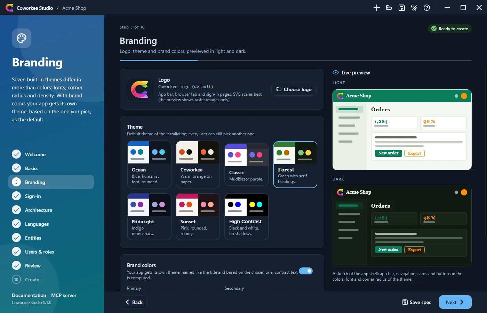

### Sign-in

Card, Split or Slide, drawn as small animated sketches of the real [sign-in pages](../security/sign-in-pages.md), with an image or video next to the form and its side.

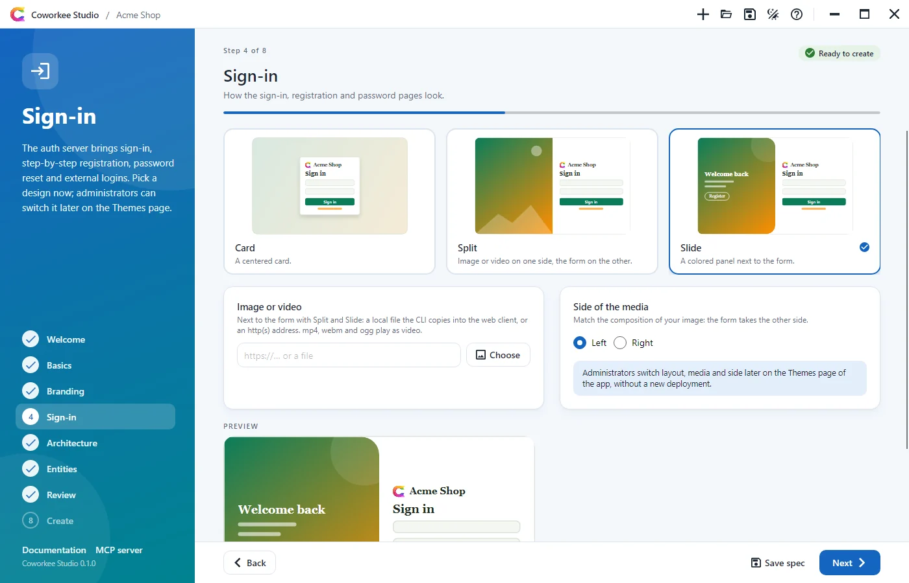

### Architecture

A compact row of presets for the app type sets the modules and the infrastructure, each with its trade-off in the tooltip:

| Preset | Database | AI provider | Redis | For |
|---|---|---|---|---|
| Minimal | Postgres | (no assistant) | off | The shell, one instance; add modules later |
| Business app | Postgres | (no assistant) | on | Audit log, files, backups, client entities, CI |
| Collaboration | Postgres | Anthropic | on | Chat, comments and the assistant across instances |
| SaaS platform | Postgres | Azure OpenAI | on | Tenants, editions, Keycloak, RabbitMQ, Azure Blob |
| Local demo | SQLite | Ollama | off | Offline on one machine without keys; one writer at a time, no backups |
| Everything | Postgres | Ollama | on | Every module and every container |

**Infrastructure** comes next: first the choices that decide how the app runs, each with what it means right below, then Keycloak and the blob storage, then the AI provider:

- **Database**: PostgreSQL (every module, backups from the admin pages), SQL Server (no backups from the admin pages, a heavy container) or SQLite (no container, one file under `.data`, one writer at a time, background jobs in memory, no backups). Off Postgres, the *Database backups* module is greyed out and left out of the app.
- **Redis**: SignalR backplane, shared presence, caches and sign-in sessions across instances; without it everything stays in each process, which is fine for one instance.
- **Grafana** and **WebDataStudio**: dashboards over the telemetry of every service and the app database, and the database in the browser, both with the administrator's sign-in ([Grafana and WebDataStudio](../hosting/observability.md)).

**AI assistant**, the last card of the infrastructure, picks the [model provider](../modules/ai.md#providers) from a grid with logos: Anthropic, OpenAI, Azure OpenAI, Gemini, OpenRouter, Mistral, Groq, DeepSeek, xAI, Together, Fireworks, Ollama, LM Studio or any OpenAI compatible server, with model and address (empty: the provider's defaults). It only counts with the *AI assistant* module; without it the card is greyed out. Ollama adds a container that pulls the model. An API key typed here never goes into the spec: after creation the Studio writes it to the user secrets of the app host (`dotnet user-secrets set Parameters:ai-apikey`), so the assistant starts switched on. Everything stays changeable on the [AI page](../modules/ai.md#the-ai-page) of the app.

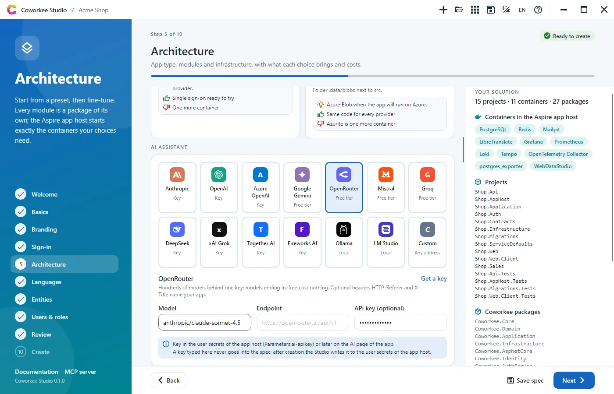

Below come the other groups (*General*, *Modules*, *Code*, *Tooling*) with every other option of `coworkee options`: description, pros, cons, when to use it, the package and the switch of `coworkee new`. *General* also holds the color mode, self registration and the GitHub repository (`owner/repo`, for the [QuickRun](https://quickrun.org) badge in the README); *Tooling* adds a GitHub Actions workflow and a dev container. The panel on the right lists what the solution will contain: projects, the containers of the Aspire app host (PostgreSQL or SQL Server, Redis, Mailpit, Elasticsearch, RabbitMQ, Azurite, Keycloak, Ollama, LibreTranslate, Grafana with Prometheus, Loki, Tempo and the collector, WebDataStudio) and the Coworkee packages.

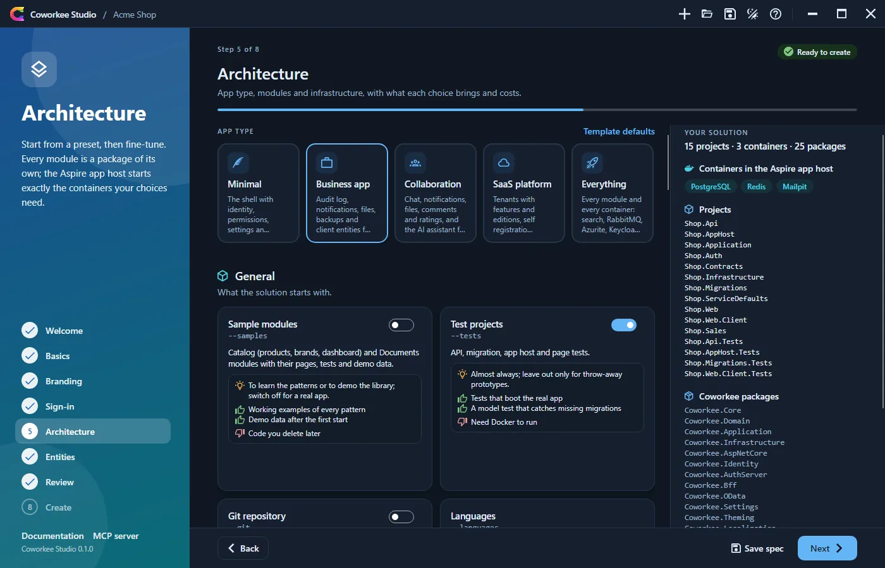

### Languages

The languages of the app in a grid you can search by code, own or English name; 23 languages ship with Coworkee (English and German are on from the start), every other one is [machine translated](../modules/localization.md#machine-translation) at the first start. Below: the default language (one of the chosen), the source language of the translations and the translation services as cards with what each costs, where the texts go and what it needs. LibreTranslate is free, needs no account and runs as a container of the app host; DeepL, Azure and Google take their key from the user secrets (`Parameters:translation-key`), AI uses the model of the assistant.

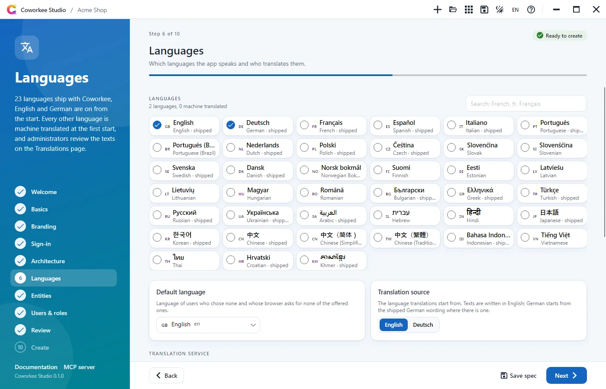

### Entities

Feature modules with their entities: name, plural, client entity, DTO mapping and a grid of properties (name, type, required, maximum length). The cog of a property opens the rest: label, default value, search box, unique, display text and facet; for an enum its name, for a reference the target (`Module.Entity`, suggested from the designer), the shown text, the delete behaviour and the collection on the target; precision and scale for decimals and money. Below the modules, **Enums** holds the value lists. Problems are shown on the module, entity, property or enum they concern. The panel on the right shows what the CLI generates for the selected entity: page route, API route, permission names and files. **Example** adds a Sales module with customers and orders, a reference between them and an order status enum.

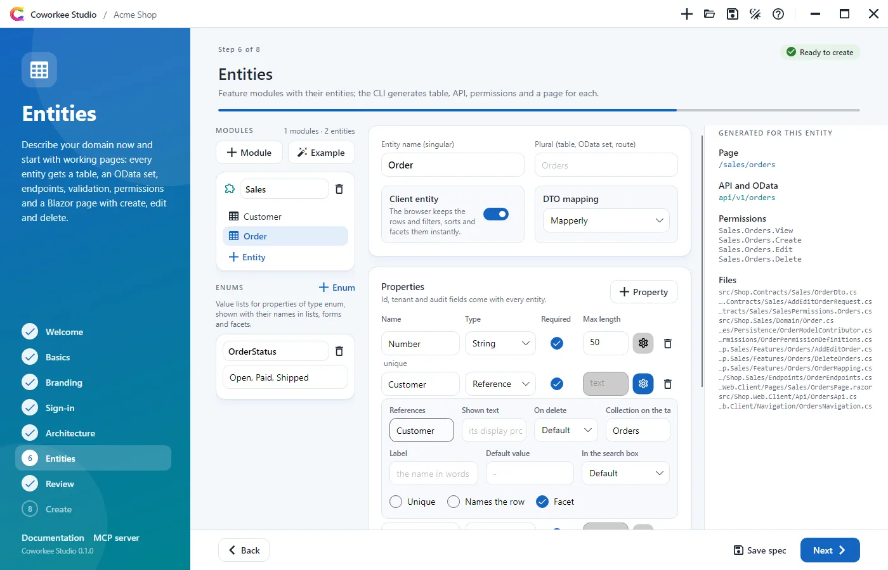

### Users & roles

Development users and roles the app is seeded with. Each user has an email, a display name (default: from the email), an optional password (generated when empty), an administrator switch and check boxes for the roles; the administrator `admin@<name>.local` is always there. Roles have a name, a description and check boxes for the permissions the app will have: those of the chosen modules, of the samples and of your entities. With Keycloak the realm gets the same users with the same passwords.

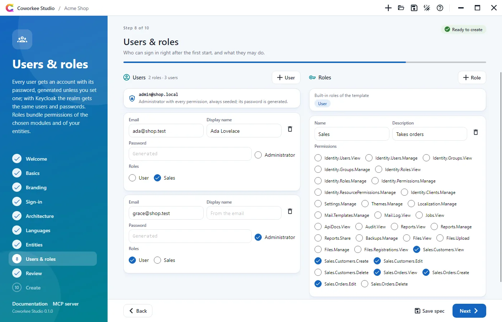

### Review

The summary (including database, AI provider, Redis, the containers, color mode, self registration and tooling), the validation with the rules of the CLI, the spec as JSON (copy or save it) and the equivalent command lines: `coworkee new --spec` with everything, and `coworkee new` with switches for the same app without entities. Logo and media from other folders are copied next to the spec when you save it, because the CLI reads files of a spec only from its folder.

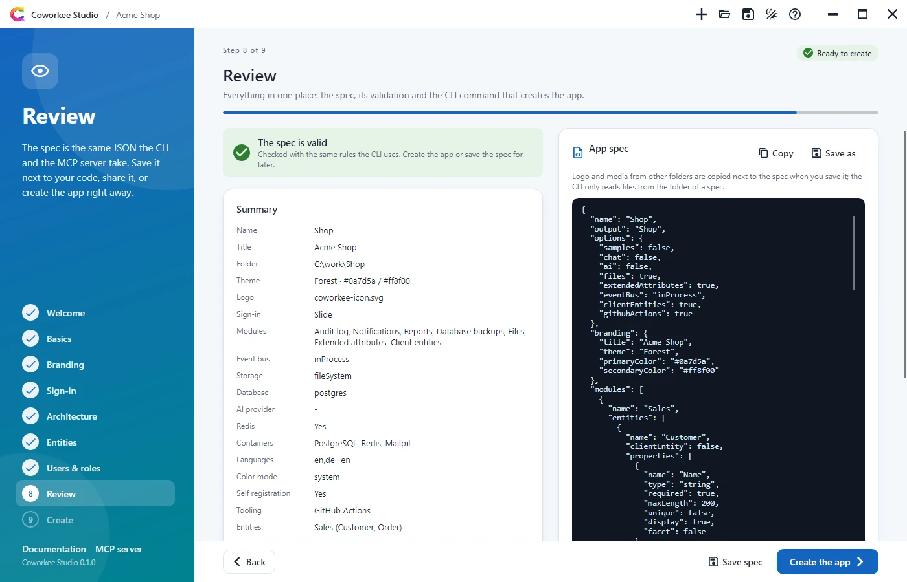

### Create

The Studio writes the spec, runs `coworkee spec validate` and `coworkee new --spec`, and shows each step of the CLI as it happens, with the full output when you want it. Output folder, logo and media go on the command line. Afterwards the **Sign in** card lists every user with password and roles, with copy buttons, and says whether Keycloak takes them too (they are also in `LOGIN.md` of the solution). Then: open the folder, open it in VS Code, Rider or Visual Studio, or run the app.

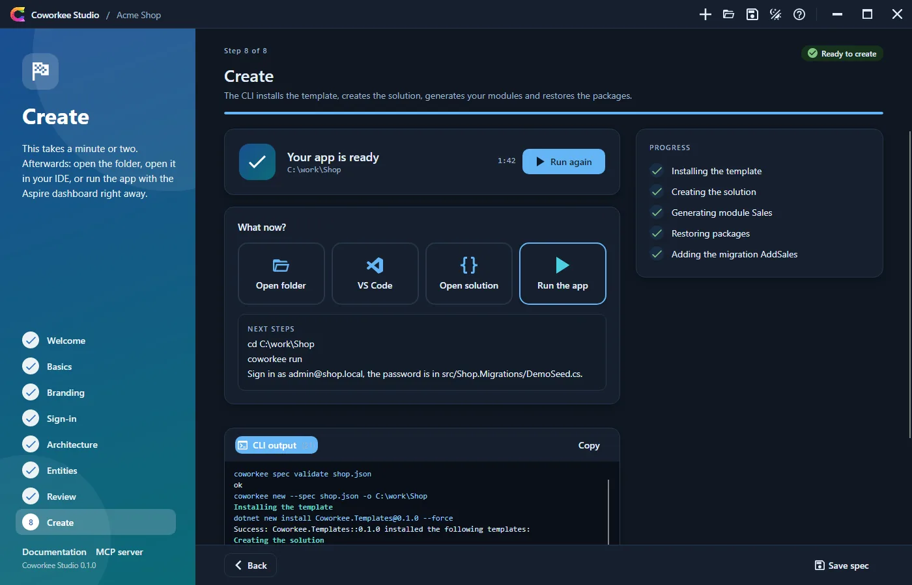

**Run the app** starts `dotnet run --project <app host>` inside the Studio. The card shows whether the app host is starting, running or has failed, and on failure the line that explains it (a port in use, a build error). Once it is up it links the Aspire dashboard (the login address with its token, read from the output) and the addresses of the web app, the API and the auth server (from their launch settings). The output of the app host is one click away; **Stop** ends the app host and what it started, and so does closing the Studio.

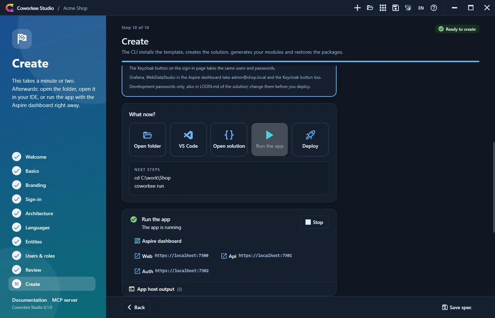

When the CLI is not installed, the Studio offers to run `dotnet tool install -g Coworkee.Cli` or to use a local CLI (`coworkee.exe` or `Coworkee.Cli.dll`).

## Help and the MCP server

The help (`F1` or the question mark) explains the wizard, the CLI commands and the [MCP server](mcp.md): what `coworkee mcp` is, its tools, and the registration for Claude Code, Claude Desktop and VS Code with copy buttons.

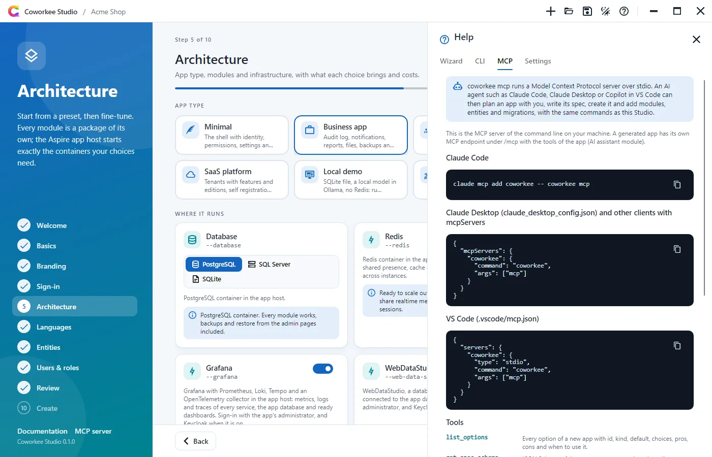

## Language and updates

`DE`/`EN` in the title bar switches the language at once and keeps it in the settings. When nuget.org has a newer Coworkee Studio (prereleases only when the running Studio is one), the title bar shows **Update available x.y.z**. A click saves an opened spec, closes the Studio, runs `dotnet tool update -g Coworkee.Cli` and `dotnet tool update -g Coworkee.Studio` to that version (in a window of its own on Windows, because a running tool cannot replace its files) and starts the Studio again with the spec. From the command line: [`coworkee self-update`](cli.md#other-commands).

## Settings

The settings in the help drawer: language (system, English, German), color mode, the CLI to use (empty for the global tool, an executable or `Coworkee.Cli.dll`), a template source (`.nupkg` or folder, passed as `--template-source`) and a local package feed that the restore of the new app uses next to nuget.org. They are kept per user with the recent specs in the application data folder under `Coworkee/Studio/settings.json`.
