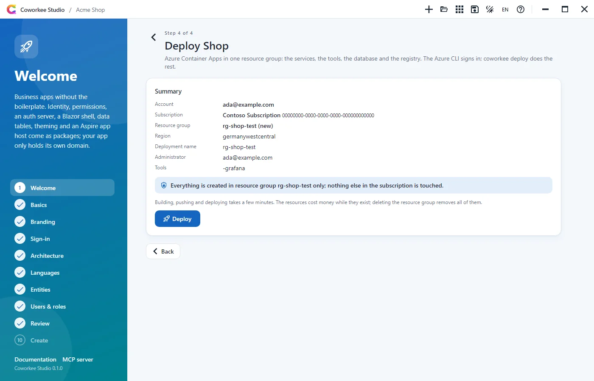
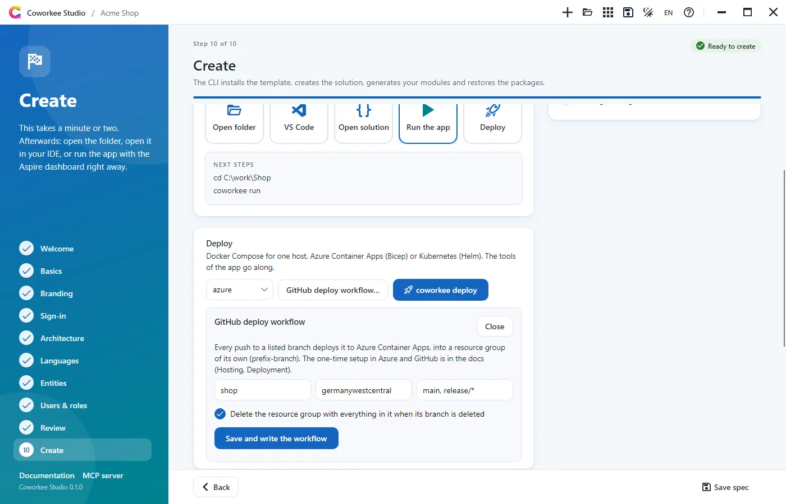

# Deployment

The app host that runs the app on your machine also describes its deployment. `coworkee deploy` publishes it for a target: Docker Compose for a single Linux host, Azure Container Apps as Bicep, Kubernetes as a Helm chart. The tools your app host uses (Keycloak, Grafana, WebDataStudio, LibreTranslate, Ollama, Open WebUI, Kibana, AspireUI) go along, each with its own volume and, where it has a web interface, a public address.

| Target | Command | Status |
|---|---|---|
| Docker Compose | `coworkee deploy compose` | verified: a generated app with Keycloak, Grafana, WebDataStudio and LibreTranslate runs from the published files behind an HTTPS proxy; the seeded administrator signs in with the password and through Keycloak, Grafana shows the app's data, WebDataStudio opens the database, machine translation works. Ollama and AspireUI are published and checked in the files, not started |
| Azure Container Apps | `coworkee deploy azure` (`--apply` deploys, `--github` writes a deploy workflow) | Bicep generated with the tools, every file compiles with `az bicep build`; `--apply` deployed a real app with all tools (services, SQL Server, Keycloak, Grafana, WebDataStudio) to Azure Container Apps |
| Kubernetes | `coworkee deploy k8s` | Helm chart generated with the tools, `helm lint` and `kubeconform -strict` pass; not installed on a cluster |

## What changes in a deployment

Publishing runs the app host in publish mode with the environment `Production`. The app then differs from a local run:

| Local run | Deployment |
|---|---|
| Each service on its https endpoint | the public addresses behind your reverse proxy, as parameters `<app>-auth-url` and `<app>-web-url` (and `<app>-airworks-url`, `<app>-elsastudio-url`) |
| Development certificates for the tokens | two certificates from the parameters `<app>-signing-certificate` and `<app>-encryption-certificate` (PKCS#12 as Base64), the issuer is the public auth address |
| Demo users from `DemoUsers.cs` | one administrator from the parameters `<app>-admin-email` and `<app>-admin-password`, created by the migrations in an empty database (see [The first administrator](#the-first-administrator)) |
| Mailpit | your mail server from the parameters `<app>-smtp-host`, `-smtp-port`, `-smtp-username`, `-smtp-password` and `-smtp-from`; Mailpit only when you ask for it (see [Mail](#mail)) |
| Keycloak, Grafana, WebDataStudio, LibreTranslate, Ollama, Open WebUI, Kibana, AspireUI | deployed as well, unless you leave one out (see [Tools](#tools)) |
| Files in `.data/blobs` | a volume `<app>-files`, shared by the services (Docker Compose) |
| Volumes named after the app host's folder | `<app>-postgres-data`, `<app>-redis-data`, ...: publishing again from another checkout finds the same data |

What stays the same: the migrations run once as their own service before the others start (and retry for a minute while the database server comes up; on Azure and Kubernetes they become a job), every service has `/health` and `/alive`, the Data Protection keys of the services with a database live in it (one key ring for api, auth server and workers), the web app keeps its sign-in sessions and their key ring in Redis, and Aspire sets `ASPNETCORE_FORWARDEDHEADERS_ENABLED` so the services read scheme and host from the proxy.

## Tools

Every tool the app host uses goes into the deployment. You leave one out for a single deployment or for good:

```bash
coworkee deploy compose --without grafana --without ollama
```

```csharp
var app = builder.AddCoworkeeApp("shop", options => options.UseGrafana().DeployTool(CoworkeeTools.Grafana, false));
```

`--without` and `--with` set `Coworkee:Deploy:Tools:<tool>`, which wins over `DeployTool`. The tools are `keycloak`, `mailpit`, `libretranslate`, `grafana`, `webdatastudio`, `ollama`, `aspireui`, `kibana`, `openwebui` and `elsastudio` (the workflow designer, a project of the app). Your own app host code asks `app.Deploys(CoworkeeTools.Ollama)`, the way the template adds Ollama and AspireUI.

| Tool | In the deployment |
|---|---|
| Keycloak | the realm of the app with the client of the auth server (the tools sign in at the auth server, not in the realm), and the first administrator as user with the role `Administrator`; the migrations bring it in line on every deployment. Public address `<app>-keycloak-url`, data in `<app>-keycloak-data` (Keycloak's own file database), its console as `admin` with `KEYCLOAK_PASSWORD`. The demo users and the login theme stay local |
| Grafana | with Prometheus, Loki, Tempo and the collector; the app's dashboards and the configuration are built into the images (`<app>-grafana`, ...). The administrator signs in with the password or at the auth server. Public address `<app>-grafana-url`, data in `<app>-grafana-data`, `<app>-prometheus-data` and `<app>-loki-data`; Tempo keeps its traces in the container |
| Open WebUI | with Ollama; the administrator signs in with the password or at the auth server. Public address `<app>-openwebui-url`, data in `<app>-openwebui-data`, key `<app>-openwebui-secret-key` |
| Kibana | behind oauth2-proxy; administrators of the system organisation sign in at the auth server (its public address is the issuer and token endpoint). Public address `<app>-kibana-url`, client secret `<app>-kibana-secret`, cookie secret `<app>-kibana-cookie-secret`, the password of `kibana_system` `<app>-kibana-password` |
| WebDataStudio | connected to the app database; the administrator signs in with the password or at the auth server. Public address `<app>-webdatastudio-url`, data in `<app>-webdatastudio-data` |
| LibreTranslate | the translation service of the app, inside the network only; the models live in `<app>-libretranslate-models`, the first start downloads them |
| Ollama | the model server of the app, inside the network only, models in `<app>-ollama-data`. It needs a host with enough memory |
| AspireUI | with the administrator's sign-in and the auth server's, public address `<app>-aspireui-url`, data in `<app>-aspireui-data`. It drives the host's Docker through `/var/run/docker.sock`, so it goes along to Docker Compose only (`--with aspireui` forces it, which the Kubernetes publisher refuses) |
| Mailpit | only with `--with mailpit`, for a test deployment: every mail lands there, its web interface (`<app>-mail-url`) asks for the administrator's email and password |

Each tool with a web interface sits behind your reverse proxy like the services; its public address also shows on the admin page **Services** (`Coworkee:Services`).

## The first administrator

When the database is empty, the migrations create the administrator of `<app>-admin-email` and `<app>-admin-password` with the organisation and the settings of the template, and the realm of a deployed Keycloak gets the same user. `coworkee deploy compose` asks for the email (or takes `--admin-email`, an environment variable `SHOP_ADMIN_EMAIL`, or `admin@<app>.local`), generates the password and prints both at the end of its output, nowhere else. The same email and password sign you in to the app, Keycloak, Grafana, WebDataStudio, Open WebUI, AspireUI and Mailpit.

Leave both values empty and nothing is created: the app shows its setup page, where `<app>-setup-token` lets you set up the organisation and the administrator yourself. A database that is set up stays as it is; a changed password in `.env` reaches Keycloak and the tools, not the app's own account.

Every run of the migrations (every `docker compose up`, the Container Apps job after each deployment, the Helm hook) also runs the app's [seed contributors](../fundamentals/persistence.md#seed-contributors), so data added to a seed reaches the deployed database; a failing one stops the run with exit code 1 and the services do not start. Roles and grants added to `DeploymentSeed` later reach a deployed database with `options.SyncRolesInDeployments = true`.

## Mail

A deployment sends through your mail server. `coworkee deploy compose` asks for host, port, user, password and sender (or reads `SHOP_SMTP_HOST`, ... from the environment) and writes them into `.env`; what you leave empty you fill in later. They become the defaults of the mail settings, which administrators change on the mail settings page. `UseMail(endpoint)` in the app host takes another SMTP resource instead, `--with mailpit` takes Mailpit.

## Docker Compose

```bash
coworkee deploy compose
```

writes `deploy/compose` in the solution (`-o` for another folder):

- `docker-compose.yaml`: Postgres or SQL Server, Redis, the migrations, auth server, api, web app, the tools, and the Aspire dashboard for logs and traces.
- `.env`: every parameter. The tool fills what it can: random passwords and the setup token, the administrator, the two token certificates, the Web Push key pair (with notifications and `pwa`), the images and the ports. The mail server it asks for at the console. An environment variable of the same name (`SHOP_WEB_URL=...`) is taken over. It keeps the values of an earlier run, so a second `coworkee deploy` does not change passwords or certificates.
- the images `<app>-migrations`, `<app>-auth`, `<app>-api`, `<app>-web` (`dotnet publish -t:PublishContainer`) and those of the tools that carry files of the app (`<app>-grafana`, `<app>-prometheus`, ..., `docker build`) in your local Docker; `--no-build` skips that.

At the end it lists every service and tool with its loopback port and public address, and how to sign in.

You set the public addresses in `.env`:

```bash
SHOP_AUTH_URL=https://auth.example.com
SHOP_WEB_URL=https://shop.example.com
SHOP_KEYCLOAK_URL=https://login.example.com
SHOP_GRAFANA_URL=https://grafana.example.com
SHOP_WEBDATASTUDIO_URL=https://data.example.com
```

The services listen on the host's loopback in the order they were added: auth server `127.0.0.1:8080`, api `8081`, web app `8082` (AirWorks `8083`). The tools have fixed ports: Keycloak `8090`, Grafana `8091`, WebDataStudio `8092`, AspireUI `8093`, Mailpit `8094`, Kibana `8096`, Open WebUI `8097`. A reverse proxy terminates HTTPS in front of them, for example Caddy, which gets the certificates from Let's Encrypt:

```caddyfile
auth.example.com {
	reverse_proxy 127.0.0.1:8080
}

shop.example.com {
	reverse_proxy 127.0.0.1:8082
}

login.example.com {
	reverse_proxy 127.0.0.1:8090
}

grafana.example.com {
	reverse_proxy 127.0.0.1:8091
}

data.example.com {
	reverse_proxy 127.0.0.1:8092
}
```

The services reach the auth server under its public address too (the web app signs in there, the api validates tokens against it), so the host must resolve that name and trust its certificate, which a public certificate does.

Then on the host (copy the folder and load the images there, or build them there with `coworkee deploy compose`):

```bash
docker compose up -d
```

Open the web address and sign in as the administrator `coworkee deploy` printed. With the administrator left empty the app shows the setup page instead: enter `SHOP_SETUP_TOKEN` from `.env`, the name of your organisation and the first administrator.

### Trying it on your machine

Docker Desktop is enough. Names under `localtest.me` point to `127.0.0.1`; a Caddy container with its own certificate authority stands in for the proxy and is known to the other containers under the same names. Next to `docker-compose.yaml`:

```caddyfile title="Caddyfile"
app.localtest.me:8443 {
	tls internal
	reverse_proxy shop-web:8080
}

auth.localtest.me:8443 {
	tls internal
	reverse_proxy shop-auth:8080
}

keycloak.localtest.me:8443 {
	tls internal
	reverse_proxy keycloak:8080
}

grafana.localtest.me:8443 {
	tls internal
	reverse_proxy grafana:3000
}

data.localtest.me:8443 {
	tls internal
	reverse_proxy webdatastudio:8080
}
```

```yaml title="compose.proxy.yaml"
services:
  caddy:
    image: caddy:2.10
    ports:
      - "8443:8443"
    volumes:
      - ./Caddyfile:/etc/caddy/Caddyfile:ro
      - caddy-data:/data
    networks:
      aspire:
        aliases: [app.localtest.me, auth.localtest.me, keycloak.localtest.me, grafana.localtest.me, data.localtest.me]
  shop-auth: &trust
    environment:
      SSL_CERT_FILE: /etc/ssl/caddy-root.crt
    volumes:
      - ./caddy-root.crt:/etc/ssl/caddy-root.crt:ro
    depends_on:
      caddy:
        condition: service_started
  shop-api: *trust
  shop-web: *trust
volumes:
  caddy-data: {}
```

```bash
# the addresses as environment variables: coworkee deploy takes them into .env
export SHOP_AUTH_URL=https://auth.localtest.me:8443 SHOP_WEB_URL=https://app.localtest.me:8443 SHOP_KEYCLOAK_URL=https://keycloak.localtest.me:8443 \
  SHOP_GRAFANA_URL=https://grafana.localtest.me:8443 SHOP_WEBDATASTUDIO_URL=https://data.localtest.me:8443
coworkee deploy compose
cd deploy/compose
docker compose -f docker-compose.yaml -f compose.proxy.yaml up -d caddy
docker compose cp caddy:/data/caddy/pki/authorities/local/root.crt caddy-root.crt
docker compose -f docker-compose.yaml -f compose.proxy.yaml up -d
```

The services trust Caddy's own authority through `caddy-root.crt`; the browser warns about it, which is expected here. Some routers (a Fritz!Box, for example) refuse to resolve names that point to `127.0.0.1`; then add the names with `127.0.0.1` to your hosts file, or start the browser with `--host-resolver-rules="MAP *.localtest.me 127.0.0.1"`. Keycloak, Grafana and WebDataStudio talk to each other over the container network, so only the auth server, api and web app need to trust Caddy.

### Your own identity provider

To sign in through a Keycloak you run elsewhere (or any OpenID Connect provider), deploy without the app host's one (`--without keycloak`) and give the auth server and the api the provider in `docker-compose.yaml` or an override file:

```yaml
  shop-auth:
    environment:
      Coworkee__Auth__External__Mode: Both
      Coworkee__Auth__External__Providers__keycloak__DisplayName: Keycloak
      Coworkee__Auth__External__Providers__keycloak__Authority: https://login.example.com/realms/shop
      Coworkee__Auth__External__Providers__keycloak__ClientId: shop-auth
      Coworkee__Auth__External__Providers__keycloak__ClientSecret: ${KEYCLOAK_CLIENT_SECRET}
  shop-api:
    environment:
      Coworkee__Auth__External__Mode: Both
      Coworkee__Auth__External__Providers__keycloak__DisplayName: Keycloak
```

The client in the realm redirects to `https://auth.example.com/signin-keycloak`. When the auth server reaches the provider at another address than the browser does, `...__BrowserUrl` names the browser's one (the app host sets it for its own Keycloak).

## Azure Container Apps

```bash
coworkee deploy azure
az bicep build --file deploy/azure/main.bicep
```

writes `main.bicep` with a Container Apps environment and a registry, and a Bicep file per service; the Postgres and Redis containers become container apps with volumes, the migrations a Container Apps job. For production take the managed services and hand them to the app (add `Aspire.Hosting.Azure.PostgreSQL` to the app host):

```csharp
var database = builder.AddAzurePostgresFlexibleServer("postgres").RunAsContainer().AddDatabase("myapp");
var app = builder.AddCoworkeeApp("myapp", options => options.UseDatabase(database));
```

Files need a storage that every replica shares: generate the app with `--storage azureBlob`. Deploy with `azd init` and `azd up`, and set the parameters there (public addresses of the services and tools, the administrator, the mail server, the two certificates, the setup token; `coworkee deploy compose` shows how to generate them). The images of the tools that carry files of the app come from Dockerfiles below `src/<App>.AppHost/observability/.generated/publish`, which azd builds. The migrations job runs when you start it: `az containerapp job start -n shop-migrations -g <resource group>`, after every deployment. **Not verified:** this azd path; the Bicep compiles. `coworkee deploy azure --apply` (above) deployed a real app.

### Deploying from your machine

```bash
az login
coworkee deploy azure --resource-group shop-test --location germanywestcentral --apply
```

publishes the app host, checks the account the Azure CLI is signed in with, and lets Aspire build, push and deploy into exactly that resource group (made when missing; nothing is created at the subscription). Then it runs the migrations job and writes `.coworkee/deployments/<name>.json` with the addresses. The parameters it generates (administrator, passwords, certificates, push keys) are kept in `.coworkee/deployments/<name>.secrets.json`, which is git ignored; the next deployment with the same name takes them again, so the database password and the token certificates stay. `--name` names the deployment (default: the resource group), `--subscription` picks another subscription than the Azure CLI's, `--yes` skips the question, `--admin-email` sets the administrator (default: the signed-in account). Values set as environment variables named like the `.env` keys of Docker Compose (`SHOP_ADMIN_EMAIL`, `SHOP_ADMIN_PASSWORD`, `SHOP_SMTP_HOST`, ...) are taken when nothing is kept yet.

**Several accounts and guest tenants.** The Azure CLI keeps several accounts signed in at once (`az login` adds one, `az login --tenant <id or domain>` signs in to a tenant where your account is a guest; `az account list --all` shows the subscriptions of all of them with `user.name` and `tenantId`). `--subscription <id>` picks the subscription, and with it the account: every `az` call of the deployment passes `--subscription`, and the app host asks the Azure CLI for its tokens with `--subscription` too, not only with the tenant (otherwise `az` answers with the account of its default subscription, which may not be the one that sees the target). The record keeps subscription, tenant and account.

**Own sign-in per app.** `--own-azure-sign-in` gives the app a sign-in of its own, apart from the global one in `~/.azure`: the CLI sets `AZURE_CONFIG_DIR` to `~/.coworkee/azure/<app folder name>-<hash of the app's path>` for itself and every process it starts (`az`, the app host, Aspire's Azure CLI credential). Sign in there once:

```bash
AZURE_CONFIG_DIR=~/.coworkee/azure/<folder> az login     # the CLI names the folder when it is not signed in
coworkee deploy azure --resource-group shop-test --location germanywestcentral --apply --own-azure-sign-in
```

The record notes `"ownAzureSignIn": true` (never the folder or a token), so the next `coworkee deploy azure --apply --name <name>` uses the same sign-in without the switch; `--own-azure-sign-in false` goes back to the global one. A deployment run with `AZURE_CONFIG_DIR` set in the environment uses that folder as well, without noting it. The folder holds tokens and lives in your user profile, never in the repository.

**The credential of the deploy step.** `coworkee deploy` sets `Azure:CredentialSource=AzureCli`, so Aspire (13.x) takes `AzureCliCredential` for provisioning, the registry login and the push, not Visual Studio, an interactive browser or `DefaultAzureCredential` (Aspire's default in publish mode is the Azure CLI as well). That credential starts `az account get-access-token` as a child process with the environment of the app host, so `AZURE_CONFIG_DIR` reaches it. Since Aspire's own credential asks only for the tenant, `AddCoworkeeApp` replaces it while deploying to Azure with `Azure:CredentialSource=AzureCli` and `Azure:SubscriptionId` set by one that asks for the subscription (`az account get-access-token --subscription <id>`).

In [Coworkee Studio](../getting-started/studio.md#deploy), **Deploy…** on the overview of an app runs the same command as a wizard: it checks the Azure CLI sign-in (the global one or, switched on, the [app's own](../getting-started/studio.md#own-sign-in-per-app)), then you pick the subscription from those of every signed-in account (**Sign in with another account**, optionally to a guest tenant), the resource group (new or one of yours), the region, the administrator and the tools, and the summary shows that everything goes into that one resource group. **Deploy** runs `coworkee deploy azure --apply --yes` with those values and shows its output live; **Update** on a recorded deployment runs it again with the values of its record.



### Deploying every branch with GitHub Actions

```bash
coworkee deploy azure --github --location germanywestcentral --branches main develop 'release/*'
```

writes `.github/workflows/deploy-azure.yml`: every push to one of the branches deploys that branch with `coworkee deploy azure --apply` into a resource group of its own. The same workflow comes from the option `deployWorkflow` when the app is created (`coworkee new --deploy-workflow azure`, the spec, the Tooling options in the Studio) or later (`coworkee add deployWorkflow azure deployBranches main,develop`). Its settings:

| Setting | `deploy azure --github` | Option | Default |
|---|---|---|---|
| Resource group prefix | `--resource-group-prefix` | `deployResourceGroupPrefix` | the app's name in lower case |
| Azure region | `--location` | `deployLocation` | `germanywestcentral` |
| Branches (`*` as in GitHub) | `--branches` | `deployBranches` (comma separated) | `main` |
| Delete with the branch | `--teardown-on-delete true` | `deployTeardown` | `false` |

They are kept in `.coworkee/app.json` like every option: `coworkee deploy azure --github` without switches writes the workflow anew from them (after a `coworkee update`, for example), and the Studio shows them in the deploy card under *GitHub deploy workflow…*, where you change them and write the workflow again (shown below). The first line of the file holds a hash of what coworkee wrote. When you change the file by hand, coworkee notices it: the CLI refuses to overwrite it unless you pass `--force`, the Studio asks whether to overwrite your changes or keep your file, `coworkee add` leaves it alone with a warning, and `coworkee remove deployWorkflow` deletes it only when it is unchanged.



What a run does:

- **Triggers:** a push to a listed branch, and *Run workflow* (`workflow_dispatch`) for the branch you pick; with teardown also the deletion of a branch.
- **One environment per branch:** a GitHub environment named like the branch (GitHub makes it on the first run) and the resource group `<prefix>-<branch>`. The branch is written in lower case, every run of characters other than `a-z`, `0-9` and `-` becomes one `-`, and the name is cut to the 90 characters Azure allows: `feature/Login_Page` becomes `shop-feature-login-page`. The deployment name in `.coworkee/deployments` is the same branch name.
- **Steps:** checkout; .NET from `global.json`; Node.js 22 when the app has the AirWorks client; the `wasm-tools` workload when a project links native WebAssembly (`WasmBuildNative`, `RunAOTCompilation`, the client entities in SQLite); the Coworkee CLI as a dotnet tool in the `CoworkeeVersion` of `Directory.Packages.props` (from nuget.org: a local development feed does not reach the runner); `azure/login` with OIDC; `coworkee deploy azure --resource-group <group> --location <region> --name <branch> --apply --yes`.
- **One run per branch at a time:** a second push waits until the first deployment is through.

#### Values that stay from run to run

The runner starts empty, but a deployment must not get new values every time: Postgres keeps the password of the first run in its volume, and new token certificates would sign everyone out. So the workflow keeps the generated parameters of each environment in its GitHub environment secret `COWORKEE_DEPLOY_SECRETS` (the content of `<name>.secrets.json`). Before the deployment it puts them back where `coworkee deploy` looks for them; after it, also after a failed run, it saves them when they changed (the first run, or a newer Coworkee with new parameters). Writing a secret needs a token: the repository secret `COWORKEE_SECRETS_TOKEN`. A run without that token and without kept values stops before it deploys anything.

Values you want to choose yourself come from GitHub variables and secrets with the names of the Docker Compose keys, for every environment (repository level) or for one (environment level): the variable `SHOP_ADMIN_EMAIL` and the secret `SHOP_ADMIN_PASSWORD` for the first administrator, the variables `SHOP_SMTP_HOST`, `SHOP_SMTP_PORT`, `SHOP_SMTP_USERNAME`, `SHOP_SMTP_FROM` and the secret `SHOP_SMTP_PASSWORD` for the mail server (`SHOP` is the app's name in upper case). They are taken on the first run of an environment; afterwards the kept value wins. Set the administrator's password yourself: a generated one sits only in `COWORKEE_DEPLOY_SECRETS`, and GitHub shows no secret.

!!! warning "Delete with the branch"
    With `deployTeardown` (`--teardown-on-delete true`) deleting a branch deletes its resource group **with everything in it**: the database, the files, the secrets. There is no undo and no backup. The workflow never does it for the default branch and only for branches of the list, but deleting a branch by mistake or merging a pull request with *Delete branch* is enough. Leave it off for every environment whose data matters, and keep the role assignments of the next section narrow so the identity cannot delete more than these groups.

#### One-time setup in Azure and GitHub

coworkee writes the workflow, it never touches Azure or GitHub. You set up the identity once:

1. **An app registration** for the workflow: `az ad app create --display-name shop-github-deploy`, then `az ad sp create --id <appId>`. It gets no client secret.
2. **A federated credential per branch environment**, so a run of that branch may sign in as the app registration: issuer `https://token.actions.githubusercontent.com`, audience `api://AzureADTokenExchange`, subject `repo:<owner>/<repo>:environment:<branch>`:

    ```bash
    az ad app federated-credential create --id <appId> --parameters '{"name":"shop-main","issuer":"https://token.actions.githubusercontent.com","subject":"repo:acme/shop:environment:main","audiences":["api://AzureADTokenExchange"]}'
    ```

    An app registration takes at most 20 federated credentials, and the subject names one environment: a pattern like `release/*` needs a credential per branch that matches it (or Entra's flexible federated identity credentials, which match subjects by pattern).
3. **Role assignments, as narrow as possible.** The deployment creates resources in the resource group and gives the container apps' managed identity pull rights on the registry, so the identity needs *Contributor* and *Role Based Access Control Administrator* (with the condition that it may assign only the roles Aspire gives, AcrPull and those of Azure resources your app host adds). Where you assign them decides what the identity can do:
    - **Least privilege (recommended):** create the resource group of each environment yourself (`az group create -n shop-main -l germanywestcentral`) and assign both roles on that group only. The identity can change nothing outside the groups of your environments, and the teardown can delete nothing else. A new branch needs its group, its role assignments and its federated credential first.
    - **Groups made by the workflow:** a resource group that does not exist yet can only be made with rights on the subscription, so both roles are assigned there. Then every branch deploys without preparation, but the identity can change everything in the subscription: give these environments a subscription of their own. Never assign *Owner*.
4. **In GitHub** (Settings, Secrets and variables, Actions): the secrets `AZURE_CLIENT_ID` (the app registration's application id), `AZURE_TENANT_ID` and `AZURE_SUBSCRIPTION_ID`, on the repository or per environment (then each branch can use another subscription); `COWORKEE_SECRETS_TOKEN`, a fine-grained personal access token for this repository only with the permission *Environments: Read and write*; the administrator and mail values above. Protection rules of an environment (required reviewers for `main`, for example) apply to its deployments.

**Not verified:** the workflow is generated and tested as text; a run against Azure has not been made.

## Kubernetes

```bash
coworkee deploy k8s
helm lint deploy/k8s
helm template deploy/k8s | kubeconform -strict -summary
```

writes a Helm chart (`Chart.yaml`, `values.yaml`, `templates/`) with a deployment and a service per service. Aspire's Kubernetes publisher is a preview; `coworkee deploy` repairs two things in its output: setting names with a dot are read with `index`, and the migrations become a Job that Helm runs after each install and upgrade.

Fill `values.yaml`: the public addresses (`shop_web_url`, `shop_auth_url`, `shop_keycloak_url`, ..., repeated per service), the administrator, the mail server, the secrets (connection strings, passwords, certificates, setup token) and the images, which you push to your registry (`dotnet publish -t:PublishContainer -p:ContainerRegistry=...`, `docker build` for the tools). Ingress and TLS are your cluster's: point the public addresses at the web app, the auth server and the tools.

**Not verified:** the chart lints and validates, it has not run on a cluster. The volumes of the chart are `emptyDir`, so the data of Postgres, Redis and the tools and the files are lost with the pod: use managed databases (`UseDatabase`, `UseRedis`), Azure Blob storage, or change the volumes to persistent volume claims before you rely on it.

## An environment of your own

`Coworkee:Deploy:Target` (`compose`, `azure`, `k8s`) picks the environment `coworkee deploy` passes. An app host that adds a compute environment itself before `AddCoworkeeApp` keeps it, for example `builder.AddDockerComposeEnvironment("compose").WithDashboard(false)`. `aspire publish` works as well once the Aspire CLI matches the app host's Aspire version; `coworkee deploy` runs the app host directly and does not need it.
