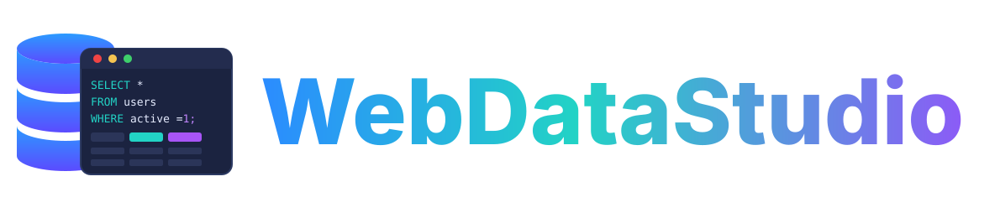
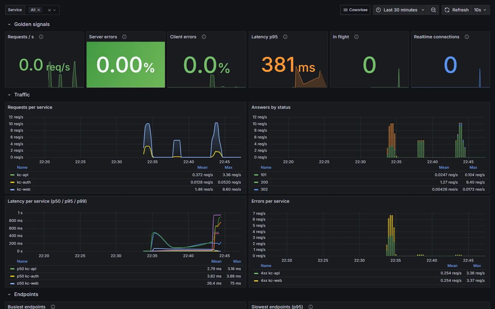
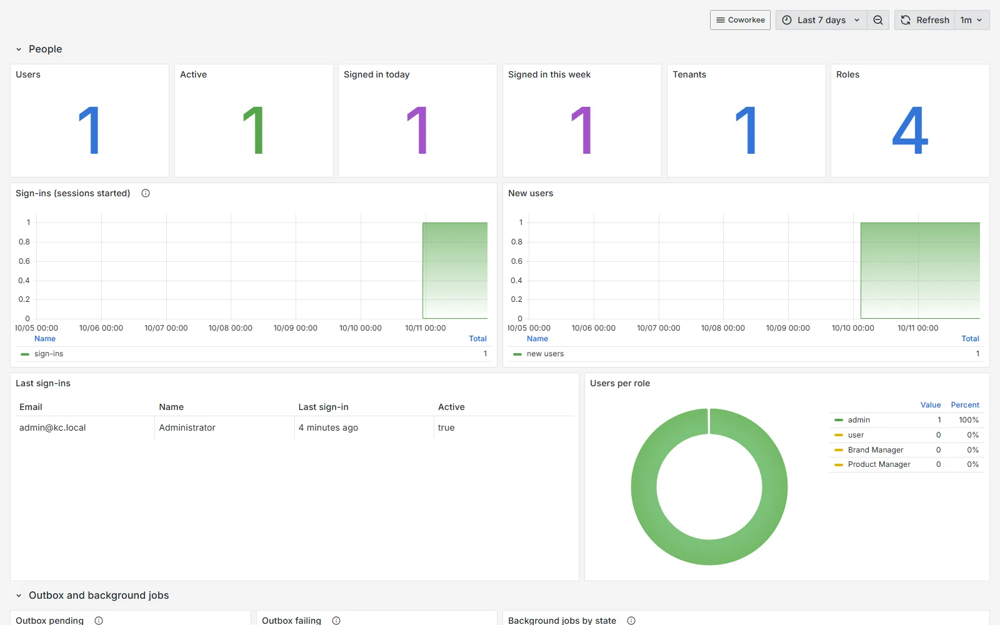
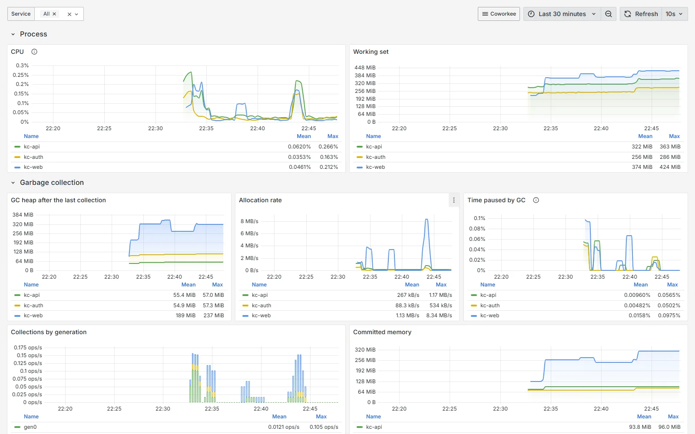
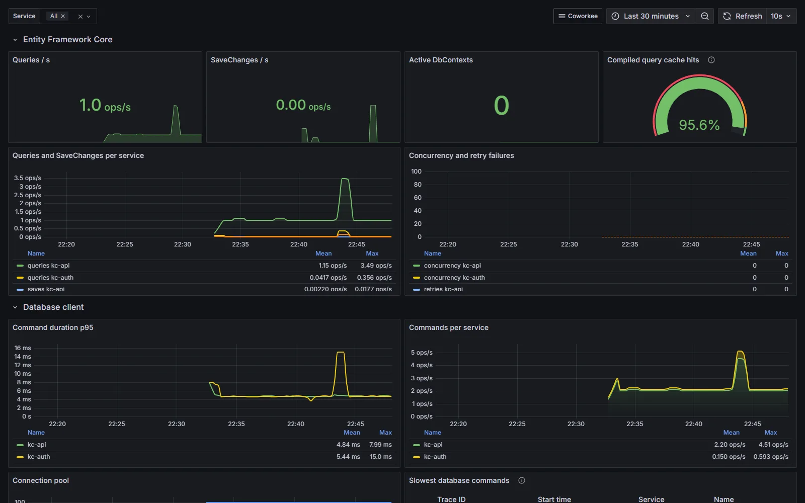
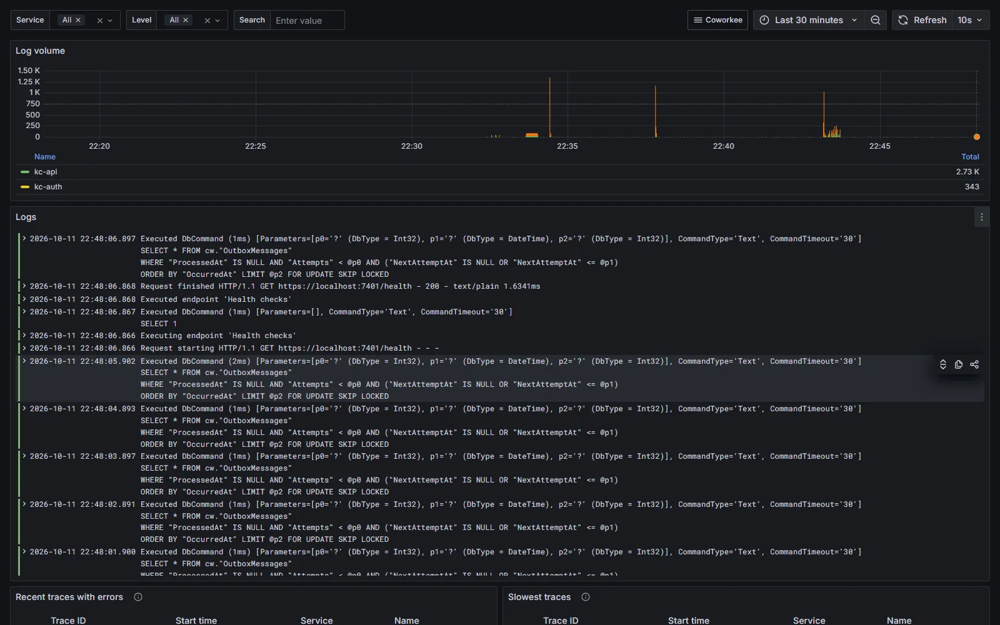
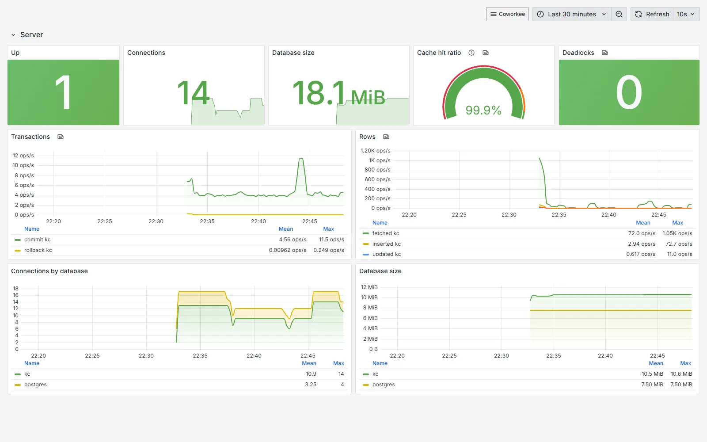
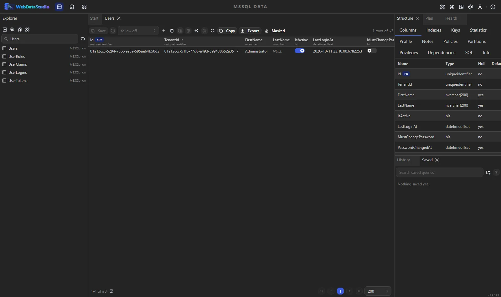

# Grafana und WebDataStudio

[{ .cw-product-logo }](https://fgilde.github.io/WebDataStudio/)

Zwei Entwicklungswerkzeuge laufen im Aspire-AppHost neben der App, in einer neuen App sind beide eingeschaltet:

- **Grafana** mit Prometheus, Loki, Tempo und einem OpenTelemetry-Collector: Metriken, Logs und Traces jedes Dienstes, die App-Datenbank und fertige Dashboards.
- **WebDataStudio**: die App-Datenbank im Browser, mit Tabellen, SQL, Diagrammen und Exporten.

Beide melden sich mit dem Administrator der App an (dieselbe E-Mail und dasselbe Passwort wie in der App, siehe `LOGIN.md`) und die Administratoren der Systemorganisation zusätzlich am Auth-Server der App (über [Keycloak](../security/authentication.md), wenn es aktiv ist). Sie kommen aus den Paketen `Nextended.Aspire.Hosting.Grafana` und `Nextended.Aspire.Hosting.WebDataStudio`, die `Coworkee.Aspire` mitbringt.



## Was du bekommst

| Ressource | Aufgabe |
|---|---|
| `grafana` | Grafana mit den Datenquellen Prometheus, Loki, Tempo und *App database* und den Dashboards in einem Ordner mit dem Namen der App |
| `prometheus` | Metriken der Dienste, vom Collector geschickt (7 Tage) |
| `loki` | Logs der Dienste |
| `tempo` | Traces der Dienste, mit Verweisen auf ihre Logs |
| `otel-collector` | nimmt OTLP der Dienste an und gibt es an die drei weiter |
| `postgres-exporter` | Metriken des Postgres-Servers (nur mit Postgres) |
| `webdatastudio` | WebDataStudio mit der Verbindung `MYAPP` zur App-Datenbank |

Die Dienste senden weiter an das Aspire-Dashboard; die generierten Service-Defaults schicken dieselben Metriken, Logs und Traces zusätzlich an den Collector (Einstellung `GRAFANA_OTLP_ENDPOINT`, die der AppHost setzt). Außerdem erfassen sie die Meter von Entity Framework Core und Npgsql.

### Dashboards

| Dashboard | Inhalt |
|---|---|
| Overview | Anfragen pro Sekunde, Server- und Client-Fehler, p95-Latenz, laufende Anfragen, Echtzeitverbindungen (SignalR); Verkehr, Statuscodes und Latenz je Dienst; meistgenutzte und langsamste Endpunkte; ausgehende Aufrufe; Log-Volumen, langsamste Traces, Warnungen und Fehler |
| .NET runtime | CPU, Working Set, GC-Heap, Allokationsrate, GC-Pausen und -Sammlungen, Threadpool, Lock-Konflikte, Ausnahmen nach Typ, JIT |
| Database access | Abfragen, SaveChanges und aktive Kontexte von Entity Framework Core, Cache kompilierter Abfragen, Konkurrenz- und Wiederholungsfehler; Befehlsdauer, Verbindungspool, langsamste Datenbank-Spans |
| PostgreSQL server | Verbindungen, Größe, Cache-Trefferquote, Deadlocks, Transaktionen und Zeilen je Datenbank (nur Postgres) |
| App data | Benutzer, aktive Benutzer, Anmeldungen heute und in dieser Woche, Mandanten, Rollen, Anmeldungen und neue Benutzer im Zeitverlauf, letzte Anmeldungen, Benutzer je Rolle, offene und fehlschlagende Outbox-Nachrichten, Ereignisse durch die Outbox, Hintergrundjobs nach Status, offene und fehlgeschlagene Jobs (Postgres und SQL Server) |
| Logs and traces | alle Logs mit Filtern für Dienst, Level und Text, Log-Volumen je Dienst, Traces mit Fehlern, langsamste Traces |

Jedes Dashboard filtert nach Dienst und verweist auf die anderen. Sie werden bei jedem Start bereitgestellt: Speichere eine Kopie (*Save as*), wenn du eine eigene Fassung behalten willst.













## Anmeldung

| | Lokale Anmeldung | Auth-Server der App |
|---|---|---|
| Grafana | E-Mail und Passwort des Administrators, als Grafana-Server-Admin | *Sign in with MyApp*: Administratoren der Systemorganisation, als Grafana-Admins |
| WebDataStudio | E-Mail und Passwort des Administrators, als Studio-Admin | der Knopf der App: Administratoren der Systemorganisation, als Studio-Admins |

Der generierte AppHost nimmt den Administrator aus `src/MyApp.Migrations/DemoUsers.cs`, der Datei, die auch der Seed und der Keycloak-Realm lesen:

```csharp
var administrator = DemoUsers.All.First(u => u.IsAdmin);
options.Administrator = new(administrator.Email, administrator.Password);
```

Ohne `options.Administrator` bekommen beide Werkzeuge den Benutzer `admin` mit einem generierten Passwort: dem Parameter `myapp-admin-password` im Aspire-Dashboard.

Mit einem Auth-Server im AppHost bekommt jedes Werkzeug einen vertraulichen Client bei ihm (`myapp-grafana`, `myapp-webdatastudio`) mit seiner Weiterleitungsadresse, nicht im Launcher sichtbar. Der Auth-Server lässt nur Administratoren der Systemorganisation durch (`SystemAdministratorsOnly`), alle anderen bekommen `access_denied`; wer auf diesem Weg kommt, ist also Admin des Werkzeugs, und ein Benutzer des Auth-Servers mit der E-Mail des Administrators ist derselbe Grafana-Benutzer. Mit Keycloak leitet der Auth-Server wie bei der App zu Keycloak weiter; die Werkzeuge haben keine Clients im Realm. Die Container erreichen den Auth-Server über das Container-Netz, der Browser über seine eigene Adresse, siehe [Tools melden sich am Auth-Server an](aspire.md#tools-melden-sich-am-auth-server-an).

## Ein- und ausschalten

### CLI

Beide Optionen sind eingeschaltet, solange sie nicht abgeschaltet werden:

```bash
coworkee new Shop --grafana false --web-data-studio false
```

`coworkee options` beschreibt sie mit Vor- und Nachteilen.

### Studio

*Architektur* hat unter *Infrastruktur* je eine Karte; die Vorlagen *Business app*, *Collaboration*, *SaaS platform* und *Everything* schalten beide ein, *Local demo* nur WebDataStudio, *Minimal* keines. Die Container erscheinen in der Zusammenfassung rechts und auf der Prüfseite.

### Spec

```json
{
  "name": "Shop",
  "options": {
    "grafana": true,
    "webDataStudio": false
  }
}
```

### AppHost

In einer bestehenden App schalten die Zeilen in `src/MyApp.AppHost/AppHost.cs` die Werkzeuge; lösch eine Zeile (oder ruf `WithoutGrafana()` / `WithoutWebDataStudio()` auf), um das Werkzeug abzuschalten, und füg sie hinzu, um es einzuschalten:

```csharp
var app = builder.AddCoworkeeApp("myapp", options =>
{
    var administrator = DemoUsers.All.First(u => u.IsAdmin);
    options.Administrator = new(administrator.Email, administrator.Password);
    options.UseGrafana();
    options.UseWebDataStudio();
});
```

`DemoUsers` braucht `using MyApp.Migrations;`. Beide Aufrufe nehmen einen Callback für die Ressource, z. B. `options.UseGrafana(grafana => grafana.WithDataVolume())` oder `options.UseWebDataStudio(studio => studio.WithReadOnly())`; danach sind `app.Grafana` und `app.WebDataStudio` die Resource-Builder.

Eine App, die vor diesen Optionen erzeugt wurde, braucht außerdem den zweiten Exporter in `MyApp.ServiceDefaults/Extensions.cs`, damit Grafana ihre Telemetrie bekommt:

```csharp
if (builder.Configuration["GRAFANA_OTLP_ENDPOINT"] is { Length: > 0 } grafana)
{
    // ein deployter Collector nimmt OTLP über HTTP, mit einem eigenen Pfad je Signal
    var http = builder.Configuration["GRAFANA_OTLP_PROTOCOL"] == "http/protobuf";
    Action<OtlpExporterOptions> Grafana(string signal) => o => (o.Endpoint, o.Protocol, o.Headers) = http
        ? (new Uri($"{grafana.TrimEnd('/')}/v1/{signal}"), OtlpExportProtocol.HttpProtobuf, string.Empty)
        : (new Uri(grafana), OtlpExportProtocol.Grpc, string.Empty);
    telemetry.WithLogging(l => l.AddOtlpExporter("grafana-logs", Grafana("logs"))).WithMetrics(m => m.AddOtlpExporter("grafana-metrics", Grafana("metrics")))
        .WithTracing(t => t.AddOtlpExporter("grafana-traces", Grafana("traces")));
}
```

`GRAFANA_OTLP_PROTOCOL` ist in einem Deployment `http/protobuf` (lokal gRPC). `telemetry` ist dabei der Builder von `builder.Services.AddOpenTelemetry()`, und der Exporter für das Aspire-Dashboard wird je Signal angehängt (`AddOtlpExporter()`) statt mit `UseOtlpExporter()`, das sich nicht mit einem zweiten Exporter verträgt.


## SigNoz

[{ .cw-product-logo }](https://signoz.io/)

`options.UseSigNoz()` fügt [SigNoz](https://signoz.io/) neben Grafana oder statt Grafana hinzu: Traces, Metriken und Logs jedes Dienstes in einer Oberfläche, mit Dashboards und Alerts. Standardmäßig ist es aus, weil sein ClickHouse 1–2 GB Speicher braucht. Es kommt aus dem Paket `Nextended.Aspire.Hosting.SigNoz`, das `Coworkee.Aspire` mitbringt.

```csharp
var app = builder.AddCoworkeeApp("myapp", options =>
{
    options.UseGrafana();      // bleibt der Standard
    options.UseSigNoz();       // optional, beide laufen auch zusammen
});
```

| Ressource | Aufgabe |
|---|---|
| `signoz` | SigNoz (Oberfläche, API, Alerts); legt bei jedem Start seinen Admin, die Dashboards und die Alert-Regeln an |
| `signoz-collector` | nimmt OTLP der Dienste an und schreibt nach ClickHouse |
| `signoz-clickhouse` | der Telemetriespeicher, mit ClickHouse Keeper darin (kein ZooKeeper-Container) |
| `signoz-signin` | oauth2-proxy vor SigNoz: die Anmeldung am Auth-Server der App (Apps mit Auth-Server) |

Die Dienste senden weiter an das Aspire-Dashboard und an Grafana. Die Service-Defaults senden dieselbe Telemetrie zusätzlich an SigNoz, über die Einstellungen `SIGNOZ_OTLP_ENDPOINT` und `SIGNOZ_OTLP_PROTOCOL`, die der App-Host nur setzt, wenn SigNoz läuft. Ohne `UseSigNoz()` startet davon nichts, und die Dienste exportieren nichts zusätzlich.

**Dashboards** (Tag `stack:aspire`, jedes nach Dienst filterbar):

- *HTTP services*: Anfragen, Fehlerquote und p50/p95/p99-Latenz je Dienst, Statuscodes, Routen, langsamste Endpunkte, ausgehende Aufrufe
- *.NET runtime*: CPU, Speicher, GC, Thread-Pool, Ausnahmen, Locks, JIT
- *Database calls*: Aufrufe, Latenz und Fehler je Dienst, langsamste Statements, Verbindungspool
- *Logs and traces*: Logs nach Level, die neuesten Fehler und fehlgeschlagenen Spans

**Alert-Regeln**: HTTP-Fehlerquote über 5 %, HTTP-p95 über 1 s, Datenbank-p95 über 500 ms, Fehler-Logs, Thread-Pool-Warteschlange. Die Regeln laufen über die Benachrichtigungsrichtlinien von SigNoz und schlagen deshalb sofort in der Oberfläche an. Wer benachrichtigt werden will, legt unter *Alerts → Configuration* einen Kanal und eine Richtlinie an.

Dashboards und Regeln werden angelegt, wenn sie fehlen. Ein gelöschtes kommt beim nächsten Start zurück.

**Anmeldung.** Das eigene Single Sign-on von SigNoz (OIDC, SAML) gehört zur Enterprise-Edition. Deshalb stellt der App-Host wie bei Kibana einen oauth2-proxy davor. Der Browser meldet sich am Auth-Server der App an (über Keycloak, wenn es an ist), nur Administratoren der System-Organisation kommen durch, und SigNoz handelt für jeden von ihnen als sein Admin. SigNoz selbst hat dann keine öffentliche Adresse.

Der Admin von SigNoz ist der Administrator der App, wenn dessen Passwort der Regel von SigNoz genügt: 12 Zeichen mit Groß- und Kleinbuchstaben, einer Ziffer und einem Sonderzeichen. Das Passwort des Templates und das eines Deployments genügen ihr. Sonst ist der Admin `admin@signoz.local` mit dem erzeugten Parameter `signoz-password`.

`options.UseSigNoz(signoz => signoz.WithDashboards("./signoz"))` fügt eigene Dashboards hinzu; danach ist `app.SigNoz` der Resource-Builder. Eine App, die vor dieser Option entstanden ist, braucht den SigNoz-Exporter in `MyApp.ServiceDefaults/Extensions.cs` neben dem von Grafana (`coworkee update` weist darauf hin):

```csharp
if (builder.Configuration["SIGNOZ_OTLP_ENDPOINT"] is { Length: > 0 } signoz)
{
    var http = builder.Configuration["SIGNOZ_OTLP_PROTOCOL"] == "http/protobuf";
    Action<OtlpExporterOptions> SigNoz(string signal) => o => (o.Endpoint, o.Protocol, o.Headers) = http
        ? (new Uri($"{signoz.TrimEnd('/')}/v1/{signal}"), OtlpExportProtocol.HttpProtobuf, string.Empty)
        : (new Uri(signoz), OtlpExportProtocol.Grpc, string.Empty);
    telemetry.WithLogging(l => l.AddOtlpExporter("signoz-logs", SigNoz("logs"))).WithMetrics(m => m.AddOtlpExporter("signoz-metrics", SigNoz("metrics")))
        .WithTracing(t => t.AddOtlpExporter("signoz-traces", SigNoz("traces")));
}
```

Einschalten geht auf jedem dieser Wege:

- `coworkee new Shop --signoz true`
- `coworkee add signoz`
- die Karte *SigNoz* in der Gruppe *Infrastructure* des Studios
- `"signoz": true` in einer Spec

!!! note "In einem Deployment"
    `coworkee deploy` nimmt SigNoz wie Grafana mit; `--without signoz` lässt es weg.

    - Konfiguration, Dashboards und Alert-Regeln stecken in den Images.
    - ClickHouse und SigNoz bekommen Volumes (`<app>-signoz-clickhouse-data`, `<app>-signoz-data`), der Proxy bekommt eine öffentliche Adresse.
    - Auf Azure bekommt ClickHouse kein Volume: Azure Files über SMB erlaubt weder Dateizeiten zu setzen noch Hardlinks, die Inserts scheitern. Die Telemetrie liegt im Container und ist nach einem Neustart weg; behalten ließe sie sich mit einer NFS-Freigabe (Premium-Storage, Umgebung in einem VNet).
    - Auf Azure bekommt ClickHouse 1 CPU und 2 GiB.
    - ClickHouse ist auf TCP 29000 veröffentlicht (19000 reserviert Container Apps) und der Collector nimmt OTLP über HTTP auf 14318 an, damit beide Stacks in eine Container-Apps-Umgebung passen.

## Datenbanken

| Datenbank | Grafana | WebDataStudio |
|---|---|---|
| Postgres | Datenquelle *App database*, postgres_exporter, alle Dashboards | Verbindung zur Datenbank |
| SQL Server | Datenquelle *App database* (Benutzer `sa`), alle Dashboards außer *PostgreSQL server* | Verbindung zur Datenbank |
| SQLite | keine Datenbank-Datenquelle und kein Dashboard *App data* | die Datenbankdatei, aus `.data` eingebunden |
| `UseDatabase(...)` | keine Datenbank-Datenquelle | Verbindung mit dem übergebenen Connection-String |

!!! note "In einem Deployment"
    Beide Werkzeuge kommen mit `coworkee deploy` mit: Grafanas Konfiguration und die Dashboards der App stecken in seinen Images, WebDataStudio bekommt ein Volume, beide eine öffentliche Adresse hinter deinem Proxy und den Administrator aus den Deploy-Parametern (und die Anmeldung am Auth-Server). `coworkee deploy --without grafana` oder `DeployTool(CoworkeeTools.Grafana, false)` lässt eins weg, siehe [Deployment](deployment.md#tools). Generierte Konfigurationen landen in `src/MyApp.AppHost/observability/.generated` (von git ignoriert).
