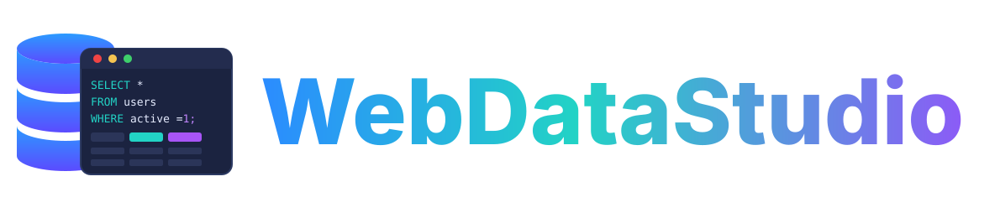
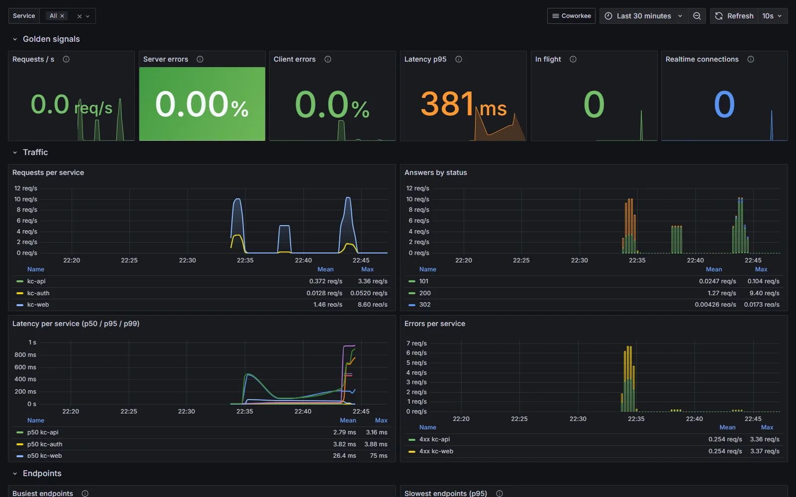
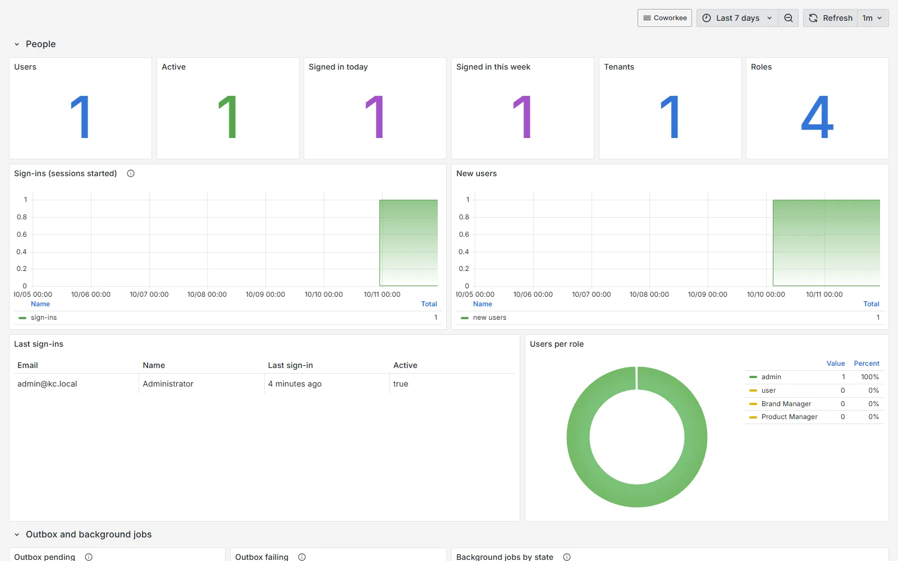
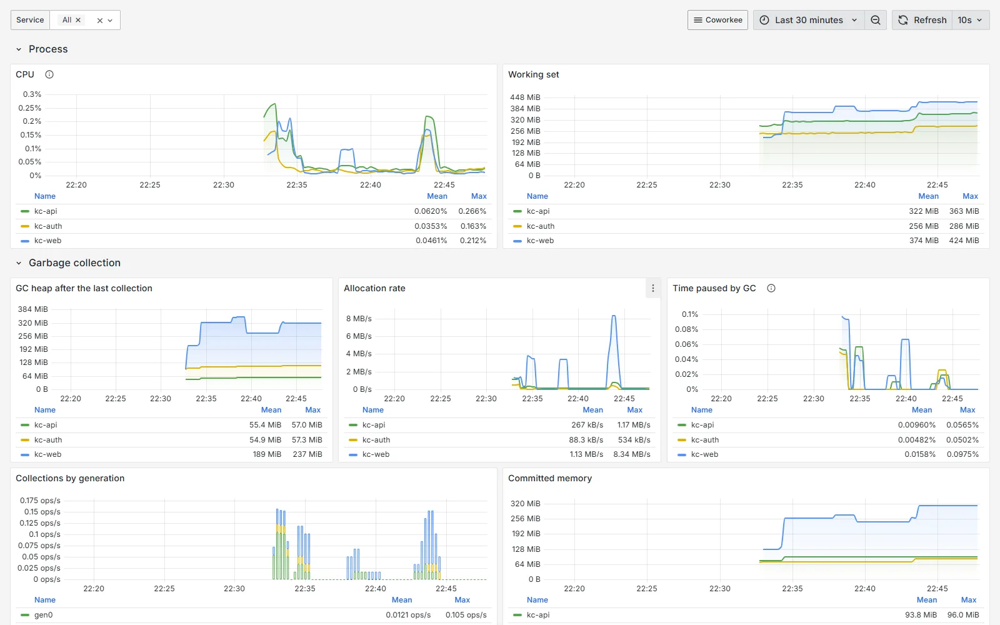
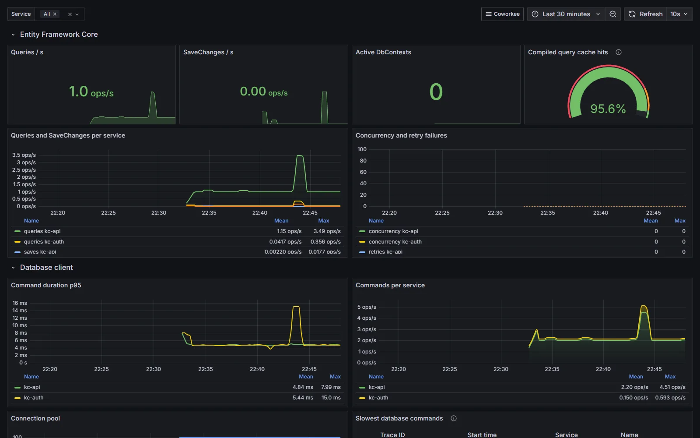
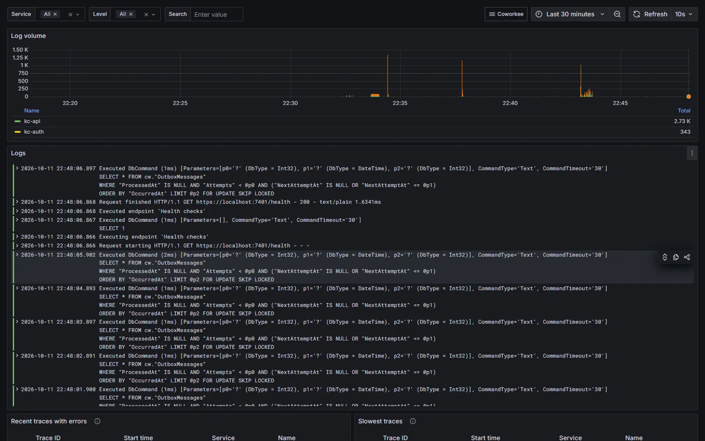
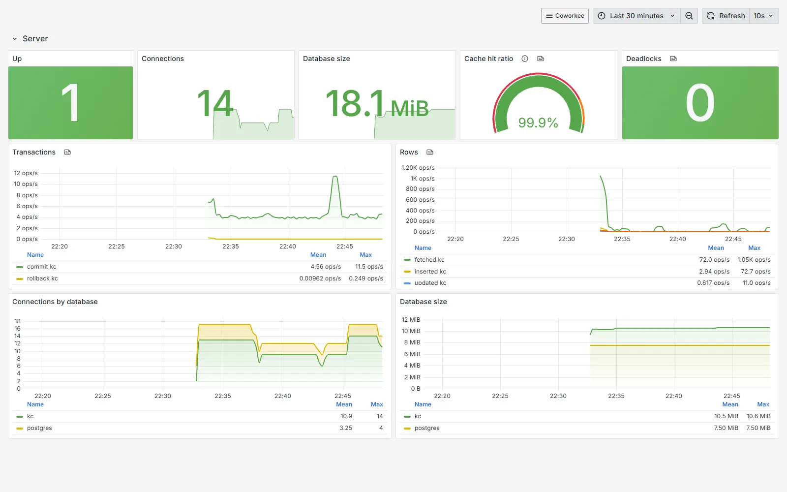
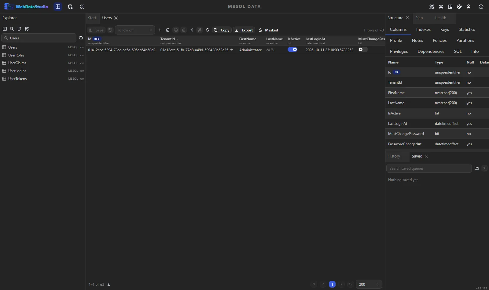

# Grafana and WebDataStudio

[{ .cw-product-logo }](https://fgilde.github.io/WebDataStudio/)

Two development tools run next to the app in the Aspire app host, both on by default in a new app:

- **Grafana** with Prometheus, Loki, Tempo and an OpenTelemetry collector: the metrics, logs and traces of every service, the app database and ready dashboards.
- **WebDataStudio**: the app database in the browser, with tables, SQL, charts and exports.

Both sign in with the app's administrator (the same email and password as in the app, see `LOGIN.md`) and the administrators of the system tenant also at the app's auth server (through [Keycloak](../security/authentication.md) when it is on). They come from the packages `Nextended.Aspire.Hosting.Grafana` and `Nextended.Aspire.Hosting.WebDataStudio`, which `Coworkee.Aspire` brings along.



## What you get

| Resource | What it does |
|---|---|
| `grafana` | Grafana with the datasources Prometheus, Loki, Tempo and *App database*, and the dashboards in a folder named after the app |
| `prometheus` | metrics of the services, sent by the collector (7 days) |
| `loki` | logs of the services |
| `tempo` | traces of the services, with links to their logs |
| `otel-collector` | receives OTLP from the services and hands it to the three |
| `postgres-exporter` | Postgres server metrics (with Postgres only) |
| `webdatastudio` | WebDataStudio with the connection `MYAPP` to the app database |

The services keep sending to the Aspire dashboard; the generated service defaults send the same metrics, logs and traces to the collector as well (setting `GRAFANA_OTLP_ENDPOINT`, which the app host sets). They also record the meters of Entity Framework Core and Npgsql.

### Dashboards

| Dashboard | Content |
|---|---|
| Overview | requests per second, server and client errors, p95 latency, requests in flight, realtime (SignalR) connections; traffic, status codes and latency per service; busiest and slowest endpoints; outgoing calls; log volume, slowest traces, warnings and errors |
| .NET runtime | CPU, working set, GC heap, allocation rate, GC pauses and collections, thread pool, lock contention, exceptions by type, JIT |
| Database access | Entity Framework Core queries, SaveChanges, active contexts, compiled query cache, concurrency and retry failures; command duration, connection pool, slowest database spans |
| PostgreSQL server | connections, size, cache hit ratio, deadlocks, transactions and rows per database (Postgres only) |
| App data | users, active users, sign-ins today and this week, tenants, roles, sign-ins and new users over time, last sign-ins, users per role, outbox pending and failing, events through the outbox, background jobs by state, open and failed jobs (Postgres and SQL Server) |
| Logs and traces | all logs with service, level and text filters, log volume per service, traces with errors, slowest traces |

Every dashboard filters by service and links to the others. They are provisioned on every start: change a copy (*Save as*) if you want to keep your own version.













## Signing in

| | Local login | The app's auth server |
|---|---|---|
| Grafana | the administrator's email and password, as Grafana server admin | *Sign in with MyApp*: administrators of the system tenant, as Grafana admins |
| WebDataStudio | the administrator's email and password, as studio admin | the app's button: administrators of the system tenant, as studio admins |

The generated app host takes the administrator from `src/MyApp.Migrations/DemoUsers.cs`, the file the seed and the Keycloak realm read too:

```csharp
var administrator = DemoUsers.All.First(u => u.IsAdmin);
options.Administrator = new(administrator.Email, administrator.Password);
```

Without `options.Administrator` both tools get the user `admin` with a generated password: the parameter `myapp-admin-password` in the Aspire dashboard.

With an auth server in the app host, each tool gets a confidential client of it (`myapp-grafana`, `myapp-webdatastudio`) with its redirect address, not shown in the launcher. The auth server lets only administrators of the system tenant through (`SystemAdministratorsOnly`), everybody else gets `access_denied`, so whoever comes that way is an admin of the tool; a user of the auth server with the administrator's email is the same Grafana user. With Keycloak on, the auth server sends you on to Keycloak as for the app; the tools have no clients in the realm. The containers reach the auth server over the container network and the browser at its own address, see [Tools sign in at the auth server](aspire.md#tools-sign-in-at-the-auth-server).

## Switching them on and off

### CLI

Both options are on unless switched off:

```bash
coworkee new Shop --grafana false --web-data-studio false
```

`coworkee options` describes them with pros and cons.

### Studio

*Architecture* has a card for each in *Infrastructure*; the presets *Business app*, *Collaboration*, *SaaS platform* and *Everything* switch both on, *Local demo* only WebDataStudio, *Minimal* neither. The containers show up in the summary on the right and on the review page.

### Spec

```json
{
  "name": "Shop",
  "options": {
    "grafana": true,
    "webDataStudio": false
  }
}
```

### App host

In an existing app, the lines in `src/MyApp.AppHost/AppHost.cs` are what switches them; delete a line (or call `WithoutGrafana()` / `WithoutWebDataStudio()`) to turn the tool off, add it to turn it on:

```csharp
var app = builder.AddCoworkeeApp("myapp", options =>
{
    var administrator = DemoUsers.All.First(u => u.IsAdmin);
    options.Administrator = new(administrator.Email, administrator.Password);
    options.UseGrafana();
    options.UseWebDataStudio();
});
```

`DemoUsers` needs `using MyApp.Migrations;`. Both calls take a callback for the resource, e.g. `options.UseGrafana(grafana => grafana.WithDataVolume())` or `options.UseWebDataStudio(studio => studio.WithReadOnly())`; afterwards `app.Grafana` and `app.WebDataStudio` are the resource builders.

An app created before these options also needs the second exporter in `MyApp.ServiceDefaults/Extensions.cs` to fill Grafana with its telemetry:

```csharp
if (builder.Configuration["GRAFANA_OTLP_ENDPOINT"] is { Length: > 0 } grafana)
{
    // a deployed collector takes OTLP over HTTP, where each signal has its own path
    var http = builder.Configuration["GRAFANA_OTLP_PROTOCOL"] == "http/protobuf";
    Action<OtlpExporterOptions> Grafana(string signal) => o => (o.Endpoint, o.Protocol, o.Headers) = http
        ? (new Uri($"{grafana.TrimEnd('/')}/v1/{signal}"), OtlpExportProtocol.HttpProtobuf, string.Empty)
        : (new Uri(grafana), OtlpExportProtocol.Grpc, string.Empty);
    telemetry.WithLogging(l => l.AddOtlpExporter("grafana-logs", Grafana("logs"))).WithMetrics(m => m.AddOtlpExporter("grafana-metrics", Grafana("metrics")))
        .WithTracing(t => t.AddOtlpExporter("grafana-traces", Grafana("traces")));
}
```

`GRAFANA_OTLP_PROTOCOL` is `http/protobuf` in a deployment (gRPC while running). Here `telemetry` is the `builder.Services.AddOpenTelemetry()` builder, and the Aspire dashboard exporter is added per signal (`AddOtlpExporter()`) instead of `UseOtlpExporter()`, which cannot be combined with a second exporter.


## SigNoz

[{ .cw-product-logo }](https://signoz.io/)

`options.UseSigNoz()` adds [SigNoz](https://signoz.io/) next to Grafana or instead of it: traces, metrics and logs of every service in one UI, with dashboards and alerts. It is off by default, because its ClickHouse needs 1–2 GB of memory. It comes from the package `Nextended.Aspire.Hosting.SigNoz`, which `Coworkee.Aspire` brings along.

```csharp
var app = builder.AddCoworkeeApp("myapp", options =>
{
    options.UseGrafana();      // stays the default
    options.UseSigNoz();       // opt-in, both can run together
});
```

| Resource | What it does |
|---|---|
| `signoz` | SigNoz (UI, API, alerts); creates its admin, the dashboards and the alert rules on every start |
| `signoz-collector` | receives OTLP from the services and writes to ClickHouse |
| `signoz-clickhouse` | the telemetry store, with ClickHouse Keeper inside (no ZooKeeper container) |
| `signoz-signin` | oauth2-proxy in front of SigNoz: the sign-in at the app's auth server (apps with an auth server) |

The services keep sending to the Aspire dashboard and Grafana. The service defaults send the same telemetry to SigNoz as well, through the settings `SIGNOZ_OTLP_ENDPOINT` and `SIGNOZ_OTLP_PROTOCOL`, which the app host sets only when SigNoz runs. Without `UseSigNoz()` none of it starts and the services export nothing extra.

**Dashboards** (tag `stack:aspire`, each filtered by service):

- *HTTP services*: requests, error rate and p50/p95/p99 latency per service, status codes, routes, slowest endpoints, outgoing calls
- *.NET runtime*: CPU, memory, GC, thread pool, exceptions, locks, JIT
- *Database calls*: calls, latency and failures per service, slowest statements, connection pool
- *Logs and traces*: logs by level, the latest errors and failed spans

**Alert rules**: HTTP error rate above 5%, HTTP p95 above 1 s, database p95 above 500 ms, error logs, thread pool queue. The rules go through SigNoz's notification policies, so they fire in the UI right away. To get notified, add a channel and a policy under *Alerts → Configuration*.

Dashboards and rules are created when missing. A deleted one comes back on the next start.

**Signing in.** SigNoz's own single sign-on (OIDC, SAML) is part of its enterprise edition. So the app host puts oauth2-proxy in front of it, as it does for Kibana. The browser signs in at the app's auth server (through Keycloak when it is on), only administrators of the system tenant get through, and SigNoz acts as its admin for each of them. SigNoz itself then has no public address.

SigNoz's admin user is the app's administrator when the password meets SigNoz's rule: 12 characters with upper and lower case, a digit and a symbol. The template's password and a deployment's meet it. Otherwise the admin is `admin@signoz.local` with the generated parameter `signoz-password`.

`options.UseSigNoz(signoz => signoz.WithDashboards("./signoz"))` adds dashboards of your own; afterwards `app.SigNoz` is the resource builder. An app created before this option needs the SigNoz exporter in `MyApp.ServiceDefaults/Extensions.cs`, next to the Grafana one (`coworkee update` points at it):

```csharp
if (builder.Configuration["SIGNOZ_OTLP_ENDPOINT"] is { Length: > 0 } signoz)
{
    var http = builder.Configuration["SIGNOZ_OTLP_PROTOCOL"] == "http/protobuf";
    Action<OtlpExporterOptions> SigNoz(string signal) => o => (o.Endpoint, o.Protocol, o.Headers) = http
        ? (new Uri($"{signoz.TrimEnd('/')}/v1/{signal}"), OtlpExportProtocol.HttpProtobuf, string.Empty)
        : (new Uri(signoz), OtlpExportProtocol.Grpc, string.Empty);
    telemetry.WithLogging(l => l.AddOtlpExporter("signoz-logs", SigNoz("logs"))).WithMetrics(m => m.AddOtlpExporter("signoz-metrics", SigNoz("metrics")))
        .WithTracing(t => t.AddOtlpExporter("signoz-traces", SigNoz("traces")));
}
```

To switch it on, use any of:

- `coworkee new Shop --signoz true`
- `coworkee add signoz`
- the card *SigNoz* in the Studio's *Infrastructure* group
- `"signoz": true` in a spec

!!! note "In a deployment"
    `coworkee deploy` takes SigNoz along like Grafana; `--without signoz` leaves it out.

    - Its configuration, dashboards and alert rules are built into the images.
    - ClickHouse and SigNoz get volumes (`<app>-signoz-clickhouse-data`, `<app>-signoz-data`), and the proxy gets a public address.
    - On Azure, ClickHouse gets no volume: Azure Files over SMB lets it neither set file times nor make hard links, so its inserts fail. The telemetry lives in the container and is gone after a restart; keeping it needs an NFS share (premium storage, an environment in a VNet).
    - On Azure, ClickHouse gets 1 CPU and 2 GiB.
    - ClickHouse is published on TCP 29000 (Container Apps reserves 19000) and the collector takes OTLP over HTTP on 14318, so both stacks fit into one Container Apps environment.

## Databases

| Database | Grafana | WebDataStudio |
|---|---|---|
| Postgres | datasource *App database*, postgres_exporter, all dashboards | connection to the database |
| SQL Server | datasource *App database* (user `sa`), all dashboards but *PostgreSQL server* | connection to the database |
| SQLite | no database datasource and no *App data* dashboard | the database file, mounted from `.data` |
| `UseDatabase(...)` | no database datasource | connection with the supplied connection string |

!!! note "In a deployment"
    Both tools go along with `coworkee deploy`: Grafana's configuration and the app's dashboards are built into its images, WebDataStudio gets a volume, both get a public address behind your proxy and the administrator of the deploy parameters (and the sign-in at the auth server). `coworkee deploy --without grafana` or `DeployTool(CoworkeeTools.Grafana, false)` leaves one out, see [Deployment](deployment.md#tools). Generated configs land in `src/MyApp.AppHost/observability/.generated` (ignored by git).
