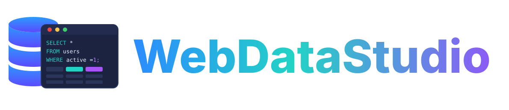
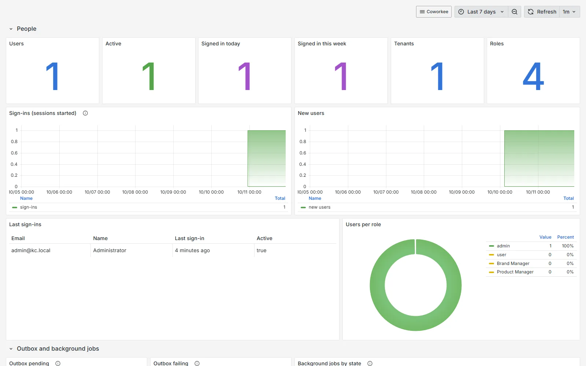
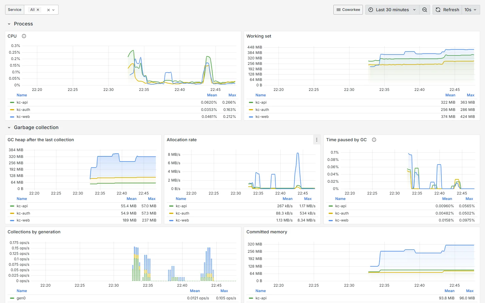
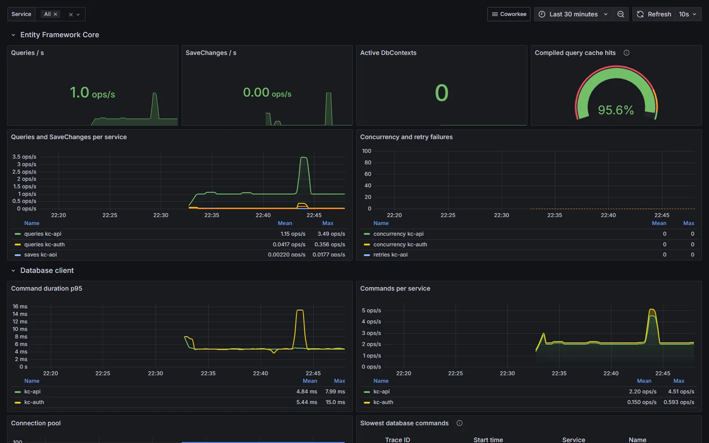
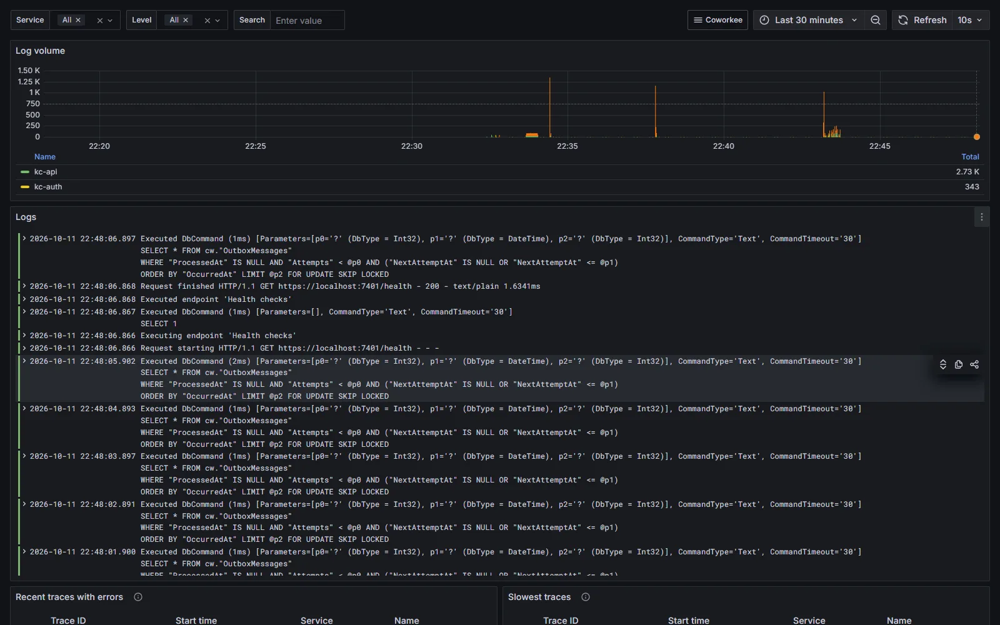
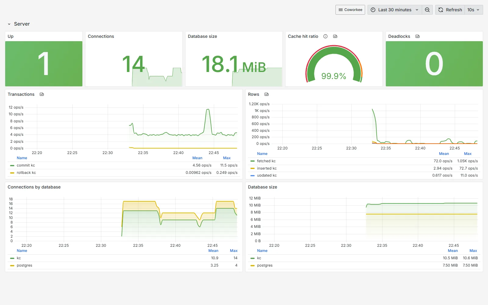

# Grafana and WebDataStudio

[{ .cw-product-logo }](https://fgilde.github.io/WebDataStudio/)

Two development tools run next to the app in the Aspire app host, both on by default in a new app:

- **Grafana** with Prometheus, Loki, Tempo and an OpenTelemetry collector: the metrics, logs and traces of every service, the app database and ready dashboards.
- **WebDataStudio**: the app database in the browser, with tables, SQL, charts and exports.

Both sign in with the app's administrator (the same email and password as in the app, see `LOGIN.md`) and, when [Keycloak](../security/authentication.md) is on, with the Keycloak button as well. They come from the packages `Nextended.Aspire.Hosting.Grafana` and `Nextended.Aspire.Hosting.WebDataStudio`, which `Coworkee.Aspire` brings along.


## What you get

| Resource | What it does |
|---|---|
| `grafana` | Grafana with the datasources Prometheus, Loki, Tempo and *App database*, and the dashboards in a folder named after the app |
| `prometheus` | metrics of the services, sent by the collector (7 days) |
| `loki` | logs of the services |
| `tempo` | traces of the services, with links to their logs |
| `otel-collector` | receives OTLP from the services and hands it to the three |
| `postgres-exporter` | Postgres server metrics (with Postgres only) |
| `webdatastudio` | WebDataStudio with the connection `MYAPP` to the app database |

The services keep sending to the Aspire dashboard; the generated service defaults send the same metrics, logs and traces to the collector as well (setting `GRAFANA_OTLP_ENDPOINT`, which the app host sets). They also record the meters of Entity Framework Core and Npgsql.

### Dashboards

| Dashboard | Content |
|---|---|
| Overview | requests per second, server and client errors, p95 latency, requests in flight, realtime (SignalR) connections; traffic, status codes and latency per service; busiest and slowest endpoints; outgoing calls; log volume, slowest traces, warnings and errors |
| .NET runtime | CPU, working set, GC heap, allocation rate, GC pauses and collections, thread pool, lock contention, exceptions by type, JIT |
| Database access | Entity Framework Core queries, SaveChanges, active contexts, compiled query cache, concurrency and retry failures; command duration, connection pool, slowest database spans |
| PostgreSQL server | connections, size, cache hit ratio, deadlocks, transactions and rows per database (Postgres only) |
| App data | users, active users, sign-ins today and this week, tenants, roles, sign-ins and new users over time, last sign-ins, users per role, outbox pending and failing, events through the outbox, background jobs by state, open and failed jobs (Postgres and SQL Server) |
| Logs and traces | all logs with service, level and text filters, log volume per service, traces with errors, slowest traces |

Every dashboard filters by service and links to the others. They are provisioned on every start: change a copy (*Save as*) if you want to keep your own version.












## Signing in

| | Local login | Keycloak |
|---|---|---|
| Grafana | the administrator's email and password, as Grafana server admin | *Sign in with Keycloak*: realm role `Administrator` (or the administrator's email) becomes Grafana server admin, everybody else Viewer |
| WebDataStudio | the administrator's email and password, as studio admin | *Keycloak*: realm role `Administrator` (or the administrator's email) becomes studio admin, everybody else viewer |

The generated app host takes the administrator from `src/MyApp.Migrations/DemoUsers.cs`, the file the seed and the Keycloak realm read too:

```csharp
var administrator = DemoUsers.All.First(u => u.IsAdmin);
options.Administrator = new(administrator.Email, administrator.Password);
```

Without `options.Administrator` both tools get the user `admin` with a generated password: the parameter `myapp-admin-password` in the Aspire dashboard.

With Keycloak, the app host registers the clients `myapp-grafana` and `myapp-webdatastudio` in the app's realm with their redirect addresses, and gives the realm users their realm roles (`KeycloakUser.Roles`; the generated app host adds `Administrator` for users with `IsAdmin`). Every client of the realm gets the roles in the `roles` claim. The containers reach Keycloak over the container network, the browser through its own address: Keycloak then names itself by the browser's address (`KC_HOSTNAME`), so all tokens carry the same issuer.

## Switching them on and off

### CLI

Both options are on unless switched off:

```bash
coworkee new Shop --grafana false --web-data-studio false
```

`coworkee options` describes them with pros and cons.

### Studio

*Architecture* has a card for each in *Infrastructure*; the presets *Business app*, *Collaboration*, *SaaS platform* and *Everything* switch both on, *Local demo* only WebDataStudio, *Minimal* neither. The containers show up in the summary on the right and on the review page.

### Spec

```json
{
  "name": "Shop",
  "options": {
    "grafana": true,
    "webDataStudio": false
  }
}
```

### App host

In an existing app, the lines in `src/MyApp.AppHost/AppHost.cs` are what switches them; delete a line (or call `WithoutGrafana()` / `WithoutWebDataStudio()`) to turn the tool off, add it to turn it on:

```csharp
var app = builder.AddCoworkeeApp("myapp", options =>
{
    var administrator = DemoUsers.All.First(u => u.IsAdmin);
    options.Administrator = new(administrator.Email, administrator.Password);
    options.UseGrafana();
    options.UseWebDataStudio();
});
```

`DemoUsers` needs `using MyApp.Migrations;`. Both calls take a callback for the resource, e.g. `options.UseGrafana(grafana => grafana.WithDataVolume())` or `options.UseWebDataStudio(studio => studio.WithReadOnly())`; afterwards `app.Grafana` and `app.WebDataStudio` are the resource builders.

An app created before these options also needs the second exporter in `MyApp.ServiceDefaults/Extensions.cs` to fill Grafana with its telemetry:

```csharp
if (builder.Configuration["GRAFANA_OTLP_ENDPOINT"] is { Length: > 0 } grafana)
{
    void Grafana(OtlpExporterOptions o) => (o.Endpoint, o.Protocol, o.Headers) = (new Uri(grafana), OtlpExportProtocol.Grpc, string.Empty);
    telemetry.WithLogging(l => l.AddOtlpExporter("grafana", Grafana)).WithMetrics(m => m.AddOtlpExporter("grafana", Grafana)).WithTracing(t => t.AddOtlpExporter("grafana", Grafana));
}
```

Here `telemetry` is the `builder.Services.AddOpenTelemetry()` builder, and the Aspire dashboard exporter is added per signal (`AddOtlpExporter()`) instead of `UseOtlpExporter()`, which cannot be combined with a second exporter.

## Databases

| Database | Grafana | WebDataStudio |
|---|---|---|
| Postgres | datasource *App database*, postgres_exporter, all dashboards | connection to the database |
| SQL Server | datasource *App database* (user `sa`), all dashboards but *PostgreSQL server* | connection to the database |
| SQLite | no database datasource and no *App data* dashboard | the database file, mounted from `.data` |
| `UseDatabase(...)` | no database datasource | connection with the supplied connection string |

!!! note "Development only"
    Both tools are added in run mode only: `aspire publish` and `azd up` leave them out, because a deployment brings its own monitoring and should not expose a database studio with the administrator's password. Generated configs land in `src/MyApp.AppHost/observability/.generated` (ignored by git).
