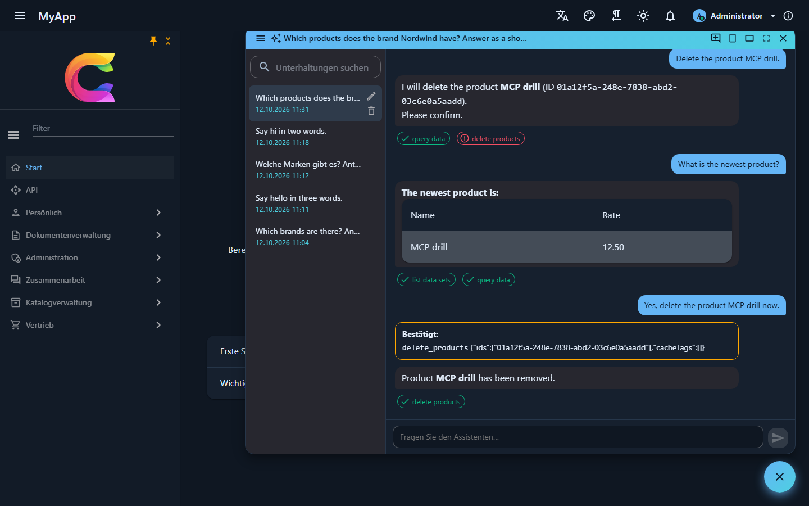
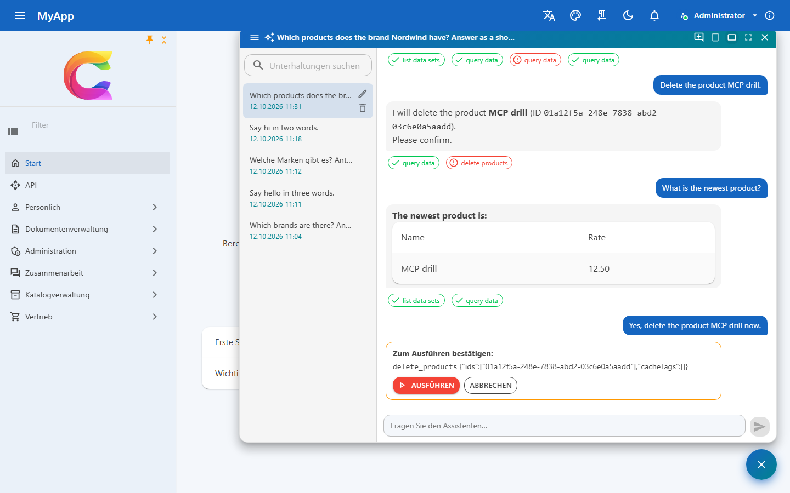
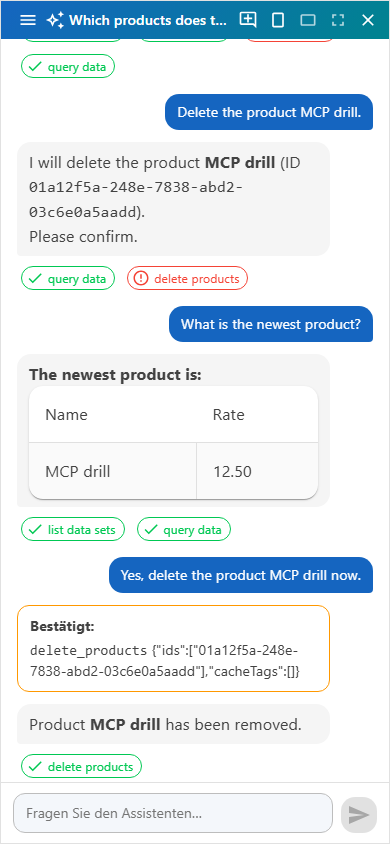
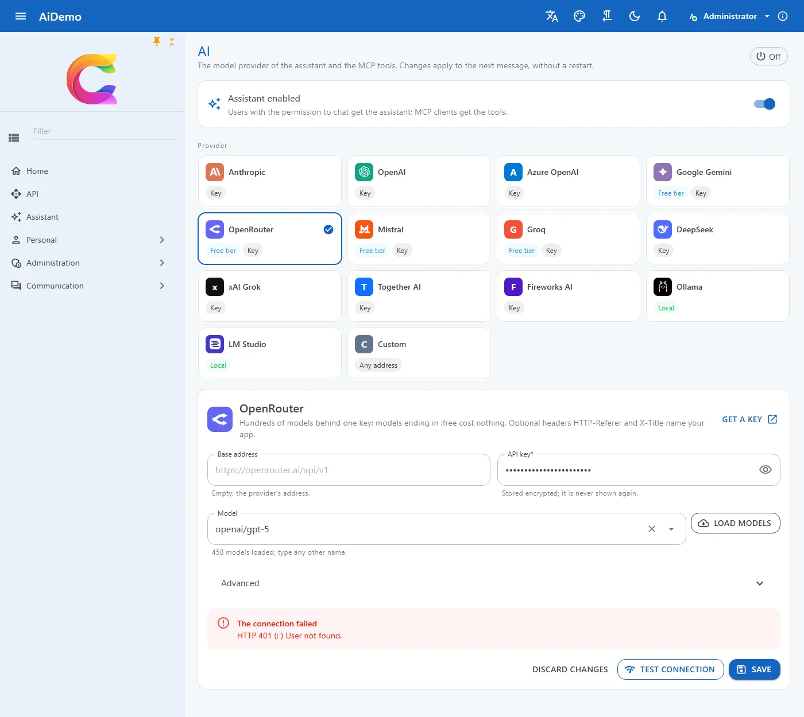
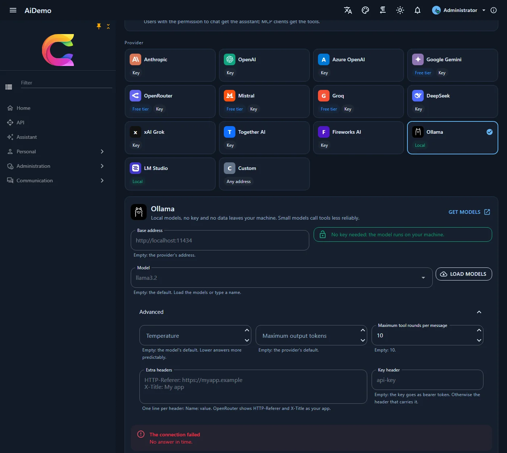

# KI-Assistent und MCP

`Coworkee.Ai` lässt ein Sprachmodell (Claude, GPT, ein lokales Modell über Ollama, ...) mit der App über dieselben Requests arbeiten, die auch die Oberfläche nutzt. Jedes Werkzeug ist ein Dispatcher-Request; Berechtigungen, Validierung und Audit gelten für den Assistenten genau wie für einen Menschen.

Neue Apps haben es (Option `ai` in Template und CLI, standardmäßig an); von Hand hängt ein Modul von `CoworkeeAiModule` ab (es braucht das Settings-Modul). Es bringt die Tabellen `cw.AiToolCalls` (Werkzeug-Audit), `cw.AiChatSessions` und `cw.AiChatMessages` (Unterhaltungen) mit: Migration anlegen. Mit dem Modul [Aufbewahrung](retention.md) legen `ai-tool-calls` und `ai-sessions` fest, wie lange sie bleiben.

## Werkzeuge

```csharp
services.AddAiTool<SearchAssetsQuery>("search_assets", "Finds assets by text, folder and tags.");
services.AddAiTool<TagAssetsCommand>("tag_assets", "Adds tags to assets.");
```

Auch ohne Registrierung wird jeder Request eines geladenen Moduls zum Werkzeug, der ein `Result` liefert und `[RequiresPermission]` oder `[AiTool]` trägt. Sein Name ist der Typname in Snake Case ohne `Command` oder `Query` (`GetBrandsQuery` → `get_brands`) oder `[AiTool(Name = ...)]`; seine Beschreibung ist `[AiTool("...")]`, sonst `[Description]`. `[AiTool(Exclude = true)]` hält einen Request heraus, zum Beispiel einen, der Berechtigungen ändert; Requests mit einer `Stream`- oder Datei-Eigenschaft sind nie Werkzeuge. Ein mit `AddAiTool` registrierter Request geht dem gefundenen vor.

```csharp
[RequiresPermission(CatalogPermissions.Brands.View)]
[Description("Lists brands, optionally filtered by name.")]
public sealed record GetBrandsQuery(string? Search) : IQuery<Result<IReadOnlyList<BrandDto>>>;
```

Ein Benutzer bekommt die Werkzeuge nur mit `Ai.Chat` und jedes Werkzeug nur mit jeder Berechtigung, die seine `[RequiresPermission]`-Attribute nennen (bei mehreren Attributen: alle). Der Request-Typ wird zum Eingabeschema des Werkzeugs, das `Result` zu seiner Ausgabe, geformt von den Response-Filtern wie die Antworten der API und nach 20.000 Zeichen gekürzt. Fehler erreichen das Modell als Meldungen, auf die es reagieren kann.

Die Bibliothek bringt diese Werkzeuge mit:

| Werkzeug | Modul | |
|---|---|---|
| `list_data_sets` | OData | die Entity-Sets, die der Benutzer lesen darf, mit Name und Typ jedes Felds |
| `query_data` | OData | Zeilen eines Sets mit `filter`, `orderBy`, `select`, `top` (1 bis 50, Standard 20) und `skip`: Berechtigungen, Zeilenfilter, ausgeblendete Eigenschaften und [Abfragegrenzen](../web/odata.md) der Tabellen gelten |
| `global_search` | OData | die [globale Suche](../web/global-search.md) über jede Art von Datensatz, die der Benutzer lesen darf (`query`, `types`, `limit` 1 bis 50 pro Anbieter) |
| `generate_report` | Reporting | baut mit dem KI-Modell der App eine Berichtsdefinition aus einer Beschreibung (`Reports.Manage`); `create_report` und `update_report` speichern sie, siehe [Bericht mit KI erstellen](reporting.md#einen-bericht-mit-ki-erstellen) |

Weitere Requests der Module (Benutzer, Rollen, Berichte, ...) sind nach der Regel oben Werkzeuge.

## Das Assistenten-Fenster

- **Assistenten-Fenster** für Benutzer mit `Ai.Chat`: ein Knopf unten rechts (oder wo die [Anzeige](#wo-der-assistent-erscheint) ihn hinlegt, und immer `Strg+I`) öffnet einen Chat mit den Werkzeugen aller Module, als angemeldeter Benutzer. Es gibt ihn klein, groß oder als Vollbild, auf Telefonen immer als Vollbild; er fehlt, solange der Assistent nicht aktiv ist oder dem Benutzer `Ai.Chat` fehlt. Die alte Route `/assistant` öffnet das Fenster.
- **Unterhaltungen** bleiben pro Benutzer auf dem Server: benannt nach der ersten Nachricht, in der Seitenleiste umbenannt, gelöscht und durchsucht, live in jedem offenen Tab und Teil von Export und Löschung der personenbezogenen Daten.
- **Gestreamte Antworten** erscheinen, während sie entstehen, als Markdown, das weder Markup noch Daten trägt: rohes HTML erscheint als Text, Bilder werden zu Links. Links zu anderen Sites verlieren Query und Fragment und zeigen ihren Host, App-Links bleiben, wie sie sind, Mail-Links behalten nur die Adresse, andere Schemata führen nirgendwohin; ein untergeschobener Link trägt so keine Daten hinaus.
- **Werkzeug-Chips** unter jeder Antwort zeigen, was der Assistent getan hat; mit `AssistantLinks` verlinken sie auf das, was er angelegt oder geändert hat:

    ```csharp
    builder.Services.AddCoworkeeClient(baseAddress, options =>
        options.AssistantLinks["add_edit_product"] = "/catalog/products/{id}");
    ```

- **[MCP-Server](mcp.md)** unter `/mcp` mit denselben Werkzeugen, für Claude Desktop, Claude Code, VS Code, Cursor und andere MCP-Clients, angemeldet mit einem [API-Schlüssel](../security/api-keys.md).
- **Werkzeug-Audit** für Benutzer mit `Ai.Audit` (*Administration > Monitoring > KI-Werkzeugaufrufe*, `/cw/admin/ai-tool-calls`, OData-Set `AiToolCalls`): jeder Aufruf mit seiner Eingabe (Werte, die nach Geheimnissen aussehen, maskiert, nach 4.000 Zeichen gekürzt), Erfolg oder Fehler, Dauer, Benutzer, Kanal (`chat`, `chat-local` für [Abfragen, die der Browser beantwortet hat](#antworten-aus-den-lokalen-daten-des-browsers), oder `mcp`) und API-Schlüssel; die Ausgabe wird nicht gespeichert.
- Queries laufen sofort. Jedes Command, das Daten ändert, wartet: das Fenster zeigt genau, was der Assistent ausführen will (Eingaben, die nach Geheimnissen aussehen, maskiert), mit *Ausführen* und *Abbrechen*, destruktive hervorgehoben, und erst der Klick des Benutzers führt es aus. Ein Produkt per Chat anlegen kostet einen Klick. Text, der in Daten oder in der Unterhaltung untergeschoben wurde, kann so nie eigenmächtig etwas ändern. Eine neue Nachricht verwirft einen wartenden Aufruf.
- Ein wartender Aufruf wird mit ASP.NET Data Protection verschlüsselt gespeichert (den Schlüsselbund zwischen API-Instanzen teilen), nur einmal entschieden, auch wenn zwei Tabs gleichzeitig klicken, und läuft nie zweimal.

Das Fenster spricht mit `/api/v1/ai`: `GET status`, `GET tools` (die Werkzeuge des Benutzers), `GET|POST sessions` (`?search=`), `GET|PUT|DELETE sessions/{id}` sowie `POST sessions/{id}/messages` und `POST sessions/{id}/confirm`, die mit `application/x-ndjson` antworten: ein `AiStreamEvent` pro Zeile, `delta` (Text), `tool` (ein Werkzeugaufruf), `client_action` (`Action`: Aufruf-ID, Name und JSON-Argumente für den Client), `client_query` (eine Abfrage, die der Client aus seiner [lokalen Kopie](#antworten-aus-den-lokalen-daten-des-browsers) beantworten darf, beantwortet mit `POST sessions/{id}/client-results`), dann `done` (die gespeicherte Nachricht) oder `error`. Die Antwort läuft zu Ende und wird gespeichert, auch wenn der Browser geht. Die KI-Seite nutzt `GET connection`, `POST connection/models` und `POST connection/test`, das Audit `GET tool-calls?channel=` (`Ai.Audit`).

Nachrichten, Bestätigungen, Modelllisten und Verbindungstests laufen über die Rate-Limit-Policy `ai` (standardmäßig 30 Anfragen pro Minute und Benutzer, `Coworkee:RateLimiting:Policies:ai`), wie der MCP-Server.

{ .shot }

{ .shot }

{ .shot }

## Wo der Assistent erscheint

Die globale Einstellung `Ai.Display` legt fest, wo Benutzer den Assistenten finden; Administratoren setzen sie unter **Administration > Benutzeroberfläche > Kopfzeile** (`/cw/admin/header`), die KI-Seite verlinkt dorthin. `Ai.Enabled` entscheidet weiterhin, ob der Assistent überhaupt da ist, und `Strg+I` öffnet ihn in jedem Modus.

| `Ai.Display` | |
|---|---|
| `BottomRight` | schwebender Knopf unten rechts (Standard) |
| `BottomLeft` | schwebender Knopf unten links; das Fenster öffnet links |
| `AppBar` | ein Knopf in der App-Leiste, Element `assistant` der [verwalteten Kopfzeile](../ui/client.md#verwaltete-kopfzeile), standardmäßig vor dem Info-Knopf |
| `Navigation` | ein Eintrag *Assistent* in der Navigation (`/assistant`) |
| `Off` | kein Knopf, nur `Strg+I` und die Befehlspalette |

Ohne schwebenden Knopf öffnet das Fenster oben rechts unter der App-Leiste.

### Der Assistent kennt die Oberfläche

Mit jeder Nachricht schickt das Fenster einen `AiUiContext` (`Ui` von `AiSendRequest` und `AiConfirmRequest`): die Seiten der Navigation, die der Benutzer sieht (Menüpfad, Titel, Adresse, Beschreibung; platziert, ausgeblendet und übersetzt wie im Menü), die aktuelle Seite, die Themes, den Farbmodus, die Sprachen, Rechts-nach-links und die Client-Aktionen. Der Server setzt das, gekürzt auf etwa 4.000 Zeichen, in den Systemprompt; „Wie ändere ich die Farben?“ bekommt so einen Klickpfad wie *Administration > System > Themes* mit den Titeln, die der Benutzer sieht, nie eine Seite, die er nicht öffnen kann, und das Angebot, dorthin zu gehen.

Wofür eine Seite da ist, sagt `Description` am Navigationseintrag (ein Satz, gern mit Stichwörtern; ein Übersetzungsschlüssel geht auch). Die Admin-Seiten der Bibliothek haben eine.

```csharp
new CoworkeeNavItem("Products", "/catalog/products", Icons.Material.Outlined.Inventory, CatalogPermissions.View,
    Description: "Products, prices and stock; import from Excel.");
```

**Client-Aktionen** sind Werkzeuge, die der Browser ausführt, nicht der Server: `navigate` (eine Adresse in der App), `set_theme`, `set_color_mode` (`light`, `dark`, `system`), `set_right_to_left` und `set_language` (eine aktivierte Kultur). Das Modell bekommt nur die, die der Client angemeldet hat; der Server streamt ein `client_action`-Ereignis und meldet dem Modell, dass der Client gebeten wurde; auf dem Server läuft kein Request und nichts landet im Audit. Das Fenster führt die Aktion sofort aus, ohne Bestätigung (sie ändern nur Oberflächen-Einstellungen, die der Benutzer zurückstellen kann), prüft ihre Argumente und vermerkt das Ergebnis unter der Antwort („Switched to dark mode“ oder „Unknown theme: Neon“, übersetzt). Theme, Modus und Sprache werden wie in den Menüs als Benutzereinstellung gespeichert. Eigene kommen als `IAssistantClientAction` dazu:

```csharp
builder.Services.AddScoped<IAssistantClientAction, OpenCartAction>();

sealed class OpenCartAction(NavigationManager nav) : IAssistantClientAction
{
    public string Name => "open_cart";
    public string Description => "Opens the shopping cart.";
    public JsonElement Parameters { get; } = JsonDocument.Parse("""{"type":"object","properties":{}}""").RootElement;

    public Task<AssistantActionResult> RunAsync(JsonElement arguments, CancellationToken cancellationToken)
    {
        nav.NavigateTo("/cart");
        return Task.FromResult(new AssistantActionResult(true, "Opened the cart"));
    }
}
```

Namen bestehen aus Buchstaben, Ziffern, `_` und `-`; der Name eines Server-Werkzeugs meint immer das Server-Werkzeug. Client-Aktionen nur für umkehrbare Änderungen an der Oberfläche verwenden: sie laufen ohne Rückfrage.

### Antworten aus den lokalen Daten des Browsers

Hält die App [Client-Entities](../ui/client-entities.md), liegen im Browser vollständige Kopien einiger OData-Sets. Der Assistent liest sie dort statt in der Datenbank: ein `query_data` auf so ein Set dauert im Browser Millisekunden statt einer Datenbankabfrage (bei einem großen Set Sekunden, in einem gemessenen Fall 28 Sekunden). Apps ändern nichts; es gilt für jedes Set, das eine Tabelle oder eigener Code gestartet hat und das vollständig und nicht auf den Server umgeschaltet ist.

1. Mit jeder Nachricht nennt das Fenster diese Sets in `AiUiContext.LocalSets` (aus `IClientDataCache.LocalSets`).
2. Ruft das Modell `query_data` auf einem davon auf, streamt der Server ein `client_query`-Ereignis (`Action`: Aufruf-ID, `query_data`, die JSON-Argumente) und wartet.
3. Das Fenster führt die Abfrage auf der Kopie aus (`IClientDataCache.QueryLocallyAsync`: Filter, Sortierung, `top` 1 bis 50, `skip`, `select`) und schickt `AiClientResult` (Aufruf-ID, Ausgabe) an `POST /api/v1/ai/sessions/{id}/client-results`. Die Ausgabe hat die Form des Server-Werkzeugs, `{"rows":[{"Name":"Drill"}],"total":1}`, mit denselben Feldnamen und demselben JSON.
4. Der Server gibt sie dem Modell wie sein eigenes Werkzeugergebnis, nach 20.000 Zeichen gekürzt, und protokolliert den Aufruf mit dem Kanal `chat-local`.

Der Server führt die Abfrage selbst aus (Kanal `chat`), wenn der Browser sie nicht beantworten kann: die Kopie ist nicht vollständig oder auf den Server umgeschaltet, der Filter geht über die [lokale Auswertung](../ui/client-entities.md#was-lokal-lauft) hinaus (`any`, `all`, unbekannte Funktionen) oder nennt ein Feld, das der Zeilentyp des Clients nicht hat, ein `select` nennt so ein Feld, oder die Argumente lassen sich nicht lesen. Das Fenster schickt dann sofort `null`, damit der Server nicht wartet. Kommt innerhalb von `Ai.LocalQueryTimeout` Sekunden (standardmäßig 4, 1 bis 30) keine Antwort, etwa weil der Tab geschlossen wurde, führt der Server sie ebenfalls aus.

An der Sicherheit ändert sich nichts: eine Kopie enthält genau die Zeilen und Felder, die das eigene OData-Lesen des Benutzers liefert (Berechtigungen, Zeilenfilter, verborgene Eigenschaften), die Antwort zeigt also nichts, was das Server-Werkzeug nicht zeigen würde, und sie geht nur in den eigenen Durchlauf dieses Benutzers. Nur `query_data` geht an den Browser; jedes andere Werkzeug und jede Datenänderung mit ihrer Bestätigung bleibt auf dem Server. Antworten kann nur der Benutzer des laufenden Durchlaufs (der wartende Aufruf ist nach Benutzer, Unterhaltung und Aufruf-ID geschlüsselt; jeder andere bekommt `404`), nur solange er wartet, und nur mit einem JSON-Objekt von höchstens 200.000 Zeichen (sonst `400`).

`global_search` bleibt auf dem Server: die Befehlspalette findet im Browser nur die Anbieter lokaler Sets, die anderen (Benutzer, Rollen, Dateien, ...) brauchen ohnehin den Server. Der [MCP-Server](mcp.md) hat keinen Browser und liest immer auf dem Server.

Abschalten mit `Ai.LocalQueries` = `false`. Der wartende Aufruf liegt im Speicher der API-Instanz, die den Durchlauf streamt, wie die Sperre gegen parallele Nachrichten eines Benutzers: mit mehreren API-Instanzen die Anfragen eines Benutzers an dieselbe Instanz leiten (Sticky Sessions), sonst findet die Antwort nichts Wartendes und der Server führt die Abfrage nach der Wartezeit aus.

## Anbieter

Der Assistent spricht über `IChatClient` aus `Microsoft.Extensions.AI` mit dem Modell, mit denselben Werkzeugen, Regeln und demselben Audit für jeden Anbieter. Die meisten Anbieter sprechen die OpenAI-Chat-API und unterscheiden sich nur in Adresse, Schlüssel und Modellen; der Katalog (`AiProviderCatalog` in `Coworkee.Contracts.Ai`) kennt sie:

| Anbieter | Id | Braucht | Standardmodell | Schlüssel holen | Hinweise |
|---|---|---|---|---|---|
| Anthropic | `anthropic` | Schlüssel | `claude-opus-5-5` | [console.anthropic.com](https://console.anthropic.com/settings/keys) | die zuverlässigste Werkzeugnutzung |
| OpenAI | `openAI` | Schlüssel | `gpt-5` | [platform.openai.com](https://platform.openai.com/api-keys) | GPT-Modelle (ChatGPT) |
| Azure OpenAI | `azureOpenAI` | Endpunkt, Deployment, Schlüssel | (das Deployment) | [Azure-Portal](https://portal.azure.com/#view/Microsoft_Azure_ProjectOxford/CognitiveServicesHub/~/OpenAI) | Daten bleiben in deinem Azure-Mandanten; v1-API von Azure OpenAI |
| Google Gemini | `gemini` | Schlüssel | `gemini-2.5-flash` | [aistudio.google.com](https://aistudio.google.com/apikey) | OpenAI-kompatible API von Google; Gratis-Kontingent |
| OpenRouter | `openRouter` | Schlüssel | `anthropic/claude-sonnet-4.5` | [openrouter.ai/keys](https://openrouter.ai/keys) | Hunderte Modelle hinter einem Schlüssel, `:free`-Modelle kosten nichts |
| Mistral | `mistral` | Schlüssel | `mistral-large-latest` | [console.mistral.ai](https://console.mistral.ai/api-keys) | gehostet in der EU; kostenloser Experiment-Plan |
| Groq | `groq` | Schlüssel | `openai/gpt-oss-120b` | [console.groq.com](https://console.groq.com/keys) | offene Modelle mit hoher Geschwindigkeit; Gratis-Kontingent |
| DeepSeek | `deepSeek` | Schlüssel | `deepseek-chat` | [platform.deepseek.com](https://platform.deepseek.com/api_keys) | niedrige Preise; Server in China |
| xAI Grok | `xai` | Schlüssel | `grok-4` | [console.x.ai](https://console.x.ai) | Grok-Modelle |
| Together AI | `together` | Schlüssel | `meta-llama/Llama-3.3-70B-Instruct-Turbo` | [api.together.ai](https://api.together.ai/settings/api-keys) | offene Modelle in der Cloud |
| Fireworks AI | `fireworks` | Schlüssel | `accounts/fireworks/models/llama-v3p3-70b-instruct` | [fireworks.ai](https://fireworks.ai/account/api-keys) | offene Modelle in der Cloud |
| Ollama | `ollama` | nichts | `llama3.2` | [ollama.com](https://ollama.com/search) | lokal und offline; kleine Modelle rufen Werkzeuge weniger zuverlässig auf |
| LM Studio | `lmStudio` | ein geladenes Modell | (das geladene Modell) | [lmstudio.ai](https://lmstudio.ai) | lokal; den Server der App LM Studio starten (`http://localhost:1234/v1`) |
| Eigener Server | `openAICompatible` | Basisadresse, Modell | | | jeder Server, der die OpenAI-Chat-API spricht: Gateways, vLLM, LiteLLM, ein Firmen-Proxy |

Anbieter ohne Werkzeugaufrufe (etwa Perplexity) passen nicht: Der Assistent arbeitet über Werkzeuge.

### Die KI-Seite

Host-Administratoren mit `Settings.Manage` richten ihn unter **Administration > System > KI** (`/cw/admin/ai-settings`) ein: Assistent einschalten, eine Anbieter-Karte wählen, Adresse, Schlüssel und Modell eingeben und speichern. Änderungen gelten ab der nächsten Nachricht, ohne Neustart. Dieselbe Seite schaltet den [MCP-Server](mcp.md) an und aus.

{ .shot }

- **Schlüssel**: verschlüsselt gespeichert und nie zurück an den Browser geschickt; die Seite zeigt ihn maskiert mit *Ersetzen* und *Entfernen*. Wechseln Anbieter oder Adresse, entfällt der gespeicherte Schlüssel beim Speichern, damit er nie einen anderen Server erreicht.
- **Modelle laden** fragt den Anbieter mit dem eingegebenen Schlüssel nach seinen Modellen (`/models` der OpenAI-kompatiblen APIs, `/v1/models` von Anthropic, `/api/tags` von Ollama); jeder andere Name lässt sich eintippen.
- **Verbindung testen** schickt einen kurzen Prompt und eine Werkzeugprobe und zeigt Latenz, Antwort und ob das Modell Werkzeuge aufruft, oder den Fehler des Anbieters.
- **Erweitert**: Temperatur, maximale Ausgabe-Tokens, Werkzeugrunden pro Nachricht, [Antworten aus den lokalen Daten des Browsers](#antworten-aus-den-lokalen-daten-des-browsers) und wie lange auf sie gewartet wird, zusätzliche Header (`HTTP-Referer` und `X-Title` nennen deine App bei OpenRouter) und ein Schlüssel-Header für Server, die den Schlüssel in einem anderen Header als `Authorization: Bearer` erwarten (etwa `api-key`).

{ .shot }

### Einstellungen

Die Seite schreibt die KI-Einstellungen. Es gibt sie nur global, damit keine Organisation den Assistenten einschaltet oder Grenzen auf dem Schlüssel des Hosts anhebt; sie haben auch Standardwerte in der Konfiguration, etwa aus dem App-Host oder aus Umgebungsvariablen:

| Einstellung | |
|---|---|
| `Ai.Enabled` | an oder aus, standardmäßig `false` |
| `Ai.Display` | wo der Assistent erscheint, siehe [oben](#wo-der-assistent-erscheint); standardmäßig `BottomRight` |
| `Ai.Provider` | eine Anbieter-Id der Tabelle oben, standardmäßig `anthropic` |
| `Ai.Model` | leer: der Standard des Anbieters; Azure OpenAI: der Deployment-Name |
| `Ai.Endpoint` | leer: die Adresse des Anbieters; Azure-OpenAI-Ressource (`https://acme.openai.azure.com`), Ollama- oder LM-Studio-Adresse oder die Basisadresse eines eigenen Servers |
| `Ai.ApiKey` | API-Schlüssel (geheim) |
| `Ai.Headers` | zusätzliche Header, ein `Name: Wert` pro Zeile |
| `Ai.AuthHeader` | Header, der den Schlüssel statt `Authorization: Bearer` trägt |
| `Ai.Temperature` | leer: der Standard des Modells; 0 bis 2, niedriger antwortet vorhersehbarer |
| `Ai.MaxOutputTokens` | leer: der Standard des Anbieters (16000 bei Anthropic) |
| `Ai.MaxToolRounds` | wie viele Werkzeugrunden eine Antwort dauern darf, standardmäßig `10` |
| `Ai.LocalQueries` | Abfragen von Sets, die der Browser lokal hält, werden dort beantwortet, standardmäßig `true`; siehe [oben](#antworten-aus-den-lokalen-daten-des-browsers) |
| `Ai.LocalQueryTimeout` | Sekunden, die der Server auf die lokale Antwort des Browsers wartet, bevor er die Abfrage selbst ausführt, standardmäßig `4`, 1 bis 30 |
| `Mcp.Enabled` | der [MCP-Server](mcp.md) zur Laufzeit, standardmäßig `true`; braucht keinen Anbieter |

```json
{
  "Coworkee": {
    "Settings": {
      "Defaults": {
        "Ai.Enabled": "true",
        "Ai.Provider": "azureOpenAI",
        "Ai.Endpoint": "https://acme.openai.azure.com",
        "Ai.Model": "gpt-5-assistant"
      }
    }
  }
}
```

### Neue Apps

`coworkee new` nimmt Anbieter, Modell und Adresse (`--ai-provider`, `--ai-model`, `--ai-endpoint`, siehe [CLI](../getting-started/cli.md)); das Studio bietet dasselbe in seiner KI-Karte. Der Schlüssel kommt nie in die Spezifikation oder auf die Kommandozeile: Der App-Host liest ihn, und wahlweise Endpunkt und Modell, aus seinen User Secrets:

```bash
dotnet user-secrets set Parameters:ai-apikey sk-... --project src/Shop.AppHost
dotnet user-secrets set Parameters:ai-endpoint https://acme.openai.azure.com --project src/Shop.AppHost
dotnet user-secrets set Parameters:ai-model gpt-5-assistant --project src/Shop.AppHost
```

Mit Schlüssel startet der Assistent eingeschaltet. `--ai-provider ollama` fügt einen Ollama-Container hinzu, der das Modell lädt; `lmStudio` schaltet den Assistenten ohne Schlüssel ein und spricht mit LM Studio auf demselben Rechner.

### Im Code

`AiConnections` liest die aktuelle Verbindung und erzeugt Chat-Clients darauf, für eigene Funktionen (Zusammenfassungen, Übersetzungen):

```csharp
public sealed class Summaries(AiConnections ai)
{
    public async Task<string?> SummarizeAsync(string text, CancellationToken ct)
    {
        using var client = await ai.CreateClientAsync(ct); // null, solange der Assistent aus oder unvollständig ist
        return client is null ? null : (await client.GetResponseAsync($"Summarize: {text}", cancellationToken: ct)).Text;
    }
}
```

Ein anderer Modelldienst (Bedrock, ein Gateway mit eigenem SDK) kommt über `IAiChatClientFactory` hinein:

```csharp
services.AddSingleton<IAiChatClientFactory, BedrockChatClients>();

internal sealed class BedrockChatClients : IAiChatClientFactory
{
    public IChatClient Create(AiConnection connection) => new BedrockChatClient(connection.EffectiveModel!);
}
```

Die erzeugten Service-Defaults nehmen den HTTP-Client `Coworkee.Ai` aus dem Standard-Resilience-Handler: Antworten dauern oft länger als seine Timeouts, und die Clients der Anbieter wiederholen selbst.
