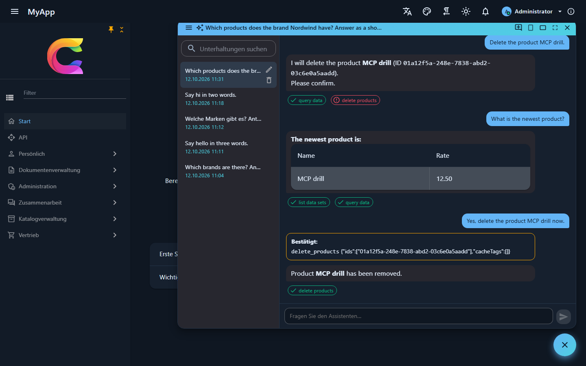
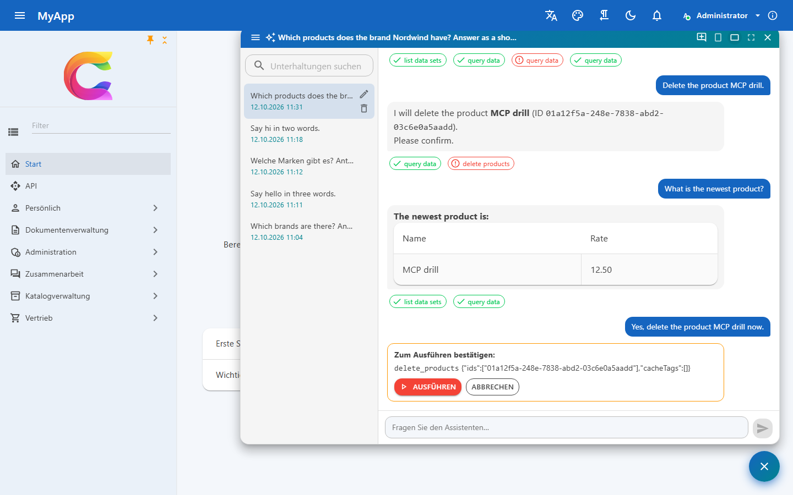
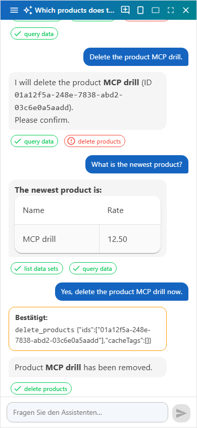
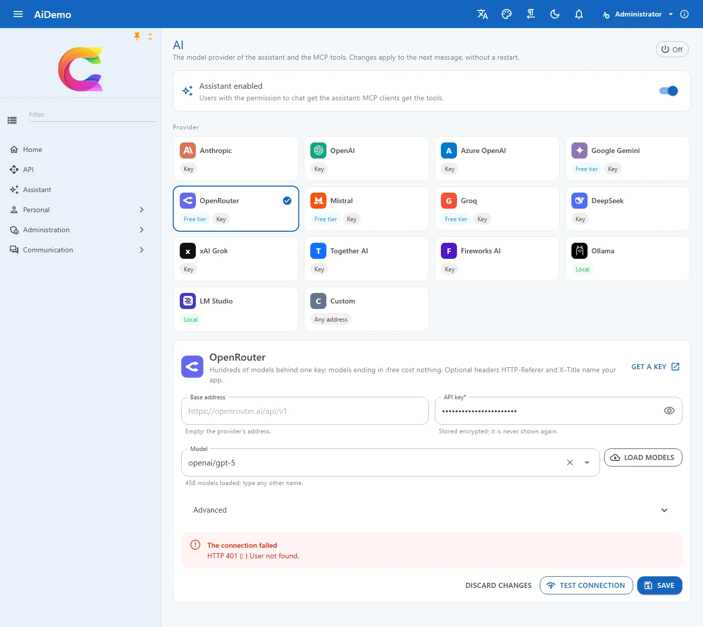
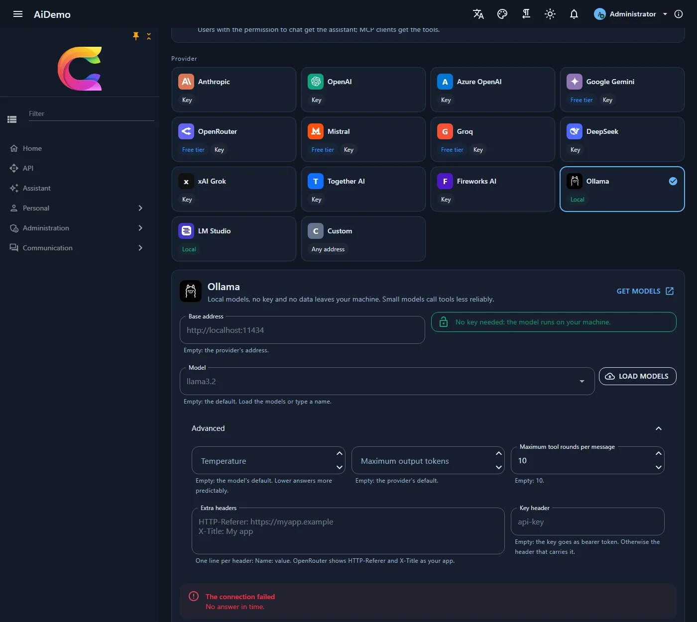

# KI-Assistent und MCP

`Coworkee.Ai` lässt ein Sprachmodell (Claude, GPT, ein lokales Modell über Ollama, ...) mit der App über dieselben Requests arbeiten, die auch die Oberfläche nutzt. Jedes Werkzeug ist ein Dispatcher-Request; Berechtigungen, Validierung und Audit gelten für den Assistenten genau wie für einen Menschen.

```csharp
services.AddAiTool<SearchAssetsQuery>("search_assets", "Finds assets by text, folder and tags.");
services.AddAiTool<TagAssetsCommand>("tag_assets", "Adds tags to assets.");
```

Auch ohne Registrierung wird jeder Request eines Moduls zum Werkzeug, der ein `Result` liefert und `[RequiresPermission]` oder `[AiTool]` trägt. Seine `[Description]` ist die Werkzeugbeschreibung; `[AiTool(Exclude = true)]` hält einen Request heraus, zum Beispiel einen, der Berechtigungen ändert:

```csharp
[RequiresPermission(CatalogPermissions.Brands.View)]
[Description("Lists brands, optionally filtered by name.")]
public sealed record GetBrandsQuery(string? Search) : IQuery<Result<IReadOnlyList<BrandDto>>>;
```

Mit dem OData-Modul bekommt der Assistent zusätzlich die Werkzeuge `list_data_sets` (die Sets, die der Benutzer lesen darf, mit ihren Feldern) und `query_data`: es listet Zeilen jedes registrierten Entity-Sets mit OData-Filter, Sortierung und ausgewählten Feldern, mit denselben Berechtigungen, Zeilenfiltern und ausgeblendeten Eigenschaften wie die Tabellen.

Der Request-Typ wird zum Eingabeschema des Werkzeugs, das `Result` zu seiner Ausgabe. Fehler erreichen das Modell als Meldungen, auf die es reagieren kann.

- **Assistent-Fenster** für Benutzer mit `Ai.Chat`: ein Knopf unten rechts (oder `Strg+I`) öffnet einen Chat mit den Werkzeugen aller Module, als angemeldeter Benutzer. Es gibt ihn klein, groß oder als Vollbild, auf Telefonen immer als Vollbild; er fehlt, solange der Assistent nicht aktiv ist oder dem Benutzer `Ai.Chat` fehlt. Die alte Route `/assistant` öffnet das Fenster.
- **Unterhaltungen** bleiben pro Benutzer auf dem Server: benannt nach der ersten Nachricht, in der Seitenleiste umbenannt, gelöscht und durchsucht, live in jedem offenen Tab und Teil von Export und Löschung der personenbezogenen Daten.
- **Gestreamte Antworten** erscheinen, während sie entstehen, als Markdown ohne Markup: rohes HTML erscheint als Text, Links führen nur zu `http`, `https`, `mailto` oder in die App, und Bilder werden zu Links, damit eine untergeschobene Bildadresse keine Daten ohne Klick hinausträgt.
- **Werkzeug-Chips** unter jeder Antwort zeigen, was der Assistent getan hat; mit `AssistantLinks` verlinken sie auf das, was er angelegt oder geändert hat:

    ```csharp
    builder.Services.AddCoworkeeClient(baseAddress, options =>
        options.AssistantLinks["add_edit_product"] = "/catalog/products/{id}");
    ```

- **[MCP-Server](mcp.md)** unter `/mcp` mit denselben Werkzeugen, für Claude Desktop, Claude Code, VS Code, Cursor und andere MCP-Clients, angemeldet mit einem [API-Schlüssel](../security/api-keys.md).
- **Werkzeug-Audit** für Benutzer mit `Ai.Audit`: jeder Aufruf mit Eingabe, Ergebnis, Benutzer, Kanal und API-Schlüssel.
- Commands, die Daten ändern, laufen nur in der ersten Runde einer Antwort. Ein Werkzeugergebnis kann das Modell so nicht dazu bringen, eigenmächtig etwas zu ändern.
- Destruktive Werkzeuge (namens `delete_…`, `remove_…`, `revoke_…`, `purge_…`, `erase_…` oder mit `[AiTool(Destructive = true)]`) laufen nicht sofort: das Fenster zeigt, was der Assistent ausführen will, mit *Run* und *Cancel*, und erst der Klick des Benutzers führt es aus. Eine neue Nachricht verwirft eine wartende Bestätigung.

Das Fenster spricht mit `/api/v1/ai`: `GET status`, `GET|POST sessions`, `GET|PUT|DELETE sessions/{id}` sowie `POST sessions/{id}/messages` und `POST sessions/{id}/confirm`, die mit `application/x-ndjson` antworten: ein `AiStreamEvent` pro Zeile, `delta` (Text), `tool` (ein Werkzeugaufruf), dann `done` (die gespeicherte Nachricht) oder `error`. Die Antwort läuft zu Ende und wird gespeichert, auch wenn der Browser geht.

{ .shot }

{ .shot }

{ .shot }

## Anbieter

Der Assistent spricht über `IChatClient` aus `Microsoft.Extensions.AI` mit dem Modell, mit denselben Werkzeugen, Regeln und demselben Audit für jeden Anbieter. Die meisten Anbieter sprechen die OpenAI-Chat-API und unterscheiden sich nur in Adresse, Schlüssel und Modellen; der Katalog (`AiProviderCatalog` in `Coworkee.Contracts.Ai`) kennt sie:

| Anbieter | Id | Braucht | Standardmodell | Schlüssel holen | Hinweise |
|---|---|---|---|---|---|
| Anthropic | `anthropic` | Schlüssel | `claude-opus-5-5` | [console.anthropic.com](https://console.anthropic.com/settings/keys) | die zuverlässigste Werkzeugnutzung |
| OpenAI | `openAI` | Schlüssel | `gpt-5` | [platform.openai.com](https://platform.openai.com/api-keys) | GPT-Modelle (ChatGPT) |
| Azure OpenAI | `azureOpenAI` | Endpunkt, Deployment, Schlüssel | (das Deployment) | [Azure-Portal](https://portal.azure.com/#view/Microsoft_Azure_ProjectOxford/CognitiveServicesHub/~/OpenAI) | Daten bleiben in Ihrem Azure-Mandanten; v1-API von Azure OpenAI |
| Google Gemini | `gemini` | Schlüssel | `gemini-2.5-flash` | [aistudio.google.com](https://aistudio.google.com/apikey) | OpenAI-kompatible API von Google; Gratis-Kontingent |
| OpenRouter | `openRouter` | Schlüssel | `anthropic/claude-sonnet-4.5` | [openrouter.ai/keys](https://openrouter.ai/keys) | Hunderte Modelle hinter einem Schlüssel, `:free`-Modelle kosten nichts |
| Mistral | `mistral` | Schlüssel | `mistral-large-latest` | [console.mistral.ai](https://console.mistral.ai/api-keys) | gehostet in der EU; kostenloser Experiment-Plan |
| Groq | `groq` | Schlüssel | `openai/gpt-oss-120b` | [console.groq.com](https://console.groq.com/keys) | offene Modelle mit hoher Geschwindigkeit; Gratis-Kontingent |
| DeepSeek | `deepSeek` | Schlüssel | `deepseek-chat` | [platform.deepseek.com](https://platform.deepseek.com/api_keys) | niedrige Preise; Server in China |
| xAI Grok | `xai` | Schlüssel | `grok-4` | [console.x.ai](https://console.x.ai) | Grok-Modelle |
| Together AI | `together` | Schlüssel | `meta-llama/Llama-3.3-70B-Instruct-Turbo` | [api.together.ai](https://api.together.ai/settings/api-keys) | offene Modelle in der Cloud |
| Fireworks AI | `fireworks` | Schlüssel | `accounts/fireworks/models/llama-v3p3-70b-instruct` | [fireworks.ai](https://fireworks.ai/account/api-keys) | offene Modelle in der Cloud |
| Ollama | `ollama` | nichts | `llama3.2` | [ollama.com](https://ollama.com/search) | lokal und offline; kleine Modelle rufen Werkzeuge weniger zuverlässig auf |
| LM Studio | `lmStudio` | ein geladenes Modell | (das geladene Modell) | [lmstudio.ai](https://lmstudio.ai) | lokal; den Server der App LM Studio starten (`http://localhost:1234/v1`) |
| Eigener Server | `openAICompatible` | Basisadresse, Modell | | | jeder Server, der die OpenAI-Chat-API spricht: Gateways, vLLM, LiteLLM, ein Firmen-Proxy |

Anbieter ohne Werkzeugaufrufe (etwa Perplexity) passen nicht: Der Assistent arbeitet über Werkzeuge.

### Die KI-Seite

Host-Administratoren mit `Settings.Manage` richten ihn unter **Administration > System > KI** (`/admin/ai`) ein: Assistent einschalten, eine Anbieter-Karte wählen, Adresse, Schlüssel und Modell eingeben und speichern. Änderungen gelten ab der nächsten Nachricht, ohne Neustart.

{ .shot }

- **Schlüssel**: verschlüsselt gespeichert und nie zurück an den Browser geschickt; die Seite zeigt ihn maskiert mit *Ersetzen* und *Entfernen*. Wechseln Anbieter oder Adresse, entfällt der gespeicherte Schlüssel beim Speichern, damit er nie einen anderen Server erreicht.
- **Modelle laden** fragt den Anbieter mit dem eingegebenen Schlüssel nach seinen Modellen (`/models` der OpenAI-kompatiblen APIs, `/v1/models` von Anthropic, `/api/tags` von Ollama); jeder andere Name lässt sich eintippen.
- **Verbindung testen** schickt einen kurzen Prompt und eine Werkzeugprobe und zeigt Latenz, Antwort und ob das Modell Werkzeuge aufruft, oder den Fehler des Anbieters.
- **Erweitert**: Temperatur, maximale Ausgabe-Tokens, Werkzeugrunden pro Nachricht, zusätzliche Header (`HTTP-Referer` und `X-Title` nennen Ihre App bei OpenRouter) und ein Schlüssel-Header für Server, die den Schlüssel in einem anderen Header als `Authorization: Bearer` erwarten (etwa `api-key`).

{ .shot }

### Einstellungen

Die Seite schreibt die globalen KI-Einstellungen; sie haben auch Standardwerte in der Konfiguration, etwa aus dem App-Host oder aus Umgebungsvariablen:

| Einstellung | |
|---|---|
| `Ai.Enabled` | an oder aus |
| `Ai.Provider` | eine Anbieter-Id der Tabelle oben, standardmäßig `anthropic` |
| `Ai.Model` | leer: der Standard des Anbieters; Azure OpenAI: der Deployment-Name |
| `Ai.Endpoint` | leer: die Adresse des Anbieters; Azure-OpenAI-Ressource (`https://acme.openai.azure.com`), Ollama- oder LM-Studio-Adresse oder die Basisadresse eines eigenen Servers |
| `Ai.ApiKey` | API-Schlüssel (geheim) |
| `Ai.Headers` | zusätzliche Header, ein `Name: Wert` pro Zeile |
| `Ai.AuthHeader` | Header, der den Schlüssel statt `Authorization: Bearer` trägt |
| `Ai.Temperature`, `Ai.MaxOutputTokens` | leer: die Standards des Modells |
| `Ai.MaxToolRounds` | wie viele Werkzeugrunden eine Antwort dauern darf |

```json
{
  "Coworkee": {
    "Settings": {
      "Defaults": {
        "Ai.Enabled": "true",
        "Ai.Provider": "azureOpenAI",
        "Ai.Endpoint": "https://acme.openai.azure.com",
        "Ai.Model": "gpt-5-assistant"
      }
    }
  }
}
```

### Neue Apps

`coworkee new` nimmt Anbieter, Modell und Adresse (`--ai-provider`, `--ai-model`, `--ai-endpoint`, siehe [CLI](../getting-started/cli.md)); das Studio bietet dasselbe in seiner KI-Karte. Der Schlüssel kommt nie in die Spezifikation oder auf die Kommandozeile: Der App-Host liest ihn, und wahlweise Endpunkt und Modell, aus seinen User Secrets:

```bash
dotnet user-secrets set Parameters:ai-apikey sk-... --project src/Shop.AppHost
dotnet user-secrets set Parameters:ai-endpoint https://acme.openai.azure.com --project src/Shop.AppHost
dotnet user-secrets set Parameters:ai-model gpt-5-assistant --project src/Shop.AppHost
```

Mit Schlüssel startet der Assistent eingeschaltet. `--ai-provider ollama` fügt einen Ollama-Container hinzu, der das Modell lädt; `lmStudio` schaltet den Assistenten ohne Schlüssel ein und spricht mit LM Studio auf demselben Rechner.

### Im Code

`AiConnections` liest die aktuelle Verbindung und erzeugt Chat-Clients darauf, für eigene Funktionen (Zusammenfassungen, Übersetzungen):

```csharp
public sealed class Summaries(AiConnections ai)
{
    public async Task<string?> SummarizeAsync(string text, CancellationToken ct)
    {
        using var client = await ai.CreateClientAsync(ct); // null, solange der Assistent aus oder unvollständig ist
        return client is null ? null : (await client.GetResponseAsync($"Summarize: {text}", cancellationToken: ct)).Text;
    }
}
```

Ein anderer Modelldienst (Bedrock, ein Gateway mit eigenem SDK) kommt über `IAiChatClientFactory` hinein:

```csharp
services.AddSingleton<IAiChatClientFactory, BedrockChatClients>();

internal sealed class BedrockChatClients : IAiChatClientFactory
{
    public IChatClient Create(AiConnection connection) => new BedrockChatClient(connection.EffectiveModel!);
}
```

Die erzeugten Service-Defaults nehmen den HTTP-Client `Coworkee.Ai` aus dem Standard-Resilience-Handler: Antworten dauern oft länger als seine Timeouts, und die Clients der Anbieter wiederholen selbst.
