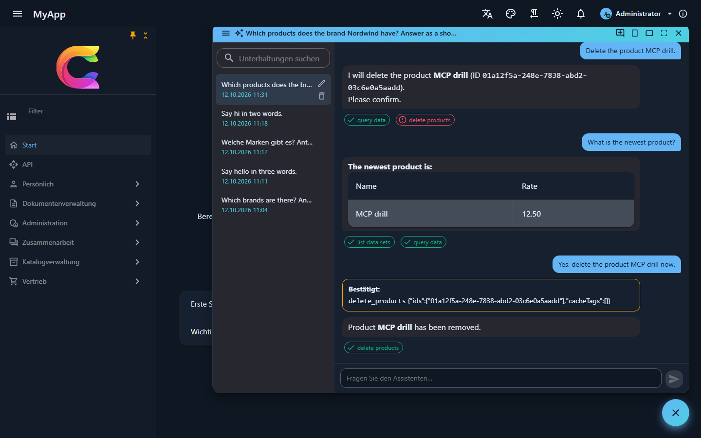
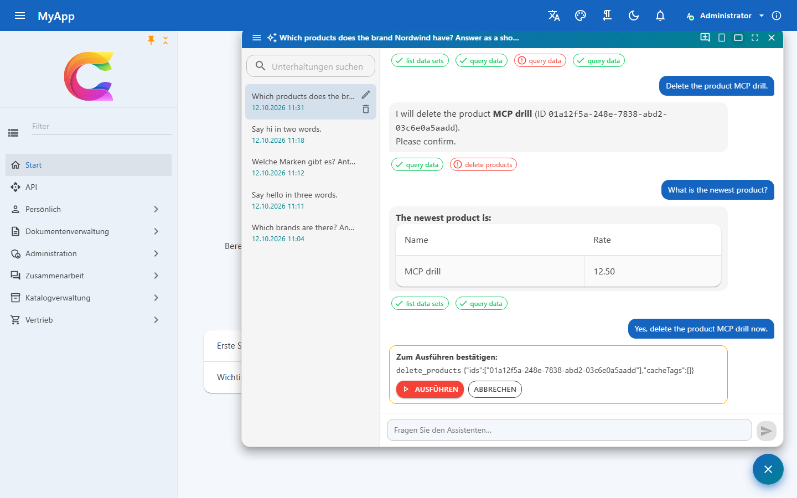
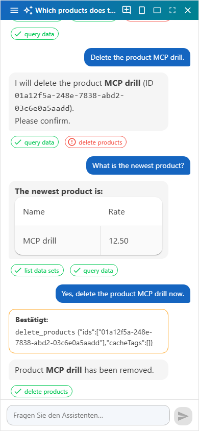
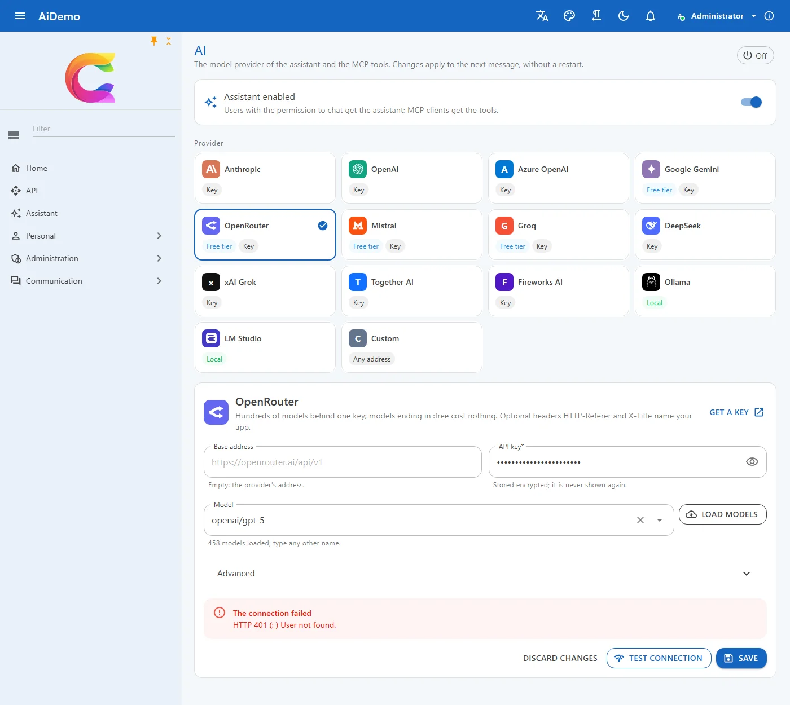
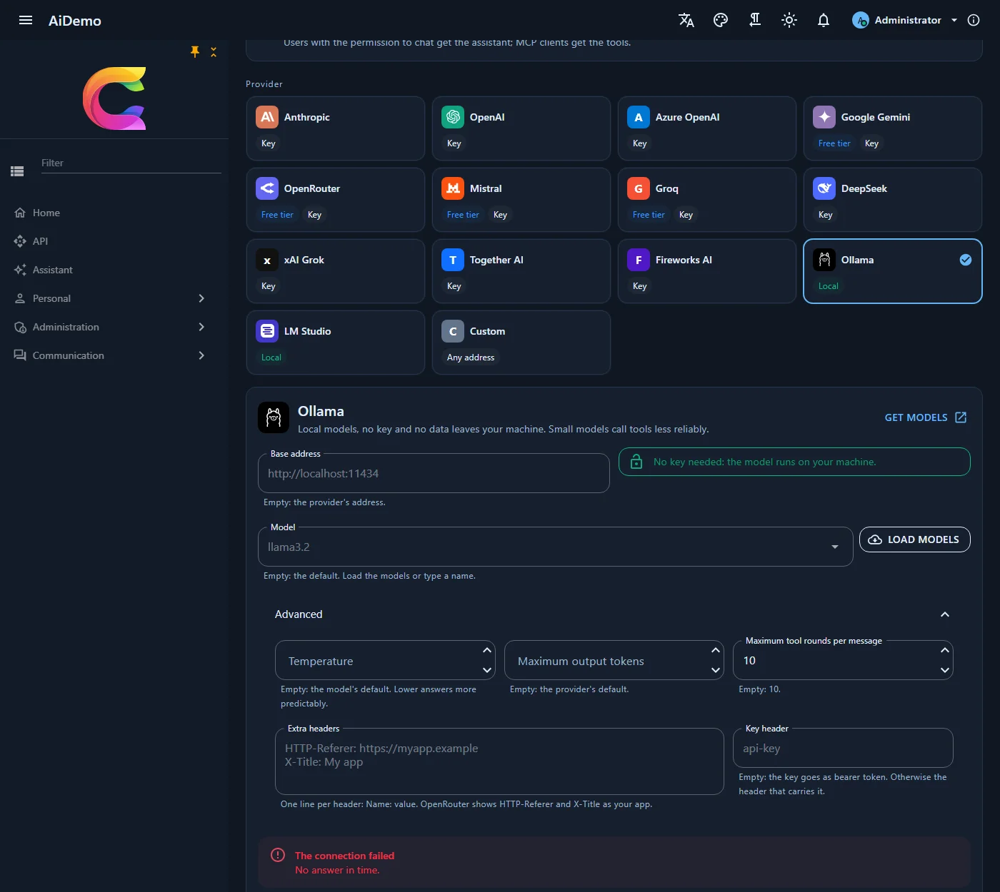

# AI assistant and MCP

`Coworkee.Ai` lets a language model (Claude, GPT, a local model through Ollama, ...) work with the app through the same requests the UI uses. Every tool is a dispatcher request, so permissions, validation and audit apply to the assistant exactly as to a person.

New apps have it (template and CLI option `ai`, on by default); by hand, depend on `CoworkeeAiModule` (it needs the settings module). It adds the tables `cw.AiToolCalls` (tool call audit), `cw.AiChatSessions` and `cw.AiChatMessages` (conversations): add a migration. With the [Retention](retention.md) module, `ai-tool-calls` and `ai-sessions` set how long they are kept.

## Tools

```csharp
services.AddAiTool<SearchAssetsQuery>("search_assets", "Finds assets by text, folder and tags.");
services.AddAiTool<TagAssetsCommand>("tag_assets", "Adds tags to assets.");
```

Without any registration, every request of a loaded module that returns a `Result` and carries `[RequiresPermission]` or `[AiTool]` becomes a tool. Its name is the type name in snake case without `Command` or `Query` (`GetBrandsQuery` → `get_brands`), or `[AiTool(Name = ...)]`; its description is `[AiTool("...")]`, else `[Description]`. `[AiTool(Exclude = true)]` keeps a request out, for example one that changes permissions; requests with a `Stream` or file property are never tools. A request registered with `AddAiTool` wins over the discovered one.

```csharp
[RequiresPermission(CatalogPermissions.Brands.View)]
[Description("Lists brands, optionally filtered by name.")]
public sealed record GetBrandsQuery(string? Search) : IQuery<Result<IReadOnlyList<BrandDto>>>;
```

A user gets the tools only with `Ai.Chat`, and each tool only with every permission its `[RequiresPermission]` attributes name (several attributes: all of them). The request type becomes the tool's input schema, the `Result` its output, shaped by the response filters like the API's answers and cut after 20,000 characters. Failures reach the model as messages it can react to.

The library brings these tools:

| Tool | Module | |
|---|---|---|
| `list_data_sets` | OData | the entity sets the user may read, with the name and type of each field |
| `query_data` | OData | rows of a set with `filter`, `orderBy`, `select`, `top` (1 to 50, default 20) and `skip`: the permissions, row filters, hidden properties and [query limits](../web/odata.md) of the tables apply |
| `global_search` | OData | the [global search](../web/global-search.md) over every kind of record the user may read (`query`, `types`, `limit` 1 to 50 per provider) |
| `generate_report` | Reporting | builds a report definition from a description with the app's AI model (`Reports.Manage`); `create_report` and `update_report` save it, see [Create a report with AI](reporting.md#create-a-report-with-ai) |

Further requests of the modules (users, roles, reports, ...) are tools by the rule above.

## The assistant window

- **Assistant window** for users with `Ai.Chat`: a button at the bottom right (or wherever the [display](#where-the-assistant-shows) puts it, and always `Ctrl+I`) opens a chat with the tools of all modules, as the signed-in user. It comes small, large or full screen, and full screen on phones; it is not there while the assistant is not active or the user lacks `Ai.Chat`. The old `/assistant` route opens the window.
- **Conversations** stay on the server per user: titled after the first message, renamed, deleted and searched in the side bar, live in every open tab, and part of the personal data export and erasure.
- **Streamed answers** appear as they are written, as Markdown that cannot carry markup or data: raw HTML shows as text and images become links. Links to other sites lose query and fragment and show their host, app links stay as they are, mail links keep only the address, and other schemes go nowhere, so a planted link cannot carry data away.
- **Tool chips** under each answer show what the assistant did; with `AssistantLinks` they link to what it created or changed:

    ```csharp
    builder.Services.AddCoworkeeClient(baseAddress, options =>
        options.AssistantLinks["add_edit_product"] = "/catalog/products/{id}");
    ```

- **[MCP server](mcp.md)** under `/mcp` with the same tools, for Claude Desktop, Claude Code, VS Code, Cursor and other MCP clients, signed in with an [API key](../security/api-keys.md).
- **Tool call audit** for users with `Ai.Audit` (*Administration > Monitoring > AI tool calls*, `/cw/admin/ai-tool-calls`, OData set `AiToolCalls`): every call with its input (values that look like secrets masked, cut after 4,000 characters), success or error, duration, user, channel (`chat`, `chat-local` for [reads the browser answered](#answers-from-the-browsers-local-data), or `mcp`) and API key; the output is not stored.
- Queries run at once. Every command, which changes data, waits: the window shows exactly what the assistant wants to run (inputs that look like secrets masked) with *Run* and *Cancel*, destructive ones highlighted, and only the user's click runs it. Creating a product by chat takes one click. Text planted in data or in the conversation can therefore never change anything on its own. A new message cancels a waiting call.
- A waiting call is stored encrypted with ASP.NET Data Protection (share the key ring between API instances), decided once even when two tabs click at the same time, and never runs twice.

The window talks to `/api/v1/ai`: `GET status`, `GET tools` (the user's tools), `GET|POST sessions` (`?search=`), `GET|PUT|DELETE sessions/{id}`, and `POST sessions/{id}/messages` and `POST sessions/{id}/confirm`, which answer with `application/x-ndjson`: one `AiStreamEvent` per line, `delta` (text), `tool` (a tool call), `client_action` (`Action`: call id, name and JSON arguments for the client), `client_query` (a read the client may answer from its [local copy](#answers-from-the-browsers-local-data), answered with `POST sessions/{id}/client-results`), then `done` (the saved message) or `error`. The answer runs to its end and is saved even when the browser goes away. The AI page uses `GET connection`, `POST connection/models` and `POST connection/test`; the audit `GET tool-calls?channel=` (`Ai.Audit`).

Messages, confirmations, model lists and connection tests go through the rate limit policy `ai` (30 requests a minute per user by default, `Coworkee:RateLimiting:Policies:ai`), like the MCP server.

{ .shot }

{ .shot }

{ .shot }

## Where the assistant shows

The global setting `Ai.Display` decides where users find the assistant; administrators set it under **Administration > User interface > Header** (`/cw/admin/header`), the AI page links there. `Ai.Enabled` still decides whether the assistant is there at all, and `Ctrl+I` opens it in every mode.

| `Ai.Display` | |
|---|---|
| `BottomRight` | floating button at the bottom right (default) |
| `BottomLeft` | floating button at the bottom left; the window opens on the left |
| `AppBar` | a button in the app bar, item `assistant` of the [managed header](../ui/client.md#managed-header), by default before the about button |
| `Navigation` | an *Assistant* entry in the navigation (`/assistant`) |
| `Off` | no button, only `Ctrl+I` and the command palette |

Without a floating button the window opens at the top right under the app bar.

### The assistant knows the UI

With every message the window sends an `AiUiContext` (`Ui` of `AiSendRequest` and `AiConfirmRequest`): the pages of the navigation the user can see (menu path, title, address, description; placed, hidden and translated like the menu), the current page, the themes, the color mode, the languages, right to left, and the client actions. The server puts it into the system prompt, cut to about 4,000 characters, so "how do I change the colors?" gets a click path such as *Administration > System > Themes* with the titles the user sees, never a page the user cannot open, and an offer to go there.

Tell the assistant what a page is for with `Description` on the navigation item (a sentence, keywords welcome; a translation key works too). The library's admin pages have one.

```csharp
new CoworkeeNavItem("Products", "/catalog/products", Icons.Material.Outlined.Inventory, CatalogPermissions.View,
    Description: "Products, prices and stock; import from Excel.");
```

**Client actions** are tools the browser runs, not the server: `navigate` (an address within the app), `set_theme`, `set_color_mode` (`light`, `dark`, `system`), `set_right_to_left` and `set_language` (an enabled culture). The model only gets those the client declared, the server streams a `client_action` event and tells the model the client was asked, and no request runs on the server and nothing goes into the audit. The window runs the action at once, without a confirmation (they only change UI preferences, which the user can switch back), checks its arguments, and notes the outcome under the answer ("Switched to dark mode", or "Unknown theme: Neon"). Theme, mode and language are kept as user settings like in the menus. Add your own with an `IAssistantClientAction`:

```csharp
builder.Services.AddScoped<IAssistantClientAction, OpenCartAction>();

sealed class OpenCartAction(NavigationManager nav) : IAssistantClientAction
{
    public string Name => "open_cart";
    public string Description => "Opens the shopping cart.";
    public JsonElement Parameters { get; } = JsonDocument.Parse("""{"type":"object","properties":{}}""").RootElement;

    public Task<AssistantActionResult> RunAsync(JsonElement arguments, CancellationToken cancellationToken)
    {
        nav.NavigateTo("/cart");
        return Task.FromResult(new AssistantActionResult(true, "Opened the cart"));
    }
}
```

Names take letters, digits, `_` and `-`; a name of a server tool always means the server tool. Keep client actions to reversible UI changes: they run without asking.

### Answers from the browser's local data

When the app keeps [client entities](../ui/client-entities.md), the browser holds complete copies of some OData sets. The assistant reads them there instead of in the database: a `query_data` on such a set takes milliseconds in the browser instead of a database query (on a large set, seconds; in a measured case 28 seconds). Apps change nothing; it works with every set a table or your own code has started and that is complete and not switched to the server.

1. With every message the window lists those sets in `AiUiContext.LocalSets` (from `IClientDataCache.LocalSets`).
2. When the model calls `query_data` on one of them, the server streams a `client_query` event (`Action`: call id, `query_data`, the JSON arguments) and waits.
3. The window runs the query on the copy (`IClientDataCache.QueryLocallyAsync`: filter, order, `top` 1 to 50, `skip`, `select`) and posts `AiClientResult` (call id, output) to `POST /api/v1/ai/sessions/{id}/client-results`. The output has the shape of the server tool, `{"rows":[{"Name":"Drill"}],"total":1}`, with the same field names and JSON.
4. The server hands it to the model like its own tool result, cut after 20,000 characters, and audits the call with the channel `chat-local`.

The server runs the read itself (channel `chat`) when the browser cannot answer it: the copy is not complete or switched to the server, the filter is beyond the [local engine](../ui/client-entities.md#what-runs-locally) (`any`, `all`, unknown functions) or names a field the client's row type does not have, a `select` names a field the row type lacks or the server does not return, without a `select` the row type lacks any field the server tool would return (the [client entity manifest](../ui/client-entities.md#endpoints) names them as `Fields`), or the arguments do not parse. So a local answer never holds less than the server's: a narrower client row type only answers reads that select fields it has. The window then posts `null` at once, so the server does not wait. Without an answer within `Ai.LocalQueryTimeout` seconds (4 by default, 1 to 30), for example because the tab was closed, the server runs it too.

Nothing changes for security: a copy holds exactly the rows and fields the user's own OData read returns (permissions, row filters, hidden properties), so the answer shows nothing the server tool would not, and it only ever goes into this user's own turn. Only `query_data` goes to the browser; every other tool, and every change of data with its confirmation, stays on the server. Only the user of the running turn can answer (the waiting call is keyed by user, conversation and call id; anyone else gets `404`), only while it waits, and only with a JSON object of at most 200,000 characters (`400` otherwise).

`global_search` stays on the server: the command palette finds only the providers of local sets in the browser, the others (users, roles, files, ...) need the server anyway. The [MCP server](mcp.md) has no browser and always reads on the server.

Switch it off with `Ai.LocalQueries` = `false`. The waiting call lives in the memory of the API instance that streams the turn, like the guard against parallel messages of one user: with several API instances route a user's requests to the same instance (sticky sessions), otherwise the answer finds nothing waiting and the server runs the read after the timeout.

## Providers

The assistant talks to the model through `IChatClient` of `Microsoft.Extensions.AI`, with the same tools, rules and audit for every provider. Most providers speak the OpenAI chat API, so they only differ in address, key and models; the catalog (`AiProviderCatalog` in `Coworkee.Contracts.Ai`) knows them:

| Provider | Id | Needs | Default model | Get a key | Notes |
|---|---|---|---|---|---|
| Anthropic | `anthropic` | key | `claude-opus-5-5` | [console.anthropic.com](https://console.anthropic.com/settings/keys) | the most reliable tool use |
| OpenAI | `openAI` | key | `gpt-5` | [platform.openai.com](https://platform.openai.com/api-keys) | GPT models (ChatGPT) |
| Azure OpenAI | `azureOpenAI` | endpoint, deployment, key | (the deployment) | [Azure portal](https://portal.azure.com/#view/Microsoft_Azure_ProjectOxford/CognitiveServicesHub/~/OpenAI) | data stays in your Azure tenant; v1 API of Azure OpenAI |
| Google Gemini | `gemini` | key | `gemini-2.5-flash` | [aistudio.google.com](https://aistudio.google.com/apikey) | Google's OpenAI compatible API; free tier |
| OpenRouter | `openRouter` | key | `anthropic/claude-sonnet-4.5` | [openrouter.ai/keys](https://openrouter.ai/keys) | hundreds of models behind one key, `:free` models cost nothing |
| Mistral | `mistral` | key | `mistral-large-latest` | [console.mistral.ai](https://console.mistral.ai/api-keys) | hosted in the EU; free experiment plan |
| Groq | `groq` | key | `openai/gpt-oss-120b` | [console.groq.com](https://console.groq.com/keys) | open models at high speed; free tier |
| DeepSeek | `deepSeek` | key | `deepseek-chat` | [platform.deepseek.com](https://platform.deepseek.com/api_keys) | low prices; servers in China |
| xAI Grok | `xai` | key | `grok-4` | [console.x.ai](https://console.x.ai) | Grok models |
| Together AI | `together` | key | `meta-llama/Llama-3.3-70B-Instruct-Turbo` | [api.together.ai](https://api.together.ai/settings/api-keys) | open models in the cloud |
| Fireworks AI | `fireworks` | key | `accounts/fireworks/models/llama-v3p3-70b-instruct` | [fireworks.ai](https://fireworks.ai/account/api-keys) | open models in the cloud |
| Ollama | `ollama` | nothing | `llama3.2` | [ollama.com](https://ollama.com/search) | local and offline; small models call tools less reliably |
| LM Studio | `lmStudio` | a loaded model | (the loaded model) | [lmstudio.ai](https://lmstudio.ai) | local; start the server of the LM Studio app (`http://localhost:1234/v1`) |
| Custom | `openAICompatible` | base address, model | | | any server that speaks the OpenAI chat API: gateways, vLLM, LiteLLM, a company proxy |

Providers without tool calls (Perplexity, for example) do not fit: the assistant works through tools.

### The AI page

Host administrators with `Settings.Manage` set it up under **Administration > System > AI** (`/cw/admin/ai-settings`): switch the assistant on, pick a provider card, enter address, key and model, and save. Changes apply to the next message, without a restart. The same page switches the [MCP server](mcp.md) on and off.

{ .shot }

- **Key**: stored encrypted and never sent back to the browser; the page shows it masked with *Replace* and *Remove*. When the provider or the address changes, the stored key is dropped on save, so it never reaches another server.
- **Load models** asks the provider for its models with the entered key (`/models` of the OpenAI compatible APIs, `/v1/models` of Anthropic, `/api/tags` of Ollama); any other name can be typed.
- **Test connection** sends a short prompt and a tool call probe and shows the latency, the answer and whether the model calls tools, or the provider's error.
- **Advanced**: temperature, maximum output tokens, tool rounds per message, [answers from the browser's local data](#answers-from-the-browsers-local-data) and how long to wait for them, extra headers (`HTTP-Referer` and `X-Title` name your app on OpenRouter) and a key header for servers that expect the key in another header than `Authorization: Bearer` (for example `api-key`).

{ .shot }

### Settings

The page writes the AI settings. They are global only, so no organisation switches the assistant on or raises limits on the host's key; they also have defaults in the configuration, e.g. from the app host or environment variables:

| Setting | |
|---|---|
| `Ai.Enabled` | on or off, `false` by default |
| `Ai.Display` | where the assistant shows, see [above](#where-the-assistant-shows); `BottomRight` by default |
| `Ai.Provider` | a provider id of the table above, `anthropic` by default |
| `Ai.Model` | empty: the provider's default; Azure OpenAI: the deployment name |
| `Ai.Endpoint` | empty: the provider's address; Azure OpenAI resource (`https://acme.openai.azure.com`), Ollama or LM Studio address, or the base address of a custom server |
| `Ai.ApiKey` | API key (secret) |
| `Ai.Headers` | extra headers, one `Name: value` per line |
| `Ai.AuthHeader` | header that carries the key instead of `Authorization: Bearer` |
| `Ai.Temperature` | empty: the model's default; 0 to 2, lower answers more predictably |
| `Ai.MaxOutputTokens` | empty: the provider's default (16000 for Anthropic) |
| `Ai.MaxToolRounds` | how many tool rounds one answer may take, `10` by default |
| `Ai.LocalQueries` | reads of sets the browser holds locally are answered there, `true` by default; see [above](#answers-from-the-browsers-local-data) |
| `Ai.LocalQueryTimeout` | seconds the server waits for the browser's local answer before it runs the read itself, `4` by default, 1 to 30 |
| `Mcp.Enabled` | the [MCP server](mcp.md) at runtime, `true` by default; needs no provider |

```json
{
  "Coworkee": {
    "Settings": {
      "Defaults": {
        "Ai.Enabled": "true",
        "Ai.Provider": "azureOpenAI",
        "Ai.Endpoint": "https://acme.openai.azure.com",
        "Ai.Model": "gpt-5-assistant"
      }
    }
  }
}
```

### New apps

`coworkee new` takes the provider, the model and the address (`--ai-provider`, `--ai-model`, `--ai-endpoint`, see [CLI](../getting-started/cli.md)); the Studio offers the same in its AI card. The key never goes into the spec or the command line: the app host reads it, and optionally endpoint and model, from its user secrets:

```bash
dotnet user-secrets set Parameters:ai-apikey sk-... --project src/Shop.AppHost
dotnet user-secrets set Parameters:ai-endpoint https://acme.openai.azure.com --project src/Shop.AppHost
dotnet user-secrets set Parameters:ai-model gpt-5-assistant --project src/Shop.AppHost
```

With a key the assistant starts switched on. `--ai-provider ollama` adds an Ollama container that pulls the model; `lmStudio` switches the assistant on without a key and talks to LM Studio on the same machine.

### In code

`AiConnections` reads the current connection and creates chat clients on it, for features of your own (summaries, translations):

```csharp
public sealed class Summaries(AiConnections ai)
{
    public async Task<string?> SummarizeAsync(string text, CancellationToken ct)
    {
        using var client = await ai.CreateClientAsync(ct); // null while the assistant is off or incomplete
        return client is null ? null : (await client.GetResponseAsync($"Summarize: {text}", cancellationToken: ct)).Text;
    }
}
```

Another model service (Bedrock, a gateway with its own SDK) plugs in through `IAiChatClientFactory`:

```csharp
services.AddSingleton<IAiChatClientFactory, BedrockChatClients>();

internal sealed class BedrockChatClients : IAiChatClientFactory
{
    public IChatClient Create(AiConnection connection) => new BedrockChatClient(connection.EffectiveModel!);
}
```

The generated service defaults take the `Coworkee.Ai` HTTP client out of the standard resilience handler: answers often take longer than its timeouts, and the provider clients retry on their own.
