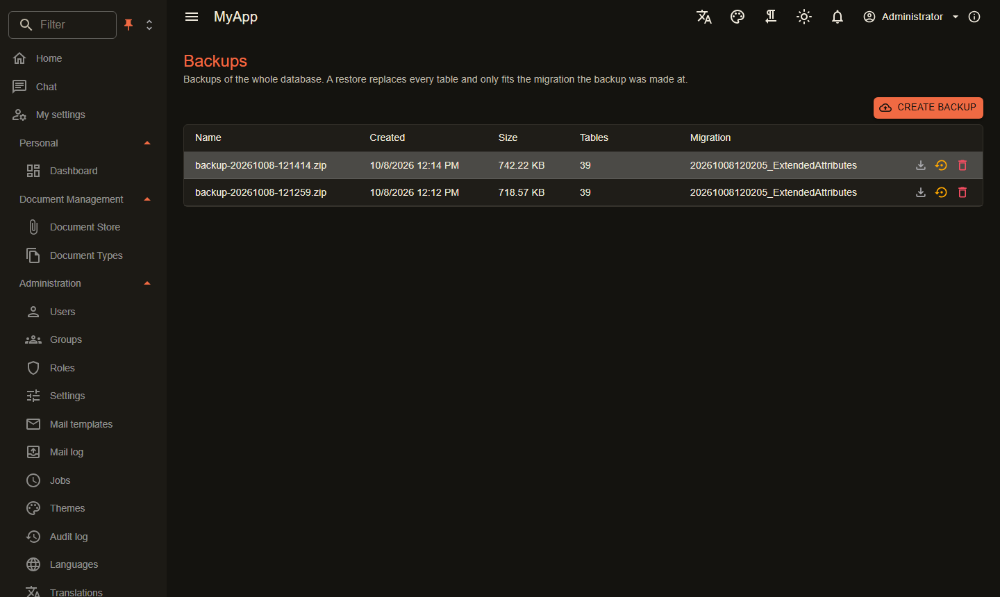

# Datenbank-Backups

`Coworkee.Backup` sichert die ganze Datenbank als ein Zip im [Dateispeicher](storage.md) und stellt sie wieder her. Das Modul braucht Postgres; bei SQL Server nutzt du dessen eigene Sicherungen, bei SQLite kopierst du die Datei.

{ .shot }

```csharp
[DependsOn(typeof(CoworkeeBackupModule))]
public sealed class MyAppDatabaseModule : CoworkeeModule;
```

- Jede Tabelle des Modells wird mit Postgres `COPY ... (FORMAT BINARY)` geschrieben; ein Manifest hält die Tabellen und die zuletzt angewendete Migration fest.
- Eine Wiederherstellung ersetzt alle Tabellen in einer Transaktion. Sie lehnt Backups ab, die auf einer anderen Migration oder mit anderen Tabellen erstellt wurden.
- Ein heruntergeladenes Zip lässt sich wieder hochladen (auch in eine andere Installation): Es erscheint in der Liste und wird wie jedes Backup wiederhergestellt. Ein Upload ohne Manifest wird abgelehnt; ob es zur Datenbank passt, prüft die Wiederherstellung.
- Nach einer Wiederherstellung werden die Caches geleert.
- Backups enthalten alle Organisationen, deshalb sehen sie nur Benutzer der System-Organisation mit `Backups.Manage`. Die Admin-Seite ist `/admin/backups`.

| Endpunkt | |
|---|---|
| `GET /api/v1/backups` | Liste |
| `POST /api/v1/backups` | erstellen |
| `GET /api/v1/backups/{id}/download` | Zip |
| `POST /api/v1/backups/upload?name=` | Zip hochladen (der Body ist die Datei) |
| `POST /api/v1/backups/{id}/restore` | wiederherstellen |
| `DELETE /api/v1/backups/{id}` | löschen |

!!! warning "Datenbankrechte"
    Die Wiederherstellung lädt Tabellen mit `session_replication_role = replica`, damit Fremdschlüssel beim Laden in beliebiger Reihenfolge nicht geprüft werden. Der Datenbankbenutzer braucht das Recht dazu (Superuser wie im Aspire-Setup oder eine Rolle mit diesem Recht).

Die Tabelle `cw.DatabaseBackups` selbst gehört nicht zum Backup, die Liste übersteht also eine Wiederherstellung.
