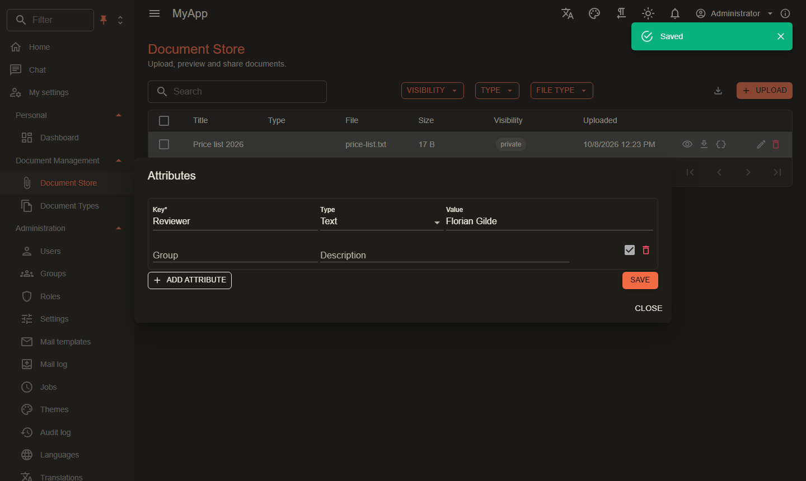

# Extended attributes

`Coworkee.ExtendedAttributes` lets users attach free key/value pairs to any entity without a schema change. A value is text, a decimal, a date or JSON; attributes can be grouped, described, carry an external id and be switched off.

{ .shot }

## Setup

```csharp
[DependsOn(typeof(CoworkeeExtendedAttributesModule))]
public sealed class MyAppDocumentsModule : CoworkeeModule
{
    public override void ConfigureServices(ModuleServiceContext context) =>
        context.Services.AddExtendedAttributes<Document>("Documents", DocumentPermissions.Documents.View, DocumentPermissions.Documents.Edit);
}
```

`AddExtendedAttributes<T>(entityType, viewPermission, editPermission)` registers the entity under a name (`"Documents"`) with the permission to read and the one to change its attributes. Attributes belong to a row by its `Guid Id`; an entity keyed otherwise is refused at registration. Attributes live in the table `cw.ExtendedAttributes` (one row per key, unique per organisation, entity type, entity and key); add a migration when you turn the module on.

## In the client

```razor
<ExtendedAttributesEditor EntityType="Documents" EntityId="document.Id" />
```

or as a dialog from a table row:

```csharp
await ExtendedAttributesDialog.ShowAsync(Dialogs, L["Attributes"], "Documents", document.Id);
```

Both take `ReadOnly`; the editor reports the saved list through `Saved`.

## Rules

- The entity is looked up through its `DbContext`, so tenant filters and soft delete apply: attributes of another organisation's entity are not found (`404`). Row filters of the entity's OData set (`IODataEntityFilter<T>`) are not checked; give the permissions only to users who may see every row of the type.
- Reading needs the view permission, saving the edit permission (`403` otherwise); an unknown entity type answers `404`.
- Saving replaces the whole list: keys missing from it are deleted. A key may appear once (case does not count), JSON values must be valid JSON; only the value of the chosen `Type` (`Text`, `Decimal`, `DateTime`, `Json`) is kept.

| Field | Limit |
|---|---|
| `Key` | required, 100 characters |
| `Group` | 100 characters |
| `Description` | 500 characters |
| `ExternalId` | 200 characters |

## Endpoints

| Endpoint | |
|---|---|
| `GET /api/v1/attributes/{entityType}/{entityId}` | the attributes, ordered by group and key |
| `PUT /api/v1/attributes/{entityType}/{entityId}` | replace with `{ "attributes": [...] }` |
