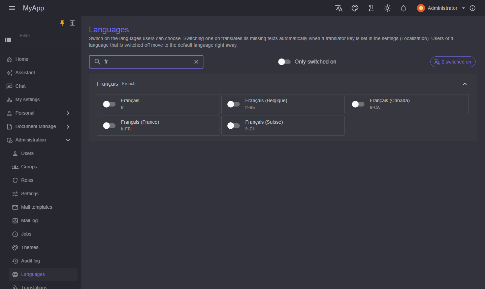

# Lokalisierung

`Coworkee.Localization` hält Sprachen und Übersetzungen in der Datenbank und liefert die Texte jedes Moduls als eingebettetes JSON mit.

```csharp
[DependsOn(typeof(CoworkeeLocalizationModule))]
public sealed class MyAppDatabaseModule : CoworkeeModule
{
    public override void ConfigureServices(ModuleServiceContext context) =>
        context.Services.AddSingleton<ILocalizationResourceContributor, MyAppTexts>();
}

internal sealed class MyAppTexts : ILocalizationResourceContributor
{
    public void Define(LocalizationResourceContext context) => context.AddEmbeddedJson(typeof(MyAppTexts).Assembly);
}
```

Schlüssel sind die englischen Texte. Ein Modul bettet `Localization/{culture}.json` ein:

```json title="Localization/de.json"
{
  "Brands": "Marken",
  "Delete {0}? This cannot be undone.": "{0} löschen? Das lässt sich nicht rückgängig machen."
}
```

```xml
<EmbeddedResource Include="Localization\*.json" />
```

## Anfangssprachen

Die Bibliothek bringt 23 Sprachen mit (`ar`, `bg`, `cs`, `da`, `de`, `el`, `en`, `es`, `fr`, `hr`, `id`, `it`, `ja`, `km`, `ko`, `nl`, `pl`, `pt`, `ru`, `sv`, `tr`, `uk`, `zh`), Englisch dient als Schlüssel. Ohne Konfiguration bietet eine Installation Englisch und Deutsch an, Englisch als Standard; die übrigen mitgelieferten Sprachen schalten Administratoren auf der Seite *Sprachen* ein. `LocalizationOptions` (Abschnitt `Coworkee:Localization`) schränken das ein; das Setup speichert genau diese Sprachen, danach ändern Administratoren sie auf der Seite *Sprachen*.

```json title="appsettings.json"
{
  "Coworkee": {
    "Localization": { "Languages": [ "en", "de" ], "DefaultLanguage": "de" }
  }
}
```

Jede Kultur geht, nicht nur die mitgelieferten: Sprachen ohne mitgelieferte Texte werden [maschinell übersetzt](#maschinelle-ubersetzung). Mit einer unbekannten Kultur oder einer Standardsprache, die nicht unter den Sprachen ist, startet der Host nicht. `coworkee new --languages en,de,fr --default-language de` schreibt dieselben Werte in eine neue App.

## Mitgelieferte Sprachen

Die Bibliothek liefert ihre Texte in 23 Sprachen mit: die Seiten und Komponenten der Module (`Coworkee.Localization/Localization/{code}.json`), die Kontoseiten des Auth-Servers (`Coworkee.AuthServer/Texts/{code}.json`) und die Mails (`Coworkee.Mailing/Templates/*.{code}.*.scriban`). Englisch ist der Schlüssel jedes Textes und braucht keine Datei.

| Code | Sprache | Code | Sprache | Code | Sprache |
|---|---|---|---|---|---|
| `ar` | Arabisch | `hr` | Kroatisch | `pt` | Portugiesisch (Brasilien) |
| `bg` | Bulgarisch | `id` | Indonesisch | `ru` | Russisch |
| `cs` | Tschechisch | `it` | Italienisch | `sv` | Schwedisch |
| `da` | Dänisch | `ja` | Japanisch | `tr` | Türkisch |
| `de` | Deutsch | `km` | Khmer | `uk` | Ukrainisch |
| `el` | Griechisch | `ko` | Koreanisch | `zh` | Chinesisch (vereinfacht) |
| `en` | Englisch | `nl` | Niederländisch | | |
| `es` | Spanisch | `pl` | Polnisch | | |
| `fr` | Französisch | | | | |

Die chinesischen Texte sind vereinfacht: `zh`, `zh-CN`, `zh-Hans` und `zh-SG` verwenden sie, Traditionelles Chinesisch (`zh-Hant`, `zh-TW`, `zh-HK`, `zh-MO`) nicht; es wird wie jede Sprache ohne mitgelieferte Texte maschinell übersetzt.

Standardmäßig sind nur Englisch und Deutsch eingeschaltet, egal wie viele Texte mitkommen: Eine App bietet die Sprachen aus `LocalizationOptions` an, weitere schalten Administratoren auf der Seite *Sprachen* ein (siehe [Anfangssprachen](#anfangssprachen)). Eine mitgelieferte Sprache, die ausgeschaltet bleibt, kostet nur ihre eingebettete Datei.

## Bibliothekstexte ändern

Drei Ebenen bestimmen, welchen Text ein Benutzer sieht, die letzte gewinnt:

1. Der mitgelieferte Text der Bibliothek.
2. Derselbe Schlüssel in einer `Localization/{culture}.json` der App: Die Ressourcen der App werden nach denen der Module definiert, ihr Text ersetzt also den der Bibliothek. Ein Schlüssel, den die Bibliothek nicht kennt, kommt einfach dazu.
3. Eine Bearbeitung unter *Übersetzungen* (`/admin/translations`), die zur Laufzeit ohne Deployment wirkt und beide schlägt.

`coworkee texts export` kopiert Bibliothekstexte in die JSON der App, damit Sie die Schlüssel nicht suchen müssen:

```bash
coworkee texts export --lang fr
coworkee texts export --lang de --keys "Filter*" --out src/Shop.Contracts/Localization/de.json
coworkee texts export --lang en --keys "/^Delete/"
```

| Schalter | |
|---|---|
| `--lang <code>` | Eine der oben genannten Sprachen. `en` schreibt jeden Schlüssel als eigenen Text, der Ausgangspunkt, um englische Texte umzuformulieren. Ein unbekannter Code listet die mitgelieferten auf |
| `--keys <muster>` | Nur passende Schlüssel: ein Glob mit `*` und `?` (Groß-/Kleinschreibung zählt, der ganze Schlüssel) oder ein regulärer Ausdruck zwischen Schrägstrichen |
| `--out <datei>` | Zieldatei; Standard `src/<App>.Contracts/Localization/<code>.json` der Solution, in der Sie sind |

Der Export führt zusammen: Texte, die die Datei schon hat, bleiben unverändert und in ihrer Reihenfolge, fehlende Schlüssel werden angehängt. Nach einem Update läuft er erneut, um neue Texte zu holen, ohne Ihre Formulierungen zu verlieren. Die Datei wird als UTF-8 mit echten Zeichen (ohne `\u`-Escapes) und den `\r\n`-Zeilenumbrüchen der übrigen Texte geschrieben. Behalten Sie in der Datei nur, was Sie ändern, und löschen Sie den Rest: Jeder kopierte Schlüssel friert seinen Wortlaut ein und folgt Updates der Bibliothek nicht mehr.

Die Kontoseiten und Mails lesen ihre eigenen eingebetteten Texte und Vorlagen, nicht die JSON der App, der Export deckt deshalb nur die Texte der eigenen Seiten und Komponenten der App ab.

## In einer neuen App

`coworkee new --languages en,de,fr` legt `Localization/de.json` und `Localization/fr.json` in `src/<App>.Contracts` an, mit den Übersetzungen der eigenen Texte der App (Navigation, Beispielseiten), und nichts für Sprachen, die Sie nicht gewählt haben; ohne den Schalter sind es Englisch und Deutsch. Die Bibliothekstexte aller 23 Sprachen kommen in jedem Fall mit den Paketen. Um später eine Sprache zu ergänzen, schalten Sie sie auf der Seite *Sprachen* ein; eine Datei `src/<App>.Contracts/Localization/<code>.json` (`coworkee texts export --lang <code>` legt sie an) brauchen Sie nur, um Texte selbst zu übersetzen oder umzuformulieren, das Muster `Localization\*.json` des Projekts bettet sie ein.

## Im Client

`CoworkeeLocalizer` übersetzt in Seiten und Komponenten; fehlende Schlüssel fallen auf den Schlüssel zurück und werden an den Server gemeldet, wo sie unter *Übersetzungen* auftauchen.

```razor
@inject CoworkeeLocalizer L
<MudButton>@L["Save"]</MudButton>
<MudText>@L["Delete {0}? This cannot be undone.", brand.Name]</MudText>
```

Die Sprache wählt der Benutzer in der App-Leiste. Auch die Texte von MudBlazor (Pager, Filter, Dialoge) werden übersetzt. Die Kultur wird vor dem ersten Rendern gesetzt:

```csharp title="Program.cs"
var host = builder.Build();
await host.Services.InitializeCoworkeeClientAsync();
await host.RunAsync();
```

## Verwaltung

- *Sprachen* (`/admin/languages`): alle Kulturen, nach Sprache gruppiert, mit einem Schalter. Beim Einschalten werden fehlende Texte mit dem [Übersetzungsdienst](#maschinelle-ubersetzung) der Einstellungen übersetzt; ein Knopf übersetzt später noch Fehlendes. Der Stern markiert die Standardsprache, die sich nicht abschalten lässt.

{ .shot }
- *Übersetzungen* (`/admin/translations`): jeder Schlüssel mit Modultext und bearbeitetem Text je Sprache. Bearbeitungen gewinnen gegen die Modultexte.

Beides braucht `Localization.Manage`.

Jede Änderung erreicht alle Clients sofort (Realtime-Topic `global:localization`): sie laden ihre Texte neu, und Benutzer, deren Sprache abgeschaltet wurde, wechseln mit kurzem Hinweis zur Standardsprache.

## Maschinelle Übersetzung

Texte, die einer Sprache fehlen, werden maschinell übersetzt: wenn ein Administrator die Sprache einschaltet, mit dem Knopf auf der Seite *Sprachen* und nach jedem Start für die eingeschalteten Sprachen (eine Sprache aus `LocalizationOptions` ohne mitgelieferte Texte oder die neuen Texte eines Updates). Übersetzungen werden wie Bearbeitungen gespeichert, die Seite *Übersetzungen* zeigt und korrigiert sie also; die mitgelieferten Texte bleiben maßgeblich. Platzhalter wie `{0}` bleiben von der Übersetzung ausgenommen, und eine Übersetzung, die einen verloren hat, wird verworfen. Ein Dienst, der scheitert (aufgebrauchtes Kontingent, Server nicht erreichbar), beendet den Lauf mit dem, was er bis dahin übersetzt hat; der Rest folgt beim nächsten Start oder mit dem Knopf.

Liefert ein Update einen Text mit, den Clients als fehlend gemeldet hatten (etwa einen Standardtext einer Komponente von MudBlazor.Extensions), verwirft der nächste Start seine gespeicherten maschinellen Übersetzungen in den Sprachen, die ihn jetzt mitliefern, sodass der mitgelieferte Text erscheint; eine Übersetzung, die ein Administrator auf der Seite *Übersetzungen* bearbeitet hat, bleibt.

| Dienst | Kosten | Konto | Wohin die Texte gehen | Gut zu wissen |
|---|---|---|---|---|
| `libreTranslate` | kostenlos, Open Source (AGPL) | keines | eigener Server oder Container | Image von etwa 600 MB plus etwa 100 MB je Sprache; gute Qualität für die großen Sprachen; Standard neuer Apps |
| `myMemory` | kostenlos | keines, optional Kontakt-E-Mail | öffentlicher Dienst von Translated | 5.000 Zeichen am Tag je Adresse, 50.000 mit E-Mail; ein Text von bis zu 500 Byte je Anfrage. Die Bibliothekstexte einer Sprache haben etwa 20.000 Zeichen, eine ganze Sprache dauert also Tage: gut für einzelne neue Texte |
| `deepL` | kostenloser Tarif 500.000 Zeichen im Monat | Schlüssel | DeepL | Schlüssel mit der Endung `:fx` nutzen `api-free.deepl.com`; beste Qualität für europäische Sprachen |
| `azure` | kostenlose Stufe 2 Millionen Zeichen im Monat | Schlüssel und Region | Microsoft | über 100 Sprachen |
| `google` | etwa 500.000 Zeichen im Monat kostenlos | Schlüssel | Google | Cloud Translation Basic (v2) |
| `ai` | je Token des Modells | der [KI-Assistent](ai.md) eingerichtet | der Anbieter des Modells | natürlicher Wortlaut; nutzt Anbieter, Modell und Schlüssel der KI-Einstellungen, auch bei abgeschaltetem Assistenten |
| `none` | | | | fehlende Texte erscheinen auf Englisch |

Inoffizielle Endpunkte wie die kostenlose Google-Adresse, die Browser-Erweiterungen und manche Kopfhörer-Apps aufrufen (`translate.googleapis.com` mit `client=gtx`), sind bewusst nicht dabei: Sie haben keine Nutzungsbedingungen für Dritte, sperren oder drosseln ohne Ankündigung und können sich jederzeit ändern.

### Einstellungen

Die Einstellungsgruppe *Übersetzung* (nur global, `Localization.*`):

| Einstellung | Bedeutung |
|---|---|
| `Localization.TranslationProvider` | Einer der Dienste oben; Standard `azure`, das ohne Schlüssel nichts tut |
| `Localization.TranslatorKey` | Schlüssel von DeepL, Azure oder Google, der optionale API-Schlüssel eines LibreTranslate-Servers; ein Geheimnis, im Formular maskiert |
| `Localization.TranslatorRegion` | Region der Azure-Übersetzer-Ressource |
| `Localization.TranslationEndpoint` | Adresse des LibreTranslate-Servers; für die anderen ein optionaler Ersatz der öffentlichen Adresse (ein Proxy) |
| `Localization.TranslationEmail` | Kontakt für MyMemory, hebt das Kontingent auf 50.000 Zeichen am Tag |
| `Localization.TranslationSource` | Die Sprache, von der aus übersetzt wird, Standard `en` |
| `Localization.AutoTranslate` | Beim Einschalten einer Sprache und nach dem Start übersetzen (Standard `true`); aus, übersetzt nur der Knopf |

Texte sind nach ihrem englischen Wortlaut geschlüsselt, Englisch ist also die natürliche Ausgangssprache. Mit `TranslationSource` auf `de` geht ein Text von seinem deutschen Wortlaut aus, wenn es einen gibt (mitgeliefert oder bearbeitet), sonst vom englischen; eine Sprache übersetzt nie aus sich selbst, `de-CH` geht also vom Englischen aus.

### Im AppHost

`UseLibreTranslate` fügt einen LibreTranslate-Container hinzu, der nur die Modelle der angegebenen Sprachen und der Ausgangssprache lädt (`LT_LOAD_ONLY`, Englisch ist immer dabei), sie im Volume `coworkee-libretranslate-models` hält, das alle Apps auf dem Rechner teilen, und die Dienste mit dem Lokalisierungsmodul warten lässt, bis er auf `/health` antwortet. Der erste Start lädt die Modelle herunter; spätere Starts finden sie im Volume. Außerdem setzt er die Einstellungen `TranslationProvider` und `TranslationEndpoint`.

```csharp title="AppHost.cs"
builder.AddCoworkeeApp("myapp", options => options.UseLibreTranslate(["en", "de", "fr", "es", "it"]));
```

Eine später eingeschaltete Sprache, die nicht in der Liste steht, wird nicht geladen: ergänzen Sie sie und starten Sie den AppHost neu. Einen anderen Dienst setzt `UseTranslation`, seinen Schlüssel aus einem Parameter:

```csharp title="AppHost.cs"
var key = builder.AddParameter("translation-key", secret: true);
builder.AddCoworkeeApp("myapp", options => options.UseTranslation("deepL", key));
```

Apps von `coworkee new` lesen `Parameters:translation-key`, `translation-region` und `translation-email` aus den User Secrets des AppHosts:

```bash
dotnet user-secrets --project src/MyApp.AppHost set Parameters:translation-key "<key>"
```

Außerhalb des AppHosts setzen Sie die Einstellungen auf der Seite *Einstellungen* oder als Standardwerte in der Konfiguration (`Coworkee:Settings:Defaults:Localization.TranslationProvider`). Ein LibreTranslate für den Betrieb läuft wie jeder Container (`libretranslate/libretranslate`); `TranslationEndpoint` zeigt darauf.

### CLI und Studio

`coworkee new --languages en,de,fr,es --translation-provider libreTranslate` bietet jede der gängigen Sprachen von Anfang an; die ohne mitgelieferte Texte werden beim ersten Start übersetzt. `--translation-source de` geht vom Deutschen aus. Studio hat einen Schritt *Sprachen* mit einer durchsuchbaren Sprachliste, Standard- und Ausgangssprache und den Diensten nebeneinander, mit dem, was jeder kostet und braucht.
