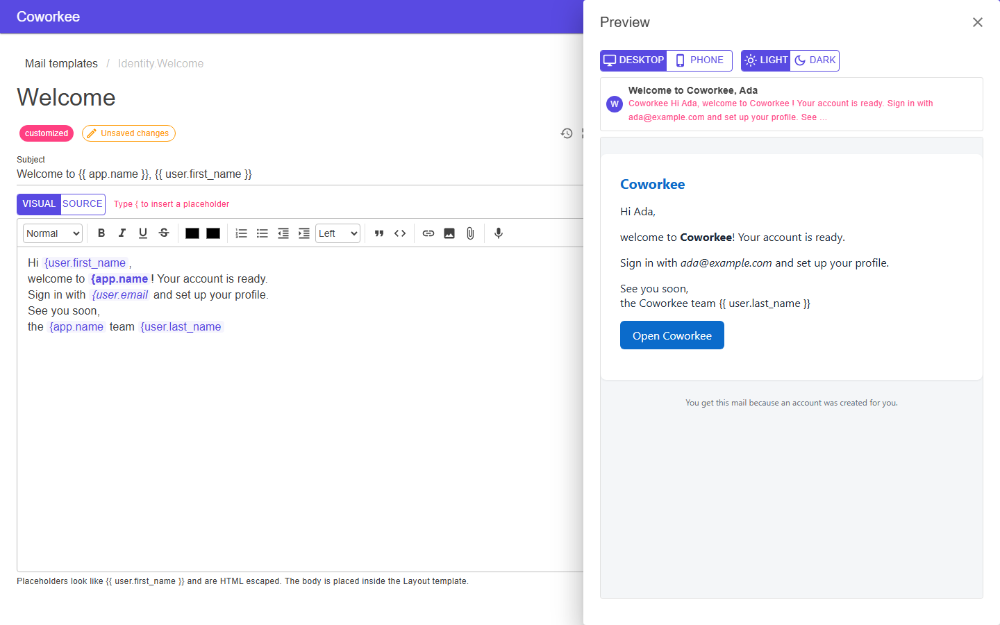

# Mailversand

Mails sind Vorlagen mit einem Modell. Module definieren sie mit Standardtexten pro Sprache; Administratoren überschreiben Betreff und Text in der Oberfläche. Der Versand läuft über eine Warteschlange mit Wiederholungen in einem Hintergrundjob, jede Mail landet im Mail-Log.

```csharp
internal sealed class OrderMailTemplates : IMailTemplateContributor
{
    public void Define(MailTemplateContext context) =>
        context.Add(new MailTemplateDefinition("Orders.Shipped", "Order shipped", new OrderShippedMail("Ada", "A-1001"),
            new Dictionary<string, MailTemplateContent>
            {
                ["en"] = new("Your order {{ number }} is on its way", "Hello {{ name }}, ..."),
                ["de"] = new("Ihre Bestellung {{ number }} ist unterwegs", "Hallo {{ name }}, ..."),
            }));
}

await mails.QueueAsync(customer.Email, "Orders.Shipped", new OrderShippedMail(customer.Name, order.Number), culture: "de", ct);
```

Vorlagen nutzen [Scriban](https://github.com/scriban/scriban). Das Beispielmodell füllt die Vorschau und die Schaltfläche *Send test* im Vorlageneditor. Ein `en`-Standardtext ist Pflicht.

Ein Modell ist ein Objekt, ein Dictionary (`Dictionary<string, object?>`) oder ein JSON-Objekt (`JsonElement`), etwa eines, das mit einer wartenden Mail gespeichert ist; Namen werden in jedem Fall klein mit Unterstrichen geschrieben (`OrderNumber` wird `order_number`), und Textwerte werden im Inhalt HTML-maskiert. [Benachrichtigungstypen](realtime.md#mail-vorlagen-pro-typ-und-verzogerung-pro-organisation) rendern ihre Vorlage mit einem solchen Modell.

## Eigene Vorlagen

Neben den Vorlagen der Module legen Administratoren unter **Administration > Communication > Mail templates** (/admin/mail/templates, Berechtigung Mail.Templates.Manage) eigene an. **Neue Vorlage** fragt nach einem Namen (Buchstaben, Ziffern, ., _ und -; er lässt sich später nicht ändern und darf keine Vorlage des Systems oder der Organisation wiederholen), einem Anzeigenamen und einer Beschreibung; danach öffnet sich der Editor. Die Kopieren-Schaltfläche neben einer Vorlage legt aus ihrem Text in allen Sprachen eine eigene Vorlage an, unter einem freien Namen wie Identity.Welcome.copy. Eigene Vorlagen tragen die Markierung *custom*; nur sie lassen sich löschen, dabei entfallen auch ihre Texte. Benutzer der Systemorganisation können **Global** ankreuzen: Die Vorlage steht dann jeder Organisation zur Verfügung.

### Vorlage bearbeiten

{ .shot }

Der Inhalt hat zwei Modi, die über dem Editor umgeschaltet werden. **Visuell** ist ein Rich-Text-Editor mit den Formatierungen, die ein Mailprogramm zeigt (Überschriften, fett, kursiv, unterstrichen, durchgestrichen, Farben, Listen, Zitate, Links). Platzhalter sind Chips mit ihrem Namen: `{` tippen (oder `{{`, die zweite Klammer wird nicht geschrieben), Strg+Leertaste drücken oder die Schaltfläche *Platzhalter einfügen* der Werkzeugleiste nutzen und einen aus der Liste wählen (sie filtert beim Tippen, auch für `user.first`). **Quelltext** ist ein Code-Editor für das HTML und den Scriban-Text: `{{` oder Strg+Leertaste an beliebiger Stelle schlägt die Platzhalter und die Anweisungen `if`, `else`, `end` und `for` vor; die Auswahl ersetzt die getippten Klammern und die, die der Editor selbst geschlossen hat, es wird also nichts doppelt, und jedes `{{ ... }}` ist hervorgehoben. Gespeichert wird immer reiner Scriban-Text, ein Chip wird als `{{ user.first_name }}` abgelegt. Beide nutzen neben der Platzhalterliste die ganze Höhe des Fensters.

Der visuelle Editor ist standardmäßig TipTap. Mit der Einstellung **Rich-Text-Editor** (`Editors.RichTextEditor`, *Einstellungen → System*) stellen Administratoren jeden Rich-Text-Editor der Bibliothek auf Quill um; Platzhalter, die Erwähnungsliste, heller und dunkler Modus funktionieren in beiden gleich. Code (HTML-Quelltext, CSS) bleibt immer im Code-Editor. Eigene Seiten bekommen dieselbe Wahl mit `<RichTextEditor @bind-Value="..." Modules="..." />`: Er zeigt den Editor der Einstellung (oder den aus `Engine`) und gibt jedem Editor die Module, die er versteht; ein `MentionModule<T>` passt zu beiden. Beide Editoren behalten nur Markup, das sie kennen, eingefügte Skripte oder unbekannte Tags überleben also nicht; Platzhalter maskiert der Server beim Rendern.

**Vorschau** öffnet rechts ein Panel, das beim Tippen offen bleibt und die Mail kurz nach jeder Änderung mit den Beispieldaten rendert. Es zeigt die Zeile im Posteingang (Betreff und die ersten Worte) und wechselt zwischen Desktop- und Telefonbreite und zwischen hellem und dunklem Mailprogramm (das dunkle kehrt die Farben grob so um, wie es Mail-Apps tun; das reicht, um unleserlichen Text zu finden). **Testmail an mich senden** schickt die gespeicherte Version mit den Beispieldaten an deine eigene Adresse.

Der Editor markiert ungespeicherte Änderungen und fragt nach, bevor du damit die Seite verlässt oder die Sprache wechselst. **Versionsverlauf** (die Uhr) listet jede gespeicherte Version dieser Sprache mit Autor und Zeitpunkt, gelesen aus dem Audit-Log, also auch Versionen von vor einem Zurücksetzen. Wähle eine aus, um Zeile für Zeile zu sehen, was sich zwischen ihr und dem Editor geändert hat; **In den Editor übernehmen** holt sie als ungespeicherten Text zurück, *Speichern* behält sie. API: `GET /api/v1/mail/templates/{name}/{culture}/history`.

Der visuelle Editor schreibt das Markup um und wird deshalb nur für Inhalte angeboten, die er unverändert lässt. Ein Inhalt mit Scriban-Anweisungen (`if`, `for`, `while`, `case`, `capture`, `with`, `func`, `tablerow`), mit anderen Tags als Textformatierung, Absätzen, Überschriften, Listen, Zitaten und Links (ein `<table`, `<div>`, ``, Kommentare) oder mit anderen Styles als `color`, `background-color` und `text-align` (die gestaltete Schaltfläche der mitgelieferten Vorlagen) öffnet sich im Quelltext, die Schaltfläche Visuell bleibt deaktiviert; von Visuell nach Quelltext lässt sich immer wechseln. Platzhalter, die die Vorlage nicht kennt, bleiben im visuellen Editor einfacher Text.

Neben dem Editor listet **Platzhalter** alle Variablen der Vorlage mit Typ und Beispielwert. Ein Klick fügt sie an der Cursorposition ein: als Chip im Visuell-Modus, als `{{ name }}` im Quelltext. Eine Liste (etwa die Benachrichtigungen eines Digests) fügt im Quelltext ein Schleifengerüst `{{ for item in liste }} ... {{ end }}` ein; ihre Mitglieder (aufgelistet als liste[].title) werden als {{ item.title }} eingefügt. Im Visuell-Modus kommen beide ans Ende des Quelltexts, weil sich Schleifen nicht visuell bauen lassen. Die Schaltfläche neben dem Betreff hängt einen Platzhalter an den Betreff an. Eigene Vorlagen verwenden das Empfängermodell (`user.first_name`, `user.display_name`, `app.name` und die weiteren Werte der Liste); *Auf Standard zurücksetzen* gibt es nur für Vorlagen der Module, eigene Vorlagen haben keinen Standard.

### Sprachen einer Vorlage

Eine Vorlage hat eine Variante pro Sprache; die Spalte *Sprachen* listet sie mit ihren Flaggen (hervorgehoben: hier geändert). Im Editor stehen dieselben Sprachen als Chips neben dem Titel: Ein Klick öffnet die Variante, die Übersetzen-Schaltfläche daneben fügt eine hinzu. Eine später auf der Sprachen-Seite eingeschaltete Sprache bekommt nicht von selbst eine Variante. **Sprache hinzufügen** (die Übersetzen-Schaltfläche einer Vorlage) fragt nach der Sprache, nach der vorhandenen Variante, von der sie ausgeht, und ob maschinell übersetzt werden soll: Ist unter den Übersetzungseinstellungen ein Übersetzungsdienst eingerichtet, werden nur die Texte zwischen den HTML-Tags übersetzt, Tags, Styles und `{{ ... }}`-Platzhalter bleiben, wie sie sind; ohne Dienst beginnt die Variante als Kopie. Danach öffnet sich der Editor der neuen Variante, dort den Text prüfen. Eine hinzugefügte Sprache lässt sich über das Kreuz ihres Chips entfernen; die mitgelieferten Sprachen einer Modulvorlage werden stattdessen im Editor zurückgesetzt, und die letzte Sprache einer eigenen Vorlage bleibt. Die Schaltfläche ist deaktiviert, wenn jede aktive Sprache schon eine Variante hat.

Eine Mail in einer Sprache ohne Variante fällt schrittweise zurück: auf die Sprache (de-AT), ihre Elternsprache (de), die Standardsprache (der Organisation, sonst des Systems, sonst die Standardsprache der Sprachen-Seite) und deren Elternsprache, auf Englisch und bei eigenen Vorlagen auf die älteste Variante. API: `POST /api/v1/mail/templates/{name}/{culture}` mit `{ "from": "en", "translate": true }` fügt eine Variante hinzu, `DELETE` auf denselben Pfad entfernt sie.

## Kampagnen

**Administration > Communication > Mail campaigns** (/admin/mail/campaigns, Berechtigung Mail.Campaigns.Send) versendet eine eigene Vorlage an viele Benutzer deiner Organisation. Eine Kampagne erreicht immer nur Benutzer der Organisation dessen, der sie versendet, auch bei der Systemorganisation. Eingebaute Vorlagen lassen sich nicht versenden, sie brauchen ein eigenes Modell; kopiere eine, um zuerst eine eigene Vorlage zu erhalten.

**Neue Kampagne** öffnet einen Assistenten mit drei Schritten:

1. **Vorlage**: eine eigene Vorlage wählen und die Kampagne benennen.
2. **Empfänger**: festlegen, wer sie erhält, siehe unten. Das Feld unter der Auswahl zeigt immer, wie viele Benutzer das sind, wie viele ausgeschlossen wurden und die ersten Empfänger.
3. **Senden**: Zusammenfassung, **Testmail an mich senden** (schickt die Vorlage an deine eigene Adresse, ihre Fußzeile verlinkt deine echte Abmeldeseite), **Jetzt senden** oder **Planen** mit Datum und Uhrzeit. Beides fragt noch einmal mit der Anzahl der Empfänger nach. Die Zeit ist die Uhrzeit deines Browsers; eine Zeit, die mehr als eine Minute in der Vergangenheit liegt, wird abgelehnt.

Empfänger stammen aus einer dieser Quellen:

- **Intelligente Liste**: eine Voreinstellung (alle aktiven Benutzer; seit mehr als N Tagen nicht angemeldet, Standard 30; noch nie angemeldet; in den letzten N Tagen registriert; E-Mail nicht bestätigt; Mitglieder von Rollen; deaktivierte Benutzer), eine **gespeicherte Liste** oder eine **eigene Abfrage**, gebaut mit demselben Abfrage-Editor wie der erweiterte Filter der Benutzertabelle. **Als Liste speichern** legt eine Abfrage unter einem Namen für spätere Kampagnen ab; eine gespeicherte Liste wird in die Kampagne kopiert, spätere Änderungen oder das Löschen der Liste ändern eine bereits geplante Kampagne also nicht.
- **Manuelle Auswahl**: die Benutzertabelle mit Kontrollkästchen. Suche, Facetten und der erweiterte Filter grenzen sie vorab ein. **Alle Treffer auswählen** wechselt von den angekreuzten Zeilen zu allen Benutzern, die dem aktuellen Filter entsprechen, auch auf anderen Seiten. Die Auswahl folgt danach dem Filter: Wer weiter sucht oder filtert, ändert, wer gemeint ist, bis du eine Zeile an- oder abwählst.

Eine eigene Abfrage und eine manuelle Auswahl brauchen zusätzlich das Recht, Benutzer anzuzeigen (`Identity.Users.View`), weil sie Personen nach Namen auswählen lassen. Mit nur `Mail.Campaigns.Send` funktionieren die Voreinstellungen, die Vorschau zeigt dann die Zahlen ohne die Namen.

Benutzer ohne E-Mail-Adresse, gesperrte Benutzer und Benutzer, die **Newsletter erhalten** abgeschaltet haben, werden nie angeschrieben; deaktivierte Benutzer nur mit der Voreinstellung *Deaktivierte Benutzer*. Sie werden als ausgeschlossen gezählt. Die Empfänger werden beim Start der Kampagne aufgelöst, nicht bei der Auswahl; eine geplante Kampagne erreicht also die Benutzer dieses Zeitpunkts. Jede Mail wird in der Sprache des Empfängers erzeugt: der des Benutzers, sonst der der Organisation, sonst der Standardsprache.

Jede Kampagnenmail endet mit einem Abmeldelink. Er öffnet ohne Anmeldung eine Bestätigungsseite; die Bestätigung schaltet die Einstellung **Newsletter erhalten** (`Mail.Newsletters`, standardmäßig an) für diesen Benutzer ab. Benutzer können sie in ihren eigenen Einstellungen wieder einschalten. Der Link trägt ein signiertes Token und läuft nicht ab; das Token wird mit dem gemeinsamen Data-Protection-Schlüsselring in der Datenbank geschützt, die Links funktionieren also über Neustarts und Hosts hinweg. Die Bestätigung ist ein einfaches Formular-POST; die Web-App (BFF) lässt es ohne den sonst nötigen \X-CSRF\-Header durch, weil der Pfad in \Coworkee:Bff:CsrfExemptPaths\ steht (Standard \/api/v1/mail/unsubscribe\), das Token allein autorisiert es.

Die Liste zeigt jede Kampagne mit Status, `Gesendet/Gesamt` und einer roten Zahl *fehlgeschlagen*, wenn Mails nicht zugestellt werden konnten; sie aktualisiert sich alle fünf Sekunden, solange eine Kampagne sendet. Eine Kampagne, die fällig ist, aber zehn Minuten später noch *Geplant* ist, wurde nicht aufgegriffen: Die Liste zeigt eine Warnung und aktualisiert sie nicht mehr; prüf, ob der Hintergrunddienst läuft. Ein **Entwurf** (ein Assistent, der vor dem Senden verlassen wurde) hat eine Schaltfläche **Bearbeiten**, die den Assistenten mit Vorlage, Name und Empfängern wieder öffnet; Empfänger, die der Assistent nicht erneut anzeigen kann (angekreuzte Benutzer, ein Filter der Benutzertabelle), bleiben wie gespeichert, bis du die Auswahl änderst. Die Log-Schaltfläche öffnet das Mail-Log gefiltert auf diese Kampagne (`/admin/mail/log?campaign=<id>`). **Kampagne abbrechen** gibt es für geplante und sendende Kampagnen: Es werden keine weiteren Empfänger eingereiht, noch wartende Mails werden aus der Warteschlange entfernt; bereits gesendete bleiben gesendet. Andere Kampagnen lassen sich löschen.

!!! warning
    Links in Kampagnenmails brauchen eine absolute Adresse. Setz `Coworkee:Notifications:PublicAppUrl` (zum Beispiel `https://app.example.com`); ohne sie lässt sich keine Kampagne starten oder planen. Das Abmelde-Token ist mit ASP.NET Core Data Protection geschützt: Läuft der Kampagnen-Job in einem anderen Host als die Web-App, müssen beide denselben Data-Protection-Schlüsselring teilen, sonst öffnen sich die Links nicht.

## Anbieter

Mails verlassen das System über genau einen *Anbieter*. `Mail.Provider` wählt ihn, die übrigen Einstellungen gehören zum Anbieter und stehen in derselben Gruppe. Jeder Anbieter braucht eine Absenderadresse (`Mail.From`); die optionale Whitelist (`Mail.Whitelist`, eine Adresse oder `@domain` je Zeile, leer erlaubt alle) gilt für alle.

| Anbieter | Wert | Einstellungen | Hinweise |
|---|---|---|---|
| SMTP | `smtp` (Standard) | `Mail.Smtp.Host` (Pflicht), `Mail.Smtp.Port` (25), `Mail.Smtp.UseSsl`, `Mail.Smtp.UserName`, `Mail.Smtp.Password` | die bisherigen Schlüssel, nichts zu migrieren; ohne SSL wechselt die Verbindung mit STARTTLS, wenn der Server es anbietet |
| SendGrid | `sendGrid` | `Mail.ApiKey` (Pflicht) | ein API-Schlüssel mit der Berechtigung *Mail Send* |
| Mailgun | `mailgun` | `Mail.ApiKey` und `Mail.Mailgun.Domain` (beide Pflicht), `Mail.Mailgun.Region` (`us` oder `eu`, Standard `us`) | die Region muss zu deinem Mailgun-Konto passen: EU-Konten nutzen `api.eu.mailgun.net` |
| Mailchimp Transactional | `mailchimp` | `Mail.ApiKey` (Pflicht) | der Schlüssel von **Mailchimp Transactional** (früher Mandrill, `mandrillapp.com`), nicht von Mailchimp Marketing: Es ist ein kostenpflichtiges Add-on eines Mailchimp-Kontos, das du unter *Transactional* anlegst und dessen Schlüssel *keine* Marketing-API-Schlüssel sind. Ein Marketing-Schlüssel wird abgelehnt |

Die HTTP-Anbieter sprechen ihre REST-API direkt über `IHttpClientFactory` an; es kommt kein zusätzliches Paket dazu. `Mail.Smtp.Password` und `Mail.ApiKey` sind Secrets: verschlüsselt gespeichert und nie an den Client gesendet. Lehnt ein Anbieter eine Mail ab, schlägt der Job fehl und wiederholt wie bei jedem anderen Fehler; die Meldung (mit maskiertem Schlüssel) steht im Mail-Log.

## Die Seite Mail-Einstellungen

**Administration > System > Mail settings** (`/admin/mail-settings`, Berechtigung `Settings.Manage`) ersetzt den Mail-Tab der Einstellungsseite. Du wählst den Anbieter, füllst seine Felder, trägst Absender und Whitelist ein und speicherst; Änderungen gelten ab der nächsten Mail, ohne Neustart. **Send test mail** schickt eine Mail an deine eigene Adresse mit den Werten, die gerade im Formular stehen, gespeichert oder nicht, und zeigt das Ergebnis: Ein leeres Secret-Feld behält den gespeicherten Schlüssel, du testest also, ohne ihn neu einzutippen. Bei einem Fehler steht die Antwort des Anbieters da; für Organisationen (siehe unten) nur eine kurze Meldung, denn eine Organisation wählt ihren Host selbst und darf die Netzwerkfehler des Servers nicht lesen.

## Eigener Server je Organisation

Organisationen versenden standardmäßig über den Server des Systems. Die Einstellung `Mail.UseOwnServer` (Geltungsbereich Organisation, standardmäßig aus) lässt eine Organisation ihren eigenen nutzen: Auf der Seite Mail-Einstellungen sieht der Administrator der Organisation den Schalter und, wenn er an ist, dasselbe Formular für Anbieter und Zugangsdaten.

- Ist der Schalter **an**, kommen alle Werte aus der Organisation: Anbieter, Zugangsdaten, Absender und Whitelist. Ist er **aus**, kommen alle aus dem System. Es wird nichts gemischt, eine Organisation sendet also nie mit dem Passwort des Systems und einem eigenen Absender.
- Ausschalten behält die Werte der Organisation; beim erneuten Einschalten gelten sie, ohne sie neu einzugeben.
- Die Werte, die der Anbieter braucht (SMTP-Host, API-Schlüssel, Mailgun-Domain), müssen in der Organisation selbst gespeichert sein. Ein Standardwert des Deployments wie `Coworkee:Settings:Defaults:Mail.Smtp.Host` zählt nicht, sonst würde eine Organisation über den Server des Systems senden, während sie glaubt, ihren eigenen zu nutzen; die Mail scheitert stattdessen mit *... is not configured.*
- Die System-Organisation nutzt immer die Einstellungen des Systems.

## Versand und eigene Transporte

Ein Hintergrundjob nimmt die eingereihte Mail, ermittelt die Verbindung (Anbieter und Werte) für die Organisation der Mail und übergibt sie dem `IMailTransport`, dessen `Provider` passt.

!!! warning "Breaking Change"
    `ISmtpTransport` entfällt und wird durch `IMailTransport` ersetzt, eine Implementierung je Anbieter. Es gibt keinen Obsolete-Shim. Die Schlüssel `Mail.Smtp.*`, `Mail.From` und `Mail.Whitelist` bleiben unverändert, gespeicherte Werte gelten also weiter. Code, der `ISmtpTransport` implementiert oder ersetzt hat, implementiert stattdessen `IMailTransport`.

```csharp
public interface IMailTransport
{
    string Provider { get; }

    Task SendAsync(MailEnvelope mail, MailConnection connection, CancellationToken cancellationToken);
}
```

`MailEnvelope` enthält `From`, `To`, `Subject`, `HtmlBody` und die angehängten `Files` (`MailAttachment`: Dateiname, Inhaltstyp, Bytes; eingereiht mit `IMailSender.QueueWithAttachmentsAsync`, höchstens 10 MB je Mail, mit der Mail in `cw.OutgoingMailAttachments` gespeichert; die vier eingebauten Anbieter senden sie); `MailConnection` den Namen des Anbieters und die ermittelten Werte nach Einstellungsname (`connection[MailSettings.ApiKey]`, null, wenn leer). Eine Ausnahme lässt die Mail scheitern, der Job wiederholt sie. Ein Transport mit eigenem Namen ist ein neuer Anbieter. Dieser schreibt Mails ins Log, was in Tests praktisch ist:

```csharp
using Coworkee.Mailing;
using Microsoft.Extensions.DependencyInjection;
using Microsoft.Extensions.DependencyInjection.Extensions;
using Microsoft.Extensions.Logging;

public sealed class LogMailTransport(ILogger<LogMailTransport> logger) : IMailTransport
{
    public string Provider => "log";

    public Task SendAsync(MailEnvelope mail, MailConnection connection, CancellationToken cancellationToken)
    {
        logger.LogInformation("Mail from {From} to {To}: {Subject}", mail.From, mail.To, mail.Subject);
        return Task.CompletedTask;
    }
}

// in ConfigureServices
services.TryAddEnumerable(ServiceDescriptor.Singleton<IMailTransport, LogMailTransport>());
```

Die Einstellungsseite bietet nur die vier eingebauten Anbieter an. Den eigenen wählst du über seinen Namen als Standardwert: `Coworkee:Settings:Defaults:Mail.Provider` = `log`. Seine Zugangsdaten, falls er welche braucht, kommen aus deinen eigenen Einstellungen oder der Konfiguration; für einen unbekannten Anbieter prüft das System keine Pflichtwerte. Genauso geht es mit einem Dienst mit HTTP-API wie Amazon SES: `SendAsync` mit einem `HttpClient` aus `IHttpClientFactory` implementieren und die Anfrage so signieren, wie der Dienst es verlangt.

Lokal zeigt der AppHost die SMTP-Einstellungen auf Mailpit.