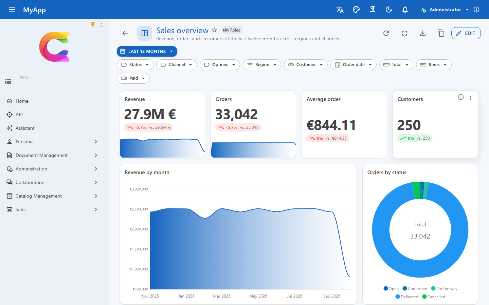
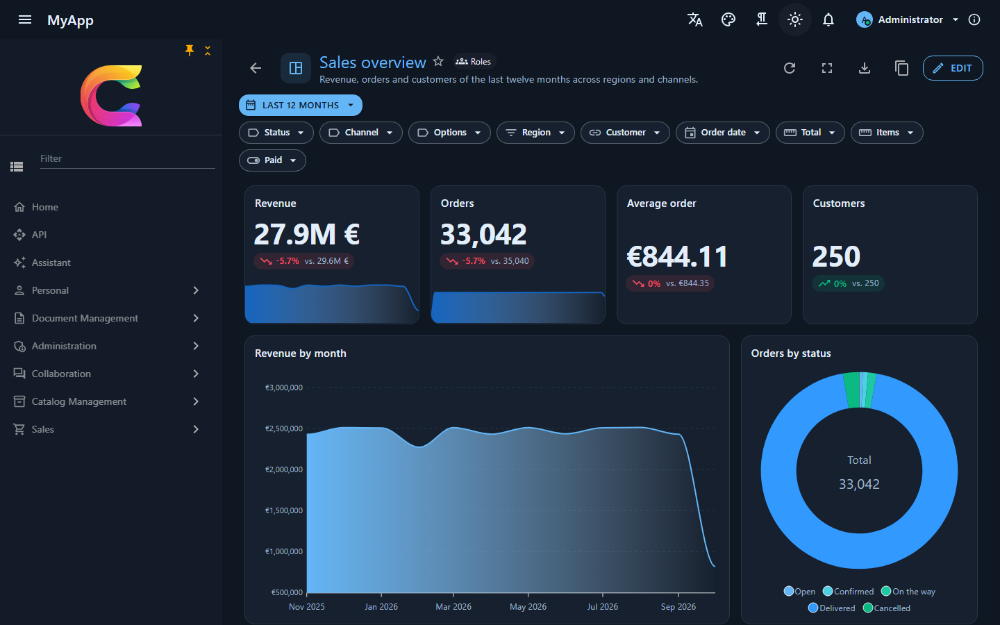
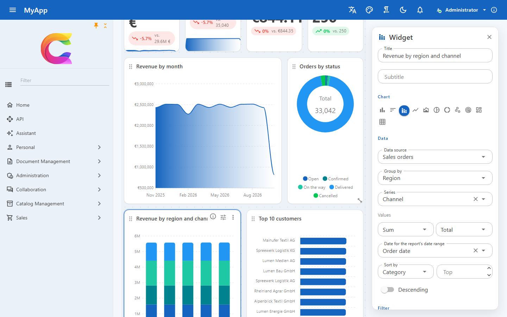
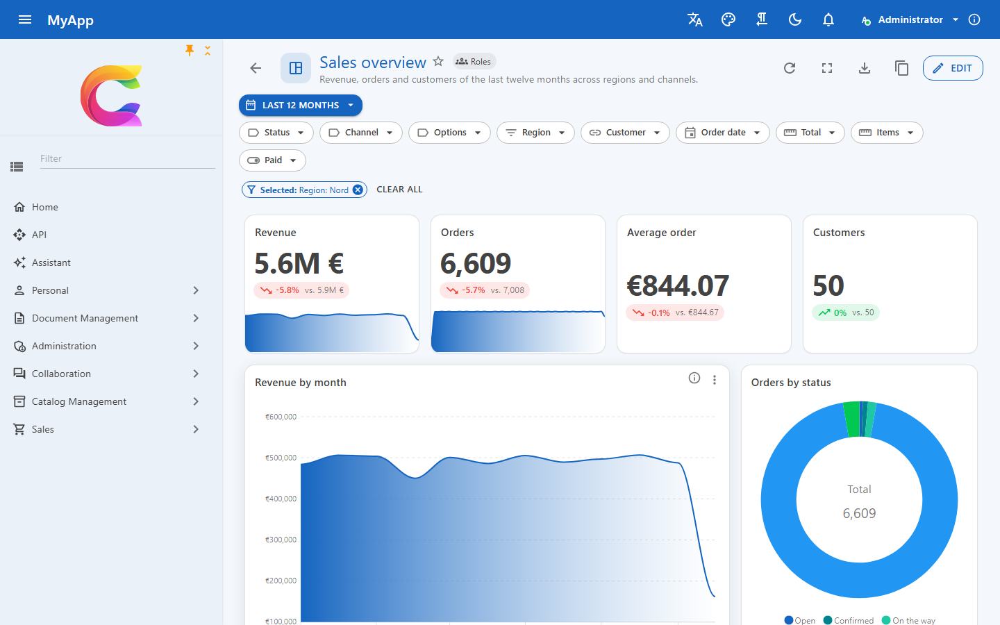

# Berichte

`Coworkee.Reporting` (Server) und `Coworkee.Client.Blazor.Reporting` (Client) ergänzen Dashboards über die OData-Entitätsmengen deiner App. Benutzer ordnen Widgets auf einem Raster an, filtern sie gemeinsam, klicken auf einen Balken, um die übrigen einzugrenzen, und teilen das Ergebnis mit Rollen, Gruppen oder dem ganzen Mandanten. Jede Zahl aggregiert die Datenbank, ein Dashboard über 100.000 Zeilen antwortet in wenigen Millisekunden.

{ .shot }

## Einrichtung

```csharp
// API: das Modul bringt Tabellen, Endpunkte, Berechtigungen und Live-Updates
[DependsOn(typeof(CoworkeeReportingModule))]
public sealed class MyAppDatabaseModule : CoworkeeModule;
```

```csharp
// WebAssembly-Client: Seiten unter /reports und der Navigationseintrag "Reports"
builder.Services.AddCoworkeeReporting(baseAddress, reports => reports
    .DrillDown("SalesOrders", "sales/orders")      // "Daten öffnen" führt mit dem Filter des Widgets auf deine Seite
    .DrillDown("Products", "catalog/products"));
```

Nimm `typeof(Coworkee.Client.Blazor.Reporting.ReportingOptions).Assembly` in die `AdditionalAssemblies` des Routers auf (in `Routes.razor` und in `AddAdditionalAssemblies` des Web-Hosts) und erzeuge eine Migration für die Tabellen `cw.Reports`, `cw.ReportFavorites`, `cw.DashboardReports` und `cw.ReportSubscriptions`. Das Modul hängt vom [Mailing-Modul](mailing.md) ab (Abo-Mails), das `cw.OutgoingMailAttachments` mitbringt. Neue Apps bekommen das alles mit der Template-Option `--reports` (standardmäßig an).

## Berichte in einer anderen App

Ein zweiter Client (ein Kundenportal neben der internen App) kann die Berichte unter eigenem Pfad und im eigenen Look anbieten oder `ReportPage` in einer eigenen Seite rendern:

```csharp
builder.Services.AddCoworkeeReporting(baseAddress, reports =>
{
    reports.BasePath = "dynamic-reports";   // /reports gehört in dieser App etwas anderem
    reports.Dashboards = false;             // keine Coworkee-Startseite: kein "Als mein Dashboard festlegen"
    reports.Subscriptions = false;          // hier keine Abo-Seite: kein "Per Mail abonnieren"
    reports.DataPages = false;              // Drill-down nur auf Seiten aus DrillDown
    reports.Colors = ["#002C61", "#00B6E8", "#D3D800", "#E89A00"];   // Reihenfarben statt der des Themes
    reports.ConfigureChart = (chart, widget) =>                       // die ApexCharts-Optionen jedes Diagramms, zuletzt
    {
        chart.Grid!.StrokeDashArray = 0;
        chart.PlotOptions!.Bar!.BorderRadius = 0;
    };
});
```

```razor
@page "/dynamic-reports/{Id:guid}"
@* die Seite der Bibliothek in der Seite der App; AllowEdit="false" lässt sie nur lesend, auch für den Besitzer *@
<ReportPage Id="Id" AllowEdit="_canEdit" />
```

`BasePath` ändert die Routen der Bibliotheksseiten, die Links zwischen ihnen (zurück zur Liste, ein neuer oder kopierter Bericht, die Abos) und den Navigationseintrag. Die eigene Palette eines Widgets geht `Colors` weiter vor.

## Deine Entitätsmengen als Datenquellen

Berichte nutzen, was du ohnehin für OData registriert hast, sonst nichts:

```csharp
services.AddODataEntity<SalesOrder>("SalesOrders", SalesPermissions.Orders.View);
services.AddODataEntity<Customer>("Customers", SalesPermissions.Orders.View);
```

- **Felder** kommen aus dem EDM: mit `AddODataEntity(..., o => o.Hide(...))` verborgene Eigenschaften erscheinen nie, weder als Feld noch in einem Filter; solche hinter `HideUnless(..., permission)` nur für Benutzer mit dieser Berechtigung.
- **Navigationen** zu einer anderen registrierten Menge ergänzen deren Felder, etwa `Customer/Name`; der Benutzer braucht auch die Berechtigung dieser Menge, und ihre Zeilenfilter gelten: ein Kunde, den der Benutzer nicht sehen darf, zählt als leer (`null`), nie unter seinem Namen.
- **Beschriftungen** kommen aus `[ProvideFacet(Label = ...)]`, `[Display(Name = ...)]` oder dem Eigenschaftsnamen; Enum-Werte zeigen ihre `[Display]`-Namen.
- **Zeilen** sind die, die auch die OData-Liste liefert: Mandantenfilter, Soft Delete und jeder `IODataEntityFilter<T>` gelten. Wer die Berechtigung der Menge nicht hat, bekommt für deren Widgets ein 403, der Rest des Berichts funktioniert weiter.
- Entitäten mit `[Realtime]` aktualisieren offene Dashboards, sobald sich ihre Zeilen ändern.

`GET /api/v1/reports/sources` listet die Mengen und Felder, die der angemeldete Benutzer nutzen darf.

## Eigene Datenquellen

Manche Kennzahlen sind keine Zeilen einer Tabelle: Mitarbeiterzahl pro Monat aus Eintritts- und Austrittsdatum, Fluktuation oder Krankenquote pro Monat, Überstunden pro Abteilung, Schulungsquote. Registriere sie als Quelle mit einem einfachen Zeilentyp; Berichte listen sie nach den Entitätsmengen (mit einem Summen-Symbol markiert) und aggregieren ihre Zeilen wie die einer Menge:

```csharp
public sealed record HeadcountRow(
    DateOnly Month,
    string Department,
    [property: DisplayName("Mitarbeitende")] int Headcount,
    int Hires,
    int Exits);

services.AddReportSource<HeadcountRow>("HeadcountByMonth", "Mitarbeitende pro Monat", HrPermissions.Reports,
    async (context, cancellationToken) =>
    {
        // die Mitarbeitenden, die der Benutzer lesen darf: Mandant, Soft Delete und die Zeilenfilter der Menge gelten
        var employees = await ODataEntityAccess.VisibleAsync<Employee>(context.Services, cancellationToken);
        var from = context.DateFrom ?? new DateOnly(DateTime.Today.Year - 1, 1, 1);
        var to = context.DateTo ?? DateOnly.FromDateTime(DateTime.Today).AddDays(1);
        var people = await employees
            .Where(e => e.HireDate < to && (e.ExitDate == null || e.ExitDate >= from))
            .Select(e => new { e.HireDate, e.ExitDate, Department = e.Department!.Name })
            .ToListAsync(cancellationToken);

        var rows = new List<HeadcountRow>();
        for (var month = new DateOnly(from.Year, from.Month, 1); month < to; month = month.AddMonths(1))
        {
            var end = month.AddMonths(1);
            rows.AddRange(people.GroupBy(p => p.Department).Select(g => new HeadcountRow(month, g.Key,
                g.Count(p => p.HireDate < end && (p.ExitDate is not { } exit || exit >= end)),
                g.Count(p => p.HireDate >= month && p.HireDate < end),
                g.Count(p => p.ExitDate >= month && p.ExitDate < end))));
        }

        return rows;
    });
```

- **Felder** sind die einfachen öffentlichen Eigenschaften des Zeilentyps (Text, Zahlen, Datumswerte, Wahrheitswerte, Enums, GUIDs), beschriftet wie bei Entitätsmengen (`[Display]`, `[DisplayName]`, `[ProvideFacet(Label = ...)]`, `[Display]`-Namen der Enum-Werte). Der Name darf nicht der einer OData-Menge sein.
- **Berechtigung** wirkt wie die einer Menge: Ohne sie fehlt die Quelle in der Liste und ihre Abfragen antworten mit 403. Die Zeilen sind das, was deine Funktion liefert; Zeilenregeln wendet sie also selbst an, z. B. über `ODataEntityAccess.VisibleAsync<T>` oder den aktuellen Benutzer aus `context.Services`.
- **Kontext**: `context.Services` sind die Dienste der Anfrage. `DateFrom`/`DateTo` sind die Grenzen, die ein Datumsfeld im Filter des Widgets bekommt (der Zeitraum des Berichts schickt `Month ge 2026-01-01 and Month lt 2026-04-01`), damit die Quelle nur diese Monate berechnet. Sie sind ein Hinweis: Der Filter gilt trotzdem für die gelieferten Zeilen.
- **Aggregation**: Filter des Widgets (OData `$filter`, gegen den Zeilentyp geparst), Gruppierung mit Datums-Buckets, Werte und Top funktionieren wie bei Mengen. Eine Liste wird im Speicher aggregiert; gib ein `IQueryable` der Datenbank zurück (das `Task<IEnumerable<T>>` nimmt es an), dann aggregiert die Datenbank. Es gibt auch eine synchrone Überladung `AddReportSource<T>(name, label, permission, context => rows)`.
- Werte, die ein Bestand pro Monat sind (Mitarbeiterzahl), addieren sich pro Quartal; nimm dafür `Average` oder `Max` und `Sum` für Bewegungen wie Eintritte.
- **Währung**: Beträge in einer Währung des Benutzers (der bevorzugten) brauchen einen Resolver, die Überladung mit `currency`:

  ```csharp
  services.AddReportSource<CostRow>("Costs", "Kosten", CostPermissions.View,
      async (context, cancellationToken) => await LoadCostsAsync(context, cancellationToken),
      async (services, cancellationToken) => await services.GetRequiredService<IPreferredCurrency>().GetAsync(cancellationToken)); // your own service, e.g. "CHF"
  ```

  `GET /api/v1/reports/sources` nennt sie pro Benutzer (`ReportSourceDto.Currency`). Ein Widget der Quelle formatiert eine *Währungs*-Zahl damit (nicht mit der eigenen `Options.Currency`), und `{currency}` in Titel und Untertitel wird zum Währungscode: ein KPI mit dem Titel `Gesamtkosten in {currency}` zeigt "Gesamtkosten in CHF". Abo-Mails machen dasselbe. `{currency}` funktioniert auch bei Quellen ohne Resolver (die Währung des Widgets).
- **Leer als null**: `Average` überspringt Zeilen ohne Wert. Mit `EmptyAsZero = true` (`new ReportAggregate(AggregateFunction.Average, "TransitDays", EmptyAsZero: true)`) zählen sie als 0: `Sum(Feld ?? 0) / Count(*)`, z. B. die durchschnittliche Transitzeit über alle Sendungen, auch die ohne Wert. Andere Funktionen lehnen das Flag ab. Der Designer zeigt den Schalter „Leer zählt als null“ neben der Funktion, wenn sie *Average* ist, in den Widget-Einstellungen und bei den Wert-Umschaltern.
- **Geteilte Filter**: Berichtsfacetten und Kreuzfilter schränken auch eine berechnete Quelle ein, die ein Feld mit gleichem Pfad und gleicher Art wie das Feld der Facette hat (`ReportFilters.Applying`); siehe [Filter über Datenmengen hinweg](../features/reporting.de.md#filter-uber-datenmengen-hinweg).
- **Widgets**: KPI, Diagramme, Pivot und Tabelle funktionieren; Tabellen lesen die Zeilen über `POST /api/v1/reports/rows`. Das Datentabellen-Widget, Facetten in der Filterleiste und die Echtzeit-Aktualisierung brauchen eine OData-Menge (nimm stattdessen das Aktualisierungsintervall des Berichts). *Daten öffnen* erscheint nur, wenn der Client eine Seite für die Quelle registriert: `ReportingOptions.DrillDown("HeadcountByMonth", "/hr/people")`.
- **KI**: Die Berichtswerkzeuge des Assistenten und des MCP-Servers (`get_report_sources`, `run_report`, `read_report_rows`, `generate_report`) sehen die Quellen, die der Benutzer lesen darf; `list_data_sets`/`query_data` decken nur OData-Mengen ab.

### Einen Bericht auf einer Quelle anlegen (Seed)

Ein Bericht speichert nur den Namen der Quelle; eine App legt ihn also wie jeden Bericht an, z. B. in ihrem Migrations-Host:

```csharp
var definition = new ReportDefinition
{
    DateRange = new ReportDateRange(DateRangePreset.Last12Months),
    Widgets =
    [
        new ReportWidget
        {
            Id = "trend", Type = WidgetType.Chart, Title = "Mitarbeitende pro Abteilung", W = 12, H = 5,
            Query = new WidgetQuery
            {
                EntitySet = "HeadcountByMonth", DateField = "Month",
                GroupBy = new ReportGroupBy("Month", DateBucket.Month), SplitBy = new ReportGroupBy("Department"),
                Aggregates = [new(AggregateFunction.Sum, "Headcount")],
            },
            Options = new WidgetOptions { Chart = ChartKind.Line },
        },
    ],
};
db.Add(new Report
{
    TenantId = tenantId, OwnerId = adminId, Name = "Mitarbeitende", Visibility = ReportVisibility.Organisation,
    Definition = JsonSerializer.Serialize(definition, new JsonSerializerOptions(JsonSerializerDefaults.Web)),
});
```

Name und Beschreibung des Berichts, Widget-Titel und Wertbeschriftungen werden gespeichert, wie sie geschrieben sind, und übersetzt angezeigt, wenn die App einen Text dafür hat (ihre `Localization/*.json`); ein Seed schreibt also englische Schlüssel und liefert deren Übersetzungen mit. Eigene Namen ohne Text erscheinen, wie sie eingegeben wurden.

## Aggregation auf dem Server

Widgets senden ein Abfragemodell, nie einen Ausdruck:

```json
POST /api/v1/reports/query
{
  "entitySet": "SalesOrders",
  "filter": "Region eq 'Nord' and Total gt 100",
  "groupBy": { "field": "OrderDate", "bucket": "Month" },
  "splitBy": { "field": "Channel" },
  "aggregates": [ { "function": "Sum", "field": "Total" }, { "function": "Count" } ],
  "sortBy": "Value", "descending": true, "top": 10
}
```

Der Server prüft jedes Feld gegen die Quelle, baut `GroupBy` und `Select` mit Expression Trees und lässt EF Core daraus SQL machen. Der Filter ist OData-`$filter`, gegen das EDM geparst wie am OData-Endpunkt. Jede Gruppe kommt mit einem OData-Filter für genau ihre Zeilen zurück, den der Client für Kreuzfilter und Drill-down nutzt.

| | |
|---|---|
| Gruppieren | nach jedem Feld, höchstens zwei (Kategorien und Reihen); Datumswerte nach `Day`, `Week` (Montag), `Month`, `Quarter`, `Year` |
| Werte | `Count`, `Sum`, `Average`, `Min`, `Max` (Zahlen), `DistinctCount` (jedes Feld), bis zu 8 |
| Grenzen | 5.000 Gruppen, Top 1 bis 1.000 |
| Abgelehnt | unbekannte oder verborgene Felder, Summen über Text, Zeiträume auf Nicht-Datumsfeldern, OData, das sich nicht parsen lässt |

Alle drei Datenbank-Provider aggregieren in SQL. Auf SQL Server werden Wochen mit `DATEDIFF` ab einem Montag gezählt, weil der Wochentag dort von Servereinstellungen abhängt. Auf SQLite speichert ein Coworkee-DbContext `DateTimeOffset` als Zahl; Zeiträume berechnen daraus das UTC-Datum. Ein anders gespeicherter `DateTimeOffset` (ein [externer DbContext](../fundamentals/persistence.md#externe-datenbanken), auch mit dem Binär-Converter, oder ein eigenes `HasConversion`) hat auf SQLite keine Datumsteile, seine Zeiträume werden dort abgelehnt.

Gemessen an den 100.000 Aufträgen der Demo (Postgres, warm): Anzahl nach Status 9 ms, Summe nach Monat 29 ms, Anzahl nach Woche 55 ms, Region nach Kanal 23 ms, Top 10 Kunden mit Join 30 ms, vier KPI-Werte 58 ms.

### Gruppierte Tabellen

Eine Tabelle, gruppiert nach mehreren Feldern (bis zu 8), daneben Werte von bis zu drei weiteren Datenmengen, nach denselben Feldern gruppiert, auf dem Server nach jeder Spalte sortiert und seitenweise geliefert. `IReportsApi.TableAsync` sendet sie; über den Dispatcher ist es `RunReportTableQuery`.

```json
POST /api/v1/reports/table
{
  "entitySet": "SalesOrders",
  "filter": "OrderDate ge 2025-01-01",
  "groupFields": [ "Region", "Channel" ],
  "aggregates": [ { "function": "Count" }, { "function": "Average", "field": "DaysToShip", "emptyAsZero": true } ],
  "joins": [
    { "entitySet": "Returns", "filter": null, "aggregates": [ { "function": "Sum", "field": "Amount" } ] }
  ],
  "orderBy": [ { "column": 2, "descending": true } ],
  "skip": 0, "top": 20
}
```

```json
{
  "rows": [
    { "keys": [ { "value": "North", "label": "North", "filter": "Region eq 'North'" }, { "value": null, "label": "", "filter": "(Channel eq null or Channel eq '')" } ],
      "values": [ 120, 3.5, 4200.5 ] }
  ],
  "more": true,
  "elapsedMilliseconds": 12
}
```

- Jede Quelle wird in der Datenbank nach allen Gruppierungsfeldern gruppiert, über dieselben Zeilen wie die anderen Berichtsabfragen (Zeilenfilter, Datenfilter, Navigationsbereich oder die Zeilen einer eigenen Quelle); Rohzeilen verlassen sie nie.
- Die Zeilen sind die Gruppen der Hauptmenge. Texte gruppieren als `COALESCE(x, '')`: Zeilen mit leerem und fehlendem Text sind eine Gruppe (Anzahl, Summe und Durchschnitt über alle), gezeigt mit einem null-Schlüssel, dessen Filter beide wählt. Ein Join hängt seine Werte an die Gruppe mit demselben Schlüssel: Texte gleichen sich ohne Rücksicht auf Groß- und Kleinschreibung, ein leerer Text gleicht null, wie `ISNULL(x, '')` unter der Collation von SQL Server, die Groß- und Kleinschreibung nicht unterscheidet. Eine Gruppe ohne Zeilen in einem Join bekommt null-Werte; Gruppen, die nur ein Join hat, fallen weg.
- `orderBy`-Spalten zählen zuerst die Gruppierungsfelder (0 bis Felder - 1), dann die Werte der Hauptmenge, dann die Werte jedes Joins der Reihe nach. Gleichstände entscheiden alle Gruppierungsfelder aufsteigend. Texte sortieren ohne Rücksicht auf Groß- und Kleinschreibung, null zuerst (absteigend zuletzt), wie auf SQL Server.
- `more` sagt, ob nach der Seite weitere Zeilen folgen.
- Jede verbundene Menge braucht ihr Leserecht (sonst 403) und jedes Gruppierungsfeld (sonst 400). Grenzen: 1 bis 8 Gruppierungsfelder, 8 Werte je Menge, 3 Joins, `top` 1 bis 50.000, höchstens 50.000 Gruppen je Menge (`ReportTables.MaxRows`).
- Schlüssel, die sich nur in Groß- und Kleinschreibung unterscheiden und getrennt gespeichert sind (Postgres gruppiert „North“ und „north“ getrennt), ordnet zuletzt ihr genauer Text, damit sich Seiten nie überschneiden. Die Werte eines Joins bekommt nur der erste von ihnen nach genauem Text, die anderen null, damit nichts doppelt zählt.

Das [Widget gruppierte Tabelle](#widget-gruppierte-tabelle) zeigt eine solche Tabelle in einem Bericht.

## Widgets

| Widget | Zeigt |
|---|---|
| Kennzahl | einen Wert mit Trend gegenüber dem Zeitraum davor, einer Kurve über die Zeit und einem Tacho zum Ziel |
| Diagramm | Balken, liegende Balken, gestapelte Balken, Linie, Fläche, Torte, Ring, Streuung, Netz, Treemap, Heatmap, Chips; Datumswerte auf einer Zeitachse |
| Tabelle | Zeilen der Menge mit endlosem Scrollen (jedes Scrollen lädt die nächste Seite), sortierbar, als Tabelle, Karten oder Liste |
| Datentabelle | die [`CoworkeeDataTable`](../ui/data-table.md) der Bibliothek: Seiten, Gruppierung, Spaltenauswahl, Facetten, Suche |
| Pivot | Kategorien als Zeilen, Reihen als Spalten, nach Größe eingefärbt, mit Summen |
| Gruppierte Tabelle | Gruppen aus bis zu 8 Feldern mit Werten der Menge und verbundener Mengen, auf dem Server sortiert und seitenweise geladen ([unten](#widget-gruppierte-tabelle)) |
| Text, Bild, Webseite | Markdown (HTML wird nicht dargestellt), ein Bild oder eine abgeschottete Seite von einer http(s)-Adresse |

Diagramme nutzen [Blazor-ApexCharts](https://github.com/apexcharts/Blazor-ApexCharts): gepflegt, animiert und ohne Nacharbeit ansehnlich, mit Klick-Ereignissen für Kreuzfilter. Farben, Schrift und Dunkelmodus kommen aus den CSS-Variablen des MudBlazor-Themes, eigene Themes brauchen keine weitere Einrichtung.

### Chips-Diagramm

`ChartKind.Chips` zeigt die Werte des Gruppierungsfelds als Chips mit ihrem Anteil am Ganzen („25 % Air“) und dient als Filter: Ein Klick schaltet den Wert um und schränkt die übrigen Widgets ein (mehrere Chips werden mit „oder“ verknüpft; ein gewählter Chip filtert beim erneuten Klick nicht mehr). `WidgetOptions.ValueIcons` ist eine geordnete Liste von `ValueIcon(Value, Icon)` mit den Werten, die einen Chip bekommen, jeweils mit einem MudBlazor-Symbol (SVG); eine Liste statt eines Wörterbuchs, weil ein gespeicherter Bericht die Reihenfolge behält. `Value` ist der Schlüssel der Daten: bei Enums der Membername (nicht das Label), für Zeilen ohne Wert eine leere Zeichenkette. Andere Werte zählen weiter zu den 100 %. Gewählte Werte, die aus den Daten verschwinden (Neuladen, Filter eines anderen Widgets), verlassen den Filter. Gewählte Chips sind gefüllt, die übrigen umrandet. Ein Chips-Widget ignoriert seinen eigenen Filter, die Anteile beziehen sich also immer auf alle Werte; sein Filter trägt das Gruppierungsfeld und schränkt deshalb auch Widgets anderer Datenmengen mit demselben Feld ein. Der Designer bietet „Chips“ unter den Diagrammarten und einen Editor für Werte und Symbole (Reihenfolge, Symbolauswahl); Abo-Mails listen die Anteile als Tabelle.

```csharp
new ReportWidget
{
    Type = WidgetType.Chart, Title = "Transportart",
    Query = new WidgetQuery { EntitySet = "Shipments", GroupBy = new ReportGroupBy("TransportMode") },
    Options = new WidgetOptions
    {
        Chart = ChartKind.Chips,
        ValueIcons = [new("Air", Icons.Material.Outlined.Flight), new("Sea", Icons.Material.Outlined.DirectionsBoat)],
    },
}
```

{ .shot }

### Widget gruppierte Tabelle

`WidgetType.GroupedTable` zeigt eine [gruppierte Tabelle](#gruppierte-tabellen): eine Zeile je Kombination der `WidgetQuery.GroupFields` (1 bis 8), daneben die `Aggregates` des Widgets und danach die Werte jedes `WidgetJoin` (eine andere Datenmenge, nach denselben Feldern gruppiert, z. B. Kosten neben der Zahl der Sendungen).

```csharp
new ReportWidget
{
    Type = WidgetType.GroupedTable, Title = "Trade lanes", W = 12, H = 7,
    Query = new WidgetQuery
    {
        EntitySet = "Shipments", DateField = "Etd",
        GroupFields = ["OriginCountry", "DestinationCountry", "Mode", "Supplier"],
        Aggregates =
        [
            new(Label: "Shipments"),
            new(AggregateFunction.Sum, "Weight", "Weight", Unit: "kg"),
            new(AggregateFunction.Average, "TransitDays", "Avg transit", EmptyAsZero: true, Format: NumberFormat.Integer, Unit: "days"),
        ],
        Joins = [new WidgetJoin { EntitySet = "ShipmentCosts", Aggregates = [new(AggregateFunction.Sum, "Amount", "Total cost", Format: NumberFormat.Currency)] }],
        OrderBy = "Total cost desc, Shipments desc",
    },
    Options = new WidgetOptions { HiddenColumns = ["Supplier"] },
}
```

- **Spalten** heißen nach dem Pfad des Gruppierungsfelds oder der Bezeichnung des Werts (ohne Bezeichnung z. B. `Count` oder `Sum Amount`, der Wert eines Joins mit seiner Menge: `Count (InsightContainers)`, angezeigt mit der Bezeichnung der Menge; `ReportTableColumns.Of(query)`). Namen sind ohne Rücksicht auf Groß- und Kleinschreibung eindeutig: Das Speichern lehnt eine zweite Spalte gleichen Namens mit dem Schlüssel ihrer Bezeichnung ab, z. B. `Widgets[lanes].Aggregates[1].Label` (`ReportTableColumns.Clashes`). `WidgetOptions.HiddenColumns` nennt Spalten, die weiter gruppieren (oder weiter berechnet werden), aber nicht angezeigt werden, z. B. die Lieferantenspalten einer Brokerage-Variante, die nach allen Lane-Feldern gruppiert.
- **Reihenfolge**: `WidgetQuery.OrderBy` ist eine Liste wie `"Total cost desc, Shipments desc"`; Einträge, die keine Spalte nennen, werden übersprungen, für einen Leser ohne Recht auf die verbundenen Kosten beginnt die Tabelle also nach Sendungen sortiert. Ein Klick auf eine Überschrift sortiert auf dem Server nach dieser Spalte (aufsteigend, absteigend, zurück zur Reihenfolge des Widgets); Gleichstände entscheiden die Gruppierungsfelder.
- **Spaltenreihenfolge**: `WidgetOptions.ColumnOrder` listet Wertspalten mit den Namen, die `HiddenColumns` verwendet, z. B. `Options = new WidgetOptions { ColumnOrder = ["Total cost", "Shipments"] }`. Gruppierungsfelder bleiben vorn; eigene und Join-Werte folgen in dieser Reihenfolge, nicht genannte danach in der Reihenfolge der Abfrage. `ReportTableColumns.Of(query, options)` liefert die Spalten in dieser Reihenfolge, `Column.Index` bleibt die Datenposition; Tabelle, Mails und Arbeitsmappen zeigen dieselbe Reihenfolge, das Widget-Panel verschiebt Werte nach oben und unten.
- **Feste Nachkommastellen**: `NumberFormat.Decimal` („Zwei Nachkommastellen“, am Widget oder an `ReportAggregate.Format`) zeigt immer zwei Nachkommastellen (`1.234,50`, `0,00`), im Browser und in Mails.
- **Filter**: Filter, Facetten und Datumsfeld des Widgets sowie Facetten und Kreuzfilter des Berichts grenzen die Hauptmenge und jede verbundene Menge ein, jede über ihre eigenen Felder (die verbundene Menge braucht auch die Felder des Widget-Filters).
- **Leser**: Eine verbundene Menge, die der Leser nicht lesen darf, fällt mit ihren Spalten ohne Fehler weg (`ReportViews.ForReader`); ohne die Berechtigung der Hauptmenge fällt das Widget weg.
- **Anzeige**: Seiten zu 20 Zeilen (`ReportTableColumns.PageSize`), Scrollen ans Ende lädt die nächste; eine feste Kopfzeile, Platzhalterzeilen beim Laden, „Keine Daten für diese Filter.“, wenn nichts da ist. Zahlen stehen rechtsbündig, jeder Wert in seinem eigenen `ReportAggregate.Format` (sonst Anzahlen als ganze Zahlen und andere Werte im Zahlenformat des Widgets) mit seiner `ReportAggregate.Unit` hinter der Zahl („1.234 kg“); ein Währungswert nimmt die Währung seiner eigenen Menge (der Quelle des Widgets oder des Joins), „–“, wo ein Join keinen Wert hat. Erneutes Sortieren oder ein neuer Filter lässt die angezeigten Zeilen abgeblendet unter der Fortschrittslinie stehen, bis die neue erste Seite da ist.
- **Designer**: Der Widget-Bereich bearbeitet die Gruppierungsfelder (hinzufügen, ändern, verschieben, entfernen), die Werte mit Bezeichnung, Zahlenformat und Einheit, die ausgeblendeten Spalten und die Reihenfolge (Spalten, Richtung, Abfolge). Eine neue Bezeichnung nimmt die Einträge des alten Namens in Reihenfolge und ausgeblendeten Spalten mit; eine Bezeichnung, die schon eine andere Spalte hat, wird markiert. Joins kommen aus der Berichtsdatei oder einer App; der Bereich zeigt sie als entfernbare Chips, fügt aber keine hinzu, weil eine verbundene Menge jedes Gruppierungsfeld braucht.
- **Mails** zeigen die ersten 20 Zeilen mit den angezeigten Spalten; die Arbeitsmappe enthält bis zu 1.000.

### App-Daten eines Widgets

`ReportWidget.AppData` (ein Wörterbuch von JSON-Werten) sind Daten, die eine App oder ein zweiter Client mit einem Widget aufbewahrt, z. B. eigene Einstellungen dazu. Berichte lesen und ändern sie nicht; sie werden mit dem Bericht gespeichert, gelesen und dupliziert und sind auf 20.000 Zeichen JSON je Widget begrenzt (mehr lehnt das Speichern ab).

## Designer

{ .shot }

- **Bearbeiten** schaltet das Raster in den Bearbeitungsmodus: Widgets am Titel ziehen, an den Rändern in der Größe ändern, neue über *Widget hinzufügen* anlegen. Das Layout nutzt [GridStack](https://gridstackjs.com/) mit 12 Spalten und fällt auf Telefonen auf eine Spalte zurück.
- Der **Widget-Bereich** bearbeitet Datenquelle, Gruppierung, Reihen, Werte, Sortierung, Top, das Datumsfeld für den Zeitraum des Berichts, Facetten und Regeln des [Query Builders](../ui/query-builder.md), Zahlenformat, Ziel, Legende und mehr; das Widget zeichnet sich neu, während du es änderst.
- **Rückgängig** und **Wiederholen** decken jede Änderung bis zum Speichern ab. Die *Berichtseinstellungen* enthalten Name, Beschreibung, Symbol, Freigabe und das Aktualisierungsintervall.
- **Ansicht**: Zeitraum für alle Widgets, Facetten je Entitätsmenge, Kreuzfilter per Klick auf Balken, Tortenstück oder Pivot-Zelle, *Daten öffnen* an jedem Widget, Vollbild je Widget, Präsentationsmodus, Aktualisieren, Export.

## Umschalter für Betrachter

Ein Widget kann Betrachtern andere Werte und Gruppierungen anbieten, ohne ein zweites Widget: *Umschalter für Betrachter* im Widget-Bereich fügt Alternativen hinzu, jede beginnt als Kopie des eigenen Werts oder der eigenen Gruppierung des Widgets.

- **Werte** (`WidgetOptions.Metrics`, eine Liste von `MetricView`): Bezeichnung, Aggregate, Zahlenformat und ein zusätzlicher OData-Filter, der mit dem eigenen Filter des Widgets und-verknüpft wird. Kennzahlen, Diagramme und Pivots wechseln ihre Werte; Tabellen übernehmen nur den Filter (z. B. *Offene Aufträge* neben *Alle*). `EntitySet` zeigt den Wert aus einer anderen Datenmenge, z. B. Kosten aus `InsightCosts` neben der Anzahl der Sendungen; Feld, Filter und die Gruppierung des Widgets beziehen sich dann auf diese Menge, und das Speichern prüft sie gegen sie.
- **Gruppierungen** (`WidgetOptions.Buckets`, eine Liste von `BucketView`): Bezeichnung, Gruppierungsfeld und Datumsstufe, optional ein anderes Datumsfeld für den Zeitraum des Berichts. Diagramme und Pivots gruppieren neu; Kennzahlen ändern die Stufe ihrer Kurve. `SplitBy` teilt die Serien nach einem anderen Feld, `NoSplit = true` zeigt keine Serien (z. B. *Jahr* nach Transportart aufgeteilt, *Monat* ohne Aufteilung).

**Rechte:** Die Quellenliste enthält nur Datenmengen, die der Benutzer lesen darf. Eine Wahl auf einer nicht lesbaren Menge wird nicht angeboten (die Indizes bleiben die des Autors); ein Widget, dessen eigene Menge nicht lesbar ist, zeigt stattdessen seinen ersten lesbaren Wert, und eines ohne einen solchen wird im Bericht weggelassen (`ReportViews.ForReader`). Wer das Finanzrecht nicht hat, sieht daher weder Kostenwerte noch Kosten-Widgets und bekommt keinen Fehler. Der Bericht lädt außerdem neu, wenn sich die Gruppenauswahl des Benutzers ändert (`GroupScopeState.Changed`).

Betrachter wählen sie in Auswahllisten im Kopf des Widgets; der eigene Eintrag des Widgets steht zuerst. Die Wahl lädt das Widget mit der Alternative neu (der Bericht bleibt unverändert), wirkt mit Facetten, Zeitraum und Kreuzfiltern zusammen und ist das, was *CSV/Excel exportieren* schreibt. Sie bleibt je Benutzer, Bericht und Widget in der Benutzereinstellung `Reports.Views` erhalten. Beim Speichern wird jede Alternative wie das Widget selbst geprüft; eine mit unbekanntem Feld oder kaputtem Filter wird abgelehnt (`400`, Schlüssel `Widgets[{id}].Metrics[{i}]...`).

```csharp
new ReportWidget
{
    Type = WidgetType.Chart,
    Title = "Aufträge",
    Query = new WidgetQuery { EntitySet = "SalesOrders", GroupBy = new ReportGroupBy("Region"), DateField = "OrderDate" },
    Options = new WidgetOptions
    {
        Metrics = [new MetricView("Umsatz", [new(AggregateFunction.Sum, "Total")], NumberFormat.Currency)],
        Buckets = [new BucketView("Nach Monat", "OrderDate", DateBucket.Month)],
    },
};
```

## Schwellenwerte

*Schwellenwerte* im Widget-Bereich färben einen Wert nach Bändern (`WidgetOptions.Thresholds`, eine Liste von `ThresholdStop`): jeder Schwellenwert hat einen Startwert, eine Farbe und eine Bezeichnung, und ein Wert nimmt das Band des höchsten Schwellenwerts, den er erreicht (Werte unter dem ersten behalten ihre eigene Farbe). Farben sind `success`, `warning`, `error` und `info` des Themes (sie folgen eigenen Themes und dem Dunkelmodus) oder ein eigenes `#rrggbb`; alles andere wird beim Speichern abgelehnt.

| Widget | Was die Bänder färben |
|---|---|
| Kennzahl | den Wert und den Tacho, mit Symbol und Bezeichnung des Bands unter dem Wert |
| Diagramm | mit *Balken nach Schwellenwert färben* (`ColorBarsByThreshold`) jeden Balken eines Balken- oder liegenden Balkendiagramms; eine Legende nennt die Bänder in Worten |
| Pivot | die Zellen, mit dem Symbol des Bands |
| Tabelle | die Zellen der Zahlenspalte `ThresholdColumn`, mit dem Symbol des Bands |

Farbe ist nie das einzige Zeichen: jedes Band zeigt ein Symbol (Haken, Warnung, Fehler, Info) und seine Bezeichnung als Text oder Tooltip. Auch die Mails von Abos zeigen die Bänder der Kennzahlen, mit ✓, !, ✕ oder i vor dem Wert. *Bänder aus dem Ziel* legt drei Bänder aus dem `Target` des Widgets und *Höher ist besser* an: unter 80 % / nahe / im Ziel, bei niedriger ist besser im Ziel / bis 120 % / darüber.

## Einen Bericht mit KI erstellen

Mit eingerichtetem KI-Modell (*Administration › KI-Einstellungen*, siehe [KI](ai.md)) bekommen Inhaber von `Reports.Manage` **Mit KI erstellen** in der Berichtsliste und **KI bitten, diesen Bericht zu ändern** (Funken-Symbol) im Designer. Das Eingabefeld schlägt drei Beispiele vor, die aus den eigenen Datenmengen des Benutzers gebaut sind.

Der Server (`GenerateReportDefinitionQuery`, `POST /api/v1/reports/generate`) schreibt die Anweisungen aus dem, was der Benutzer lesen darf: jede sichtbare Menge mit Bezeichnung, Feldpfaden, Arten und Enum-Werten (berechnete Quellen gekennzeichnet), die Widget-Typen, Diagrammarten, Aggregate, Datumsstufen, Optionen samt Umschaltern und Schwellenwerten, die Regeln des 12-Spalten-Rasters, eine kleine Beispieldefinition und die Sprache des Benutzers für Titel. Er nimmt das JSON des Modells, prüft es wie beim Speichern (Validator und jedes Widget samt Alternativen gegen die Quellen) und fragt bei Fehlern das Modell mit der Fehlerliste erneut, höchstens zweimal. Die Definition kommt **ungespeichert** zurück:

- ein neuer Bericht öffnet sich unter `reports/new` im Designer; *Speichern* legt ihn an, *Abbrechen* verwirft ihn;
- eine Änderung ersetzt die Definition des Designers als ein Schritt des Verlaufs, *Rückgängig* holt die alte zurück.

Ohne Modell antwortet der Endpunkt mit `403` und die Schaltflächen bleiben verborgen (`GET /api/v1/reports/ai` liefert `{ "available": false }`); liefert das Modell dreimal keinen brauchbaren Bericht, endet es in einem `400` mit den letzten Fehlern.

Der Assistent und MCP-Clients bekommen dasselbe als lesendes Werkzeug `generate_report` (Prompt, optional die aktuelle Definition). `create_report` und `update_report` speichern das Ergebnis; als Befehle laufen sie im Assistenten erst, nachdem der Benutzer den Aufruf bestätigt hat.

## Filter

{ .shot }

Die Zeilen eines Widgets grenzen in dieser Reihenfolge ein: seine eigenen Query-Builder-Regeln und Facetten, die Facetten des Berichts für seine Entitätsmenge, der Zeitraum des Berichts auf dem Datumsfeld des Widgets und die Kreuzfilter anderer Widgets derselben Menge. Facetten und Zeitraum gehören zum Bericht und werden mit ihm gespeichert, Kreuzfilter gelten für den Moment.

## Freigabe und Berechtigungen

| Berechtigung | Erlaubt |
|---|---|
| `Reports.View` | mit dir geteilte Berichte öffnen, Favoriten |
| `Reports.Manage` | Berichte anlegen, eigene ändern und löschen, jeden sichtbaren duplizieren |
| `Reports.Share` | mit Rollen, Gruppen oder des Mandanten teilen |
| `Reports.Dashboard` | das Dashboard des Mandanten wählen |
| `Reports.Subscriptions` | die Berichtsabos des Mandanten sehen und beenden |

Ein Bericht ist *privat*, mit *Rollen* geteilt (Inhaber einer davon, direkt oder über Gruppen), mit *Gruppen* oder mit der *Mandant*. Mit Gruppen geteilt erreicht er die Mitglieder dieser Gruppen und der Gruppen darüber: die aktiven Gruppen des Benutzers (`IGroupScope.ActiveAsync`), eine Gruppenauswahl grenzt die Berichtsliste also ein wie die Daten. Der Besitzer teilt nur mit seinen Gruppen und den Gruppen darunter (`GET /api/v1/reports/groups`, `Reports.Share`), mit höchstens 100; eine andere Gruppe beantwortet die API mit `403` (`reports.foreign_group`). Früher geteilte Gruppen bleiben, wenn er eine verlässt. Der Besitzer sieht den Bericht immer.

`SaveReportRequest` trägt `Visibility`, `RoleIds` und `GroupIds` (`ReportDto` liefert sie zurück). `Reports.Share` wird nur geprüft, wenn sich die Freigabe ändert; ein Besitzer ohne diese Berechtigung kann einen geteilten Bericht also weiter ändern. Ein Client, der einen gelesenen Bericht speichert, gibt `RoleIds` und `GroupIds` mit: Ein mit Rollen oder Gruppen geteilter Bericht ohne sie wird mit `400` abgelehnt (*Choose the groups to share with.*). Nur der Besitzer ändert ihn; andere duplizieren ihn in eine private Kopie. Eine Änderung erreicht über den [Realtime-Hub](realtime.md) jeden, der den Bericht geöffnet hat.

## Abos per Mail

*Per Mail abonnieren* (Briefumschlag-Symbol) an einem Bericht schickt ihn nach Plan: jeden Tag, jede Woche an einem Wochentag oder jeden Monat an einem Tag (kürzere Monate nehmen ihren letzten Tag) oder an einem Wochentag einer Woche (`ReportSchedule.Week`, z. B. am letzten Freitag), jeden n-ten Tag, jede n-te Woche oder jeden n-ten Monat (`Every`), zu einer Uhrzeit einer Zeitzone (IANA-Ids wie `Europe/Berlin` oder Windows-Ids; die Zeit folgt der Sommerzeit, eine übersprungene Uhrzeit läuft direkt nach der Lücke, eine doppelte beim ersten Mal). Der Dialog kann den Zeitraum des Berichts ersetzen (z. B. *Letzter Monat* für eine monatliche Mail) und die gerade gewählten Facetten übernehmen; der Excel-Anhang lässt sich abschalten. Ein Benutzer hat höchstens 50 Abos; anlegen oder ändern lässt sich keins, während man als ein anderer Benutzer angemeldet ist.

Die Mail (Vorlage `Reports.Subscription`, in jeder mitgelieferten Sprache, bearbeitbar unter *Mail-Vorlagen*) zeigt jede Kennzahl mit Wert, Schwellenwert-Farbe, Zeichen und Bezeichnung und die ersten zehn Zeilen jedes Diagramms, Pivots und jeder Tabelle (ein Diagramm über einen Datumsbereich zeigt seine neuesten zehn, die älteste zuerst; eine gruppierte Tabelle ihre ersten 20), mit einem Link zum Bericht. Sie ist in der Sprache des Abonnenten geschrieben, sonst in der Standardsprache des Mandanten (Seite Sprachen), wie die Abmeldeseite. Die angehängte Arbeitsmappe hat ein Blatt je Widget mit allen Zeilen (Tabellen bis 1.000), geschrieben wie *Excel exportieren*. Bilder der Widgets oder ein PDF werden auf dem Server nicht erzeugt.

Der wiederkehrende Job `coworkee-report-subscriptions` (alle fünf Minuten, `Coworkee:Reporting:SubscriptionCron`) führt die fälligen Abos Mandant für Mandant aus, jedes **als der Abonnent**: der Bericht muss ihm noch freigegeben sein, und seine Berechtigungen, geschützten Felder und Zeilenfilter bestimmen, was die Mail zeigt. Wie auf der Berichtsseite (`ReportViews.ForReader`) zeigt ein Widget auf einer Datenmenge, die der Abonnent nicht lesen darf, stattdessen seinen ersten lesbaren Wert, eines ohne einen solchen fällt weg (kein Block, kein Blatt), und verbundene Mengen einer gruppierten Tabelle, die er nicht lesen darf, fallen mit ihren Spalten weg. Steht etwas im Weg (Bericht nicht mehr freigegeben, keine aktive Mail-Adresse, `Reports.View` entzogen), wird nichts gesendet und das Abo zeigt den Grund; der nächste Lauf versucht es erneut. Für ihre Links brauchen die Mails `Coworkee:Notifications:PublicAppUrl`.

Jede Mail endet mit einem Link, der das Abo ohne Anmeldung beendet (ein geschütztes Token; das Öffnen fragt zuerst, die Bestätigung schickt ein Formular). *Berichte › Abos* (`reports/subscriptions`) listet die Abos des Benutzers mit Plan, nächster und letzter Mail und dem letzten Fehler, zum Ändern, sofort Senden oder Beenden. Inhaber von `Reports.Subscriptions` wechseln zu *Alle im Mandanten* und sehen und beenden alle. Gesendete Mails samt Anhängen gehören zum Mail-Log und folgen dessen Aufbewahrung.

| Endpunkt | |
|---|---|
| `GET /api/v1/reports/subscriptions`, `GET /api/v1/reports/subscriptions/all` | die Abos des Benutzers, die des Mandanten (`Reports.Subscriptions`) |
| `POST /api/v1/reports/subscriptions`, `PUT …/{id}`, `DELETE …/{id}` | abonnieren, ändern, beenden (fremde mit `Reports.Subscriptions`) |
| `POST /api/v1/reports/subscriptions/{id}/send` | jetzt senden, der Plan bleibt |
| `GET`/`POST /api/v1/reports/subscriptions/unsubscribe` | die Abmeldeseite des Mail-Links (anonym, ohne `X-CSRF`) |

### Personenbezogene Daten

Der [Export personenbezogener Daten](../security/privacy.md) hat einen Abschnitt `reports`: die Berichte des Benutzers, seine Favoriten, Abos und Dashboard-Wahl. Das Löschen des Benutzers entfernt seine privaten Berichte, Favoriten, Abos und Dashboard-Wahl, kein Abo mailt ihm also mehr; Berichte, die er geteilt hat, bleiben für ihr Publikum, Eigentümer ist der Platzhalter für gelöschte Benutzer, und niemand ändert sie mehr.

## Ein Bericht als Dashboard

Jeder Bericht, den du öffnen kannst, kann dein Dashboard sein: *Als mein Dashboard festlegen* im Menü seiner Karte oder auf der Berichtsseite. Inhaber von `Reports.Dashboard` (Administratoren) legen außerdem das Dashboard des Mandanten fest, das jeder sieht, der selbst keins gewählt hat. Deine eigene Wahl gewinnt; einen Bericht, den du (nicht mehr) öffnen kannst, überspringt sie, und wer einen Bericht löscht, nimmt ihn auch als Dashboard heraus.

`ReportDashboard` zeigt es an. Leg es um das eigene Dashboard der App, dann sehen Benutzer ohne gewählten Bericht oder ohne `Reports.View` weiter dieses; ohne Inhalt zeigt es einen Hinweis, einen Bericht zu wählen. Eine geänderte Wahl erreicht offene Tabs sofort (Realtime-Topic `type:DashboardReport`).

```razor
@using Coworkee.Client.Blazor.Reporting.Components

<ReportDashboard>
    <PageHeader Title="Dashboard" />
    @* das eigene Dashboard der App *@
</ReportDashboard>
```

Die Dashboard-Seite des Templates (*Persönlich > Dashboard*, über *Berichte*) macht genau das, und mit Beispielen macht die Einrichtung den Bericht *Catalog overview* zum Dashboard des Mandanten. Der Seed legt dazu neben dem Bericht eine Zeile `DashboardReport` an (`UserId` null für den Mandanten).

## Export

- Bericht: Bild (PNG), PDF über den Druckdialog des Browsers (Druckstile blenden Navigation und Werkzeuge aus) und die Berichtsdatei (`.report.json`) zum Import an anderer Stelle.
- Widget: CSV und Excel dessen, was es zeigt; Tabellen exportieren ihre geladenen Zeilen.

## Grenzen

| | |
|---|---|
| Bericht | Name 200 Zeichen, Beschreibung 2.000, 60 Widgets, Aktualisierung alle 10 Sekunden bis einmal am Tag oder nie, mit höchstens 100 Gruppen geteilt, 8 Datumsfelder zur Wahl, 20 Felder der Filterleiste |
| Widget | Id 40 Zeichen, Titel 200, Text 20.000, `AppData` 20.000; Breite 1 bis 12 Spalten, Höhe 1 bis 40 Zeilen |
| Werte und Umschalter | 8 Werte je Abfrage oder Umschalter, 8 Wert- und 8 Gruppierungs-Umschalter, Bezeichnungen 100 Zeichen, Einheiten 16 |
| Chips | 50 Werte je Widget, Wert 200 Zeichen, Symbol 4.000 |
| Schwellenwerte | 10 je Widget |
| Aggregation | 5.000 Gruppen, Top 1 bis 1.000; gruppierte Tabellen 1 bis 8 Felder, 3 Joins, 50.000 Gruppen je Menge |
| KI-Prompt | 4.000 Zeichen, drei Versuche |
| Abos | 50 je Benutzer; Mails zeigen 10 Zeilen je Widget (gruppierte Tabellen 20), die Arbeitsmappe bis 1.000 Zeilen je Tabelle |

## Endpunkte

| Endpunkt | |
|---|---|
| `GET /api/v1/reports` | Berichte, die du öffnen kannst, Favoriten zuerst |
| `POST /api/v1/reports`, `PUT /api/v1/reports/{id}`, `DELETE /api/v1/reports/{id}` | anlegen, ändern, löschen |
| `POST /api/v1/reports/{id}/duplicate`, `PUT /api/v1/reports/{id}/favorite` | kopieren, Favorit |
| `GET /api/v1/reports/sources`, `GET /api/v1/reports/roles`, `GET /api/v1/reports/groups` | Felder je Menge, Rollen und Gruppen zum Teilen |
| `POST /api/v1/reports/query` | aggregieren |
| `POST /api/v1/reports/table` | eine Seite einer [gruppierten Tabelle](#gruppierte-tabellen) mit verbundenen Mengen |
| `POST /api/v1/reports/rows` | Zeilen einer eigenen Quelle, für Tabellen |
| `POST /api/v1/reports/sheet` | Zeilen als Excel-Arbeitsmappe |
| `GET /api/v1/reports/ai`, `POST /api/v1/reports/generate` | ob KI verfügbar ist, eine Definition aus einem Prompt (nicht gespeichert) |
| `GET /api/v1/reports/dashboard`, `PUT /api/v1/reports/dashboard`, `PUT /api/v1/reports/dashboard/organisation` | der Dashboard-Bericht, den du siehst, deinen oder den des Mandanten wählen (`{ "reportId": null }` setzt zurück) |
