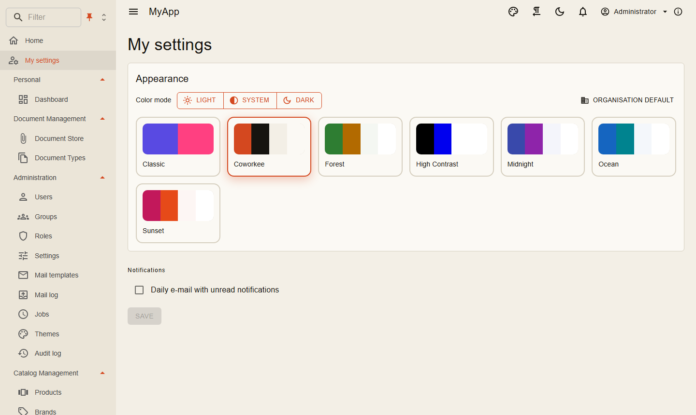

# Themes

Themes sind Daten: Paletten für hellen und dunklen Modus, Typografie, Eckenradius, Breite der Navigation und Höhe der App-Leiste, Schatten, Logo, eigenes CSS und die Optionen der App. Sieben Themes sind eingebaut (Ocean als Standard, Coworkee, Classic, Forest, Midnight, Sunset und High Contrast); sie unterscheiden sich in Schrift, Radius, Breite und Verhalten der Navigation, nicht nur in den Farben.

{ .shot }

- *Administration > Themes* (`Themes.Manage`) zeigt je Theme eine Kachel: helle und dunkle Farben, Name, Veröffentlichungsstatus, *Bearbeiten*, *Als Standard festlegen* und *Löschen* (nur eigene Themes, nach Rückfrage). *Bearbeiten* und *Neues Theme* öffnen einen `MudExThemeEdit<CoworkeeTheme>` mit Live-Vorschau; ein neues Theme startet von einem der vorhandenen. Eingebaute Themes bleiben unverändert, Speichern legt eine Kopie an.
- Alle Benutzer können die eingebauten und die *veröffentlichten* Themes wählen; der Standard des Mandanten gilt, bis ein Benutzer in den Kontoeinstellungen oder über die Palette in der App-Leiste ein anderes Theme (und hellen, dunklen oder System-Modus) wählt.
- `CoworkeeTheme` erbt von `MudTheme` und ergänzt: `ShowLogoInNav`, `ShowLogoInAppBar`, `ShowNavFilter`, `CanPinNav`, `CanChangeNavExpandMode`, `NavSingleExpand` (bis der Benutzer wählt), `Dense`, `StripedTables`, `IsPublished`, `Logo`, `CustomCss`. Alle sind Felder im Editor. `CustomCss` ist ein Stylesheet für die ganze App (nach dem Theme gerendert) und wird mit dem CssRulesEditor bearbeitet: im Modus *Regeln* als Liste von Regeln (je ein Selektor und ein Style-Editor, mit Verschieben und Löschen) und *Regel hinzufügen*; im Modus *Roh* als ganzes Stylesheet in einem Monaco-Code-Editor (auch im Vollbild). At-Regeln, Kommentare und verschachteltes CSS bleiben in der Regelliste Rohblöcke. Der Modus wird pro Browser gemerkt; Speichern aus der Regelliste normalisiert das CSS (eine Deklaration pro Zeile), ein leeres Stylesheet wird als nichts gespeichert. Den CssRulesEditor kann man auch allein verwenden (Value, ValueChanged, Label, HelperText, ReadOnly).
- `Dense` (standardmäßig an) macht die ganze Oberfläche kompakt: Tabellen, Listen, Menüs, Baumansichten, Hinweise, Ausklappbereiche und Checkboxen werden `Dense` dargestellt, Eingabefelder und Auswahllisten mit `Margin.Dense`, Chips mit `Size.Small`. Formulare (`MudExObjectEdit`) und das Navigationsmenü behalten ihre normale Größe. Themes, die mit der früheren Option `DenseTables` gespeichert wurden, behalten ihren Wert.
- Die Komponenten der Bibliothek erben von `CoworkeeComponentBase`, das die `Density` des Themes als Cascading Value erhält (`Density.Dense`, `Density.Margin`, `Density.Size`). Eigene Komponenten können das genauso nutzen: `@inherits CoworkeeComponentBase` oder `[CascadingParameter] Density Density { get; set; } = Density.Default;`. Eine eigene `IObjectMetaConfiguration<T>` eines Modells ersetzt die kompakte Formular-Konfiguration für dieses Modell.
- `Logo` ist SVG-Markup oder eine Bild-Data-URL (PNG, JPEG, WebP oder SVG, höchstens 512 KB; SVG mit Skripten, Event-Handlern oder eingebetteten Dokumenten wird abgelehnt). Der Editor zeigt es mit `ThemeLogoEdit`: Vorschau, *Logo wählen* (Upload, die konfigurierten Cloud-Laufwerke oder *Aus Dateien wählen* mit den Dateien der App) und *App-Logo verwenden*. Rasterbilder über 512 px werden vorher im Browser verkleinert. Das Logo erscheint in der App-Leiste, der Navigation, im Setup, im Über-Dialog und auf den Kontoseiten und ist, solange es gesetzt ist, das Favicon.
- Ohne Logo im Theme erscheint das Logo der App: `options.AppLogo = "logo.svg"` in `AddCoworkeeClient` (`Coworkee:Auth:LogoUrl` für die Kontoseiten).
- Auf dem Server macht `ThemeLogo.TryRead(theme.Logo, out var bytes, out var contentType)` (`Coworkee.Contracts.Theming`) aus beiden Formen Bytes und Content-Type, etwa um das Logo in eine Datei zu schreiben.
- Die Spalte `LogoSvg` der Theme-Tabelle heißt jetzt `Logo`: Eine bestehende App braucht eine Migration (EF Core benennt die Spalte um, wenn Sie die erzeugte Migration auf `RenameColumn` ändern).
- Das Setup bietet das Theme als eigenen Schritt an.
- Die Kontoseiten des Auth-Servers übernehmen Farben, Schrift und Logo des Standard-Themes. Layout und Medien sind eine Einstellung für die ganze Installation: die Karte *Anmeldeseite* oben auf *Administration > Themes*, siehe [Anmeldeseiten und Designs](../security/sign-in-pages.md).
- Die Felder des Theme-Editors kommen aus MudEx-Metadaten für Objektformulare. Die Bibliothek registriert `CoworkeeThemeEditMeta` als `IObjectMetaConfiguration<CoworkeeTheme>` (die Felder `Logo` und `CustomCss`); registrieren Sie nach `AddCoworkeeClient` eine eigene, um Felder anders darzustellen (sie ersetzt die der Bibliothek):

```csharp
builder.Services.AddScoped<IObjectMetaConfiguration<CoworkeeTheme>, MyThemeEditMeta>();

public sealed class MyThemeEditMeta : IObjectMetaConfiguration<CoworkeeTheme>
{
    public Task ConfigureAsync(ObjectEditMeta<CoworkeeTheme> meta)
    {
        meta.Property(t => t.Logo).WithLabel("Firmenlogo");
        return Task.CompletedTask;
    }
}
```
- `ThemeService` im Client wendet ein Theme zur Laufzeit an (`Apply`, `Preview`, `SetMode`).

## Ladebildschirm

Während die WebAssembly-App lädt, zeigt der Web-Host einen Ladebildschirm in den Farben und mit dem Logo des Standard-Themes der Organisation (vor der Anmeldung das der Installation). Die `App.razor` der Vorlage setzt ihn an den Anfang des Body:

```razor
<Coworkee.Bff.CoworkeeLoadingScreen Logo="coworkee-icon.svg" />
```

- Der Server rendert ihn (statisch, aus `GET /api/v1/themes/loading-screen`, das jeder aufrufen darf; pro Organisation 30 Sekunden zwischengespeichert, höchstens 2 Sekunden Wartezeit, neutrale Farben, wenn die API nicht antwortet), daher hat schon das erste Bild die richtigen Farben. Das Layout merkt sich Farbmodus, angewendetes Theme und Sprache des Benutzers im Cookie `coworkee-loading` (`mode`, `theme`, `culture`): Hell oder dunkel folgt ihm, sonst der Systemeinstellung. Angemeldete Besucher erhalten das Theme, das sie gewählt haben (`?themeId=`, von der API geprüft: nur ein eingebautes oder veröffentlichtes Theme der eigenen Organisation, für alle dort dieselbe Antwort; alles andere und jeder anonyme Besucher erhält das Standard-Theme). Die Texte kommen in der Sprache des Cookies, sonst des Browsers (`Accept-Language`), abgebildet auf eine der aktiven Sprachen der App (`/api/v1/localization/languages`: aus `de-AT` wird `de`, eine nicht aktive Sprache wird Englisch), aus `/api/v1/localization/texts/{culture}`. Logo und Skript sind eigene, zwischenspeicherbare Anfragen (`/bff/loading-screen/logo?v={theme}-{revision}`, `/bff/loading-screen/script.js?v={hash}`; kein Inline-Skript und kein Event-Handler, daher genügt eine Content-Security-Policy mit `script-src 'self'`), und die Seite geht mit `Cache-Control: no-store` hinaus, weil sie Theme und Sprache des Besuchers enthält.
- Der Ring um das Logo zeigt den echten Download-Fortschritt von Blazor (`--blazor-load-percentage`); solange es keinen gibt (Laufzeit aus dem Cache, Start), dreht er sich. `CoworkeeLayout` und `SetupLayout` blenden ihn aus, sobald das Theme angewendet ist (sie beanspruchen den Bildschirm mit einem verborgenen Element `[data-coworkee-loading-claim]`). Ohne diesen Anspruch, etwa bei einer App mit eigenem Layout oder einer Seite ohne `CoworkeeLayout`, verschwindet der Bildschirm, sobald die App ihren ersten Inhalt gerendert hat; ein eigenes Layout, das zuerst ein Theme anwendet, rendert das Element selbst und ruft `window.coworkeeLoadingScreen.hide()` auf (30 Sekunden nach dem Download verschwindet ein beanspruchter Bildschirm von selbst).
- Schlägt der Start fehl (Blazor zeigt seine Fehleranzeige nach einem Download- oder Startfehler, einer unbehandelten Ausnahme oder einem Circuit-Fehler; ein Framework-Skript lädt nicht; ein Fehler oder abgelehntes Promise des Frameworks bleibt unbehandelt), wird der Bildschirm sofort zu einer Meldung im selben Design: *Die App konnte nicht starten.*, ein Hinweis, *Neu laden* und *Details* mit dem Fehler (dem letzten Konsolenfehler). Blazors eigenes `#blazor-error-ui` bleibt verborgen, solange die Meldung steht; der Code einer App kann `window.coworkeeLoadingScreen.fail(detail)` selbst aufrufen.
- Hintergrund: die Einstellung *Ladebildschirm* auf der Karte *Anmeldeseite* (*Administration > Themes*): *Animierter Hintergrund* (Standard, sanft bewegte Formen in den Farben des Themes), *Bild oder Video der Anmeldeseite* (unter einem Schleier in den Farben des Themes; ohne Medium oder wenn es nicht lädt, erscheint die Animation) oder *Schlichter Hintergrund*. Sie wird mit dem Anmeldedesign gespeichert (`Coworkee:Auth:Design:LoadingScreen`, `Animated`, `SignInMedia`, `Plain`); Aspire setzt sie mit `options.SignIn.LoadingScreen`.
- Mit `prefers-reduced-motion` bewegt sich nichts: keine Formen, kein Pulsieren, ein stehendes Videobild.
- `Logo` erscheint, wenn das Theme keines hat.
- Apps, die vor dieser Version erstellt wurden, ergänzen die Zeile oben in `MyApp.Web/App.razor`.

## Standard-Theme und Themes der App

`ThemingOptions` bestimmt das Standard-Theme der Installation und ergänzt Themes der App. Ein App-Theme ist ein eingebautes Theme mit anderen Farben; es wird wie die eingebauten angelegt und gepflegt (in der App schreibgeschützt, im Setup angeboten). Ein geändertes `Primary` oder `Secondary` bekommt eine lesbare Kontrastfarbe für Text, sofern die Palette keine nennt.

```csharp title="MyApp.Infrastructure/MyAppInfrastructureModule.cs"
context.Services.Configure<ThemingOptions>(themes =>
{
    themes.DefaultTheme = "Shop";
    themes.Themes.Add(new AppTheme("Shop", "Ocean", new Dictionary<string, string> { ["Primary"] = "#0a7d5a", ["Secondary"] = "#ff8f00" }));
});
```

Ein unbekannter Name in `DefaultTheme` lässt Ocean als Standard. Ein App-Theme mit dem Namen eines eingebauten oder eines anderen App-Themes, oder auf Basis eines unbekannten Themes, hält den Host beim Start mit einer Meldung an. Der Standard gilt, bis eine Organisation ein eigenes Theme wählt (Setup oder *Als Standard*). `coworkee new --theme Forest --primary-color "#0a7d5a"` schreibt das für Sie.

## Keycloak-Anmeldeseite

Mit `Coworkee:Keycloak:ThemeDirectory` (dem Themes-Ordner von Keycloak) und `ThemeName` hält die API ein Keycloak-Login-Theme im Design der App: die Farben des Standard-Themes der System-Organisation für hellen und dunklen Modus, sein Logo (ein Rasterbild als Datei neben dem Stylesheet, SVG darin eingebettet; ohne Logo `LogoUrl`), `AppName` über dem Formular sowie Layout und Medien aus dem Design der *Anmeldeseite*. Relative Pfade (`/media/welcome.mp4`) werden gegen `BaseUrl` aufgelöst. Die API schreibt das Theme beim Start und eine Sekunde nachdem eine Theme-Änderung gespeichert oder das Anmelde-Design gespeichert wurde; jede Datei entsteht neben der alten und wird dann darüber verschoben, Keycloak liest also nie eine halbe Datei. Der Aspire-AppHost füllt diese Einstellungen und mountet den Ordner (siehe [Aspire-AppHost](../hosting/aspire.md#anmeldeseite-im-design-der-app)).

Die Karte *Keycloak-Anmeldeseite* unter *Administration > Themes* zeigt, wann das Theme zuletzt geschrieben wurde (oder warum es scheiterte), und schreibt es mit *Nach Keycloak übernehmen* sofort; sie erscheint nur, wenn die API einen Theme-Ordner hat, und nur für die System-Organisation (andere Organisationen bekommen `Configured: false` und beim Übernehmen 403). Schreibfehler stehen im Log der API; die Karte meldet nur, dass das Schreiben fehlschlug. Die Endpunkte sind `GET /api/v1/themes/keycloak` und `POST /api/v1/themes/keycloak/apply` (`Themes.Manage`). Der Schreiber selbst ist `KeycloakLoginTheme.Write` in `Coworkee.Contracts.Theming`.

In Produktion cacht Keycloak Themes. Teilen Sie ein Volume zwischen API und Keycloak (`ThemeDirectory` der API, `/opt/keycloak/themes` bei Keycloak), setzen Sie das Login-Theme des Realms einmal auf den `ThemeName` und starten Sie Keycloak nach einer Änderung des Designs neu, oder starten Sie es mit `--spi-theme--cache-themes=false --spi-theme--cache-templates=false`, wenn ein paar Millisekunden pro Seite in Ordnung sind. Ohne `ThemeDirectory` wird nichts geschrieben.
