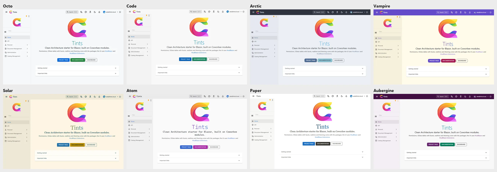
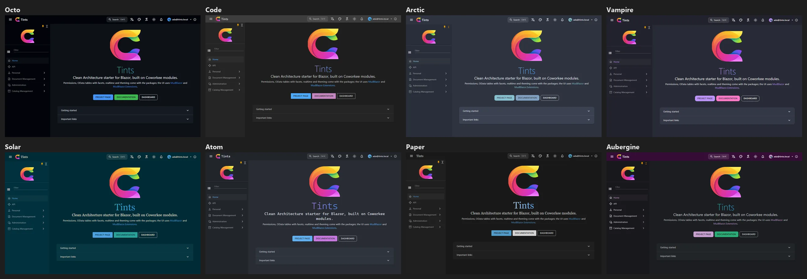

# Theming

Themes are data: palettes for light and dark mode, typography, border radius, drawer width and app bar height, shadows, logo, custom CSS, and the app's own options. Twenty-one built-in themes ship with the package (see [Built-in themes](#built-in-themes)); they differ in fonts, radius, navigation width and behaviour, not only in colors.

{ .shot }

`Coworkee.Theming` (`CoworkeeThemingModule`, depends on the settings module) stores the themes in `cw.Themes` and seeds the built-in ones; every app from the template has it. The client side (`ThemeService`, the editor, the theme picker) comes with `AddCoworkeeClient`.

## Managing themes

- *Administration > System > Themes* (`/cw/admin/themes`, permission `Themes.Manage`) shows a tile per theme: light and dark colors, name, published state, *Edit*, *Make default* and *Delete* (own themes only, after a confirmation). *Edit* and *New theme* open a `MudExThemeEdit<CoworkeeTheme>` with a live preview; a new theme starts from one of the existing themes. Built-in themes stay read-only, saving one creates a copy.
- Everyone can choose the built-in themes and the *published* ones; the tenant default applies until a user picks another theme (and light, dark or system mode) in the account settings or from the palette in the app bar.
- `CoworkeeTheme` derives from `MudTheme` and adds: `ShowLogoInNav`, `ShowLogoInAppBar`, `ShowNavFilter`, `CanPinNav`, `CanChangeNavExpandMode`, `NavSingleExpand` (until the user chooses), `Dense`, `StripedTables`, `IsPublished`, `Logo`, `CustomCss`. All of them are fields in the editor. `CustomCss` is a stylesheet for the whole app (rendered after the theme), edited with the CssRulesEditor: in *Rules* mode a list of rules (a selector and a style editor each, with move and delete buttons) and *Add rule*; in *Raw* mode the whole stylesheet in a Monaco code editor (also full screen). At-rules, comments and nested CSS stay raw blocks in the rules list. The mode is remembered per browser; saving from the rules list normalises the CSS (one declaration per line), an empty stylesheet is stored as nothing. CssRulesEditor is also usable on its own (Value, ValueChanged, Label, HelperText, ReadOnly).
- `Dense` (on by default) makes the whole UI compact: tables, lists, menus, tree views, alerts, expansion panels and checkboxes render `Dense`, inputs and selects use `Margin.Dense`, chips `Size.Small`. Forms (`MudExObjectEdit`) and the navigation menu keep their normal size. Themes saved with the former `DenseTables` option keep their value.
- The library's components inherit `CoworkeeComponentBase`, which receives the theme's `Density` as cascading value (`Density.Dense`, `Density.Margin`, `Density.Size`). Own components can do the same: `@inherits CoworkeeComponentBase` or `[CascadingParameter] Density Density { get; set; } = Density.Default;`. A model's own `IObjectMetaConfiguration<T>` replaces the dense object edit configuration for that model.
- `Logo` is SVG markup or an image data URL (PNG, JPEG, WebP or SVG, at most 512 KB; SVG is rejected when it contains scripts, event handlers or embedded documents). The editor shows it with `ThemeLogoEdit`: a preview, *Choose logo* (upload, the configured cloud drives, or *Choose from files* with the app's files) and *Use app logo*. Raster images larger than 512 px are shrunk in the browser first. The logo appears in the app bar, the navigation, setup, the about dialog and the account pages, and is the favicon while it is set.
- Without a theme logo the app's own logo shows: `options.AppLogo = "logo.svg"` in `AddCoworkeeClient` (`Coworkee:Auth:LogoUrl` for the account pages).
- On the server `ThemeLogo.TryRead(theme.Logo, out var bytes, out var contentType)` (`Coworkee.Contracts.Theming`) turns either form into bytes and content type, for example to write the logo to a file.
- Setup offers the theme as one of its steps.
- The auth server's account pages follow the default theme's colors, font and logo. Their layout and media are one setting for the whole installation: the card *Sign-in page* at the top of *Administration > System > Themes*, see [Sign-in pages and designs](../security/sign-in-pages.md).
- The theme editor's fields come from MudEx object edit metadata. The library registers `CoworkeeThemeEditMeta` as `IObjectMetaConfiguration<CoworkeeTheme>` (the `Logo` and `CustomCss` fields); register your own after `AddCoworkeeClient` to render fields differently (it replaces the library's):

```csharp
builder.Services.AddScoped<IObjectMetaConfiguration<CoworkeeTheme>, MyThemeEditMeta>();

public sealed class MyThemeEditMeta : IObjectMetaConfiguration<CoworkeeTheme>
{
    public Task ConfigureAsync(ObjectEditMeta<CoworkeeTheme> meta)
    {
        meta.Property(t => t.Logo).WithLabel("Company logo");
        return Task.CompletedTask;
    }
}
```
- `ThemeService` in the client applies a theme at runtime (`Apply`, `Preview`, `SetMode`).

## Built-in themes

Each one has a light and a dark palette. The names only hint at what inspired them and none ships a logo; GitHub is named after the site it follows. They also differ in where the logo sits: in the menu, in the header, in both or nowhere (`ShowLogoInNav`, `ShowLogoInAppBar`); LinkHub brings custom CSS for its pill buttons. The newer ones (from Octo on) meet WCAG AA contrast for text, buttons, app bar and navigation (`ThemeSeedTests`).

| Theme | Look | Headings / text | Radius |
|---|---|---|---|
| Ocean (default) | blue app bar, cyan accent | Segoe UI | 14 px |
| Coworkee | warm orange on paper | Inter | 6 px |
| Classic | MudBlazor purple | Roboto | 4 px |
| Forest | green, amber accent | Georgia / Segoe UI | 4 px |
| Sunset | pink, roomy | Trebuchet MS | 20 px |
| Midnight | indigo, violet accent | Cascadia Code / Inter | 8 px |
| High Contrast | black and white (yellow on black in dark), no shadows | Arial | 0 |
| Octo | neutral grays and blue, like a code hosting site | system font | 6 px |
| Code | editor look: compact, gray title bar, blue | Segoe UI, dense | 2 px |
| Arctic | cool polar blues and frost, dark app bar | Inter | 10 px |
| Vampire | purple and pink on a night background (cream by day) | Inter | 12 px |
| Solar | warm cream and deep teal, amber accent | Georgia / Segoe UI | 4 px |
| Atom | soft editor grays, blue and violet | Cascadia Code / Inter, dense | 6 px |
| Paper | plain white paper, flat (no shadows) | Georgia / Inter | 4 px |
| Aubergine | aubergine app bar (and navigation in dark mode), green accents | Lato | 8 px |
| GitHub | dark header, white pages, blue links, like GitHub; logo in the header only | system font | 6 px |
| LinkHub | link page look: lime and violet, pill buttons, roomy; logo above the menu only | Lato | 24 px |
| Terminal | green on black like a shell, monospace, square; no logo, flat | Cascadia Code, dense | 0 |
| Slate | dark sidebar next to light pages, indigo; logo above the menu only | Inter | 8 px |
| Ember | amber on charcoal, dark header; logo in the header only | Inter / Segoe UI | 6 px |
| Mint | fresh mint and teal, roomy; logo in the header only | Trebuchet MS / Lato | 12 px |

{ .shot }

{ .shot }

Pick one for a new app with `coworkee new --theme Octo` (or `theme` in the spec), in Coworkee Studio on the Branding page, or later as the organisation's default under *Administration > System > Themes*.

## Loading screen

While the WebAssembly app loads, the web host shows a loading screen in the colours and with the logo of the organisation's default theme (the installation's default before sign-in). The template's `App.razor` places it at the start of the body:

```razor
<Coworkee.Bff.CoworkeeLoadingScreen Logo="coworkee-icon.svg" />
```

- The server renders it (static, from `GET /api/v1/themes/loading-screen`, which anyone may call; cached per organisation for 30 seconds, at most 2 seconds of waiting, neutral colours when the API does not answer), so the first paint already has the right colours. The layout remembers the user's colour mode, the theme they applied and their language in the cookie `coworkee-loading` (`mode`, `theme`, `culture`): light or dark follow it, else the system preference. A signed-in visitor gets the theme they chose (`?themeId=`, checked by the API: only a built-in or published theme of their own organisation, the same answer for everyone there; anything else, and every anonymous visitor, gets the default). The texts come in the cookie's language, else the browser's (`Accept-Language`), mapped to one of the app's active languages (`/api/v1/localization/languages`: `de-AT` becomes `de`, an inactive language English), from `/api/v1/localization/texts/{culture}`. The logo and the script are separate, cacheable requests (`/bff/loading-screen/logo?v={theme}-{revision}`, `/bff/loading-screen/script.js?v={hash}`; no inline script or event handler, so a Content-Security-Policy with `script-src 'self'` is enough), and the page is sent with `Cache-Control: no-cache, no-store` because it carries the visitor's theme and language.
- The ring around the logo shows Blazor's real download progress (`--blazor-load-percentage`); while there is none (runtime from the cache, start-up) it spins. `CoworkeeLayout` and `SetupLayout` fade it out once the theme is applied (they claim the screen with a hidden `[data-coworkee-loading-claim]` element). Without such a claim, e.g. an app with its own layout or a page without `CoworkeeLayout`, the screen fades out as soon as the app has rendered its first content; an own layout that applies a theme first renders the claim element itself and calls `window.coworkeeLoadingScreen.hide()` (30 seconds after the download finished a claimed screen hides itself).
- When the start fails (Blazor shows its error UI after a download or boot error, an unhandled exception or a circuit failure; a framework script does not load; an error or rejected promise of the framework goes unhandled) the screen at once becomes a message in the same design: *The app could not start.*, a hint, *Reload* and *Details* with the error (the last console error). Blazor's own `#blazor-error-ui` stays hidden while the message shows; an app's code can call `window.coworkeeLoadingScreen.fail(detail)` itself.
- Background: the setting *Loading screen* on the card *Sign-in page* (*Administration > System > Themes*): *Animated background* (default, soft moving shapes in the theme's colours), *Image or video of the sign-in page* (under a veil in the theme's colours; without media, or when it fails to load, the animation shows) or *Plain background*. It is stored with the sign-in design (`Coworkee:Auth:Design:LoadingScreen`, `Animated`, `SignInMedia`, `Plain`); Aspire sets it with `options.SignIn.LoadingScreen`.
- With `prefers-reduced-motion` nothing moves: no shapes, no pulse, a still video frame.
- `Logo` is shown when the theme has none.

## Default theme and app themes

`ThemingOptions` picks the default theme of the installation and adds themes of the app. An app theme is a built-in theme with other colors; it is seeded and kept like the built-in ones (read-only in the app, offered in setup). A changed `Primary` or `Secondary` gets a readable contrast text unless the palette names one.

```csharp title="MyApp.Infrastructure/MyAppInfrastructureModule.cs"
context.Services.Configure<ThemingOptions>(themes =>
{
    themes.DefaultTheme = "Shop";
    themes.Themes.Add(new AppTheme("Shop", "Ocean", new Dictionary<string, string> { ["Primary"] = "#0a7d5a", ["Secondary"] = "#ff8f00" }));
});
```

An unknown `DefaultTheme` keeps Ocean. An app theme with the name of a built-in or another app theme, or based on an unknown theme, stops the host at start with a message. The default applies until an organisation chooses its own theme (setup or *Make default*). `coworkee new --theme Forest --primary-color "#0a7d5a"` writes this for you.

## Settings, permission and endpoints

| Setting | Scopes | |
|---|---|---|
| `Theme.Mode` (*Color mode*) | system, organisation, user | `system` (default), `light` or `dark` |
| `Theme.Id` (*Theme*) | user | the theme the user picked; empty follows the organisation's default |

The permission `Themes.Manage` (group *Themes*) covers the admin page and every change. Themes are `[Realtime]` entities: the theme lists of holders of `Themes.Manage` follow changes at once. Each saved theme keeps its versions.

| Endpoint | |
|---|---|
| `GET /api/v1/themes/current` | the default theme of the user's organisation (anonymous: of the system organisation), also during setup |
| `GET /api/v1/themes/built-in` | the built-in and app themes (anonymous, setup offers them) |
| `GET /api/v1/themes/loading-screen?themeId=` | colours, logo and texts of the [loading screen](#loading-screen) (anonymous) |
| `GET /api/v1/themes/` | the themes a signed-in user may choose (built-in, published, the default); with `Themes.Manage` all of the organisation |
| `POST /api/v1/themes/` | a new theme (`Themes.Manage`) |
| `PUT /api/v1/themes/{id}`, `DELETE /api/v1/themes/{id}` | change or delete an own theme (`Themes.Manage`) |
| `POST /api/v1/themes/{id}/default` | make it the organisation's default (`Themes.Manage`) |
| `GET /api/v1/themes/keycloak`, `POST /api/v1/themes/keycloak/apply` | see [Keycloak sign-in page](#keycloak-sign-in-page) |

## Keycloak sign-in page

With `Coworkee:Keycloak:ThemeDirectory` (Keycloak's themes folder) and `ThemeName` the API keeps a Keycloak login theme in the app's design: the colors of the system organisation's default theme for light and dark mode, its logo (a raster image as file next to the stylesheet, SVG embedded in it; without a logo `LogoUrl`), `AppName` above the form and the layout and media of the *Sign-in page* design. Relative paths (`/media/welcome.mp4`) are resolved against `BaseUrl`. The API writes the theme at start and a second after a theme change is committed or the sign-in design is saved; each file is written next to the old one and then moved over it, so Keycloak never reads half a file. The Aspire app host fills these settings and mounts the folder (see [Aspire app host](../hosting/aspire.md#sign-in-page-in-the-apps-design)).

The card *Keycloak sign-in page* on *Administration > System > Themes* shows when the theme was written last (or why it failed) and writes it at once with *Apply to Keycloak*; it only shows when the API has a theme folder and only to the system organisation (other organisations get `Configured: false` and a 403 on apply). Write errors go to the log of the API; the card only says that writing failed. The endpoints are `GET /api/v1/themes/keycloak` and `POST /api/v1/themes/keycloak/apply` (`Themes.Manage`). The writer itself is `KeycloakLoginTheme.Write` in `Coworkee.Contracts.Theming`.

In production Keycloak caches themes. Share a volume between the API and Keycloak (the API's `ThemeDirectory`, Keycloak's `/opt/keycloak/themes`), set the realm's login theme to the `ThemeName` once, and restart Keycloak after a change of the design, or start it with `--spi-theme--cache-themes=false --spi-theme--cache-templates=false` if a few milliseconds per page are fine. Without `ThemeDirectory` nothing is written.

## Upgrading older apps

- Apps created before the loading screen add `<Coworkee.Bff.CoworkeeLoadingScreen Logo="..." />` as the first line of `<body>` in `MyApp.Web/App.razor`.
- The column `LogoSvg` of the theme table is now `Logo`: add a migration to an existing app (EF Core renames the column when you edit the generated migration to use `RenameColumn`).
