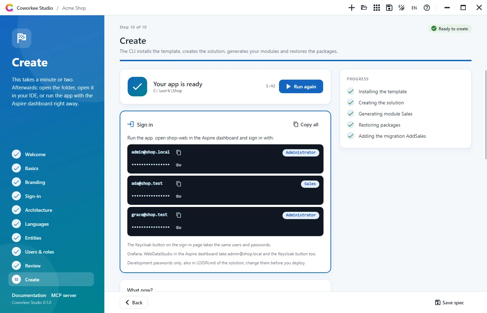

# Screenshots

The demo app in the Ocean theme, the tools of its app host and Coworkee Studio. Click a picture to see it large; the arrow keys move on, Esc closes.

<figure markdown>
{ loading=lazy }
<figcaption>Sign-in (slide)</figcaption>
</figure>

<figure markdown>
{ loading=lazy }
<figcaption>Registration, dark</figcaption>
</figure>

<figure markdown>
{ loading=lazy }
<figcaption>Sign-in on a phone</figcaption>
</figure>

<figure markdown>
{ loading=lazy }
<figcaption>Dashboard</figcaption>
</figure>

<figure markdown>
{ loading=lazy }
<figcaption>Dashboard, dark</figcaption>
</figure>

<figure markdown>
{ loading=lazy }
<figcaption>Products grouped by brand</figcaption>
</figure>

<figure markdown>
{ loading=lazy }
<figcaption>Column filter with counts</figcaption>
</figure>

<figure markdown>
{ loading=lazy }
<figcaption>Orders grouped by status</figcaption>
</figure>

<figure markdown>
{ loading=lazy }
<figcaption>Server and browser compared</figcaption>
</figure>

<figure markdown>
{ loading=lazy }
<figcaption>Reports</figcaption>
</figure>

<figure markdown>
{ loading=lazy }
<figcaption>Sales overview report</figcaption>
</figure>

<figure markdown>
{ loading=lazy }
<figcaption>Sales overview report, dark</figcaption>
</figure>

<figure markdown>
{ loading=lazy }
<figcaption>Report designer with widget settings</figcaption>
</figure>

<figure markdown>
{ loading=lazy }
<figcaption>Cross filter after a click on a bar</figcaption>
</figure>

<figure markdown>
{ loading=lazy }
<figcaption>Drill-down into the orders behind a widget</figcaption>
</figure>

<figure markdown>
{ loading=lazy }
<figcaption>Table widget switched to cards</figcaption>
</figure>

<figure markdown>
{ loading=lazy }
<figcaption>Pivot with totals</figcaption>
</figure>

<figure markdown>
{ loading=lazy }
<figcaption>A report on a phone</figcaption>
</figure>

<figure markdown>
{ loading=lazy }
<figcaption>Command palette (Ctrl+K)</figcaption>
</figure>

<figure markdown>
{ loading=lazy }
<figcaption>Chat with mentions, reactions and files</figcaption>
</figure>

<figure markdown>
{ loading=lazy }
<figcaption>Chat, dark</figcaption>
</figure>

<figure markdown>
{ loading=lazy }
<figcaption>Mini chats at the bottom right</figcaption>
</figure>

<figure markdown>
{ loading=lazy }
<figcaption>Mini chats, dark</figcaption>
</figure>

<figure markdown>
{ loading=lazy }
<figcaption>Import wizard: columns matched to fields</figcaption>
</figure>

<figure markdown>
{ loading=lazy }
<figcaption>Themes and sign-in design</figcaption>
</figure>

<figure markdown>
{ loading=lazy }
<figcaption>My settings</figcaption>
</figure>

<figure markdown>
{ loading=lazy }
<figcaption>App configuration</figcaption>
</figure>

<figure markdown>
{ loading=lazy }
<figcaption>Users</figcaption>
</figure>

<figure markdown>
{ loading=lazy }
<figcaption>New user dialog</figcaption>
</figure>

<figure markdown>
{ loading=lazy }
<figcaption>Roles</figcaption>
</figure>

<figure markdown>
{ loading=lazy }
<figcaption>Field level audit log</figcaption>
</figure>

<figure markdown>
{ loading=lazy }
<figcaption>Services and their health</figcaption>
</figure>

<figure markdown>
{ loading=lazy }
<figcaption>Translations</figcaption>
</figure>

<figure markdown>
{ loading=lazy }
<figcaption>Languages</figcaption>
</figure>

<figure markdown>
{ loading=lazy }
<figcaption>Account</figcaption>
</figure>

<figure markdown>
{ loading=lazy }
<figcaption>Swagger</figcaption>
</figure>

<figure markdown>
{ loading=lazy }
<figcaption>Grafana overview dashboard</figcaption>
</figure>

<figure markdown>
{ loading=lazy }
<figcaption>WebDataStudio on the app database</figcaption>
</figure>

<figure markdown>
{ loading=lazy }
<figcaption>Coworkee Studio: start</figcaption>
</figure>

<figure markdown>
{ loading=lazy }
<figcaption>Coworkee Studio: branding with live preview</figcaption>
</figure>

<figure markdown>
{ loading=lazy }
<figcaption>Coworkee Studio: modules and infrastructure</figcaption>
</figure>

<figure markdown>
{ loading=lazy }
<figcaption>Coworkee Studio: designing entities</figcaption>
</figure>

<figure markdown>
{ loading=lazy }
<figcaption>Coworkee Studio: the entities as a diagram</figcaption>
</figure>

<figure markdown>
{ loading=lazy }
<figcaption>Coworkee Studio: the app is created</figcaption>
</figure>

