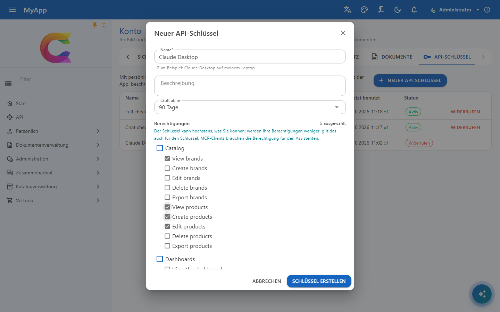
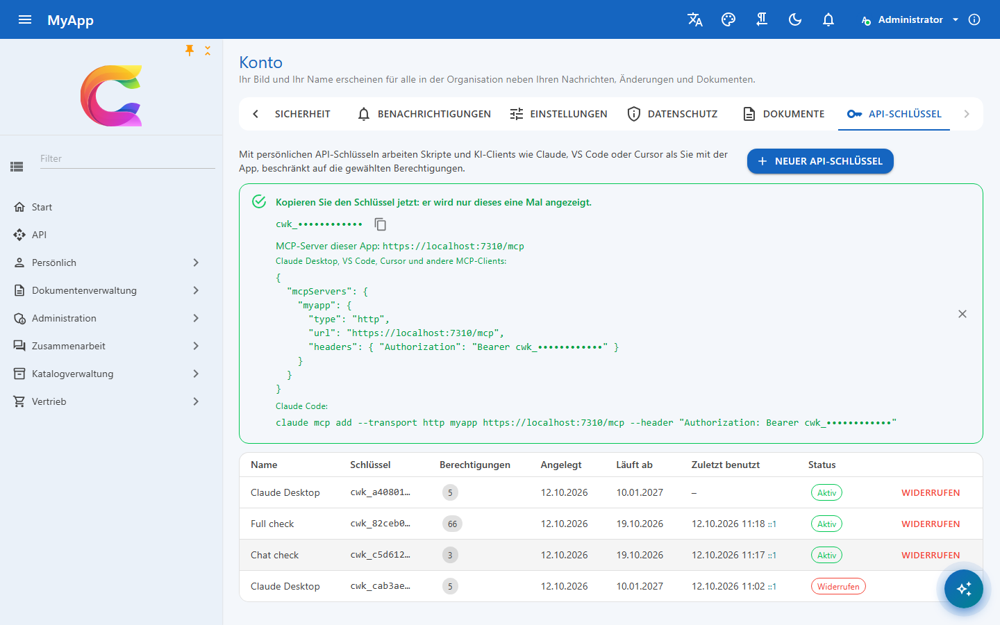
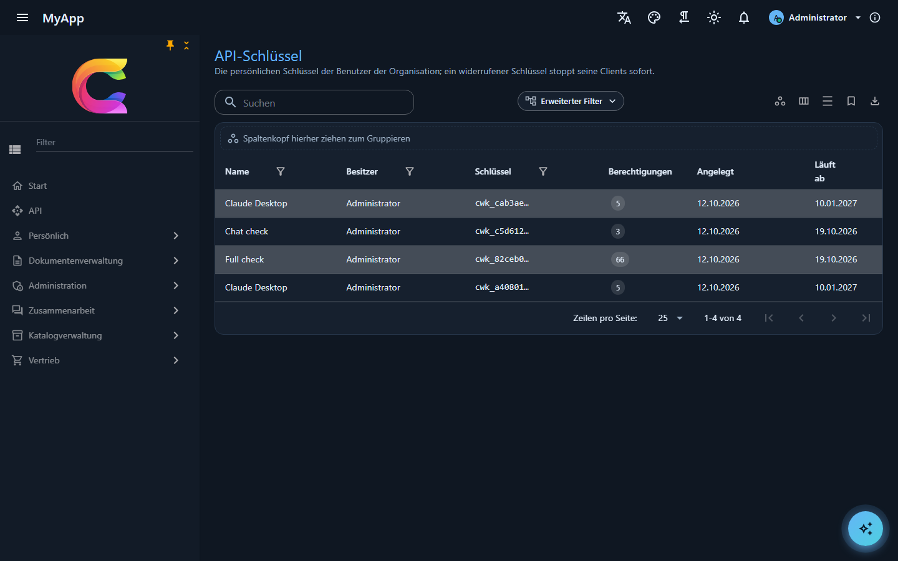

# API-Schlüssel

Persönliche API-Schlüssel lassen Skripte und KI-Clients als ihr Benutzer mit der App arbeiten: mit den REST-Endpunkten, OData, dem Realtime-Hub und dem [MCP-Server](../modules/mcp.md). Ein Schlüssel handelt höchstens mit den Berechtigungen seines Benutzers und nur mit denen, die er bekommen hat.

## Einen Schlüssel anlegen

Benutzer mit `ApiKeys.Create` öffnen *Konto > API-Schlüssel* und legen einen Schlüssel an mit

- einem Namen und optional einer Beschreibung, z. B. *Claude Desktop auf meinem Laptop*,
- einer Laufzeit von 7 bis 365 Tagen (die API nimmt höchstens 366),
- den Berechtigungen des Schlüssels, ausgewählt aus den eigenen Berechtigungen des Benutzers über alle seine Rollen. Andere Berechtigungen werden nicht angeboten, und die API lehnt sie ab.

Der Schlüssel wird einmal angezeigt: `cwk_` und 64 Hex-Zeichen (256 Zufallsbits). Der Server speichert nur seinen SHA-256-Hash und vergleicht Hashes in fester Zeit; die ersten 10 Zeichen bleiben sichtbar, damit man seine Schlüssel unterscheiden kann. Ein verlorener Schlüssel lässt sich nicht erneut anzeigen: widerrufen und einen neuen anlegen.

{ .shot }

{ .shot }

## Einen Schlüssel nutzen

```bash
curl -H "Authorization: Bearer cwk_..." https://api.myapp.example/api/v1/identity/permissions/me
curl -H "X-Api-Key: cwk_..." https://api.myapp.example/odata/Products?$top=5
```

Beide Header funktionieren gegen den API-Host. Der Web-Host leitet `/api` nur mit der Browser-Sitzung (und deren CSRF-Header) weiter, Skripte rufen also direkt die API-Adresse auf; der MCP-Server ist unter beiden Adressen erreichbar.

`AddCoworkeeApiAuthentication` richtet die Schlüssel im API-Host ein. Hosts mit eigener Authentifizierung und Tests fügen sie mit `services.AddCoworkeeApiKeys()` hinzu: Anfragen mit Schlüssel gehen an den Schlüssel-Handler, alle anderen behalten das Standardschema.

## Was ein Schlüssel darf

Die wirksamen Berechtigungen eines Schlüssels sind seine Berechtigungen (mit den darin enthaltenen) geschnitten mit den **aktuellen** Berechtigungen seines Benutzers, geprüft bei jeder Anfrage. Nimmt ein Administrator dem Benutzer eine Rolle weg, verliert auch der Schlüssel sie. Der Schlüssel funktioniert sofort nicht mehr, wenn

- er widerrufen oder abgelaufen ist,
- sein Benutzer deaktiviert oder gesperrt ist oder die Organisation deaktiviert ist,
- sein Benutzer `ApiKeys.Create` verliert.

Schlüssel ignorieren die aktive Rolle, die der Benutzer in der App gewählt hat, und arbeiten mit allen Rollen des Benutzers. Die aktive Rolle schränkt die Oberfläche für den Moment ein; ein Schlüssel ist für einen Zweck gemacht, und seine Berechtigungen sind schon die Einschränkung. Ein Schlüssel, der sich mit jedem Rollenwechsel im Browser ändert, würde die Skripte brechen, die ihn nutzen.

Schlüssel können keine Schlüssel anlegen oder widerrufen, auch nicht mit `ApiKeys.Create` unter ihren Berechtigungen: dafür meldet sich der Benutzer in der App an. Die Requests für Schlüssel sind nie KI-Werkzeuge, ein Geheimnis erreicht also nie ein Modell.

## Übersicht und Audit

Die Liste zeigt, wann und von welcher IP-Adresse jeder Schlüssel zuletzt genutzt wurde (höchstens einmal pro Minute aktualisiert). Anlegen und Widerrufen landen im Audit-Trail, der Hash des Geheimnisses nie. MCP-Werkzeugaufrufe halten den Schlüssel im Audit der KI-Werkzeugaufrufe fest. Rate-Limits zählen pro Benutzer, egal mit welchem Schlüssel.

Administratoren mit `ApiKeys.Manage` (enthält `ApiKeys.Create`) sehen die Schlüssel aller Benutzer ihrer Organisation unter *Administration > Identität > API-Schlüssel* (`/admin/api-keys`): Besitzer, Berechtigungen, angelegt, Ablauf, letzte Nutzung und Status, mit Suche, Filtern, Export und Live-Aktualisierung, und widerrufen sie. Schlüssel anderer Organisationen bleiben unsichtbar.

Der Export der personenbezogenen Daten enthält die Schlüssel des Benutzers ohne Geheimnisse; das Löschen des Kontos löscht sie.

{ .shot }
