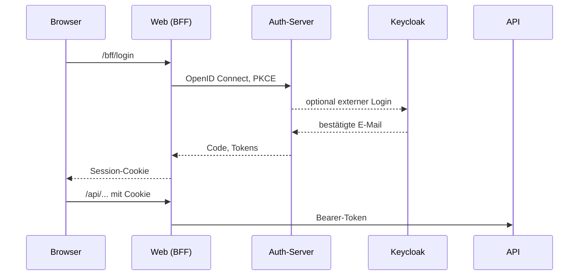

# Anmeldung und Keycloak

Drei Hosts teilen sich die Arbeit:



| Host | Paket | Aufgabe |
|---|---|---|
| Auth | `Coworkee.AuthServer` | OpenIddict-Server, Anmeldung, Registrierung, Passwort zurücksetzen, Bestätigung in zwei Schritten (2FA), Kontoseite, externe Anbieter |
| Web | `Coworkee.Bff` | hält die Tokens auf dem Server, gibt dem Browser ein Cookie, leitet `/api`, `/odata`, `/openapi`, `/swagger`, `/mcp` und die Präfixe aus `Coworkee:Bff:ForwardedPrefixes` weiter (`AddWeb` ergänzt `/hubs` und `/admin/jobs`) |
| API | `Coworkee.AspNetCore` | prüft Bearer-Tokens (`AddCoworkeeApiAuthentication`) |

Der Browser sieht nie ein Access-Token. Die Anmeldung samt Tokens liegt in einem Sitzungsspeicher auf dem Server (Redis, wenn ein Connection String `redis` gesetzt ist, sonst im Speicher), das Cookie enthält nur einen Sitzungsschlüssel. Anfragen des Clients tragen den Header `X-CSRF: 1`, den `ApiClientBase` setzt.

## Clients und Scopes

Der Auth-Server legt seine OpenID-Connect-Clients beim Start aus der Konfiguration an. Mit dem [AppHost](../hosting/aspire.md) setzt du nichts davon; von Hand sieht es so aus:

```json
"Coworkee": {
  "Auth": {
    "ApiScopes": { "myapp_api": "myapp_api" },
    "Clients": [{
      "ClientId": "myapp-web",
      "DisplayName": "MyApp",
      "Scopes": [ "myapp_api" ],
      "RedirectUris": [ "https://localhost:7300/signin-oidc" ],
      "PostLogoutRedirectUris": [ "https://localhost:7300/signout-callback-oidc" ]
    }]
  }
}
```

Weitere Schlüssel eines Clients:

| Schlüssel | Bedeutung |
|---|---|
| `ClientSecret` | macht ihn zu einem vertraulichen Client |
| `ClientUri`, `LogoUrl`, `Description`, `ShowInLauncher` (Standard `true`) | seine Kachel im [App-Launcher](clients.md#app-launcher) |
| `SystemAdministratorsOnly` | dort melden sich nur Administratoren der Systemorganisation an, für Werkzeuge, die die Daten jeder Organisation sehen |
| `AllowImpersonation` | bedient einen Benutzer, als der sich jemand angemeldet hat ([Anmelden als](../features/identity.md#als-anderer-benutzer-anmelden)); andere Clients antworten `access_denied`. `AddWeb` setzt es für den Web-Client |

Außerhalb der Entwicklung konfigurierst du `SigningCertificate` und `EncryptionCertificate`: eine PKCS#12-Datei (`Path`) oder ihr Inhalt als Base64 (`Base64`, etwa aus einem Secret), jeweils mit `Password`. Alle Instanzen teilen sie.

### Optionen des Auth-Servers

| `Coworkee:Auth:` | Standard | Bedeutung |
|---|---|---|
| `DisplayName`, `LogoUrl` | `Coworkee` | App-Name und Ersatzlogo der Kontoseiten ([Branding](clients.md#branding-der-kontoseiten)) |
| `Issuer` | die Adresse der Anfrage | öffentliche Basisadresse, die Tokens als Aussteller nennen; hinter einem Proxy oder mit mehreren Instanzen setzen |
| `DynamicBackchannel` | `false` | mit `Issuer`: Discovery nennt Token, Schlüssel und User-Info unter der angefragten Adresse, Anmelden und Abmelden unter dem Issuer, damit Werkzeuge in Containern den Server unter einem anderen Namen erreichen als der Browser |
| `AccessTokenLifetime` | 15 Minuten | Lebensdauer der Access-Tokens; auch so lange bleiben Tokens einer beendeten Übernahme gültig |
| `MaxImpersonationDuration` | 8 Stunden | längste Sitzung *Anmelden als* |
| `FrameAncestors` | keine | Origins derselben Site, die die Kontoseiten einbetten dürfen (AirWorks-Fenster) |
| `AllowHttp` | `false` | bedient die Endpunkte über einfaches http (Tests, ein TLS-Proxy davor) |
| `DevelopmentCertificates` | `false` | nutzt die Entwicklungszertifikate des Rechners auch außerhalb von Development |
| `Design`, `AllowDesignChanges` | | die [Anmeldeseiten](sign-in-pages.md#konfiguration) |
| `Passkeys` | | die [Passkey-Optionen](passkeys.md#konfiguration) |
| `External`, `Login` | | externe Anbieter unten und die [Anmelderegeln](registration.md#anmelderegeln) |

## Externer Login mit Keycloak

Jeder OpenID-Connect-Anbieter kann Benutzer anmelden. Jeder ist ein Abschnitt unter `Coworkee:Auth:External:Providers`:

```json
"Coworkee": {
  "Auth": {
    "External": {
      "Mode": "Both",
      "AutoProvision": true,
      "Providers": {
        "keycloak": {
          "DisplayName": "Keycloak",
          "Authority": "https://keycloak.example.com/realms/myapp",
          "ClientId": "myapp-auth",
          "ClientSecret": "..."
        }
      }
    }
  }
}
```

| Einstellung | Bedeutung |
|---|---|
| `Mode` | `Internal` nur Passwort, `External` nur Anbieter, `Both` (Standard) |
| `AutoProvision` | legt beim ersten externen Login ein Konto an, wenn keines die E-Mail hat |
| `Scopes` | Standard `openid profile email` |
| `RequireHttpsMetadata` | `false` nur für ein lokales Keycloak über http |
| `TrustEmail` | die Adressen des Anbieters gelten ohne `email_verified` als bestätigt (ein Anbieter, den du selbst betreibst) |
| `BrowserUrl` | die Adresse, unter der Browser sich anmelden, wenn der Auth-Server den Anbieter unter einer anderen erreicht (eine Container-Adresse als `Authority`) |
| `ModeOverride` | unter `External`: gewinnt gegen die Einstellung `Auth.LoginMode`, der Weg zurück für den Betrieb, wenn sich niemand mehr anmelden kann ([Anmeldemethoden zur Laufzeit](registration.md#anmeldemethoden-zur-laufzeit)) |

Bei der Anmeldung sucht der Auth-Server den Benutzer in dieser Reihenfolge: über den verknüpften externen Login, dann über ein Konto mit derselben E-Mail, dann legt er ein neues an. Die Verknüpfung über die E-Mail setzt voraus, dass der Anbieter die Adresse als bestätigt meldet (`email_verified`) oder mit `TrustEmail` konfiguriert ist, sonst wird die Anmeldung abgelehnt. Neue Benutzer folgen den [Registrierungseinstellungen](registration.md) und starten ohne Rollen.

Lokal startet `options.UseKeycloak()` im AppHost ein Keycloak mit einem Realm für die App und konfiguriert all das.

{ .shot }

## Setup-Assistent oder Seed

Eine neue Installation braucht einen Mandanten und einen ersten Administrator. Zwei Wege:

**Assistent.** Die API antwortet mit `503 setup_required`, bis das Setup erledigt ist. Der Blazor-Client zeigt die Setup-Seite: Prüfungen, Organisation, Administrator, Theme.

Wann erscheint die Setup-Seite? Immer, wenn die Datenbank kein eingerichtetes System enthält: eine leere Datenbank ohne Seed (kein `AddCoworkeeIdentitySeed` oder eine Template-App mit abgeschalteten Demo-Benutzern) und ein Deployment ohne ersten Administrator (`<APP>_ADMIN_EMAIL` und `_ADMIN_PASSWORD` leer). Apps mit Demo-Benutzern richten ihre Migrationen ein; dort erscheint sie nie.

Die Seite fragt nach dem Setup-Token. Hier findest du es:

- **Lokaler Lauf** (`coworkee run`, Visual Studio, Coworkee Studio): Der AppHost gibt allen Diensten dasselbe Token (sein eigenes `Coworkee:SetupToken`, sonst ein neues pro Lauf). Solange das System nicht eingerichtet ist, schreibt er `Setup token of <app>: <token> - open https://.../setup?token=...` in seine Konsole und dieselbe Zeile ins Log der API, hängt an die Web-Ressource im Aspire-Dashboard einen Link *Setup* (mit Token) und an die API die Eigenschaft *Setup token*. Coworkee Studio zeigt das Token mit Kopier-Knopf in der Lauf-Karte der Seite Erstellen und unter *Meine Apps*.
- **Deployment**: der Parameter `<app>-setup-token`; `coworkee deploy` füllt ihn in `.env` (`<APP>_SETUP_TOKEN`) und nennt ihn am Ende, wenn kein Administrator gesetzt ist.
- **Ohne beides**: Die API erzeugt beim Start eins und schreibt es in ihr Log (`System is not set up yet. Setup token: ...`); oder du setzt `Coworkee:SetupToken`.

Eine Setup-Seite, die in einem anderen Tab offen ist, wechselt zur App, sobald das Setup erledigt ist: Sie fragt erneut, wenn der Tab den Fokus bekommt und wenn ein anderer Tab fertig wird, und ein eingerichtetes System zeigt den Assistenten nie (`/setup` führt zu `/`).

**Seed.** `AddCoworkeeIdentitySeed` im Migrations-Dienst legt beim ersten Start alles an; der Assistent erscheint nie. So arbeitet das Template.

```csharp
public static void Configure(IdentitySeedOptions seed)
{
    seed.TenantName = "MyApp";
    seed.Roles.Add(new SeedRole("Brand Manager", "Maintains brands", [CatalogPermissions.Brands.View, CatalogPermissions.Brands.Edit]));
    seed.Users.Add(new SeedUser("admin@example.com", password, "Ada", "Admin", IsAdmin: true));
    seed.Users.Add(new SeedUser("brands@example.com", password) { Roles = ["Brand Manager"] });
}
```

## Kontofunktionen

Registrierung ist standardmäßig aus; die Einstellung `Account.AllowRegistration` schaltet sie ein, und Apps aus der Vorlage legen sie eingeschaltet an (`--registration false` lässt sie aus). Assistent, Freischaltung, erlaubte Adressen, Dokumente und Anmelderegeln beschreibt [Registrierung und Anmelderegeln](registration.md), Layout, Theme und Medien der Kontoseiten [Anmeldeseiten und Designs](sign-in-pages.md). Passwort, Bestätigung in zwei Schritten und [Passkeys](passkeys.md) ändern Benutzer auf der Kontoseite des Auth-Servers, verlinkt aus dem Benutzermenü; das Passwort auch über die API ([Das eigene Passwort ändern](clients.md#das-eigene-passwort-andern)). Die E-Mail-Adresse ändern sie in der App unter *Mein Profil › Sicherheit*: nach dem aktuellen Passwort bekommt die neue Adresse einen Bestätigungslink und die alte einen Hinweis; die alte Adresse gilt, bis der Link geöffnet wird. Eine Adresse, die ein anderes Konto nutzt, bekommt keinen Link, und die Antwort bleibt gleich, so erfährt niemand, welche Adressen es gibt.

Auf der Seite eines Benutzers bearbeiten Administratoren alles: Benutzername, Namen, Telefon, Adresse, Sprache, aktiv, E-Mail bestätigt, die Adresse selbst (sofort, bestätigt oder mit Bestätigungsmail; die alte Adresse bekommt einen Hinweis), das Passwort (setzen oder Link zum Zurücksetzen senden), eine Einladung für Benutzer ohne Passwort, Sperre, Zurücksetzen der Bestätigung in zwei Schritten, externe Anmeldungen, Rollen, Gruppen und das Bild. Neue Benutzer entstehen in einem Dialog, entweder per Mail eingeladen, ein Passwort zu wählen, oder mit einem Startpasswort.

Administratoren verwalten weitere Clients und Scopes in der App, beenden Sitzungen sofort und legen Passwortregeln fest: siehe [Clients, Sitzungen und Passwortregeln](clients.md).

## Sicherheits-Header der Web-App

`app.UseCoworkeeSecurityHeaders()` (vor `UseStaticFiles` und `MapCoworkeeBff`) schickt mit jeder Antwort des Web-Hosts eine Content-Security-Policy, `X-Content-Type-Options: nosniff` und `Referrer-Policy: strict-origin-when-cross-origin`. Die Policy passt zum Blazor-WebAssembly-Client:

| Direktive | Quellen | Warum |
|---|---|---|
| `script-src` | `'self' 'wasm-unsafe-eval' 'unsafe-eval'` und die CDNs der Datei-Viewer | WebAssembly, und BlazorJS von MudBlazor.Extensions wertet Skript-Strings aus |
| `style-src` | `'self' 'unsafe-inline'` und die CDNs der Datei-Viewer | MudBlazor positioniert mit Inline-Styles |
| `img-src` | `'self' data: blob: https:` | Vorschauen, Logos und Credits anderer Hosts, die Kacheln des Karten-Viewers |
| `media-src`, `frame-src`, `object-src` | `'self' data: blob:` | `MudExFileDisplay` zeigt Video und Audio, PDFs und andere Dateien in `object` oder `iframe` |
| `connect-src` | `'self'` und die CDNs der Datei-Viewer | der Browser spricht mit diesem Host, der API und Hubs weiterleitet, und lädt Viewer-Module |
| `frame-ancestors` | `'self'` und `Coworkee:Bff:FrameAncestors` | der AirWorks-Host darf die Seiten einbetten |
| `default-src`, `base-uri`, `form-action` | `'self'` | alles andere nur von diesem Host |
| `font-src` | `'self' data:` | Schriften, die die App selbst ausliefert |
| `worker-src` | `'self' blob:` | der Service Worker der installierbaren App und Worker aus Blob-URLs |

Die CDNs der Datei-Viewer stehen in `Coworkee:Bff:SecurityHeaders:FileViewerCdns` (`https://cdn.jsdelivr.net`, `https://esm.sh`, `https://unpkg.com`). `MudExFileDisplay` lädt von dort die Viewer vieler Typen, wenn es einen zum ersten Mal zeigt (Word, Excel, PowerPoint, Karten, 3D-Modelle, HEIC, PSD, Parquet, ...), damit jede Datei ohne weiteres Zutun angezeigt wird. Der Preis ist Fremd-Skript: Eine App, die keines will, leert die Liste und verliert die Vorschau dieser Typen (Bilder, Video, Audio, PDF und Text gehen weiter):

```csharp
app.UseCoworkeeSecurityHeaders(headers => headers.FileViewerCdns.Clear());
```

Der Inline-`onerror`-Fallback von `MudExFileDisplay` ist nicht erlaubt: Sein Skript ist pro Viewer anders, also deckt ihn kein Hash ab; ohne ihn bleibt nur diese Fallback-Meldung aus.

In Development erlaubt `connect-src` zusätzlich `http://localhost:*`, `ws://localhost:*` und `wss://localhost:*` (Browser Link und Hot Reload). Antworten mit eigener Policy (hochgeladene Dateien, auch wenn der Web-Host sie von der API weiterleitet, und das Logo des Ladebildschirms) behalten sie und bekommen keine zweite.

Weitere Quellen pro Direktive kommen aus `Coworkee:Bff:SecurityHeaders:Sources` oder dem Callback; `ContentSecurityPolicy` ersetzt die ganze Policy (frame-ancestors setzt du dann selbst), `ReferrerPolicy` die Referrer-Policy:

```csharp
app.UseCoworkeeSecurityHeaders(headers =>
{
    // die Cloud-Auswahl des Files-Moduls
    headers.Sources["script-src"] = ["https://apis.google.com", "https://js.live.net", "https://www.dropbox.com"];
    headers.Sources["frame-src"] = ["https://accounts.google.com", "https://docs.google.com", "https://onedrive.live.com", "https://login.microsoftonline.com", "https://www.dropbox.com"];
});
```

```json
"Coworkee": { "Bff": { "SecurityHeaders": { "Sources": { "frame-src": [ "https://view.officeapps.live.com" ] } } } }
```

Das [Head-Skript](../modules/settings.md#head-skript) (ein Tag-Manager, Analytics) läuft unter dieser Policy: Das Layout führt Inline-JavaScript über `eval` aus, das `'unsafe-eval'` schon erlaubt, also brauchen nur die Hosts Einträge, von denen das Skript lädt, an die es sendet und die es einbettet (`img-src` erlaubt schon jede https-Adresse), zum Beispiel für Google Tag Manager:

```json
"Coworkee": { "Bff": { "SecurityHeaders": { "Sources": {
  "script-src": [ "https://www.googletagmanager.com" ],
  "connect-src": [ "https://*.google-analytics.com", "https://*.analytics.google.com", "https://*.googletagmanager.com" ],
  "frame-src": [ "https://www.googletagmanager.com" ]
} } } }
```

Eine eigene `ContentSecurityPolicy` ohne `'unsafe-eval'` führt kein Inline-Head-Skript aus.

Uploads fließen durch den Web-Host: Seine weitergeleiteten Routen nehmen Bodys jeder Größe über Kestrels Grenze von etwa 30 MB hinaus an, und die API prüft ihre eigene Grenze pro Endpunkt (`Coworkee:Files:MaxFileSize`, die Einstellung `Chat.MaxAttachmentMb`). `Coworkee:Bff:MaxRequestBodySize` (Bytes) begrenzt, was der Web-Host weiterleitet.
