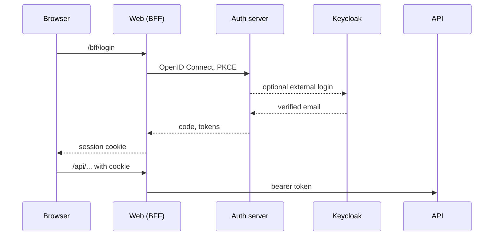
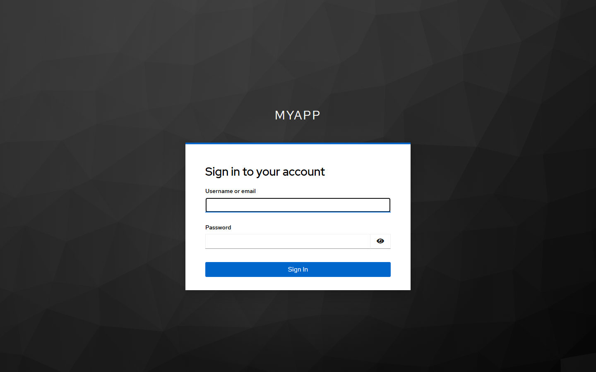

# Authentication and Keycloak

Three hosts share the work:



| Host | Package | Job |
|---|---|---|
| Auth | `Coworkee.AuthServer` | OpenIddict server, sign-in, registration, password reset, two factor, account page, external providers |
| Web | `Coworkee.Bff` | keeps tokens on the server, gives the browser a cookie, forwards `/api`, `/odata`, `/openapi`, `/swagger`, `/mcp` and the prefixes of `Coworkee:Bff:ForwardedPrefixes` (`AddWeb` adds `/hubs` and `/admin/jobs`) |
| API | `Coworkee.AspNetCore` | validates bearer tokens (`AddCoworkeeApiAuthentication`) |

The browser never sees an access token. The sign-in with its tokens lives in a server-side session store (Redis when a `redis` connection string is set, otherwise memory), so the cookie only holds a session key. Requests from the client carry the `X-CSRF: 1` header, which `ApiClientBase` adds.

## Clients and scopes

The auth server creates its OpenID Connect clients from configuration on start. With the [app host](../hosting/aspire.md) you set nothing; by hand it looks like this:

```json
"Coworkee": {
  "Auth": {
    "ApiScopes": { "myapp_api": "myapp_api" },
    "Clients": [{
      "ClientId": "myapp-web",
      "DisplayName": "MyApp",
      "Scopes": [ "myapp_api" ],
      "RedirectUris": [ "https://localhost:7300/signin-oidc" ],
      "PostLogoutRedirectUris": [ "https://localhost:7300/signout-callback-oidc" ]
    }]
  }
}
```

Further keys of a client:

| Key | Meaning |
|---|---|
| `ClientSecret` | makes it a confidential client |
| `ClientUri`, `LogoUrl`, `Description`, `ShowInLauncher` (default `true`) | its tile in the [app launcher](clients.md#app-launcher) |
| `SystemAdministratorsOnly` | only administrators of the system organisation sign in there, for tools that see every organisation's data |
| `AllowImpersonation` | serves a user someone signed in as ([Log in as](../features/identity.md#log-in-as-another-user)); other clients answer `access_denied`. `AddWeb` sets it for the web client |

Outside development, configure `SigningCertificate` and `EncryptionCertificate`: a PKCS#12 file (`Path`) or its content as Base64 (`Base64`, e.g. from a secret), each with `Password`. All instances share them.

### Auth server options

| `Coworkee:Auth:` | Default | Meaning |
|---|---|---|
| `DisplayName`, `LogoUrl` | `Coworkee` | app name and fallback logo of the account pages ([branding](clients.md#branding-of-the-account-pages)) |
| `Issuer` | the request's address | public base address tokens name as issuer; set it behind a proxy or with several instances |
| `DynamicBackchannel` | `false` | with `Issuer`: discovery names token, keys and user info by the address asked, sign-in and sign-out by the issuer, so tools in containers reach the server by another name than the browser |
| `AccessTokenLifetime` | 15 minutes | lifetime of access tokens; also how long tokens of an ended impersonation stay valid |
| `MaxImpersonationDuration` | 8 hours | longest *Log in as* session |
| `FrameAncestors` | none | origins of the same site that may frame the account pages (AirWorks windows) |
| `AllowHttp` | `false` | serves the endpoints over plain http (tests, a TLS proxy in front) |
| `DevelopmentCertificates` | `false` | uses the per-machine development certificates outside Development |
| `Design`, `AllowDesignChanges` | | the [sign-in pages](sign-in-pages.md#configuration) |
| `Passkeys` | | the [passkey options](passkeys.md#configuration) |
| `External`, `Login` | | external providers below and the [sign-in rules](registration.md#sign-in-rules) |

## External login with Keycloak

Any OpenID Connect provider can sign users in. Each one is a section under `Coworkee:Auth:External:Providers`:

```json
"Coworkee": {
  "Auth": {
    "External": {
      "Mode": "Both",
      "AutoProvision": true,
      "Providers": {
        "keycloak": {
          "DisplayName": "Keycloak",
          "Authority": "https://keycloak.example.com/realms/myapp",
          "ClientId": "myapp-auth",
          "ClientSecret": "..."
        }
      }
    }
  }
}
```

| Setting | Meaning |
|---|---|
| `Mode` | `Internal` password only, `External` providers only, `Both` (default) |
| `AutoProvision` | create a user on the first external sign-in when no account has the email |
| `Scopes` | defaults to `openid profile email` |
| `RequireHttpsMetadata` | `false` only for a local Keycloak on http |
| `TrustEmail` | take the provider's addresses as verified without `email_verified` (a provider you run yourself) |
| `BrowserUrl` | the address browsers sign in at when the auth server reaches the provider under another one (a container address as `Authority`) |
| `ModeOverride` | under `External`: wins over the setting `Auth.LoginMode`, the operator's way back when nobody can sign in ([sign-in methods at runtime](registration.md#sign-in-methods-at-runtime)) |

On sign-in the auth server looks for the user in this order: the linked external login, then an account with the same email, then a new account. Linking by email requires the provider to mark the address as verified (`email_verified`) or to be configured with `TrustEmail`, otherwise the sign-in is refused. New users follow the [registration settings](registration.md) and start without roles.

Locally, `options.UseKeycloak()` in the app host starts Keycloak with a realm for the app and configures all of this.

{ .shot }

## Setup wizard or seed

A new installation needs a tenant and a first administrator. Two ways:

**Wizard.** The API answers `503 setup_required` until setup is done. The Blazor client shows the setup page: checks, organization, administrator, theme.

When does the setup page show up? Whenever the database has no set up system: an empty database without a seed (no `AddCoworkeeIdentitySeed`, or a template app whose demo users are switched off), and a deployment without a first administrator (`<APP>_ADMIN_EMAIL` and `_ADMIN_PASSWORD` left empty). Apps generated with demo users are set up by their migrations and never show it.

The page asks for the setup token. Where to find it:

- **Local run** (`coworkee run`, Visual Studio, Coworkee Studio): the app host gives every service one token (its own `Coworkee:SetupToken`, otherwise a new one per run). While the system is not set up it prints `Setup token of <app>: <token> - open https://.../setup?token=...` on its console, writes the same line into the api's log, adds a *Setup* link (token included) to the web resource and the property *Setup token* to the api in the Aspire dashboard. Coworkee Studio shows the token with a copy button on the run card of the Create page and under *My apps*.
- **Deployment**: the parameter `<app>-setup-token`; `coworkee deploy` fills it in `.env` (`<APP>_SETUP_TOKEN`) and names it at the end when no administrator is set.
- **Without either**: the api makes one up at start and writes it to its log (`System is not set up yet. Setup token: ...`); or set `Coworkee:SetupToken`.

A setup page left open in another tab leaves for the app as soon as setup is done: it asks again when the tab gets the focus and when another tab finishes, and a set up system never shows the wizard (`/setup` goes to `/`).

**Seed.** `AddCoworkeeIdentitySeed` in the migration service creates everything on the first start; the wizard never appears. The template works this way.

```csharp
public static void Configure(IdentitySeedOptions seed)
{
    seed.TenantName = "MyApp";
    seed.Roles.Add(new SeedRole("Brand Manager", "Maintains brands", [CatalogPermissions.Brands.View, CatalogPermissions.Brands.Edit]));
    seed.Users.Add(new SeedUser("admin@example.com", password, "Ada", "Admin", IsAdmin: true));
    seed.Users.Add(new SeedUser("brands@example.com", password) { Roles = ["Brand Manager"] });
}
```

## Account features

Registration is off by default; the setting `Account.AllowRegistration` turns it on, and apps from the template seed it on (`--registration false` leaves it off). The wizard, activation, allowed addresses, documents and the sign-in rules are described in [Registration and sign-in rules](registration.md); layout, theme and media of the account pages in [Sign-in pages and designs](sign-in-pages.md). Users change password, two-step verification and [passkeys](passkeys.md) on the account page of the auth server, linked from the user menu; the password also through the API ([changing the own password](clients.md#changing-the-own-password)). The email address changes under *My profile › Security* in the app: after the current password, the new address gets a confirmation link and the old one a notice; the old address keeps working until the link is opened. An address another account uses gets no link, and the answer is the same, so nobody learns which addresses exist.

On a user's page administrators edit everything about the user: user name, names, phone, address, language, active, email confirmed, the address itself (at once, confirmed or with a confirmation mail; the old address gets a notice), the password (set one or send a reset link), an invitation for users without password, lockout, two-step verification reset, external sign-ins, roles, groups and the picture. New users are created in a dialog, either invited by mail to choose a password or with an initial password.

Administrators manage further clients and scopes in the app, end sessions at once and set password rules: see [Clients, sessions and password rules](clients.md).

## Security headers of the web app

`app.UseCoworkeeSecurityHeaders()` (before `UseStaticFiles` and `MapCoworkeeBff`) sends a Content-Security-Policy, `X-Content-Type-Options: nosniff` and `Referrer-Policy: strict-origin-when-cross-origin` with every answer of the web host. The policy fits the Blazor WebAssembly client:

| Directive | Sources | Why |
|---|---|---|
| `script-src` | `'self' 'wasm-unsafe-eval' 'unsafe-eval'` and the file viewer CDNs | WebAssembly, and BlazorJS of MudBlazor.Extensions evaluates script strings |
| `style-src` | `'self' 'unsafe-inline'` and the file viewer CDNs | MudBlazor positions with inline styles |
| `img-src` | `'self' data: blob: https:` | previews, logos and credits from other hosts, the tiles of the map viewer |
| `media-src`, `frame-src`, `object-src` | `'self' data: blob:` | `MudExFileDisplay` shows video and audio, and PDFs and other files in `object` or `iframe` |
| `connect-src` | `'self'` and the file viewer CDNs | the browser talks to this host, which forwards the API and the hubs, and loads viewer modules |
| `frame-ancestors` | `'self'` and `Coworkee:Bff:FrameAncestors` | the AirWorks host may frame the pages |
| `default-src`, `base-uri`, `form-action` | `'self'` | everything else from this host only |
| `font-src` | `'self' data:` | fonts served by the app itself |
| `worker-src` | `'self' blob:` | the service worker of the installable app and workers started from blob URLs |

The file viewer CDNs are `Coworkee:Bff:SecurityHeaders:FileViewerCdns` (`https://cdn.jsdelivr.net`, `https://esm.sh`, `https://unpkg.com`). `MudExFileDisplay` loads the viewers of many types from there the first time it shows one (Word, Excel, PowerPoint, maps, 3D models, HEIC, PSD, Parquet, ...), so every file shows out of the box. The trade-off is third-party script: an app that wants none clears the list and loses the preview of those types (pictures, video, audio, PDF and text keep working):

```csharp
app.UseCoworkeeSecurityHeaders(headers => headers.FileViewerCdns.Clear());
```

The inline `onerror` fallback of `MudExFileDisplay` is not allowed: its script differs per viewer, so no hash covers it; without it only that fallback message stays away.

In Development `connect-src` also allows `http://localhost:*`, `ws://localhost:*` and `wss://localhost:*` (browser link and hot reload). Answers with their own policy (uploaded files, also when the web host forwards them from the API, and the loading screen logo) keep it and get no second one.

Extra sources per directive come from `Coworkee:Bff:SecurityHeaders:Sources` or the callback; `ContentSecurityPolicy` replaces the whole policy (frame-ancestors is then yours to set), `ReferrerPolicy` the referrer policy:

```csharp
app.UseCoworkeeSecurityHeaders(headers =>
{
    // the cloud pickers of the Files module
    headers.Sources["script-src"] = ["https://apis.google.com", "https://js.live.net", "https://www.dropbox.com"];
    headers.Sources["frame-src"] = ["https://accounts.google.com", "https://docs.google.com", "https://onedrive.live.com", "https://login.microsoftonline.com", "https://www.dropbox.com"];
});
```

```json
"Coworkee": { "Bff": { "SecurityHeaders": { "Sources": { "frame-src": [ "https://view.officeapps.live.com" ] } } } }
```

The [head script](../modules/settings.md#head-script) (a tag manager, analytics) runs under this policy: the layout runs inline JavaScript through `eval`, which `'unsafe-eval'` already allows, so only the hosts the script loads from, sends to and frames need entries (`img-src` already allows every https address), for example Google Tag Manager:

```json
"Coworkee": { "Bff": { "SecurityHeaders": { "Sources": {
  "script-src": [ "https://www.googletagmanager.com" ],
  "connect-src": [ "https://*.google-analytics.com", "https://*.analytics.google.com", "https://*.googletagmanager.com" ],
  "frame-src": [ "https://www.googletagmanager.com" ]
} } } }
```

An own `ContentSecurityPolicy` without `'unsafe-eval'` runs no inline head script.

Uploads stream through the web host: its forwarded routes take bodies of any size past Kestrel's limit of about 30 MB, and the API checks its own limit per endpoint (`Coworkee:Files:MaxFileSize`, the setting `Chat.MaxAttachmentMb`). `Coworkee:Bff:MaxRequestBodySize` (bytes) caps what the web host forwards.
