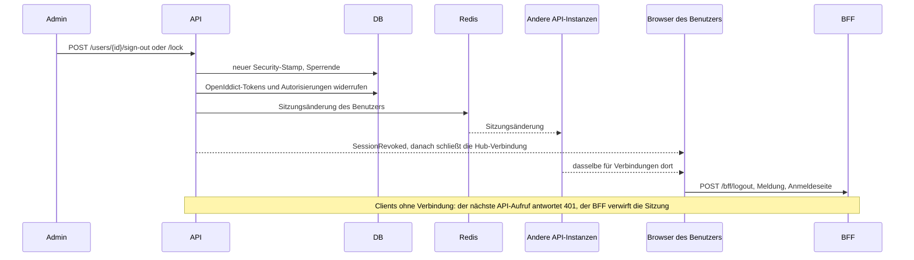

# Clients, Sitzungen und Passwortregeln

Der Auth-Server ist ein vollständiger OpenID-Connect-Provider. Neben den Clients aus der Konfiguration verwalten Administratoren der Systemorganisation weitere Clients und Scopes in der App, beenden Sitzungen sofort und legen die Passwortregeln fest.

## Clients und Scopes in der App

**Administration › Anwendungen** listet alle OpenID-Connect-Clients, **Administration › Scopes** die Scopes, die sie anfragen dürfen. Beide brauchen die Berechtigung `Identity.Clients.Manage` und funktionieren nur in der Systemorganisation, wie die Mandantenseite.

| Feld | Bedeutung |
|---|---|
| Client-ID | die `client_id`, die der Client sendet |
| Typ | `public` (Browser- und Mobile-Apps, nur PKCE, `S256`) oder `confidential` (Server mit Geheimnis) |
| Zustimmung | `implicit` meldet direkt an, `explicit` fragt den Benutzer einmal je Scope-Auswahl |
| Weiterleitungsadressen | wohin Codes gehen dürfen; ihre Origins kommen auch in die `form-action` der Content Security Policy |
| Adressen nach der Abmeldung | erlaubte Werte für `post_logout_redirect_uri` |
| Refresh-Tokens erlauben | ergänzt den Grant `refresh_token` neben `authorization_code` |
| Scopes | `openid profile email roles offline_access` und API-Scopes |
| Dienst-Client | ergänzt den Grant `client_credentials` (siehe unten); ohne Weiterleitungsadressen meldet der Client niemanden an |

Scopes, Weiterleitungsadressen und Adressen nach der Abmeldung sind Chip-Listen ([`RenderAsChips`](../ui/data-table.md#chip-listen)): Wert tippen und Enter drücken oder eine Liste einfügen, die an Leerzeichen, Kommas und Zeilenumbrüchen in Chips zerfällt. Scopes schlagen die Standard-Scopes (`openid`, `profile`, `email`, `roles`, `offline_access`, `phone`, `address`) und die unter **Administration › Scopes** definierten vor, nehmen aber jeden Namen; `openid` ist immer dabei und lässt sich nicht entfernen. Werte werden wie auf dem Server geprüft: Adressen müssen absolut sein, Scope-Namen dürfen nur Buchstaben, Ziffern und `. _ : -` enthalten. Ungültige Werte bleiben mit dem Fehler im Feld. Auch die Ressourcen eines Scopes sind eine Chip-Liste, mit den Ressourcen der anderen Scopes als Vorschlägen.

Ein vertraulicher Client bekommt ein erzeugtes Geheimnis. Es erscheint genau einmal, direkt nach dem Anlegen oder nach **Neues Geheimnis**; die Datenbank behält nur seinen Hash.

Clients und API-Scopes aus `Coworkee:Auth` werden bei jedem Start in die OpenIddict-Tabellen geschrieben und als aus der Konfiguration stammend markiert. Die Seiten zeigen sie mit einem Schloss und ändern sie nicht; geändert werden sie in der Konfiguration. Markierte Clients und Scopes, die die Konfiguration nicht mehr nennt, werden beim Start entfernt; in den Seiten angelegte bleiben. Die Ressourcen eines Scopes werden zu Audiences des Access-Tokens: Ein Scope `reports` mit der Ressource `reports_api` liefert Tokens, die eine API mit der Audience `reports_api` annimmt.

```http
GET    /api/v1/identity/clients
POST   /api/v1/identity/clients          → { id, clientSecret }
PUT    /api/v1/identity/clients/{id}     → { id, clientSecret }, wenn er vertraulich wurde
POST   /api/v1/identity/clients/{id}/secret
DELETE /api/v1/identity/clients/{id}
GET|POST /api/v1/identity/scopes, PUT|DELETE /api/v1/identity/scopes/{id}
```

Die Endpunkte liegen in `CoworkeeAuthStoreModule`, das der API-Host zusammen mit den OpenIddict-Stores lädt.

## Dienst-Clients

Ein vertraulicher Client mit **Dienst-Client** ruft APIs selbst auf, ohne Benutzer, über den Grant `client_credentials`. Er handelt in der Systemorganisation mit den Berechtigungen der Rollen und der Berechtigungsliste, die in seiner Zeile unter **Administration › Anwendungen** gewählt sind:

```http
POST /connect/token
grant_type=client_credentials&client_id=reporting&client_secret=…&scope=myapp_api
```

- Das Access-Token nennt den Client als `sub` und `client_id` und trägt `tenant`, die Rollennamen und die gelisteten Berechtigungen (`permission`).
- In der API ist `ICurrentUser.UserId` `null` und `ICurrentUser.ClientId` die Client-ID; `IPermissionChecker` gewährt, was die Rollen gewähren (Änderungen gelten sofort), plus die gelisteten Berechtigungen (sie gelten ab dem nächsten Token).
- Systemrollen können Clients nicht erhalten, und Administratoren vergeben nur Berechtigungen, die sie selbst haben.
- Dienst-Clients haben keine Sitzung: Es gibt kein Refresh-Token, ein neues Token kommt wieder vom Token-Endpunkt.

## Zustimmung und berechtigte Anwendungen

Bei einem Client mit expliziter Zustimmung zeigt der Auth-Server **Zugriff erlauben** mit den angefragten Scopes. Erlauben speichert eine dauerhafte Autorisierung; Ablehnen gibt `consent_required` an den Client zurück.

Wer als anderer Benutzer angemeldet ist ([Als anderer Benutzer anmelden](../features/identity.md#als-anderer-benutzer-anmelden)), stimmt nie für ihn zu: Ohne die eigene Autorisierung des Benutzers bekommt der Client `consent_required`. Nur Clients mit `AllowImpersonation` (`Coworkee:Auth:Clients:<n>:AllowImpersonation`; `AddWeb` setzt es für den Web-Client) bedienen eine Übernahme überhaupt, die anderen antworten mit `access_denied`.

Auf der Kontoseite (**Kontosicherheit › Autorisierte Anwendungen**) sehen Benutzer jede Anwendung mit Zugriff, seit wann und mit welchen Scopes, und widerrufen sie. Widerrufen beendet die Autorisierungen und Tokens dieser Anwendung; sie muss erneut um eine Anmeldung bitten.

## App-Launcher

Die Startadresse des Auth-Servers öffnet für angemeldete Benutzer **Ihre Anwendungen**: eine Kachel je Anwendung mit Logo, Name, kurzer Beschreibung und einem Link zu ihrer Startadresse. Die Marke oben auf jeder Kontoseite verlinkt dorthin, und die Seite nach dem Abmelden bietet **Erneut anmelden** an.

Der Launcher zeigt Clients, die Benutzer anmelden (Authorization Code), eine Startadresse haben und **Im App-Launcher anzeigen** eingeschaltet haben; Dienst-Clients erscheinen nie. Administratoren setzen **Startadresse**, **Logo-Adresse**, **Beschreibung** und **Im App-Launcher anzeigen** auf der Seite der Clients; Clients aus der Konfiguration nehmen `ClientUri`, `LogoUrl`, `Description` und `ShowInLauncher` (standardmäßig an) aus `Coworkee:Auth:Clients`. Ein konfigurierter Client ohne eigenes Logo zeigt das Logo der Kontoseiten. Im App-Host setzt `AddWeb` die Startadresse des Web-Clients, sodass er ohne weitere Konfiguration erscheint. Adressen müssen absolute http(s)-Adressen sein; die Content Security Policy erlaubt die Herkunft der Logos als Bildquelle.

## Überall abmelden und sperren

Die Benutzerdetailseite hat **Überall abmelden** und **Sperren** (bis zu einem Tag oder bis zum Entsperren); **Entsperren** hebt eine Sperre auf. Alles wirkt sofort:



- Access-Tokens tragen `stamp`, einen Hash des Security-Stamps. Die API vergleicht ihn bei jeder Anfrage und antwortet `401`, sobald sich der Stamp geändert hat.
- Die Stamps liegen eine Minute im HybridCache, mit Redis als zweiter Ebene, wenn der Connection-String `redis` gesetzt ist. Jede gespeicherte Stamp-Änderung (egal von wem: Administrator, Passwortänderung, Einrichtung der Bestätigung in zwei Schritten) geht als Sitzungsänderung hinaus: Über Redis Pub/Sub verwirft jede API-Instanz ihren gecachten Stamp sofort; ohne Redis hört es nur die eigene Instanz, die anderen merken es innerhalb der Minute.
- Jede Instanz kennt ihre Realtime-Verbindungen je Benutzer. Bei einer Sitzungsänderung schickt sie `SessionRevoked` (Grund `signed-out`, `locked` oder `password-changed`) an die Verbindungen, deren Token nicht mehr gilt, und schließt sie eine Sekunde später; `SessionGuard` im Layout meldet ab und sagt dem Benutzer warum.
- Der BFF beendet seine Cookie-Sitzung, wenn die API auf eine Anfrage mit Token `401` antwortet.
- Refresh-Tokens werden widerrufen und, mit dem alten Stamp ausgestellt, ohnehin abgelehnt; das Anmelde-Cookie des Auth-Servers zählt bei `/connect/authorize` nicht mehr.

Administratoren können ihre eigene Sitzung so nicht beenden, und nur Administratoren können andere Administratoren abmelden oder sperren.

### Das eigene Passwort ändern

Ein neues Passwort ändert den Stamp ebenfalls, eine Passwortänderung beendet also die anderen Sitzungen: Ihre Tokens und Refresh-Tokens werden abgelehnt, ihre Realtime-Verbindungen schließen, ihre Anmeldung am Auth-Server zählt nicht mehr. Die Sitzung, in der das Passwort geändert wurde, läuft weiter: Jede Anmeldung am Auth-Server bekommt eine Sitzungs-ID, die in ihre Tokens geht (`sid`), und der Benutzerdatensatz merkt sich diese ID mit dem Stamp davor (`KeptSession`). Ihre Tokens bleiben bis zur nächsten Erneuerung gültig, die sie für den neuen Stamp ausstellt; jede spätere Stamp-Änderung hebt die Ausnahme auf. `SessionRevoked` nennt diese Sitzung (`SessionRevokedPayload.KeptSessionId`, die `sid`): `SessionGuard` ignoriert die Nachricht, wenn es die eigene Sitzung ist, und eine Single-Page-App ignoriert ein `SessionRevoked` mit der `sid` ihres eigenen Access Tokens genauso.

Apps ohne die Kontoseiten ändern es über die API, mit denselben Regeln: `PUT /api/v1/identity/me/password` mit `{ currentPassword, newPassword }` antwortet `204`. Ein falsches aktuelles Passwort antwortet `400` (Feld `CurrentPassword`) und zählt zur Sperre, Passwortregeln und Historie antworten `400` (Feld `NewPassword`), ein Konto ohne Passwort `409` (`account.no_password`). Abgelehnt wird es, während jemand als anderer Benutzer angemeldet ist (`auth.impersonating`), und mit einem API-Schlüssel (`account.own_sign_in_required`); es ist begrenzt wie die Anmeldung (Rate-Limit-Policy `auth`). Die aufrufende Sitzung behält ihre Tokens über die `sid` ihres Access Tokens; ein Token ohne sie endet mit den anderen. Das Anmeldecookie des Auth-Servers in diesem Browser zählt nicht mehr, die nächste Anmeldung dort fragt nach dem neuen Passwort.

Andere Module klinken sich mit `IUserSessionListener` ein (aufgerufen, nachdem ein Administrator die Sitzungen eines Benutzers beendet hat).

## Aufrufe von anderen Origins (CORS)

Browser-Apps auf einem anderen Origin (die [Single-Page-Apps](../hosting/aspire.md#single-page-apps) des App-Hosts) rufen den Auth-Server (Discovery, Schlüssel, Token) und die API direkt auf. `UseCoworkee` setzt auf beiden eine CORS-Policy, die genau die Origins aus `Coworkee:Cors:Origins` zulässt, bei leerer Liste keinen:

```json
"Coworkee": { "Cors": { "Origins": [ "https://spa.example.com" ] } }
```

- Ein Eintrag ist Schema, Host und Port; ein Pfad wird ignoriert, `*` oder etwas, das keine http(s)-Adresse ist, verhindert den Start.
- Jede Methode und jeder Header, `Content-Disposition` lesbar, Preflights zehn Minuten gecacht. Keine Credentials: Die App schickt ihr Token im `Authorization`-Header, nie ein Cookie.
- Endpunkte, die ein Browser mit Credentials aufrufen muss, schalten das mit `.RequireCors(CoworkeeCors.WithCredentials)` ein: dieselben Origins plus `Access-Control-Allow-Credentials`. Der Realtime-Hub tut das, weil der Browser-Client von SignalR mit Credentials verhandelt.
- Andere Origins bekommen keine CORS-Header, der Browser verwirft also die Antwort; Aufrufe vom selben Origin und von Servern sind nicht betroffen.
- Der Web-Host (BFF) entfernt jeden `Access-Control-*`-Header aus seinen Antworten, auch aus denen, die er von der API weiterleitet: Dort ist das Sitzungscookie das Credential, kein anderer Origin darf also lesen, was er antwortet.

## Passwortregeln und Sperre

Die Meldungen von ASP.NET Core Identity (Passwortregeln, vergebene E-Mail-Adresse oder vergebener Benutzername, ungültige Codes und Links) folgen der Sprache der Anfrage: `LocalizedIdentityErrorDescriber` übersetzt sie über `ITextTranslator`, den der Auth-Server aus seinen `Texts/{Sprache}.json` und `Coworkee.Localization` aus den Modultexten (`Localization/{Sprache}.json`) speist, sodass auch die Admin-Seiten der API sie übersetzt zeigen.

**Administration › Einstellungen › Anmeldesicherheit**, alles zur Laufzeit:

| Einstellung | Standard | Bedeutung |
|---|---|---|
| `Account.Password.RequiredLength` | 8 | kürzestes Passwort, mindestens 1 |
| `Account.Password.RequiredUniqueChars` | 1 | ein Passwort braucht so viele verschiedene Zeichen |
| `Account.Password.RequireDigit` | an | ein Passwort braucht eine Ziffer |
| `Account.Password.RequireLowercase` | an | ein Passwort braucht einen Kleinbuchstaben |
| `Account.Password.RequireUppercase` | an | ein Passwort braucht einen Großbuchstaben |
| `Account.Password.RequireNonAlphanumeric` | an | ein Passwort braucht ein Sonderzeichen |
| `Account.Lockout.MaxFailedAttempts` | 10 | falsche Passwörter oder Codes in Folge bis zur Sperre |
| `Account.Lockout.Minutes` | 15 | wie lange diese Sperre dauert |
| `Account.Password.ExpiryDays` | 0 | nach so vielen Tagen verlangt die Anmeldung ein neues Passwort; 0 nie |
| `Account.Password.History` | 0 | ein neues Passwort darf keines der letzten so vielen sein (bis zu 24 werden behalten) |

Die Standards der sechs Passwortregeln kommen aus den konfigurierten Identity-Optionen, `Coworkee:Registration:Password` bleibt also der Ausgangspunkt einer Installation; was Administratoren speichern, gilt. Es sind `Global`-Einstellungen, die für die Clients sichtbar sind. `SettingsPasswordValidator` setzt sie bei jedem Weg durch, ein Passwort zu setzen: Registrierung, Zurücksetzen, Ändern, Setzen durch Administratoren und der erste Administrator im Setup. Ein Host, der nur das Identity-Modul lädt, ohne das Account-Modul, behält den Standard-Validator von Identity und dessen konfigurierte Optionen.

Neben jedem Passwortfeld (Registrierung, Zurücksetzen, Ändern, neues Passwort bei der Anmeldung, Dialog der Administratoren, Setup-Assistent) nennt ein Hinweis die geltenden Regeln, z. B. *Mindestens 12 Zeichen, eine Ziffer, ein Großbuchstabe.* `PasswordRules.Describe` baut ihn aus den Einstellungen und einer Übersetzungsfunktion. Solange es keinen ersten Administrator gibt, kann niemand Einstellungen lesen, deshalb trägt der Setup-Status (`SetupStatusDto.PasswordRules`) die Regeln für die Setup-Seite.

Administratoren setzen beim Anlegen eines Benutzers **Passwort bei der ersten Anmeldung ändern** oder auf der Benutzerdetailseite **Passwort bei der nächsten Anmeldung ändern**. Nach der Anmeldung und bevor der Client Tokens bekommt, zeigt der Auth-Server **Neues Passwort wählen**; dasselbe passiert, wenn das Passwort abgelaufen ist. Wer sich nur über einen externen Anbieter anmeldet, hat kein Passwort und wird nie gefragt.

## Branding der Kontoseiten

Die Kontoseiten nehmen den App-Namen aus `Coworkee:Auth:DisplayName` und Logo und Farben aus dem Standard-Theme der Systemorganisation ([Themes](../modules/theming.md)); Änderungen erscheinen innerhalb einer Minute. Ein Theme ohne Logo zeigt `Coworkee:Auth:LogoUrl`, eine absolute Adresse oder einen Pfad auf dem Auth-Server; die Content Security Policy erlaubt den Origin einer absoluten Adresse als Bildquelle. Im AppHost verweist `options.LogoUrl = "/coworkee-icon.svg"` den Auth-Server auf diesen Pfad der Web-App.
