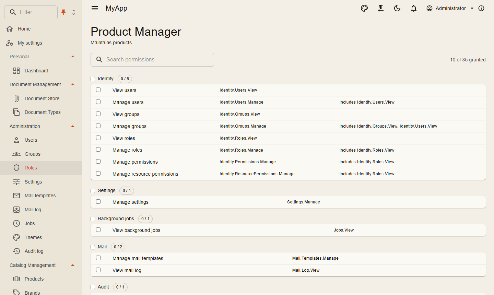

# Berechtigungen

Berechtigungen sind Zeichenketten, von den Modulen definiert, an Rollen, Gruppen oder einzelne Benutzer vergeben und auf dem Server wie in der Oberfläche geprüft.

## Definieren

```csharp
internal sealed class CatalogPermissionDefinitions : IPermissionDefinitionContributor
{
    public void Define(PermissionDefinitionContext context) =>
        context.Group(CatalogPermissions.GroupName, "Catalog")
            .Add(CatalogPermissions.Products.View, "View products")
            .Add(CatalogPermissions.Products.Edit, "Edit products", CatalogPermissions.Products.View);
}

services.AddSingleton<IPermissionDefinitionContributor, CatalogPermissionDefinitions>();
```

`Add(name, displayName, implies...)`: Die Namen nach dem Anzeigenamen sind Berechtigungen, die die neue einschließt; eine Rolle mit *Edit products* darf Produkte also auch ansehen. Einschlüsse verketten sich und gelten überall, wo eine Berechtigung geprüft wird. Ein doppelt definierter Name oder eine eingeschlossene Berechtigung, die niemand definiert, beendet den Start mit einer `InvalidOperationException`.

Mehrere Module dürfen Berechtigungen zur selben Gruppe hinzufügen, so wie das Head-Skript `Settings.HeadScript` zur Gruppe des Settings-Moduls: Die Gruppe steht einmal in der Liste, mit dem Anzeigenamen des ersten Moduls, das sie nennt.

Aus den Definitionen entsteht die Berechtigungsmatrix im Rolleneditor: gruppiert, durchsuchbar, mit Zählern und einem Schalter pro Gruppe.

{ .shot }

## Rollen seeden

```csharp
seed.Roles.Add(new SeedRole("Product Manager", "Maintains products",
    [CatalogPermissions.Products.View, CatalogPermissions.Products.Create, CatalogPermissions.Products.Edit]));
```

`SeedRole(..., SelectableForRegistration: true)` bietet die Rolle in der [Registrierung](registration.md#rollen-in-der-registrierung) an, `{ IsDefault = true }` gibt sie jedem neuen Benutzer ([Standardrollen](../features/identity.md#besitzer-standardgruppe-und-standardrolle)). Siehe [Persistenz](../fundamentals/persistence.md#migrationen-und-seed).

## Rollen umbenennen und ihre Benutzer verschieben

Unter *Administration → Identität → Rollen* ändert der Stift einer Zeile (und der neben dem Namen auf der Seite der Rolle) Name und Beschreibung (`PUT /api/v1/identity/roles/{id}`, `Identity.Roles.Manage`; Schalter, die in `RoleRequest` null bleiben, behalten ihren Wert). Zuweisungen, Benutzer, Gruppen, Ressourcenrechte, Berichtsfreigaben und Dienst-Clients verweisen auf die Id der Rolle und bleiben bei ihr. Offene Rollenlisten, Benutzerseiten und die Berechtigungen der Benutzer ziehen sofort nach.

Zwei Arten von Rollen behalten ihren Namen:

- **Systemrollen** (`admin`, `user`) gehören allen Organisationen und werden über den Namen gefunden: `409 identity.role_system`.
- **Rollen, die Code über ihren Namen sucht**, werden weder umbenannt noch gelöscht: `409 identity.role_name_fixed`, mit dem Code, der sich auf die Rolle verlässt, in der Meldung ("Code findet diese Rolle über ihren Namen (Workflows: Invoices); sie kann nicht gelöscht werden."), die die Rollenseite in der Sprache des Benutzers anzeigt ([Meldungen des Servers](../modules/localization.md#im-client)). Die Beschreibung bleibt änderbar. Das Files-Modul trägt seine Rolle *Registration documents* ein, Coworkee.Workflows jede Rolle, die seine deklarierten Workflows nennen (`Role`, `EscalateTo`, `RequiresRole`, `NotifyRole`). Trage die Namen ein, die dein eigener Code benutzt, jeweils mit dem, was sich auf sie verlässt:

```json
{ "Coworkee": { "Identity": { "FixedRoleNames": { "Dispatchers": "The dispatch board" } } } }
```

oder `services.Configure<IdentityAdministrationOptions>(o => o.FixedRoleNames["Dispatchers"] = "The dispatch board")`. Was die Bibliothek nicht sieht, prüfen Apps vor dem Umbenennen oder Löschen:

- **Seeds** finden Rollen über den Namen (`SeedRole`, `SeedUser.Roles`): Benenne die Rolle auch im Seed um, sonst legt der Entwicklungsabgleich den alten Namen für die Seed-Benutzer wieder an.
- **Als Daten gespeicherte Rollennamen**: die Rolle der Aktivität *Notify* in Elsa-Workflows, Namen in Einstellungen oder Tabellen der App. Trage sie in `FixedRoleNames` ein oder passe sie beim Umbenennen an.
- **Tokens**, die vor dem Umbenennen ausgestellt wurden, tragen den alten Namen in ihren `role`-Claims bis zur nächsten Erneuerung. Berechtigungsprüfungen nutzen die Id der Rolle und ziehen sofort nach.

**Benutzer verschieben oder kopieren**: *Benutzer verschieben oder kopieren…* in der Zeile einer Rolle (`Identity.Users.Manage`, die Berechtigung für das Zuweisen einzelner Rollen) gibt ihren Benutzern eine oder mehrere Zielrollen. *Kopieren* lässt ihnen die Rolle, *Verschieben* nimmt sie ihnen, *Nur ausgewählte Benutzer* beschränkt es auf die gewählten. `POST /api/v1/identity/roles/{id}/users/transfer` mit `TransferRoleUsersRequest(TargetRoleIds, Move, UserIds)` (`UserIds` null: alle Benutzer der Rolle; `ICoworkeeApi.TransferRoleUsersAsync`) antwortet mit der Zahl der Benutzer. Die Regeln einer einzelnen Rollenänderung gelten für jeden Benutzer, und eine Ablehnung stoppt die ganze Anfrage: die Kontoregel für jeden Benutzer (`identity.user_more_permissions`, `identity.admin_role_restricted`), jede Berechtigung der Zielrollen und beim Verschieben auch der Rolle selbst (`identity.grant_restricted`) sowie der letzte aktive Administrator (`409 identity.last_admin`). Mit [gruppenbezogener Verwaltung](#gruppenbezogene-verwaltung) zählen nur Benutzer in der Reichweite des Aufrufers; die anderen behalten ihre Rollen. Jede geänderte Zuordnung ist ein Eintrag im Audit-Log und eine Realtime-Nachricht, zwischengespeicherte Berechtigungen werden verworfen. `GET /api/v1/identity/users?roleId={id}` (`ICoworkeeApi.GetRoleUsersAsync`) listet die Benutzer einer Rolle.

## Eigene Berechtigungen

Administratoren legen zur Laufzeit eigene Berechtigungen an, z. B. um eine Schaltfläche der Kopfzeile oder eine Funktion der App nur einem Teil der Leute zu zeigen: *Administration → Identität → Eigene Berechtigungen* (`/admin/permissions`, Seitenschlüssel `custom-permissions`, auch von der Rollenseite verlinkt). Eine eigene Berechtigung hat einen Namen, einen Anzeigenamen, optional eine Beschreibung und eine Gruppe (Standard *Custom*); sie erscheint sofort und auf jeder Instanz in der Berechtigungsmatrix des Rolleneditors und in `GET /api/v1/identity/permissions/definitions`, Rollen, Gruppen und Benutzer erhalten sie wie jede andere Berechtigung. Geprüft wird sie ebenso: `<PermissionGate Permission="Custom.Reports.Export">`, `IsGrantedAsync("Custom.Reports.Export", ct)`.

- **Namen** beginnen mit `Custom.`, gefolgt von Buchstaben, Ziffern, `-` oder `_`, Teile durch Punkte getrennt (`Custom.Reports.Export`). Das Präfix trennt sie von den Berechtigungen der Bibliothek und der App; ein Name, den eine Berechtigung im Code oder eine andere eigene Berechtigung trägt, antwortet `409 identity.permission_taken`. Der Name bleibt fest, da Zuweisungen und Code auf ihn verweisen; Anzeigename, Beschreibung und Gruppe lassen sich ändern.
- **Geltung:** Die Definitionen gelten wie die im Code für die ganze Installation, die Zuweisungen bleiben je Organisation. Darum verwalten sie nur Berechtigungsverwalter (`Identity.Permissions.Manage`) der Systemorganisation (sonst `403 identity.permission_host_only`).
- **Löschen** zeigt zuerst, wer die Berechtigung verliert: die Rollen (anderer Organisationen mit deren Namen), Gruppen und Benutzer, denen sie zugewiesen ist. Nach der Bestätigung gehen die Definition und jede Zuweisung in jeder Organisation; offene Clients laden ihre Berechtigungen neu. Berechtigungen aus dem Code lassen sich weder ändern noch löschen (`409 identity.permission_code_defined`).
- **Speicher:** Tabelle `cw.CustomPermissions`; Apps legen eine Migration an. Bis dahin funktionieren die Berechtigungen aus dem Code weiter, und eine Warnung wird protokolliert.

```http
GET    /api/v1/identity/permissions/custom                 → [CustomPermissionDto]
POST   /api/v1/identity/permissions/custom                 { name, displayName, description, group }
PUT    /api/v1/identity/permissions/custom/{name}          { displayName, description, group }
GET    /api/v1/identity/permissions/custom/{name}/usage    → { roles, groups, users }
DELETE /api/v1/identity/permissions/custom/{name}
```

Im Blazor-Client: `ICoworkeeApi.GetCustomPermissionsAsync`, `CreateCustomPermissionAsync`, `UpdateCustomPermissionAsync`, `GetCustomPermissionUsageAsync`, `DeleteCustomPermissionAsync`. Weitere Laufzeitquellen für Definitionen implementieren `IStoredPermissionDefinitions` (Coworkee.Application): Der Definitionsmanager liest bei jeder Verwendung deren Liste `Current` und baut neu auf, sobald er eine andere Instanz erhält; ein Name aus dem Code gewinnt.

## Prüfen auf dem Server

| Wo | Wie |
|---|---|
| Ein Request | `[RequiresPermission(CatalogPermissions.Products.Delete)]` am Request-Typ |
| Im Handler | `await permissions.IsGrantedAsync(CatalogPermissions.Products.Edit, ct)` mit `IPermissionChecker` |
| Eine einzelne Ressource | `await permissions.IsGrantedAsync(permission, "Folder", folderId, ct)` |
| Eine Endpunktgruppe | `.RequireAuthorization()` plus das Attribut am Request |
| Ein OData-Set | die Berechtigung, die `AddODataEntity` mitbekommt |

Berechtigungen auf Ressourcen vererben sich entlang einer Hierarchie, die du mit `IResourceHierarchy` beschreibst (etwa Ordner in Ordnern). `IResourceRestriction` entzieht bestimmten Rollen den Zugriff wieder, auch Inhabern einer globalen Berechtigung.

Die wirksamen Berechtigungen eines Benutzers sind die seiner Rollen, der Rollen seiner Gruppen, der Berechtigungen seiner Gruppen und seiner eigenen, mit allem, was sie einschließen; die Systemrolle *Admin* hat jede Berechtigung. Ein Benutzer mit mehreren Rollen kann innerhalb einer davon handeln, der [aktiven Rolle](../modules/realtime.md#aktive-rolle): Solange eine gewählt ist, zählt nur diese, weder die anderen Rollen noch direkt vergebene Berechtigungen. API-Schlüssel und die Liste [Wer eine Berechtigung hat](#wer-eine-berechtigung-hat) ignorieren die aktive Rolle.

### Wer eine Berechtigung hat

`IPermissionChecker.UsersGrantedAsync(permission, groupId, page, ct)` listet die aktiven Benutzer der Organisation des Aufrufers, die eine Berechtigung haben, etwa für Empfängerlisten oder Auswahlfelder: über eine Rolle (eigene oder die einer ihrer Gruppen), eine eigene Berechtigung oder eine ihrer Gruppen, auch über eine Berechtigung, die sie einschließt; Administratoren immer. Das Ergebnis ist eine Seite von Benutzer-IDs, nach E-Mail sortiert, `PageRequest.Search` sucht in E-Mail und Namen. `groupId` schränkt auf Mitglieder dieser Gruppe und ihrer Untergruppen ein. Wie bei jeder Prüfung gibt eine Gruppe nur ihren eigenen Mitgliedern Rechte, nicht denen ihrer Untergruppen. Alle Rollen zählen, egal welche Rolle ein Benutzer als aktive gewählt hat; berechnete Berechtigungen und Berechtigungen auf einzelnen Ressourcen nicht. Über HTTP mit `Identity.Users.View` und `Identity.Roles.View` (die Liste verrät so viel wie die Rollenseite):

```http
GET /api/v1/identity/users/granted?permission=Orders.Approve&groupId={id}&page=1&pageSize=25&search=ann
→ { items: [UserDto], totalCount, page, pageSize }
```

Eine unbekannte Berechtigung antwortet `400`, eine unbekannte Gruppe `404`. Eigene `IPermissionChecker`-Implementierungen liefern eine leere Seite, solange sie die Methode nicht implementieren.

## Prüfen in der Oberfläche

```razor
@attribute [Authorize(Policy = PermissionPolicy.Prefix + CatalogPermissions.Products.View)]

<PermissionGate Permission="@CatalogPermissions.Products.Create">
    <MudButton OnClick="CreateAsync">New product</MudButton>
</PermissionGate>
```

`PermissionGate` rendert seinen Inhalt nur mit der Berechtigung; Navigationseinträge und Tabellenschaltflächen nehmen eine Berechtigung als Parameter und blenden sich selbst aus. Der Client lädt die wirksamen Berechtigungen des Benutzers nach der Anmeldung.

Die Oberfläche blendet nur aus. Entscheiden tut der Server.

## Berechnete Berechtigungen

Manche Rechte folgen aus Daten, nicht aus einer Rolle: „führt mindestens eine Person“, „besitzt ein Projekt“. Eine berechnete Berechtigung vergibt eine definierte Berechtigung, sobald ihre Prüfung true liefert:

```csharp
services.AddComputedPermission(HrPermissions.LeadsPeople, (c, ct) =>
    c.Granted.Contains(HrPermissions.Manage)
        ? Task.FromResult(true)
        : c.Services.GetRequiredService<HrDbContext>().Employees.AnyAsync(e => e.LeaderUserId == c.UserId, ct));
```

Oder eine Klasse, die `IComputedPermission` implementiert, registriert mit `services.AddScoped<IComputedPermission, LeadsPeople>()`. Die Berechtigung muss wie jede andere definiert sein (sie erscheint im Rolleneditor, ein Admin kann sie also auch einer Rolle geben) und schließt ein, was ihre Definition einschließt. Sie gehört überall zu den effektiven Berechtigungen des Benutzers: `[RequiresPermission]`, `IPermissionChecker`, OData-Sets, MCP-Tools, die Berechtigungsliste, die der Client lädt, und damit Navigationseinträge, `PermissionGate` und Policies.

- Die Prüfungen laufen nach den Rollenrechten, einmal pro Request und Benutzer (das Ergebnis gilt für den Request, nicht darüber hinaus), nur für aktive Mitglieder und nur für Berechtigungen, die der Benutzer noch nicht hat. Eine Datenänderung wirkt ab dem nächsten Request; der Client sieht sie, wenn er seine Berechtigungen neu lädt (nach der Anmeldung oder einer Rechteänderung).
- Halte sie bei je einer Abfrage über einen Index: jeder angemeldete Request, der eine Berechtigung prüft, zahlt einmal für alle berechneten Berechtigungen.
- Frag deine Tabellen direkt ab. Ruft eine Prüfung den Permission-Checker oder einen Command mit `[RequiresPermission]` auf, rekursiert sie.
- API-Schlüssel bekommen eine berechnete Berechtigung nur innerhalb ihrer Scopes.

## Einstellungen hinter einer Berechtigung

Eine Einstellung kann zusätzlich zur Regel ihres Scopes (`Settings.Manage` für `Global` und `Tenant`, der Benutzer selbst für `User`) eine eigene Berechtigung verlangen. Sie wird bei der Definition mitgegeben:

```csharp
context.Group("Billing", "Billing")
    .Add("Billing.IbanOverride", "IBAN of the invoices", SettingType.String, [SettingScope.Tenant], permission: BillingPermissions.Bank);
```

Jede Änderung einer solchen Einstellung prüft die Berechtigung: die Einstellungs-Tabs, `PUT /api/v1/settings/{scope}` und die Benutzereinstellungen gleichermaßen. Ein Speichern, das sie ohne die Berechtigung enthält, wird als Ganzes abgelehnt (`403 settings.permission`); Lesen ist nicht eingeschränkt. Das [Head-Skript](../modules/settings.md#head-skript) arbeitet so mit `Settings.HeadScript`.

## Gruppen und Gruppen-Geltungsbereich

Gruppen haben zwei Aufgaben. Als Träger von Berechtigungen wirken sie wie Rollen: Eine Rolle einer Gruppe oder eine Berechtigung an einer Gruppe zählt für ihre **direkten** Mitglieder, nicht für Mitglieder ihrer Untergruppen. Als Einheiten des [Gruppenbaums](../features/identity.md#gruppenbaum-und-geltungsbereich) vergeben sie nichts und entscheiden nur, was ein Benutzer sieht: `IGroupScope` (`Coworkee.Application.Groups`) liefert Filtern die Gruppen, die ein Benutzer erreicht (Mitgliedschaften und ihre Untergruppen), und die, die er in `<GroupScopePicker />` ausgewählt hat. Eine Auswahl schränkt Listen ein, nie den Zugriff, und persönliche API-Schlüssel, MCP, Service-Clients und Jobs ignorieren sie.

| Berechtigung | Wirkung |
|---|---|
| `Identity.Groups.View` | den Gruppenbaum lesen |
| `Identity.Groups.ManageMembers` | Mitglieder hinzufügen, entfernen, verschieben und Besitzer markieren |
| `Identity.Groups.Manage` | Gruppen anlegen, verschieben, löschen; schließt `ManageMembers` ein |
| `Identity.Groups.ScopeAll` | jede Gruppe der Organisation ist erreichbar, für Bearbeiter, die zu keiner Einheit gehören; mit [gruppenbezogener Verwaltung](#gruppenbezogene-verwaltung) lässt sich jeder Benutzer und jede Gruppe verwalten |

Welche Zeilen ein Benutzer sieht, entscheiden die Zeilenfilter der App (`IODataEntityFilter<T>` gegen `IGroupScope.ActiveAsync`); siehe [Welche Gruppen ein Benutzer sieht](../features/identity.md#welche-gruppen-ein-benutzer-sieht).

## Andere Konten und Berechtigungen weitergeben

Wer `Identity.Users.Manage` (oder `Groups.ManageMembers`, `Permissions.Manage`, `Roles.Manage`) hat, übernimmt damit kein stärkeres Konto und gibt nicht mehr weiter, als er selbst hat. Eine Regel, `AccountGuard` (`Coworkee.Identity.Users`), läuft in jedem Request, der das Konto eines anderen Benutzers ändert oder steuert, und in jedem Request, der Berechtigungen gibt oder nimmt:

- **Am Konto eines anderen** (Passwort, E-Mail-Adresse, Zwei-Schritt-Verifizierung, Passkeys, externe Anmeldungen, Avatar, Profil und Benutzername, Aktivierung, Sperren und Entsperren, Abmelden, seine Sitzungen beenden und sein Sitzungslimit setzen, Löschen, Rollen, Gruppen, eigene Berechtigungen, Sprache, Einladungs- und Passwort-Mails, seine API-Schlüssel widerrufen) scheitert jede Aktion mit `403 identity.user_more_permissions`, solange der Benutzer eine Berechtigung hat, die dem Aufrufer fehlt. Es zählen alle Rollen des Benutzers, egal welche er als aktive gewählt hat, auch während er deaktiviert ist (was er zurückbekäme); eine Berechtigung auf einer einzelnen Ressource zählt, außer der Aufrufer hat sie global oder auf dieser Ressource. Das ist die Regel von [Als anderer Benutzer anmelden](#als-anderer-benutzer-anmelden). Nur Administratoren handeln an Administratoren (`403 identity.admin_role_restricted`), auch wenn ein anderer jede Berechtigung hat. Administratoren haben jede Berechtigung und handeln deshalb an jedem ihrer Organisation; die Regeln zum letzten Administrator bleiben.
- **Berechtigungen vergeben oder entziehen** (Freigaben an Rollen, Benutzer und Gruppen), eine Rolle geben oder nehmen (`SetUserRoles`, `CreateUser` mit Rollen, `SetGroupRoles`, eine Rolle löschen), einer Gruppe beitreten lassen oder sie verlassen lassen (`SetUserGroups`, die Mitglieder-Requests, eine Gruppe löschen: die Mitglieder bekommen oder verlieren ihre Rollen, Freigaben und Ressourcenfreigaben) und eine Rolle auf einer Ressource vergeben oder entziehen braucht jede beteiligte Berechtigung samt der mitgegebenen, sonst `403 identity.grant_restricted`. Auf einer Ressource darf der Aufrufer sie dort statt global haben. Die Administratorrolle braucht einen Administrator (`identity.admin_role_restricted`). Standardrollen und die Standardgruppe gehen durch: jedes Konto, das ein Benutzerverwalter anlegt, bekommt sie ohnehin, und Standard machen konnte sie nur, wer ihre Berechtigungen hatte ([Standardrolle](../features/identity.md#besitzer-standardgruppe-und-standardrolle)).
- **Service-Clients** folgen derselben Regel: einen Client anlegen, ändern, sein Secret erneuern und ihn löschen braucht jede Berechtigung seiner Rollen und seiner Liste (`403 auth.client_rights_restricted`).

Der Aufrufer zählt mit dem, was er gerade hat: seiner aktiven Rolle, den Scopes seines [API-Schlüssels](api-keys.md) (ein Schlüssel schränkt nur ein) und einem dekorierten `IPermissionChecker`. Der Benutzer, an dem er handelt, zählt mit allem, was seine Rollen geben. Requests, die [als System](#als-system-handeln) laufen, gehen durch: der Code, der sie schickt, hat schon entschieden. Eigene Requests, die das Konto eines anderen ändern, rufen den Guard nach dem Laden des Benutzers:

```csharp
if (await guard.CheckUserAsync(userId, ct) is { } refused) return refused;
if (await guard.CheckRolesAsync(addedOrRemovedRoleIds, ct) is { } restricted) return restricted;
```

Mit [gruppenbezogener Verwaltung](#gruppenbezogene-verwaltung) lehnt der Guard auch Benutzer außerhalb der Gruppen des Aufrufers ab.

### Gruppenbezogene Verwaltung

Apps, die mehrere Kunden in einer Organisation führen und durch Gruppen trennen, beschränken ihre Verwalter mit einer Einstellung auf die eigenen Gruppen:

```json
{ "Coworkee": { "Identity": { "GroupScopedAdministration": true } } }
```

Sie ist standardmäßig aus. Eine App, deren Gruppen Abteilungen einer Firma sind, lässt ihre Benutzerverwalter heute alle verwalten; eingeschaltet sähe der Verwalter einer Abteilung keine Kollegen anderer Abteilungen und keine Benutzer ohne Gruppe mehr. Harmlos als Standard wäre sie nur, wo sie nichts ändert (eine Organisation ohne Gruppen, ein Verwalter jeder Gruppe); deshalb entscheidet die App.

Eingeschaltet erreicht ein Verwalter die Gruppen, in denen er Mitglied ist, ihre Untergruppen (`IGroupScope.AccessibleAsync`, nie durch die Gruppenauswahl eingeschränkt) und die Benutzer, die Mitglied in einer davon sind; sich selbst immer. Die ganze Organisation wie bisher erreichen Inhaber von `Identity.Groups.ScopeAll`, Administratoren, das System (`ISystemDispatcher`, `CurrentUserScope.BeginSystem`) und wer jede Gruppe erreicht. Die [Standardgruppe](../features/identity.md#besitzer-standardgruppe-und-standardrolle) zählt für niemanden: Alle sind darin, also erreicht sie keine Benutzer, steht keiner Änderung eines Benutzers entgegen und wird nur mit der ganzen Organisation geändert.

- **Lesen:** Benutzer, Gruppen und ihre Berechtigungen außerhalb der Reichweite antworten mit 404 (`identity.user_not_found`, `identity.group_not_found`, `identity.grant_target_not_found`) und fehlen in Listen, Zählungen und Nachschlagen: `GetUsers`, `GetGroups`, `/users/roles`, `/users/granted`, effektive Berechtigungen, die Sprache eines Benutzers, der Gruppenbaum (`/groups/children` beginnt bei den obersten Gruppen der Reichweite, `/groups/tree` findet nur Gruppen darin) und die OData-Sets `Users`, `Groups` und `ApiKeys`, damit auch Exporte, die globale Suche, Client-Entities, Berichte, Mail-Empfänger und die KI-Werkzeuge. Die Detailansicht eines Benutzers nennt nur seine Gruppen in der Reichweite, Ressourcenfreigaben nur Empfänger in der Reichweite.
- **Einen Benutzer ändern** (alles, was `AccountGuard.CheckUserAsync` schützt, siehe oben) braucht alle seine Gruppen in der Reichweite; ein Benutzer, der auch zu einer Gruppe außerhalb gehört, antwortet mit `403 identity.user_other_groups`. Einer Gruppe des Aufrufers beitreten oder sie verlassen ist eine solche Änderung.
- **Mitglieder und Besitzer hinzufügen:** nur Benutzer in der Reichweite oder Benutzer ohne Gruppe außerhalb der Reichweite (eine neue Registrierung in der Standardgruppe), damit Hinzufügen nie den Benutzer eines anderen Kunden hereinholt; andere sind unbekannt (`400 Unknown user.`).
- **Gruppen:** Gruppen anlegen, umbenennen, verschieben und löschen, ihre Mitglieder, Rollen und Berechtigungen gehen innerhalb der Reichweite; eine übergeordnete Gruppe oder Gruppe außerhalb antwortet mit 404. Eine Gruppe auf oberster Ebene (dort angelegt, dorthin verschoben oder importiert), die Standardgruppe und Rollen (anlegen, ändern, löschen, ihre Berechtigungen: sie erreichen Benutzer überall) brauchen die ganze Organisation, `403 identity.all_groups_required`. Gruppenrollen und -berechtigungen und das Löschen einer Gruppe werden abgelehnt, solange ein Mitglied auch zu einer Gruppe außerhalb der Reichweite gehört (`identity.user_other_groups`): Sie ändern, was er dort darf.
- **Neue Benutzer:** Ein beschränkter Verwalter nennt mindestens eine seiner Gruppen (`CreateUserRequest.GroupIds`, braucht `Identity.Groups.ManageMembers`; der Dialog *Neuer Benutzer* bietet die Gruppen an), sonst wäre der Benutzer sofort außerhalb seiner Reichweite.
- **Ressourcenfreigaben** nennen Benutzer und Gruppen in der Reichweite; Freigaben an andere sieht er nicht und entzieht er nicht.
- **Anmelden als** ein Benutzer außerhalb der Reichweite antwortet mit 404; die [Regel fürs Anmelden als](#als-anderer-benutzer-anmelden) (jede Gruppe des Ziels liegt in denen des Aufrufers) gilt mit und ohne die Einstellung.

Nicht beschränkt: Namen, Karten und Avatare von Kollegen (`/users/names`, `/users/cards`, `/users/{id}/avatar`), die jeder angemeldete Benutzer für "Erstellt von"-Spalten und den Chat liest; die Rollenliste; die Spalte `ParentPath` des Sets `Groups`, die die Vorfahren über den eigenen Gruppen des Aufrufers nennt; und die `[Realtime]`-Änderungsmeldungen zu Benutzern und Gruppen (nur Ids; das Neuladen ist gefiltert). Service-Clients gehören zu keiner Gruppe: Sie bekommen `ScopeAll`.

Eigene Requests wenden dieselben Regeln über `AdminReach` (`Coworkee.Identity.Users`) an:

```csharp
var users = await reach.FilterUsersAsync(db.Set<User>(), ct);              // die Benutzer in der Reichweite (alle, wenn die Einstellung aus ist)
if (!await reach.ReachesGroupAsync(groupId, ct)) return GroupNotFound;     // eine Gruppe außerhalb ist unbekannt
if (await guard.CheckUserAsync(userId, ct) is { } refused) return refused; // Reichweite, Obermengen- und Administratorregel
if (await reach.CheckAllAsync(ct) is { } restricted) return restricted;    // Änderungen für die ganze Organisation
```

## Als anderer Benutzer anmelden

Mit `Identity.Users.Impersonate` (schließt `Identity.Users.View` ein, gehört nicht zu `Identity.Users.Manage`) melden sich Support-Mitarbeiter als ein anderer aktiver Benutzer ihrer Organisation an. Das Ziel darf keine Berechtigung haben, die dem Aufrufer fehlt, und jede seiner Gruppen muss in den Gruppen des Aufrufers oder darunter liegen (`Identity.Groups.ScopeAll` hebt das auf); geprüft wird beim Ausstellen des Tickets und bei jeder Autorisierung und Token-Erneuerung, eine spätere Berechtigung für das Ziel beendet die Sitzung also. Details, Tokens und das Ende einer Sitzung: [Als anderer Benutzer anmelden](../features/identity.md#als-anderer-benutzer-anmelden).

Für Berechtigungsprüfungen **ist** die Sitzung das Ziel: `IPermissionChecker` antwortet mit dessen Berechtigungen. Was sich unterscheidet:

- `ICurrentUser.ImpersonatorId` nennt den Impersonator. Das Audit speichert ihn neben dem Benutzer (`AuditEntry.ImpersonatorId`, „angemeldet durch“ auf der Protokollseite, `GET /api/v1/audit?impersonatorId=...`).
- Jobs, Outbox-Nachrichten und Integration-Events aus der Sitzung behalten ihn (`JobEnvelope`, `IntegrationMessage`, `ImpersonatedUser(userId, tenantId, impersonatorId)`), damit auch ihre Änderungen den Impersonator nennen.
- `[NotWhileImpersonating]` an einem Request lehnt ihn mit `403 auth.impersonating` ab, auch in Jobs, die für den Benutzer handeln. Die Bibliothek markiert das Ändern der eigenen E-Mail-Adresse und des Passworts, das Anlegen von API-Schlüsseln, den Export der persönlichen Daten, das Löschen des eigenen Kontos, die Wahl der aktiven Rolle und das Anlegen und Ändern von Webhooks und Bericht-Abonnements. Markiere eigene Requests, die die Zugangsdaten des Benutzers berühren oder für ihn sprechen, genauso.

## Als System handeln

Manchmal muss ein Modul ein Kommando der Bibliothek ausführen, egal was der Aufrufer darf: Das HR-Modul hält die Gruppe eines Teams aktuell, wenn eine Führungskraft das Team bearbeitet, auch wenn sie keine Gruppen verwalten darf. `ISystemDispatcher` sendet so ein Kommando als System:

```csharp
await system.SendAsync(new SetGroupMembers(groupId, memberIds), [IdentityPermissions.Groups.ManageMembers], ct);
```

Das Kommando läuft in der Organisation des Aufrufers, angemeldet ohne Benutzer und mit genau den genannten Berechtigungen (keine Rollen, nichts darüber hinaus), und in einem eigenen DI-Scope, damit die offenen Änderungen des Aufrufers nicht mitgespeichert werden. Seine Audit-Einträge zeigen *system*. `CurrentUserScope.BeginSystem(tenantId, permissions)` tut dasselbe ohne eigenen Scope, etwa in einem Hintergrundjob für eine andere Organisation.

Nutze es erst, nachdem dein eigener Code entschieden hat, dass der Aufrufer die Änderung auslösen darf (`[RequiresPermission]` am eigenen Kommando, eine Prüfung am Datensatz). Reiche nie einen Request weiter, den der Aufrufer gebaut hat: Er könnte damit alles tun, was die genannten Berechtigungen erlauben. Für Arbeit im Namen eines Benutzers handelst du stattdessen als dieser Benutzer: `CurrentUserScope.Begin(new ImpersonatedUser(userId, tenantId, impersonatorId))`, mit dem Impersonator einer Sitzung [als anderer Benutzer](#als-anderer-benutzer-anmelden), damit das Audit ihn weiter nennt. Was `ISystemDispatcher` ausführt, läuft als System und nennt keinen Impersonator.

## Berechtigungen nur für den Host

Manche Berechtigungen betreffen die ganze Installation: `Features.Tenants`, `Features.Editions`, `Identity.Clients.Manage` ([Clients und Scopes](clients.md)), `Backups.Manage` ([Backups](../modules/backups.md)) und `Retention.Manage` ([Aufbewahrung](../modules/retention.md)). Jeder Administrator hat sie, sie wirken aber nur in der Systemorganisation; anderswo antworten die Requests mit `403`. Einstellungen mit dem Scope `Global` folgen derselben Regel: `Settings.Manage` ändert sie nur aus der Systemorganisation.
