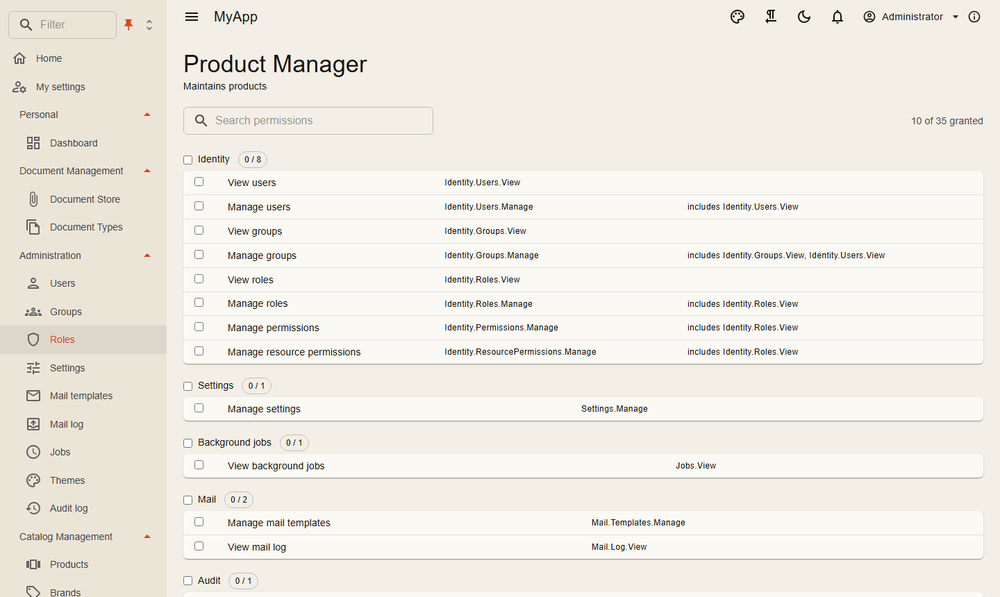

# Permissions

Permissions are strings, defined by the modules, granted to roles, groups or single users, and checked on the server and in the UI.

## Defining

```csharp
internal sealed class CatalogPermissionDefinitions : IPermissionDefinitionContributor
{
    public void Define(PermissionDefinitionContext context) =>
        context.Group(CatalogPermissions.GroupName, "Catalog")
            .Add(CatalogPermissions.Products.View, "View products")
            .Add(CatalogPermissions.Products.Edit, "Edit products", CatalogPermissions.Products.View);
}

services.AddSingleton<IPermissionDefinitionContributor, CatalogPermissionDefinitions>();
```

`Add(name, displayName, implies...)`: the names after the display name are permissions the new one implies, so a role with *Edit products* may also view them. Implications chain and count everywhere a permission is checked. A name defined twice, or an implied permission nobody defines, stops the start with an `InvalidOperationException`.

Several modules may add permissions to the same group, as the head script adds `Settings.HeadScript` to the group of the Settings module: the group is listed once, with the display name of the first module that named it.

The definitions build the permission matrix in the role editor: grouped, searchable, with counts and a toggle per group.

{ .shot }

## Seeding roles

```csharp
seed.Roles.Add(new SeedRole("Product Manager", "Maintains products",
    [CatalogPermissions.Products.View, CatalogPermissions.Products.Create, CatalogPermissions.Products.Edit]));
```

`SeedRole(..., SelectableForRegistration: true)` offers the role in the [registration](registration.md#roles-offered-in-the-registration), `{ IsDefault = true }` gives it to every new user ([default roles](../features/identity.md#owners-default-group-and-default-role)). See [Persistence](../fundamentals/persistence.md#migrations-and-seeding).

## Custom permissions

Administrators create permissions of their own at runtime, e.g. to show a header button or an app feature only to some people: *Administration → Identity → Custom permissions* (`/admin/permissions`, page key `custom-permissions`, also linked from the roles page). A custom permission has a name, a display name, an optional description and a group (default *Custom*); it shows in the role editor's permission matrix and in `GET /api/v1/identity/permissions/definitions` at once, on every instance, and roles, groups and users get it like any other permission. Check it like one, too: `<PermissionGate Permission="Custom.Reports.Export">`, `IsGrantedAsync("Custom.Reports.Export", ct)`.

- **Names** start with `Custom.`, followed by letters, digits, `-` or `_`, parts separated by dots (`Custom.Reports.Export`). The prefix keeps them apart from the library's and the app's permissions; a name taken by a permission in code or another custom permission answers `409 identity.permission_taken`. The name cannot change later, as grants and code refer to it; display name, description and group can.
- **Scope:** the definitions belong to the whole installation like the ones in code, the grants stay per organisation. So only permission managers (`Identity.Permissions.Manage`) of the system organisation handle them (`403 identity.permission_host_only` elsewhere).
- **Deleting** shows first who loses the permission: the roles (of other organisations with their name), groups and users it is granted to. Confirming deletes the definition and every grant of it in every organisation; open clients reload their permissions. Permissions in code can be neither edited nor deleted (`409 identity.permission_code_defined`).
- **Storage:** table `cw.CustomPermissions`; apps add a migration. Until they do, the permissions in code keep working and a warning is logged.

```http
GET    /api/v1/identity/permissions/custom                 → [CustomPermissionDto]
POST   /api/v1/identity/permissions/custom                 { name, displayName, description, group }
PUT    /api/v1/identity/permissions/custom/{name}          { displayName, description, group }
GET    /api/v1/identity/permissions/custom/{name}/usage    → { roles, groups, users }
DELETE /api/v1/identity/permissions/custom/{name}
```

In the Blazor client: `ICoworkeeApi.GetCustomPermissionsAsync`, `CreateCustomPermissionAsync`, `UpdateCustomPermissionAsync`, `GetCustomPermissionUsageAsync`, `DeleteCustomPermissionAsync`. Other runtime sources of definitions implement `IStoredPermissionDefinitions` (Coworkee.Application): the definition manager reads its `Current` list on every use and rebuilds when it gets another instance; a name defined in code wins.

## Checking on the server

| Where | How |
|---|---|
| A request | `[RequiresPermission(CatalogPermissions.Products.Delete)]` on the request type |
| Inside a handler | `await permissions.IsGrantedAsync(CatalogPermissions.Products.Edit, ct)` with `IPermissionChecker` |
| A single resource | `await permissions.IsGrantedAsync(permission, "Folder", folderId, ct)` |
| An endpoint group | `.RequireAuthorization()` plus the request attribute |
| An OData set | the permission passed to `AddODataEntity` |

Resource grants inherit along a hierarchy you describe with `IResourceHierarchy` (folders in folders, for example). `IResourceRestriction` takes access away again for certain roles, even from holders of a global grant.

A user's effective permissions are those of his roles, his groups' roles, grants to his groups and grants to him, with everything they imply; the system role *Admin* holds every permission. A user with several roles may act within one of them, the [active role](../modules/realtime.md#active-role): while one is chosen, only that role counts, neither the other roles nor direct grants. API keys and the [Who holds a permission](#who-holds-a-permission) list ignore the active role.

### Who holds a permission

`IPermissionChecker.UsersGrantedAsync(permission, groupId, page, ct)` lists the active users of the caller's organisation who hold a permission, for recipient lists or pickers: through a role (their own or one of their groups), a grant of their own or a grant of one of their groups, also through a permission that implies it; administrators always. The result is a page of user ids ordered by email, `PageRequest.Search` looks in email and names. `groupId` narrows to members of that group and its sub-groups. As in every check, a group grants only to its own members, not to those of its sub-groups. All roles count, whatever role a user picked as active; computed permissions and grants on single resources do not. Over HTTP with `Identity.Users.View` and `Identity.Roles.View` (the list tells as much as the roles page):

```http
GET /api/v1/identity/users/granted?permission=Orders.Approve&groupId={id}&page=1&pageSize=25&search=ann
→ { items: [UserDto], totalCount, page, pageSize }
```

An unknown permission answers `400`, an unknown group `404`. Own `IPermissionChecker` implementations return an empty page unless they implement it.

## Checking in the UI

```razor
@attribute [Authorize(Policy = PermissionPolicy.Prefix + CatalogPermissions.Products.View)]

<PermissionGate Permission="@CatalogPermissions.Products.Create">
    <MudButton OnClick="CreateAsync">New product</MudButton>
</PermissionGate>
```

`PermissionGate` renders its content only with the permission; navigation entries and table buttons take a permission parameter and hide themselves. The client loads the effective permissions of the user after sign-in.

The UI only hides. The server decides.

## Computed permissions

Some rights follow from data, not from a role: "leads at least one person", "owns a project". A computed permission grants a defined permission whenever its check answers true:

```csharp
services.AddComputedPermission(HrPermissions.LeadsPeople, (c, ct) =>
    c.Granted.Contains(HrPermissions.Manage)
        ? Task.FromResult(true)
        : c.Services.GetRequiredService<HrDbContext>().Employees.AnyAsync(e => e.LeaderUserId == c.UserId, ct));
```

Or a class implementing `IComputedPermission`, registered with `services.AddScoped<IComputedPermission, LeadsPeople>()`. The permission must be defined like any other (it shows in the role editor, so an admin can also grant it to a role) and implies what its definition implies. It is part of the user's effective permissions everywhere: `[RequiresPermission]`, `IPermissionChecker`, OData sets, MCP tools, the permission list the client loads, and so navigation entries, `PermissionGate` and policies.

- The checks run after the role grants, once per request and user (the result is kept for the request, not across requests), only for active members, and only for permissions the user does not already hold. A data change shows with the next request; the client sees it when it reloads its permissions (after sign-in or a permission change).
- Keep them to one indexed query each: every authenticated request that checks a permission pays for all computed permissions once.
- Query your tables directly. Calling the permission checker or a command with `[RequiresPermission]` from a check recurses.
- API keys get a computed permission only within their scopes.

## Settings behind a permission

A setting can need a permission of its own on top of the rule of its scope (`Settings.Manage` for `Global` and `Tenant`, the user for `User`). Pass it when defining the setting:

```csharp
context.Group("Billing", "Billing")
    .Add("Billing.IbanOverride", "IBAN of the invoices", SettingType.String, [SettingScope.Tenant], permission: BillingPermissions.Bank);
```

Every change of such a setting checks the permission: the settings tabs, `PUT /api/v1/settings/{scope}` and the user settings alike. A save that contains it without the permission is refused as a whole (`403 settings.permission`); reading is not restricted. The [head script](../modules/settings.md#head-script) works this way with `Settings.HeadScript`.

## Groups and the group scope

Groups play two parts. As holders of permissions they act like roles: a role of a group or a grant to a group counts for its **direct** members, not for members of its sub-groups. As units of the [group tree](../features/identity.md#group-tree-and-scope) they grant nothing and only decide what a user sees: `IGroupScope` (`Coworkee.Application.Groups`) gives filters the groups a user may reach (memberships and their sub-groups) and the ones he selected in `<GroupScopePicker />`. A selection narrows lists, never access, and personal API keys, MCP, service clients and jobs ignore it.

| Permission | Effect |
|---|---|
| `Identity.Groups.View` | read the group tree |
| `Identity.Groups.ManageMembers` | add, remove, move members and mark owners |
| `Identity.Groups.Manage` | create, move, delete groups; implies `ManageMembers` |
| `Identity.Groups.ScopeAll` | every group of the organisation is accessible, for operators who belong to no unit; with [group-scoped administration](#group-scoped-administration) every user and group can be administered |

Rows the user may see are the business of the app's row filters (`IODataEntityFilter<T>` against `IGroupScope.ActiveAsync`); see [which groups a user sees](../features/identity.md#which-groups-a-user-sees).

## Other accounts and handing out permissions

Holding `Identity.Users.Manage` (or `Groups.ManageMembers`, `Permissions.Manage`, `Roles.Manage`) does not let anyone take over a stronger account or hand out more than he holds. One rule, `AccountGuard` (`Coworkee.Identity.Users`), runs in every request that changes or controls another user's account and in every request that gives or takes permissions:

- **Acting on another account** (password, e-mail address, two-step verification, passkeys, external logins, avatar, profile and user name, activation, lock and unlock, sign-out, deletion, roles, groups, own grants, language, invitation and password reset mails, revoking his API keys) is refused with `403 identity.user_more_permissions` while the user holds a permission the caller lacks. All of the user's roles count, whichever he picked as active, also while he is deactivated (what he would get back); a permission he holds on a single resource counts unless the caller holds it globally or on that resource. It is the rule of [Log in as another user](#log-in-as-another-user). Only administrators act on administrators (`403 identity.admin_role_restricted`), also when someone else holds every permission. Administrators hold every permission, so they act on everyone of their organisation; the last-administrator rules stay.
- **Granting or revoking** a permission (grants of roles, users and groups), giving or taking a role (`SetUserRoles`, `CreateUser` with roles, `SetGroupRoles`, deleting a role), joining or leaving a group (`SetUserGroups`, the member requests, deleting a group: the members get or lose its roles, grants and resource grants) and granting or revoking a role on a resource needs every permission involved, implied ones included, otherwise `403 identity.grant_restricted`. On a resource the caller may hold them there instead of globally. The administrator role needs an administrator (`identity.admin_role_restricted`). Default roles and the default group pass: every account a user manager creates gets them anyway, and only who held their permissions could make them default ([default role](../features/identity.md#owners-default-group-and-default-role)).
- **Service clients** follow the same rule: creating, changing, rotating the secret of and deleting a client needs every permission of its roles and its list (`403 auth.client_rights_restricted`).

The caller counts with what he holds right now: his active role, the scopes of his [API key](api-keys.md) (a key only narrows) and a decorated `IPermissionChecker`. The user he acts on counts with everything his roles give. Requests sent [as the system](#acting-as-the-system) pass: the code that sends them has decided already. Your own requests that change another user's account call the guard after loading the user:

```csharp
if (await guard.CheckUserAsync(userId, ct) is { } refused) return refused;
if (await guard.CheckRolesAsync(addedOrRemovedRoleIds, ct) is { } restricted) return restricted;
```

With [group-scoped administration](#group-scoped-administration) the guard also refuses users outside the caller's groups.

### Group-scoped administration

Apps that keep several customers in one organisation, separated by groups, limit their administrators to their own groups with one setting:

```json
{ "Coworkee": { "Identity": { "GroupScopedAdministration": true } } }
```

It is off by default. An app whose groups are departments of one company lets its user managers manage everybody today; turned on, the manager of a department would no longer see colleagues of other departments or users without a group. Only where it changes nothing would it be harmless as a default (an organisation without groups, a manager of every group), so the app decides.

With it on, an administrator reaches the groups he is a member of and their sub-groups (`IGroupScope.AccessibleAsync`, never narrowed by the group selection) and the users who are a member of one of them; himself always. The whole organisation, as before, is reached by holders of `Identity.Groups.ScopeAll`, administrators, the system (`ISystemDispatcher`, `CurrentUserScope.BeginSystem`) and whoever reaches every group. The [default group](../features/identity.md#owners-default-group-and-default-role) counts for nobody: everyone is in it, so it reaches no users, does not stand against changing a user and is changed only with the whole organisation.

- **Reading:** users, groups and their grants out of reach answer 404 (`identity.user_not_found`, `identity.group_not_found`, `identity.grant_target_not_found`) and are absent from lists, counts and lookups: `GetUsers`, `GetGroups`, `/users/roles`, `/users/granted`, effective permissions, the language of a user, the group tree (`/groups/children` starts at the top groups of the reach, `/groups/tree` finds only groups in reach), and the OData sets `Users`, `Groups` and `ApiKeys`, so also exports, the global search, client entities, reports, mail recipients and the AI tools. A user's detail lists only his groups in reach, resource grants only principals in reach.
- **Changing a user** (everything `AccountGuard.CheckUserAsync` guards, see above) needs all his groups in reach; a user who also belongs to a group outside answers `403 identity.user_other_groups`. Joining or leaving one of the caller's groups is such a change.
- **Adding members and owners:** only users in reach or users of no group outside the reach (a new registration in the default group), so adding never takes in another customer's user; others are unknown (`400 Unknown user.`).
- **Groups:** creating, renaming, moving and deleting groups, their members, roles and grants work inside the reach; a parent or group outside answers 404. A group at the top level (created, moved or imported there), the default group and roles (create, change, delete, their grants: they reach users everywhere) need the whole organisation, `403 identity.all_groups_required`. Group roles and grants and deleting a group are refused while a member also belongs to a group outside the reach (`identity.user_other_groups`): they change what he may do there.
- **New users:** a scoped administrator names at least one of his groups (`CreateUserRequest.GroupIds`, needs `Identity.Groups.ManageMembers`; the *New user* dialog offers the groups), otherwise the user would be out of his reach at once.
- **Resource grants** name users and groups in reach; grants to others are not listed and cannot be revoked by him.
- **Log in as** a user out of reach answers 404; the [impersonation rule](#log-in-as-another-user) (each of the target's groups lies in the caller's) holds with or without the setting.

Not limited: names, cards and avatars of colleagues (`/users/names`, `/users/cards`, `/users/{id}/avatar`), which every signed-in user reads for "created by" columns and the chat; the role list; the `ParentPath` column of the `Groups` set, which names the ancestors above the caller's own groups; and the `[Realtime]` change notifications of users and groups (ids only; the reload is filtered). Service clients belong to no group: give them `ScopeAll`.

Own requests apply the same rules through `AdminReach` (`Coworkee.Identity.Users`):

```csharp
var users = await reach.FilterUsersAsync(db.Set<User>(), ct);              // the users in reach (all when the setting is off)
if (!await reach.ReachesGroupAsync(groupId, ct)) return GroupNotFound;     // a group out of reach is unknown
if (await guard.CheckUserAsync(userId, ct) is { } refused) return refused; // reach, superset and admin rule
if (await reach.CheckAllAsync(ct) is { } restricted) return restricted;    // organisation-wide changes
```

## Log in as another user

With `Identity.Users.Impersonate` (implies `Identity.Users.View`, not part of `Identity.Users.Manage`) support staff sign in as another active user of their organisation. The target must hold no permission the caller lacks, and each of its groups must lie in the caller's groups or below them (`Identity.Groups.ScopeAll` waives that); the rules are checked when the ticket is issued and on every authorization and token refresh, so a later grant to the target ends the impersonation. Details, tokens and the end of an impersonation: [Log in as another user](../features/identity.md#log-in-as-another-user).

For permission checks the session **is** the target: `IPermissionChecker` answers with the target's permissions. What differs:

- `ICurrentUser.ImpersonatorId` names the impersonator. The audit trail stores it next to the user (`AuditEntry.ImpersonatorId`, *impersonated by* on the audit page, `GET /api/v1/audit?impersonatorId=...`).
- Jobs, outbox messages and integration events started in the session keep it (`JobEnvelope`, `IntegrationMessage`, `ImpersonatedUser(userId, tenantId, impersonatorId)`), so their changes name the impersonator too.
- `[NotWhileImpersonating]` on a request refuses it with `403 auth.impersonating`, also in jobs acting for the user. The library marks changing the own e-mail address and password, creating API keys, exporting personal data, deleting the own account, choosing the active role and changing webhooks and report subscriptions. Mark own requests that touch the user's credentials or speak for him the same way.

## Acting as the system

Sometimes a module has to run a library command whatever the caller may do: the HR module keeps the group of a team in step when a manager edits the team, although the manager may not manage groups. `ISystemDispatcher` sends such a command as the system:

```csharp
await system.SendAsync(new SetGroupMembers(groupId, memberIds), [IdentityPermissions.Groups.ManageMembers], ct);
```

The command runs in the caller's organisation, signed in without a user and with exactly the permissions you name (no roles, nothing more), and in a DI scope of its own, so the caller's pending changes are not saved with it. Its audit entries show *system*. `CurrentUserScope.BeginSystem(tenantId, permissions)` does the same without the own scope, e.g. in a background job for another organisation.

Use it only after your own code has decided that the caller may cause the change (`[RequiresPermission]` on your own command, a check on the record). Never pass on a request the caller built: it would let them do anything the named permissions allow. For work on behalf of a user, act as that user instead: `CurrentUserScope.Begin(new ImpersonatedUser(userId, tenantId, impersonatorId))`, passing on the impersonator of a [Log in as](#log-in-as-another-user) session so the audit still names him. Work dispatched with `ISystemDispatcher` runs as the system and names no impersonator.

## Host-only permissions

Some permissions serve the whole installation: `Features.Tenants`, `Features.Editions`, `Identity.Clients.Manage` ([clients and scopes](clients.md)), `Backups.Manage` ([backups](../modules/backups.md)) and `Retention.Manage` ([retention](../modules/retention.md)). Every administrator holds them, but they work only in the system organisation; elsewhere the requests answer `403`. Settings of scope `Global` follow the same rule: `Settings.Manage` changes them only from the system organisation.
