# Symvopath

{ width=240 }

[Symvopath](https://www.symvopath.de) stellt einen virtuellen Raum zur Verfügung, in dem Pathologen komplexe diagnostische Fälle digital und ortsunabhängig vorstellen und bearbeiten können. Ein Pathologe stellt einen Fall mit eingescannten Gewebeschnitten und klinischen Informationen ein; ein Spezialist begutachtet ihn in der Webanwendung und schreibt das histopathologische Gutachten.

Symvopath wurde im Mai 2022 aus dem Template angelegt, auf .NET 6, und läuft seit 2022 in Produktion. Es läuft auf dem Template, aus dem Coworkee entstanden ist, nicht auf den NuGet-Paketen: Was diese Seite zeigt, ist Template-Code aus den Jahren 2022 bis 2025, den die Pakete übernommen und ausgebaut haben. Symvopaths eigener Code ist die Fachlichkeit: Fälle, Konsilanfragen, Spezialisierungen, ICD-Codes und pathologische Leistungen. Die Daten stehen in der [Geschichte](../about/history.md).

Die Screenshots stammen aus Symvopaths Entwicklungsinstanz mit Testdaten, angemeldet als Administrator, ohne etwas zu ändern. Namen, E-Mail-Adressen, Telefonnummern und Dokumenttitel echter Benutzer sind unkenntlich gemacht. Die Oberfläche ist auf den Bildern englisch, bis auf eines.

## Layout und Navigation

Die obere Leiste trägt Sprache, Schreibrichtung, Theme, Benachrichtigungen und das Benutzermenü; die Navigation lässt sich anheften und zeigt nur die Seiten, die der Benutzer öffnen darf. In Coworkee: [Client und Layout](../ui/client.md).

<figure markdown>
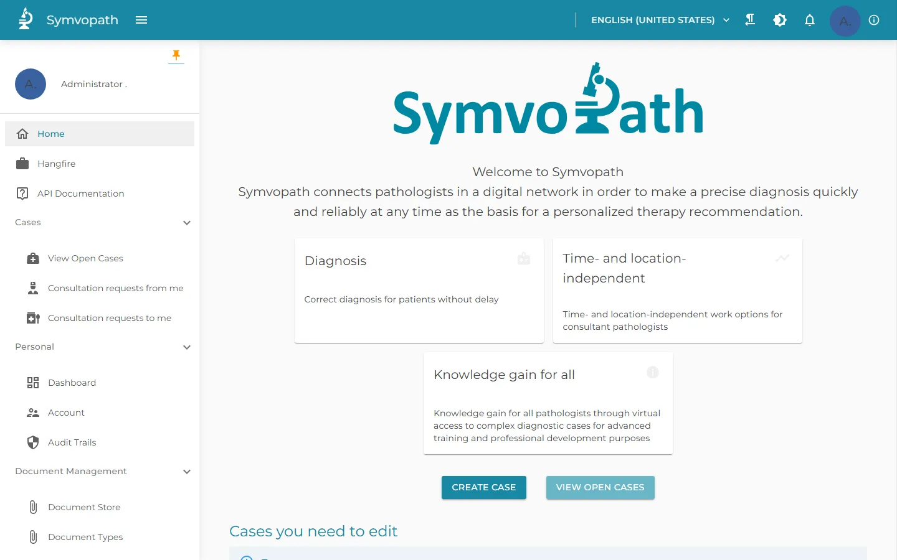{ loading=lazy }
<figcaption>Startseite, Navigation und obere Leiste</figcaption>
</figure>

<figure markdown>
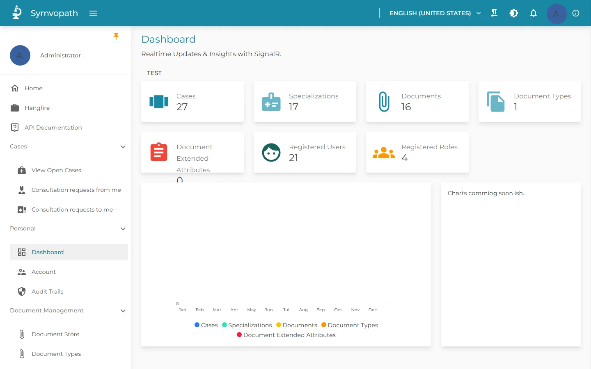{ loading=lazy }
<figcaption>Dashboard mit Zählern, die sich über SignalR aktualisieren</figcaption>
</figure>

Das Dashboard lädt seine Zähler neu, wenn sich Datensätze ändern, über SignalR. In Coworkee: [Realtime und Benachrichtigungen](../modules/realtime.md).

## Tabellen und Formulare über der Fachlichkeit

Fälle, Konsilanfragen und die Kataloge sind Tabellen mit serverseitigem Paging, Suche und Filtern; der ICD-Katalog hat 2.383 Codes. Formulare entstehen aus dem Modell, mit Abschnitten, Hilfetexten und Längenzählern. In Coworkee: [Datentabellen](../ui/data-table.md), die Facetten, Gruppierung und gespeicherte Ansichten dazulegen, und die [Blazor-Admin-Oberfläche](../features/blazor-ui.md).

<figure markdown>
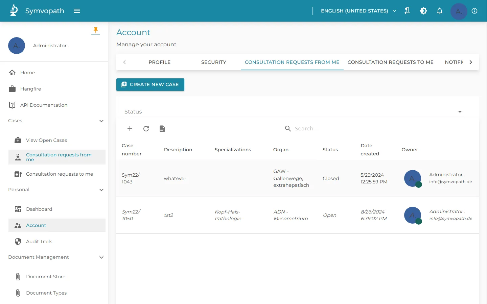{ loading=lazy }
<figcaption>Konsilanfragen mit Statusfilter</figcaption>
</figure>

<figure markdown>
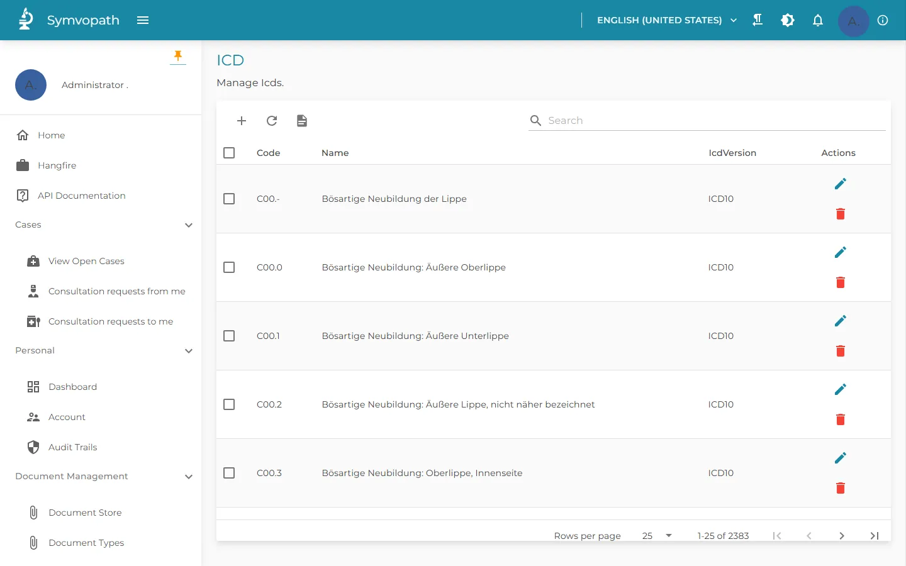{ loading=lazy }
<figcaption>ICD-Katalog, 2.383 Codes mit serverseitigem Paging</figcaption>
</figure>

<figure markdown>
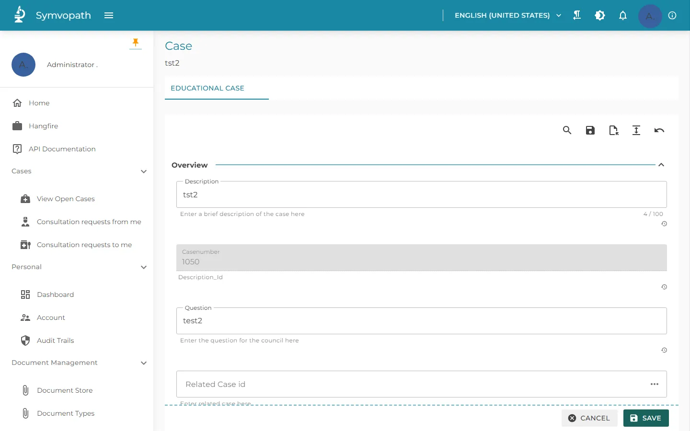{ loading=lazy }
<figcaption>Ein Testfall im erzeugten Formular</figcaption>
</figure>

## Benutzer, Rollen und Berechtigungen

Administratoren verwalten Benutzer und Rollen und vergeben Berechtigungen pro Rolle, nach Bereichen gruppiert. In Coworkee: [Identity und Sicherheit](../features/identity.md) und [Berechtigungen](../security/permissions.md).

<figure markdown>
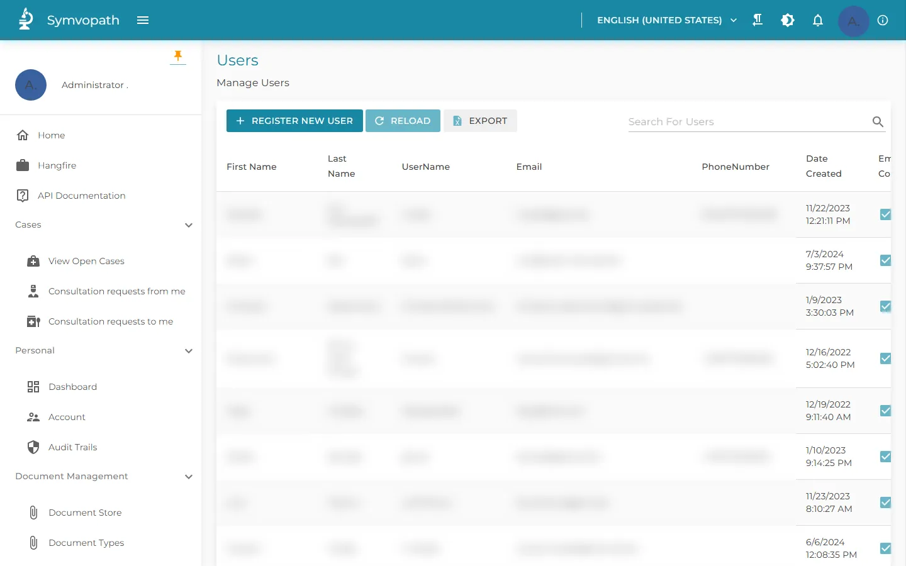{ loading=lazy }
<figcaption>Benutzer (Namen, E-Mail-Adressen und Telefonnummern unkenntlich)</figcaption>
</figure>

<figure markdown>
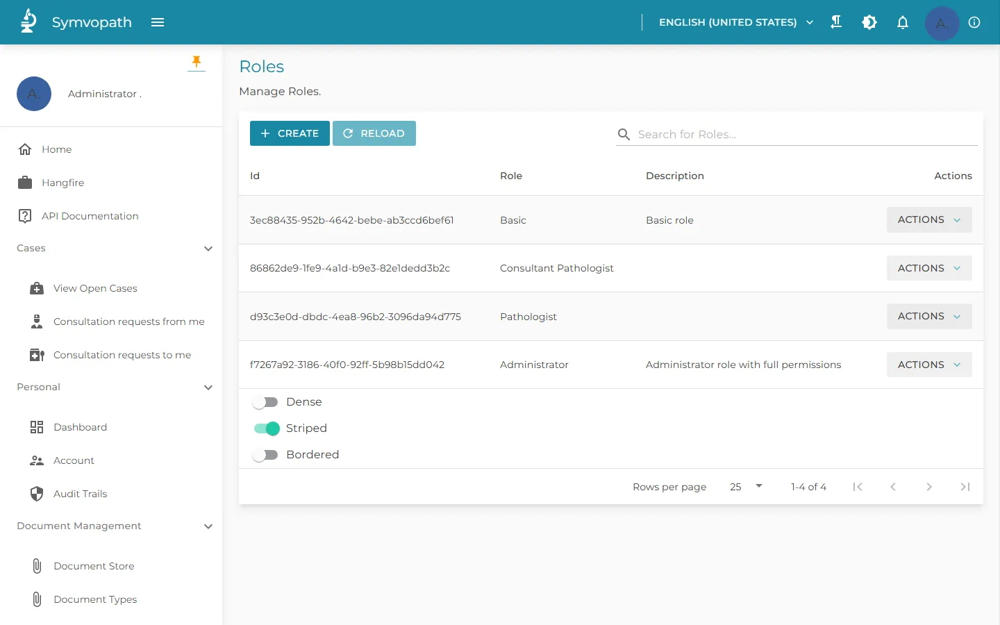{ loading=lazy }
<figcaption>Rollen</figcaption>
</figure>

<figure markdown>
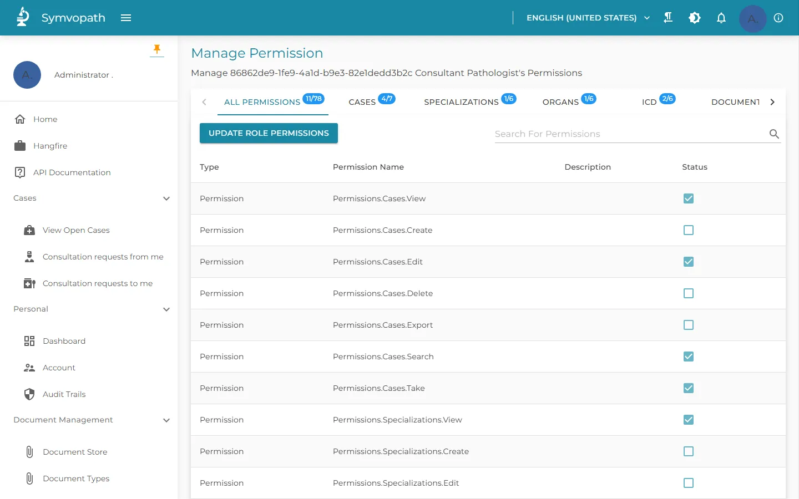{ loading=lazy }
<figcaption>Berechtigungen einer Rolle, nach Bereichen gruppiert</figcaption>
</figure>

## Audit-Trail

Jede Änderung wird mit geänderten Spalten, altem und neuem Wert, Benutzer und Zeit festgehalten; Administratoren filtern nach Benutzer, Zeitraum und Wert und exportieren nach Excel. In Coworkee: [Audit](../modules/auditing.md).

<figure markdown>
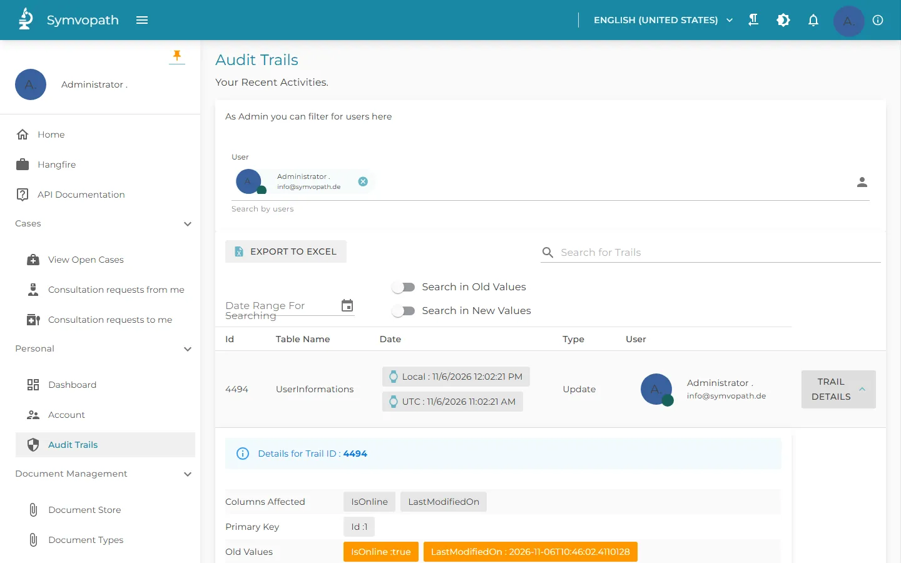{ loading=lazy }
<figcaption>Audit-Trail mit den Details einer Änderung</figcaption>
</figure>

## Sprachen und Themes

Administratoren bearbeiten Übersetzungen in der laufenden App; Benutzer wechseln Sprache, Theme und Dunkelmodus. In Coworkee: [Lokalisierung](../modules/localization.md) und [Themes](../modules/theming.md).

<figure markdown>
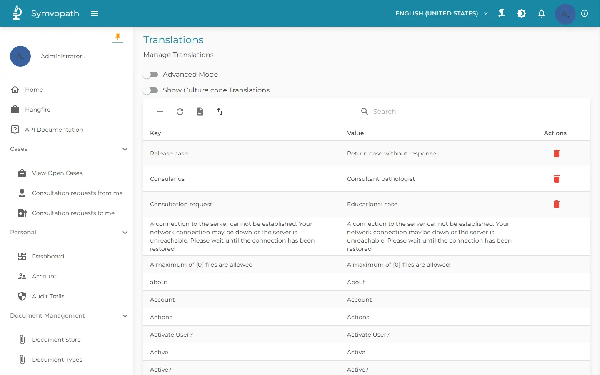{ loading=lazy }
<figcaption>Übersetzungen, in der App bearbeitbar</figcaption>
</figure>

<figure markdown>
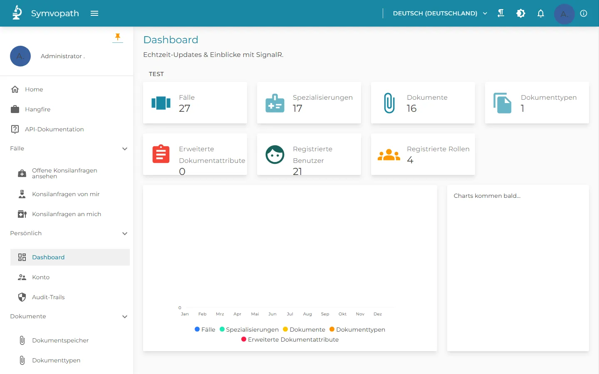{ loading=lazy }
<figcaption>Dasselbe Dashboard auf Deutsch</figcaption>
</figure>

<figure markdown>
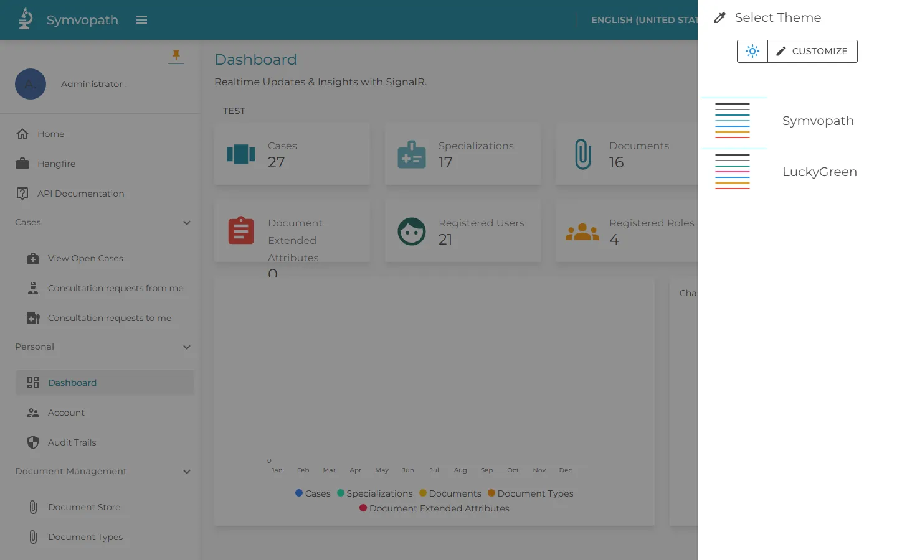{ loading=lazy }
<figcaption>Theme-Auswahl mit dem Symvopath-Theme</figcaption>
</figure>

<figure markdown>
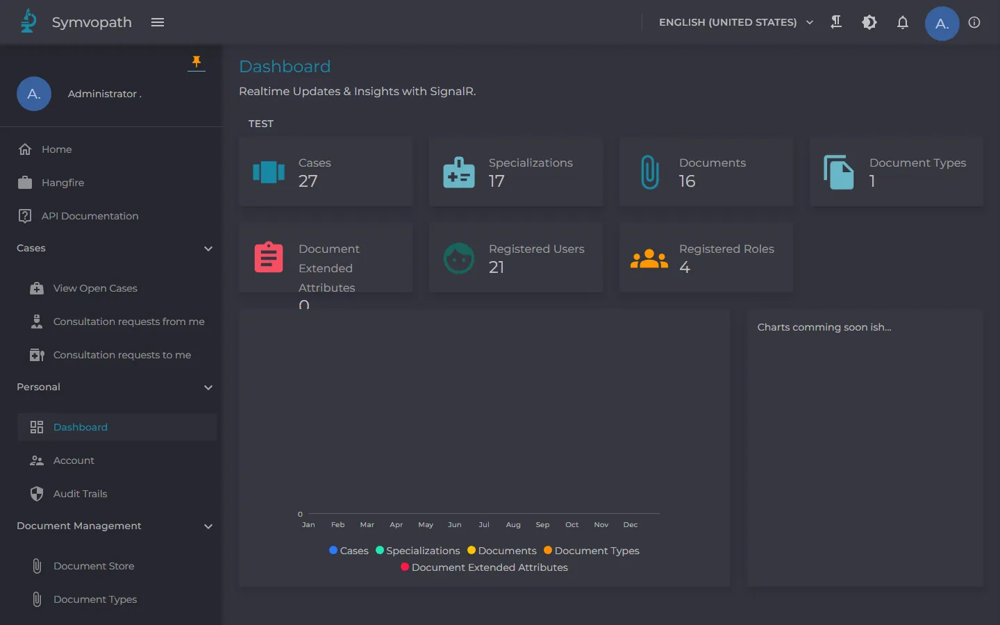{ loading=lazy }
<figcaption>Dunkelmodus</figcaption>
</figure>

## Dokumente, Hintergrundjobs und die API

Dokumente mit Typen und Freigabe-Schalter, Hintergrundjobs auf Hangfire und eine HTTP-API mit Swagger UI. In Coworkee: [Dateien](../modules/files.md), [Hintergrundjobs](../modules/background-jobs.md) und [HTTP-APIs](../web/http-api.md).

<figure markdown>
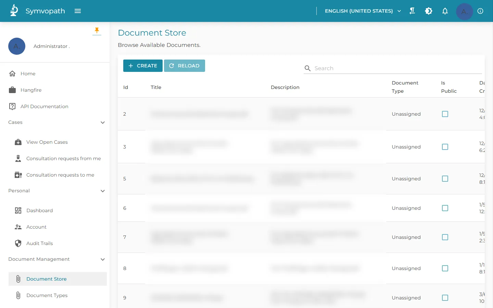{ loading=lazy }
<figcaption>Dokumentenablage (Titel und Beschreibungen unkenntlich)</figcaption>
</figure>

<figure markdown>
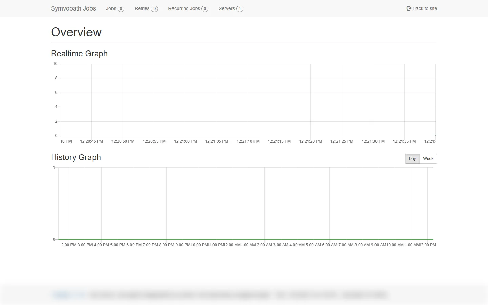{ loading=lazy }
<figcaption>Hangfire-Dashboard (Servername unkenntlich)</figcaption>
</figure>

<figure markdown>
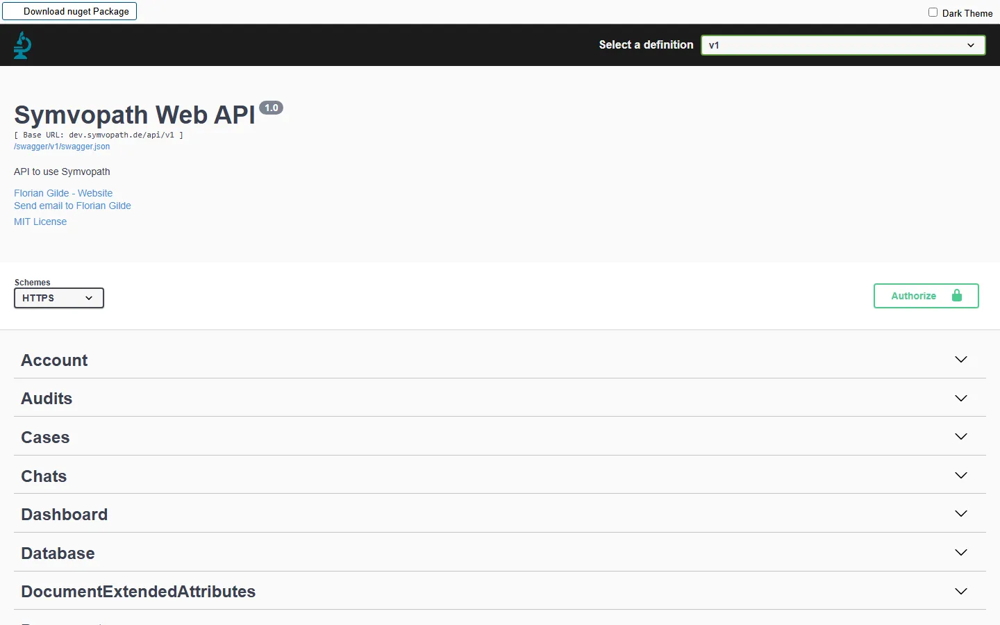{ loading=lazy }
<figcaption>Die HTTP-API in Swagger UI</figcaption>
</figure>

Mehr über Symvopath auf [symvopath.de](https://www.symvopath.de).
