# Symvopath

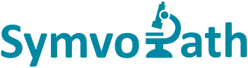{ width=240 }

[Symvopath](https://www.symvopath.de) provides a virtual space where pathologists present complex diagnostic cases digitally and work on them from anywhere. A pathologist submits a case with scanned tissue sections and clinical information; a specialist reviews it in the web app and writes the histopathological report.

Symvopath was started from the template in May 2022, on .NET 6, and has run in production since 2022. It runs on the template that Coworkee grew out of, not on the NuGet packages: what this page shows is template code from 2022 to 2025, which the packages took over and extended. Symvopath's own code is the domain: cases, consultation requests, specializations, ICD codes and pathological services. The [history](../about/history.md) has the dates.

The screenshots come from Symvopath's development instance with test data, signed in as an administrator, nothing changed. Names, e-mail addresses, phone numbers and document titles of real users are blurred.

## Layout and navigation

The top bar carries language, text direction, theme, notifications and the user menu; the navigation drawer can be pinned and shows only the pages the user may open. In Coworkee: [Client and layout](../ui/client.md).

<figure markdown>
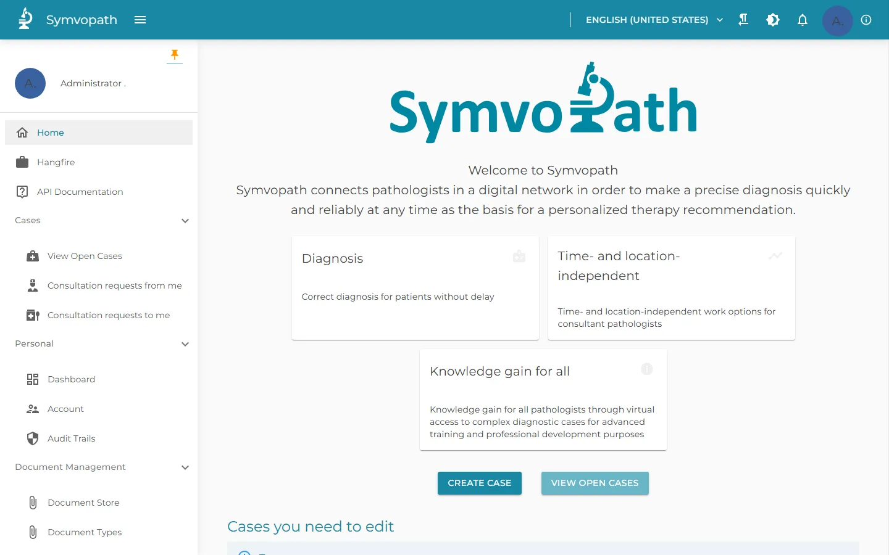{ loading=lazy }
<figcaption>Home page, navigation and top bar</figcaption>
</figure>

<figure markdown>
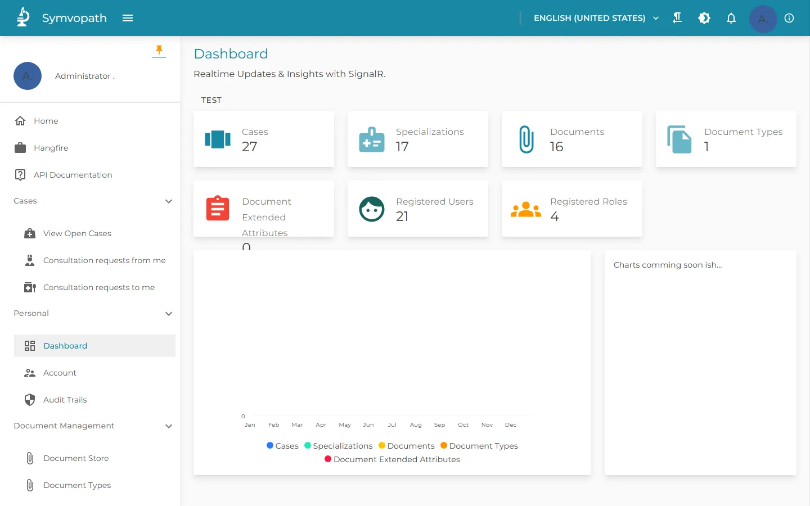{ loading=lazy }
<figcaption>Dashboard with counts that update over SignalR</figcaption>
</figure>

The dashboard reloads its counts when records change, over SignalR. In Coworkee: [Realtime and notifications](../modules/realtime.md).

## Tables and forms over the domain

Cases, consultation requests and the catalogs are tables with server paging, search and filters; the ICD catalog has 2,383 codes. Forms are generated from the model with sections, help texts and length counters. In Coworkee: [Data tables](../ui/data-table.md), which add facets, grouping and saved views, and the [Blazor admin UI](../features/blazor-ui.md).

<figure markdown>
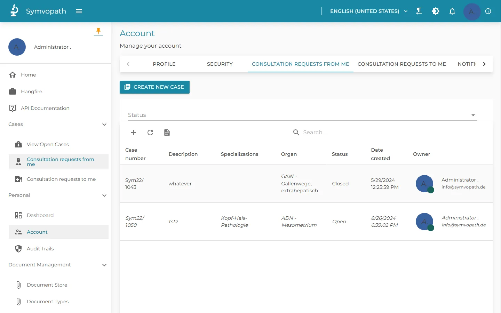{ loading=lazy }
<figcaption>Consultation requests with status filter</figcaption>
</figure>

<figure markdown>
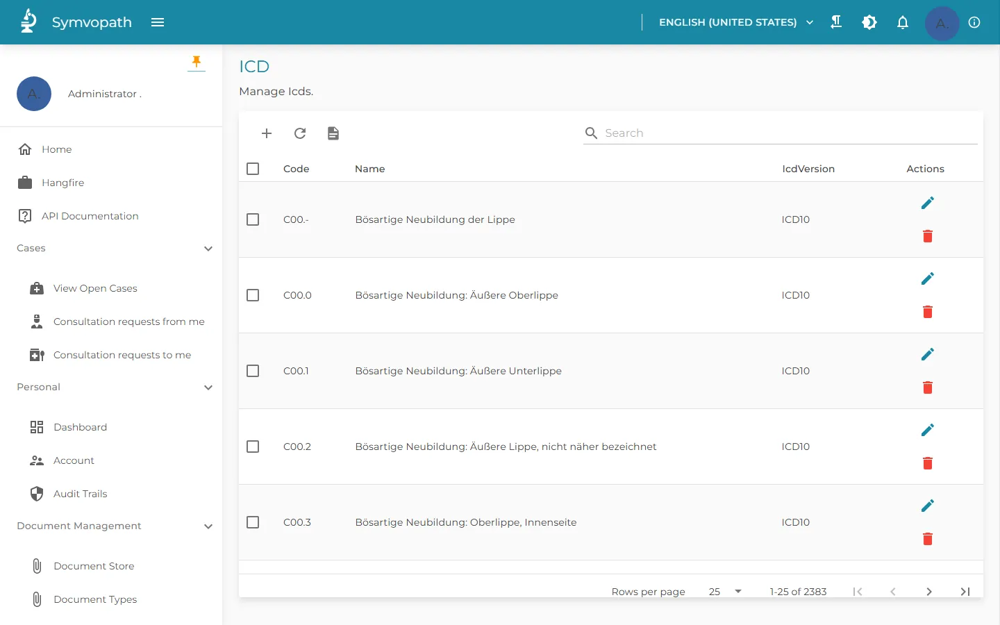{ loading=lazy }
<figcaption>ICD catalog, 2,383 codes with server paging</figcaption>
</figure>

<figure markdown>
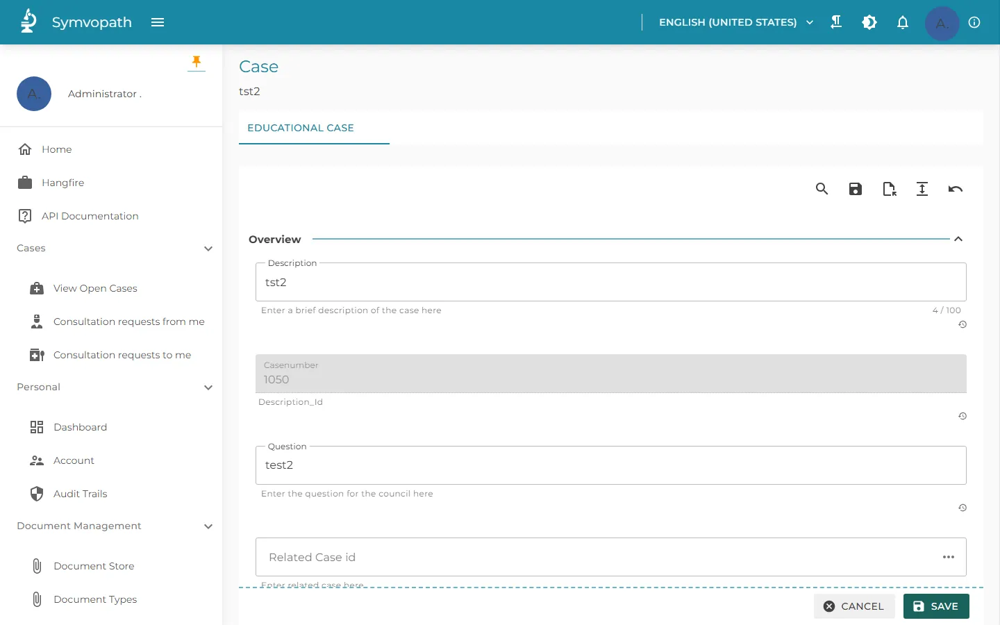{ loading=lazy }
<figcaption>A test case in the generated form</figcaption>
</figure>

## Users, roles and permissions

Administrators manage users and roles and set permissions per role, grouped by area. In Coworkee: [Identity and security](../features/identity.md) and [Permissions](../security/permissions.md).

<figure markdown>
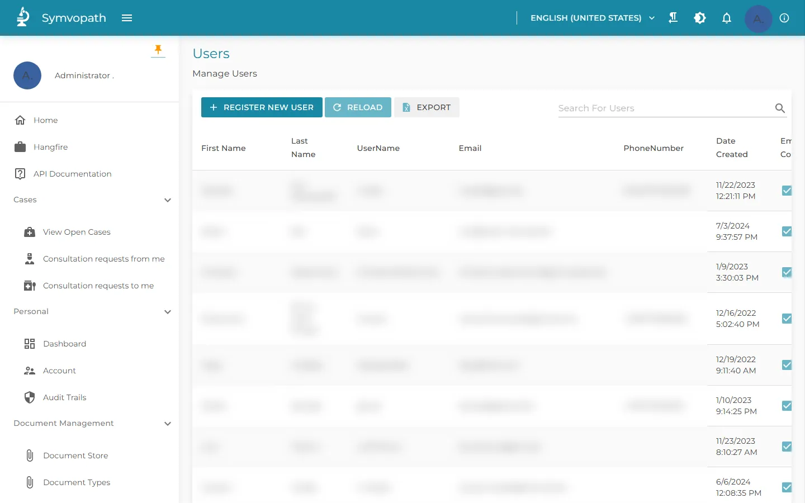{ loading=lazy }
<figcaption>Users (names, e-mail addresses and phone numbers blurred)</figcaption>
</figure>

<figure markdown>
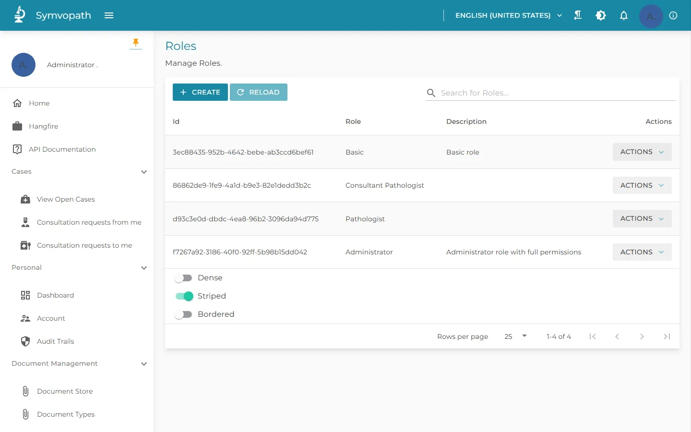{ loading=lazy }
<figcaption>Roles</figcaption>
</figure>

<figure markdown>
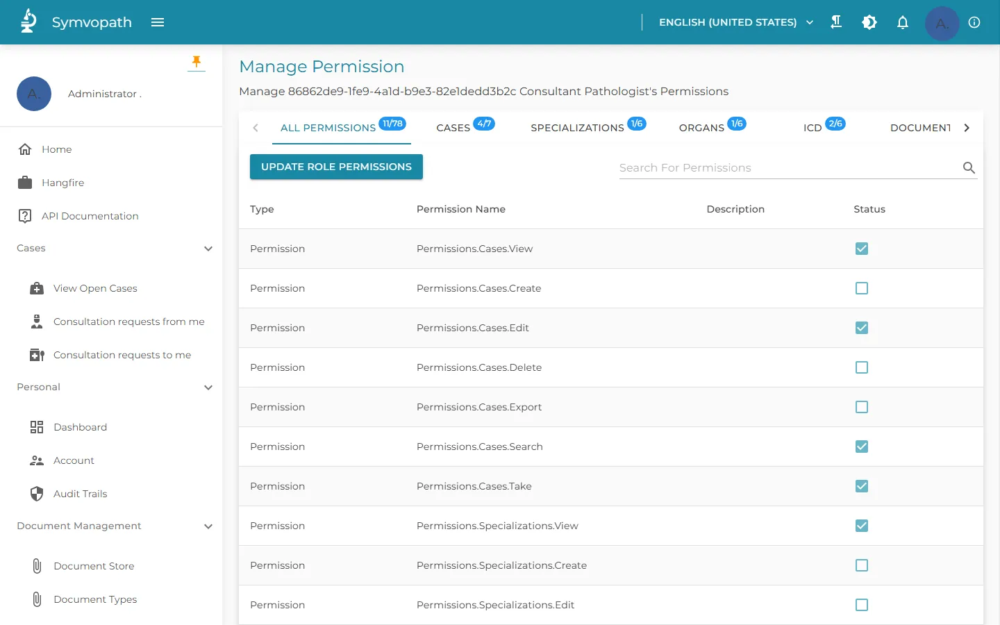{ loading=lazy }
<figcaption>Permissions of one role, grouped by area</figcaption>
</figure>

## Audit trail

Every change is recorded with the changed columns, old and new values, user and time; administrators filter by user, date and value and export to Excel. In Coworkee: [Auditing](../modules/auditing.md).

<figure markdown>
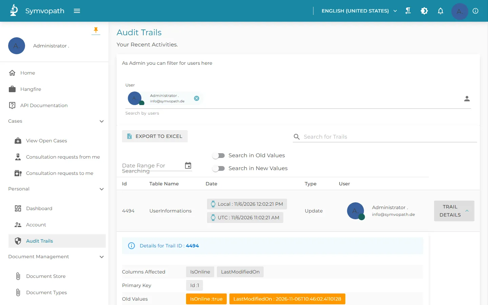{ loading=lazy }
<figcaption>Audit trail with the details of one change</figcaption>
</figure>

## Languages and themes

Administrators edit translations in the running app; users switch language, theme and dark mode. In Coworkee: [Localization](../modules/localization.md) and [Theming](../modules/theming.md).

<figure markdown>
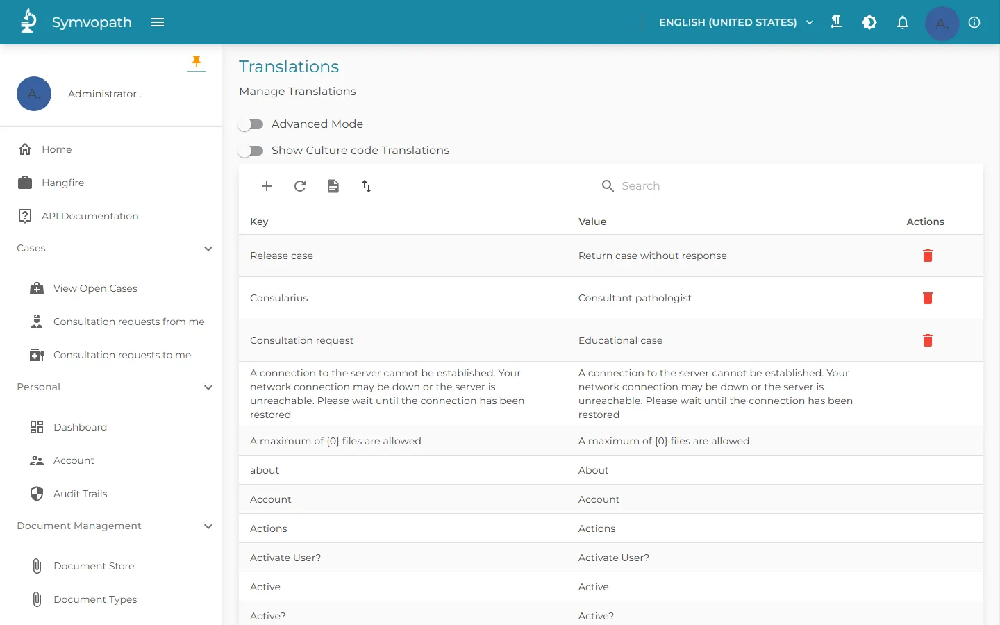{ loading=lazy }
<figcaption>Translations, editable in the app</figcaption>
</figure>

<figure markdown>
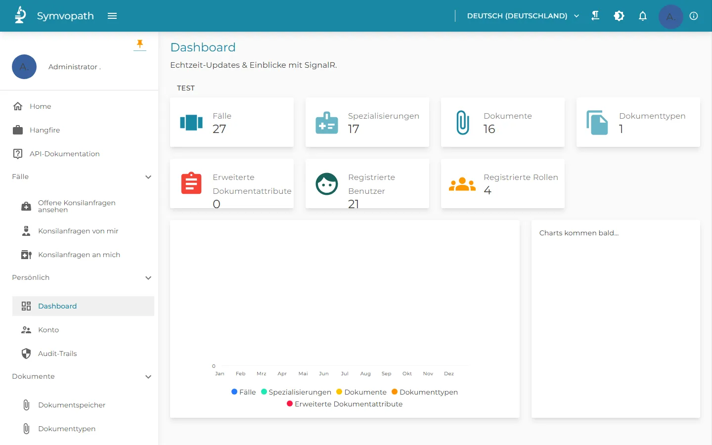{ loading=lazy }
<figcaption>The same dashboard in German</figcaption>
</figure>

<figure markdown>
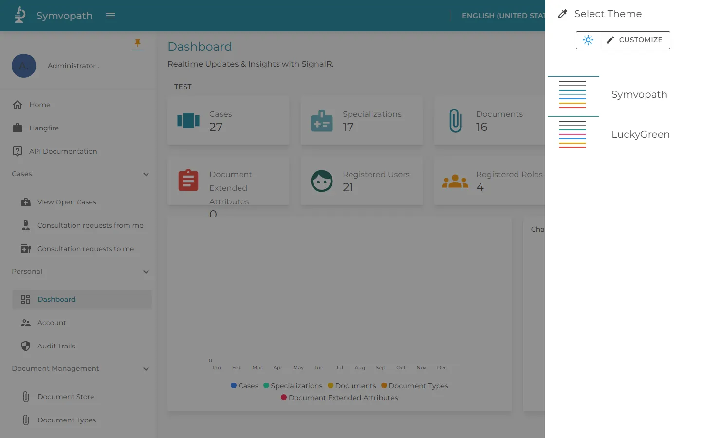{ loading=lazy }
<figcaption>Theme selection with the Symvopath theme</figcaption>
</figure>

<figure markdown>
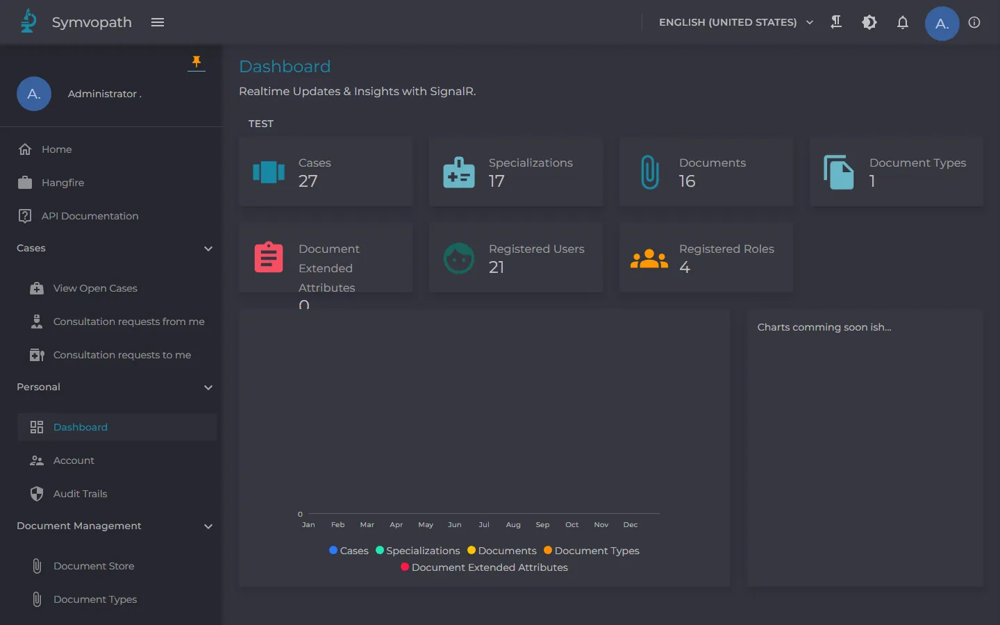{ loading=lazy }
<figcaption>Dark mode</figcaption>
</figure>

## Documents, background jobs and the API

Documents with types and a public flag, background jobs on Hangfire, and an HTTP API with Swagger UI. In Coworkee: [Files](../modules/files.md), [Background jobs](../modules/background-jobs.md) and [HTTP APIs](../web/http-api.md).

<figure markdown>
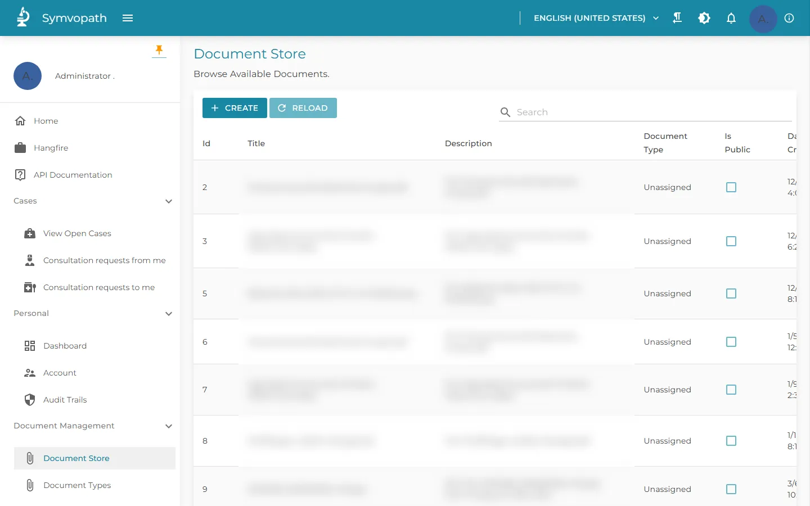{ loading=lazy }
<figcaption>Document store (titles and descriptions blurred)</figcaption>
</figure>

<figure markdown>
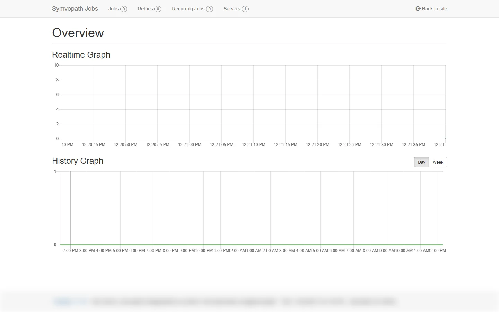{ loading=lazy }
<figcaption>Hangfire dashboard (server name blurred)</figcaption>
</figure>

<figure markdown>
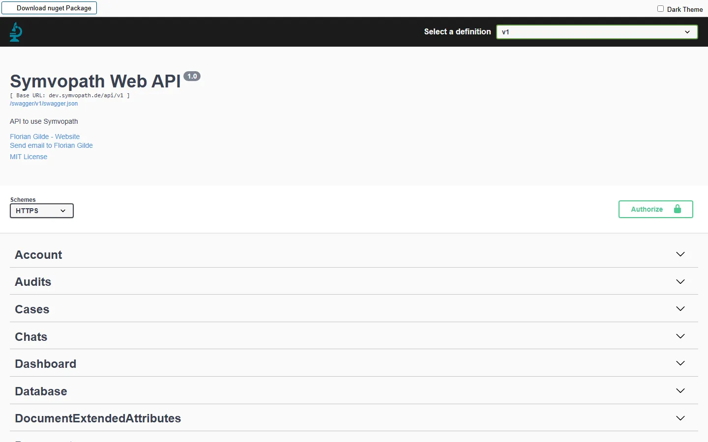{ loading=lazy }
<figcaption>The HTTP API in Swagger UI</figcaption>
</figure>

More about Symvopath at [symvopath.de](https://www.symvopath.de).
