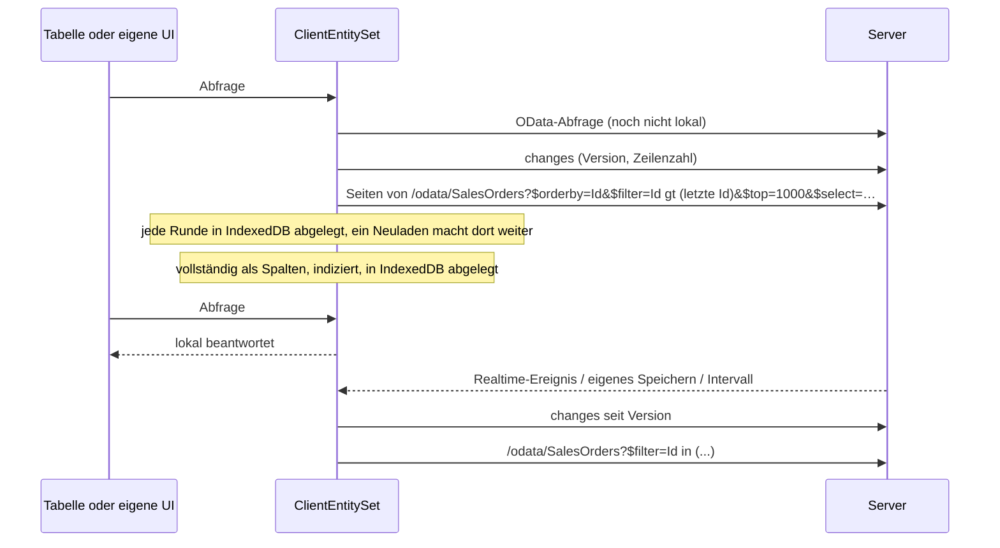

# Client-Entities

Eine Client-Entity ist ein [OData-Set](../web/odata.md), von dem der Browser eine Kopie hält. Solange die Kopie lädt, geht jede Abfrage weiter an den Server; sobald sie vollständig ist, laufen Filter, Suche, Sortierung, Gruppierung, Blättern und Facetten im Browser, ohne Umweg über das Netz. Änderungen auf dem Server kommen als kleine Deltas nach.

**Wozu**: Listen, die Benutzer den ganzen Tag filtern (Aufträge, Kunden, Artikel, Tickets), antworten sofort, der Server sieht einen Download pro Benutzer statt einer Abfrage pro Klick, und die Tabelle bleibt bedienbar, wenn die API langsam ist. **Wann nicht**: Sets mit Millionen Zeilen, Zeilen, die ein Benutzer nicht auf dem Gerät haben darf, Daten, die sich jede Sekunde ändern.

Diese Seite geht Schritt für Schritt durch eine Demo-App, die aus dem Template entstanden ist und ein Vertriebsmodul mit 100.000 Aufträgen hat (*Vertrieb → Aufträge*); das Modul gehört zur Demo, das Template hat keins. Das Template verdrahtet nur den Client: `--client-entities` (`clientEntities`, standardmäßig aus; Spec-Entities mit `clientEntity` schalten es ein) fügt das Paket und `AddCoworkeeClientEntities()` aus Schritt 3 hinzu.



## Schritt 1: Entity und OData-Set

Jede Entity mit `Guid`-Schlüssel, die ein OData-Set ist, kann Client-Entity werden. `IAuditable` (aus `AuditedEntity`) erlaubt dem Client, nur Geändertes zu holen; `[Realtime]` bringt Änderungen anderer Benutzer sofort.

```csharp title="MyApp.Sales/Domain/SalesOrder.cs"
[Realtime(SalesPermissions.Orders.View)]
[ClientEntity]
public sealed class SalesOrder : AuditedEntity, IMultiTenant
{
    public required string Number { get; set; }

    [ProvideFacet(Label = "Customer", ValuePath = "CustomerId", LabelPath = "Customer.Name", ValueType = typeof(Guid), Order = 3)]
    public Guid CustomerId { get; set; }

    public Customer? Customer { get; set; }

    [ProvideFacet(Label = "Status", Order = 0)]
    public SalesOrderStatus Status { get; set; }

    [ProvideFacet(Label = "Order date", Type = FacetType.DateRange, Order = 4)]
    public DateTimeOffset OrderDate { get; set; }

    public decimal Total { get; set; }

    public Guid TenantId { get; set; }
    // Channel, Region, Items …
}
```

```csharp title="MyApp.Sales/SalesModule.cs"
services.AddODataEntity<SalesOrder>("SalesOrders", SalesPermissions.Orders.View);
services.AddODataEntity<Customer>("Customers", SalesPermissions.Orders.View);
```

Mehr braucht der Server nicht. Die Zeilen kommen über das OData-Set selbst; Berechtigung des Sets, Mandanten- und Soft-Delete-Filter, Zeilenfilter (`IODataEntityFilter`) und versteckte Eigenschaften gelten für die Kopie also genau wie für jede Abfrage.

Eine Entity, die das Attribut nicht tragen kann (eine Klasse einer anderen Bibliothek, die Tabelle einer [externen Datenbank](../fundamentals/persistence.md#externe-datenbanken)), wird genauso mit `o.For<TEntity>()` in den Optionen oder über ihren Application Service gespiegelt (Schritt 2); alle drei Wege führen zur selben Kopie.

## Schritt 2: Einstellungen (optional)

Jedes Set startet mit den Standardwerten, dann wirken das Attribut, die Optionen und zuletzt sein Anwendungsdienst:

| Einstellung | Standard | |
|---|---|---|
| `BatchSize` | 1000 | Zeilen pro Seite beim Herunterladen, höchstens `Coworkee:OData:MaxTop` |
| `ParallelPages` | 1 | Seiten des Downloads, die gleichzeitig laden (auch die Blöcke geänderter Zeilen). Der Download blättert über die letzte Id; eine zweite Seite einer Runde überspringt die erste (`$skip`), die Datenbank liest diese also zweimal. Nur erhöhen, wo die Abfrage des Sets billig und das Netz der Engpass ist |
| `MaxRows` | 50 000 | größere Sets bleiben auf dem Server; `[ClientEntity(MaxRows = …)]` setzt den Wert pro Entity |
| `Expand` | keins | die Navigationseigenschaften, die die Kopie mitführt, wie in `$expand` (`[ClientEntity(Expand = "Customer")]` oder die Optionen). Ohne entscheidet die erste Abfrage eines Besuchs; siehe unten |
| `RefreshInterval` | 5 Minuten | wie oft Clients nach Änderungen fragen |
| `Enabled` | `true` | `false` lässt eine markierte Entity auf dem Server |
| `ChangedAt` | keine | Datumseigenschaften, die sagen, wann eine Zeile angelegt oder geändert wurde, für Entities ohne `IAuditable` (Tabellen einer [externen Datenbank](../fundamentals/persistence.md#externe-datenbanken)); ohne sie lädt ein solches Set bei jeder Aktualisierung vollständig |
| `Overlap` | 5 Sekunden | wie weit vor die letzte Aktualisierung jede Aktualisierung erneut schaut, für späte Commits und abweichende Uhren |

=== "Optionen"

    ```csharp
    services.AddCoworkeeClientEntities(o =>
    {
        o.Default.MaxRows = 20_000;
        o.For<Product>(s => s.RefreshInterval = TimeSpan.FromMinutes(1));   // gespiegelt ohne Attribut
        o.For<Brand>(s => s.Enabled = false);                               // markierte Entity abgeschaltet
    });
    ```

    Eine Tabelle ohne `IAuditable`, hier die Sendungen einer externen Hub-Datenbank, die ein Job jede Minute neu schreibt, nennt das Datum, an dem man Änderungen erkennt, und schaut weiter zurück, weil eine Zeile dort bis zu einen Lauf nach ihrem Datum ankommt:

    ```csharp
    services.AddCoworkeeClientEntities(o => o.For<CalculatedShipment>(s =>
    {
        s.ChangedAt = [nameof(CalculatedShipment.DateUpdatedUtc)];
        s.Overlap = TimeSpan.FromMinutes(5);
    }));
    ```

    Die Standardwerte können auch aus der Konfiguration kommen (`Coworkee:ClientEntities:Default`).

!!! tip "Expand benennen"
    Ein Set hat eine Kopie pro Besuch. Ohne `Expand` nimmt sie das Expand der ersten Abfrage, die sie erreicht; fragt eine Seite mit anderem Expand als die Liste (ein Dashboard-Widget, ein Picker), bleibt die Liste für diesen Besuch auf dem Server und ihre Kopie liegt unter einem anderen Schlüssel, was beim nächsten Besuch einen Download kostet. Mit `Expand` führt die Kopie diese Eigenschaften, egal wer zuerst fragt, und jede Abfrage, deren Expand darin enthalten ist, wird lokal beantwortet. Abfragen mit `$select` oder `$search` starten nie eine Kopie: Keine Kopie könnte sie beantworten.

=== "Pro Anwendungsdienst"

    Ein [Anwendungsdienst](../web/application-services.md) kann die Entity nennen, die er schreibt, und die Einstellungen ihres Sets mitbringen. Die Demo hebt so die Grenze an, denn 100.000 Aufträge sind mehr als die standardmäßigen 50.000:

    ```csharp title="MyApp.Sales/SalesModule.cs"
    services.Configure<ApplicationServiceOptions>(options => options.Configure<ISalesOrderAppService>(service =>
        service.ClientEntity<SalesOrder>(settings => settings.MaxRows = 250_000)));
    ```

    `ClientEntity<TEntity>()` allein spiegelt das Set wie `o.For<TEntity>()`; seine Einstellungen wirken zuletzt. Ein Attribut am Dienst-Interface gibt es bewusst nicht: Das Interface liegt in den Contracts, die die Entity nicht kennen.

## Schritt 3: der Client, eine Zeile

Füge dem WebAssembly-Projekt das Paket `Coworkee.Client.Blazor.ClientEntities` hinzu und registriere es nach `AddCoworkeeClient`:

```csharp title="MyApp.Web.Client/Program.cs"
builder.Services.AddCoworkeeClient(baseAddress, ...);
builder.Services.AddCoworkeeClientEntities();
```

Ab jetzt fragt jede `CoworkeeDataTable` und jeder `ODataPicker` bei einem gespiegelten Set die lokale Kopie, sobald sie vollständig ist. Die Seite der Demo ist eine gewöhnliche Datentabelle, nichts darauf handelt von Client-Entities:

```razor title="MyApp.Web.Client/Pages/Sales/SalesOrders.razor"
<CoworkeeDataTable @ref="_table" T="SalesOrderDto" EntitySet="SalesOrders" Expand="Customer" SearchFields="SearchFields" ...>
    <Columns>
        <PropertyColumn Property="o => o.Number" />
        <PropertyColumn Property="o => o.Customer!.Name" />
        ...
    </Columns>
</CoworkeeDataTable>
```

### Der Schalter in der Tabelle

Jede Tabelle über einem gespiegelten Set bekommt ein Bedienelement in ihrer Werkzeugleiste (`ClientEntitySwitch`, von `AddCoworkeeClientEntities` hinzugefügt):

- **Symbol**: ein Computer, solange im Browser gesucht wird, eine Wolke, solange auf dem Server gesucht wird.
- **Ring** darum: der Fortschritt des Downloads, drehend, während die Kopie sich aktualisiert, grün, wenn die Kopie aktuell ist, orange für ein Set, das zu groß zum Spiegeln ist, rot, wenn der Abgleich fehlschlug. Der Tooltip sagt dasselbe in Worten.
- **Menü**: *Im Browser suchen* (sobald die Kopie vollständig ist), *Auf dem Server suchen* und *Vergleichen und das Schnellere wählen*: Die aktuelle Abfrage der Tabelle (Filter, Suche, Facetten, Sortierung, eine Seite) läuft auf jeder Seite dreimal; eine Meldung zeigt die Medianzeiten und ob beide gleich viele Zeilen fanden, danach wird die schnellere Seite gewählt. Eine Abfrage, die die Kopie nicht beantworten kann (eine Eigenschaft, die dem Zeilentyp fehlt, eine Funktion, die sie nicht kennt), wird nicht verglichen: Die Meldung sagt das, und die Tabelle sucht auf dem Server, wohin solche Abfragen ohnehin gingen; mit der Eigenschaft im Zeilentyp beantwortet der Browser sie selbst.
- **Häkchen**: auf der Seite, wohin die Abfragen der Tabelle gerade gehen. Solange der Browser gewählt, die Kopie aber noch nicht lokal ist (der erste Download, eine wiederhergestellte Kopie bis zu ihrer ersten Aktualisierung), trägt es *Auf dem Server suchen*, und der andere Eintrag heißt *Im Browser suchen (wird geladen…)*. Ein Set, das zu groß zum Spiegeln ist, ein fehlgeschlagener Download oder eine pausierte Synchronisierung ohne Kopie suchen ebenfalls auf dem Server.

Die Wahl bleibt je Set in der Benutzereinstellung `Table.ClientEntityModes` und folgt dem Benutzer so auf jedes Gerät. Auch bei der Suche auf dem Server gleicht die Kopie weiter ab, der Wechsel zurück geht also sofort. Ändern sich die lokalen Zeilen, lädt der Schalter seine Tabelle neu. Auch Code kann wählen: `ClientEntities.SetModeAsync("SalesOrders", ClientEntityMode.Server)`.

Die Kopie aktualisiert sich

- direkt nachdem dieser Client etwas gespeichert hat (jedes erfolgreiche `POST`, `PUT`, `PATCH` oder `DELETE` über einen `HttpClient` der App, die generierten Proxies der Anwendungsdienste eingeschlossen),
- wenn die Entity `[Realtime]` trägt und jemand anderes sie geändert hat,
- alle `RefreshInterval`.

Beim Abmelden werden alle Kopien aus dem Browser-Speicher entfernt. Ein Set, das der Benutzer nicht mehr lesen darf (der Server antwortet 403 oder 404), verwirft seine Kopie bei der nächsten Aktualisierung.

### Zwischen Besuchen behalten, und wann die Kopie neu beginnt

Die Kopie soll pro Benutzer und Gruppenauswahl einmal herunterladen und danach nur Änderungen holen:

- **Fortsetzen**: Der Download blättert über die letzte Id durch das Set (`$filter=Id gt …&$orderby=Id`) und legt jede Runde im Browser-Speicher ab. Ein Neuladen, ein geschlossener Tab oder eine fehlgeschlagene Anfrage macht bei der letzten abgelegten Runde weiter, nicht bei null; der Fortschrittsring zeigt die Zeilen, die schon da sind.
- **Vollständig bleibt vollständig**: Die fertige Kopie ersetzt die Runden. Der nächste Besuch stellt sie wieder her und fragt nur nach den Änderungen seit ihrer Version.
- **Änderungen statt Downloads**: Änderungen kommen als Ids geänderter und gelöschter Zeilen, die der Client per Id holt (`ParallelPages` Blöcke gleichzeitig). Viele Änderungen auf einmal (eine Massenänderung auf dem Server) kommen in Seiten von Ids; die Kopie bleibt solange lokal. Eine erneut geholte Zeile, deren Werte alle so sind, wie die Kopie sie hält (der Feed meldet Änderungen innerhalb seines `Overlap` erneut), ist keine Änderung: Die Kopie wird nur neu gespeichert und ihre Tabellen nur neu geladen, wenn eine Zeile hinzukam, wegfiel oder sich ein Wert änderte. Nur ein Set ohne `IAuditable` und ohne `ChangedAt` lädt bei jeder Aktualisierung neu.
- **Eine wiederhergestellte Kopie antwortet nach ihrer ersten Aktualisierung**: Bis die Änderungen seit ihrer Version da sind (und inzwischen gelöschte oder für den Benutzer nicht mehr sichtbare Zeilen fort), fragt die Tabelle den Server. Die Kopie zeigt so nie Zeilen, auf die der Benutzer den Zugriff verlor, während der Browser zu war.
- **Anderer Benutzer oder Mandant**: Das Manifest des Servers nennt den Besitzer (Benutzer, Mandant, Client). Weicht er vom Besitzer der abgelegten Kopien ab, werden alle vom Gerät gelöscht, bevor etwas gelesen wird, auch wenn sich der vorige Benutzer nicht abgemeldet hat (abgelaufene Sitzung). Kopien einer älteren Version ohne Besitzer gelten als die eines anderen Benutzers.
- **Andere Gruppenauswahl**: Die Partition der Kopie enthält die [Gruppenauswahl](../features/identity.md#gruppenbaum-und-geltungsbereich), eine neue Auswahl zeigt also nie Zeilen der alten. Die Kopien der letzten drei Auswahlen bleiben im Browser-Speicher: Der Wechsel zurück stellt diese Kopie wieder her und holt nur ihre Änderungen. Jede Antwort des Änderungs-Feeds trägt die aktuelle Partition des Aufrufers; eine Kopie einer anderen Partition (Auswahl in einem anderen Tab geändert, inzwischen ein anderer Benutzer angemeldet) verlässt sofort den Arbeitsspeicher, und die Sets beginnen mit der neuen.
- **Von null** nur, wenn es sein muss: Der Zeilentyp oder die .NET-Laufzeit hat sich geändert (die abgelegten Spalten passen nicht mehr), das Set ist über `MaxRows` gewachsen, der Server bietet das Set nicht mehr an oder der Benutzer verlor die Berechtigung (403, 404), oder die Kopie gehört einem anderen Benutzer, Mandanten oder einer Auswahl älter als die letzten drei.

## Schritt 4: Schreiben

Eine Client-Entity ist eine Kopie zum Lesen; geschrieben wird wie bisher auf dem Server. In der Demo über `ISalesOrderAppService` (siehe [Anwendungsdienste](../web/application-services.md)), dessen generierten Client die Seite injiziert:

```csharp title="MyApp.Web.Client/Pages/Sales/SalesOrders.razor.cs"
[Inject] private ISalesOrderAppService Orders { get; set; } = null!;

private Task CancelAsync(SalesOrderDto order) => Snackbar.RunAsync(() => Orders.CancelAsync(order.Id));
```

Das `POST` gelingt, die Kopie fragt nach den Änderungen seit ihrer Version, holt den geänderten Auftrag per Id, und die Tabelle lädt neu.

### Änderungen, die kein Datum sieht

Der Feed findet geänderte Zeilen an `ModifiedAt` (oder `ChangedAt`). Eine Änderung, die keine solche Spalte bewegt, etwa ein Tag an einem Auftrag über eine Verknüpfungstabelle, den die Kopie mit `Expand = "Tags"` zeigt, ließe die Kopie bis zum nächsten vollen Download veraltet. Melde solche Zeilen mit `IClientEntityChangeLog` (`Coworkee.OData.ClientEntities`) im Command, der die Änderung macht:

```csharp
internal sealed class TagOrderHandler(AppDbContext db, IClientEntityChangeLog changes) : IHandler<TagOrder, Result>
{
    public async Task<Result> HandleAsync(TagOrder command, CancellationToken ct)
    {
        db.Add(new OrderTag { OrderId = command.OrderId, TagId = command.TagId });
        changes.Touch<SalesOrder>(command.OrderId);   // mit dem Command gespeichert, in cw.ClientEntityTouches
        return Result.Success();
    }
}
```

Die nächste Aktualisierung jeder Kopie lädt diese Zeilen neu, aber nur die, die ihr Leser sieht (Mandant, Zeilenfilter und Gruppenbereich gelten wie für jede Zeile); Typen ohne Client-Entity-Set werden ignoriert. Tags, Bewertungen, Kommentare und Reaktionen der Bibliothek melden die Entity selbst, wenn sie typisiert registriert ist (`Tags<SalesOrder>("SalesOrders")`). Meldungen bleiben `Coworkee:ClientEntities:ChangeLogLifetime` lang (30 Tage, der Job `coworkee-client-entity-touches` löscht ältere); eine Kopie, die zuletzt davor aktualisiert wurde, lädt neu.

## Schritt 5: eigene Oberflächen

`ClientEntities.SetAsync<T>` liefert die Kopie eines Sets. Sie ist `null`, wenn der Server das Set diesem Benutzer nicht anbietet.

```csharp
[Inject] private ClientEntities Entities { get; set; } = null!;

var orders = await Entities.SetAsync<SalesOrderDto>("SalesOrders", expand: "Customer");
var top = await orders!.QueryAsync(q => q.Where(o => o.Status == SalesOrderStatus.Open).OrderByDescending(o => o.Total).Take(10));
```

| Member | |
|---|---|
| `QueryAsync(ODataQuery)` | eine OData-Abfrage: lokal, sobald vollständig, bis dahin und für das, was lokal nicht geht, auf dem Server |
| `QueryAsync(q => q.Where(…))` | LINQ über die lokalen Zeilen; wartet, bis sie da sind |
| `Items`, `Query()` | die lokalen Zeilen als Liste und als `IQueryable` (leer, bis vollständig); als Spalten gehaltene Zeilen werden beim ersten Zugriff zu Objekten, bei großen Sets also besser `QueryAsync(ODataQuery)` |
| `Status`, `Changed` | Zustand, Fortschritt (`Loaded` von `Total`), Version und eine `Revision`, die mit jeder Änderung der Zeilen wächst |
| `WhenLocalAsync()` | ist erledigt, wenn die Zeilen lokal sind; schlägt fehl für Sets, die auf dem Server bleiben |
| `RefreshAsync()` | jetzt nach Änderungen fragen |
| `Mode` | `Client` oder `Server`: wo OData-Abfragen laufen, sobald die Kopie vollständig ist (`ClientEntities.SetModeAsync` merkt es sich auch für den Benutzer) |
| `MeasureAsync(query, side)` | führt eine Abfrage unabhängig vom Modus auf einer Seite aus und liefert Zeit und Zeilenzahl |

Der OData-Client, der an den Kopien vorbeigeht, ist unter einem Schlüssel registriert, etwa zum Vergleichen:

```csharp
[Inject(Key = ClientEntitiesServiceCollectionExtensions.ServerKey)] private IODataClient Server { get; set; } = null!;
```

Ein [QuickGrid](https://learn.microsoft.com/aspnet/core/blazor/components/quickgrid) arbeitet direkt auf den lokalen Zeilen:

```razor
<QuickGrid Items="_orders?.Query().Where(o => o.Region == "Nord")">
    <PropertyColumn Property="o => o.Number" Sortable="true" />
</QuickGrid>
```

oder über einen Items-Provider, der auch während des Ladens funktioniert:

```csharp
private GridItemsProvider<SalesOrderDto> Provider => async request =>
{
    var page = await _orders!.QueryAsync(new ODataQuery { Filter = _filter, OrderBy = "Number", Skip = request.StartIndex, Top = request.Count }, request.CancellationToken);
    return GridItemsProviderResult.From([.. page.Items], (int)(page.Count ?? 0));
};
```

`ODataLinq.Filter<T>("contains(tolower(Number),'42')")` und `ODataLinq.OrderBy(rows, "Total desc")` machen aus OData-Text LINQ für Zeilen, die du selbst hältst.

## Was lokal läuft

Die lokale Kopie versteht, was Tabellen, Facetten und Picker senden: `eq ne gt ge lt le and or not in`, Arithmetik, `contains startswith endswith tolower toupper trim length year month day hour minute second`, Pfade wie `Customer/Name` (null-sicher) und Literale aller einfachen Typen, Enums eingeschlossen. `$search`, Lambda-Operatoren (`any`, `all`), ein `$expand`, mit dem die Kopie nicht geladen wurde, und alle anderen Funktionen gehen an den Server. Facetten behalten Gruppen und Optionen des Servers; nur die Anzahlen werden lokal gezählt. Die Kopie speichert die Facetten des Servers mit ihren Zeilen und fragt sie höchstens alle 10 Minuten im Hintergrund neu an; Optionen inzwischen neu aufgetauchter Werte erscheinen dann.

## Performance

WebAssembly interpretiert .NET-Code; Arbeit pro Zeile ist im Browser also teuer: 35 MB JSON zu lesen dauert über 15 Sekunden, 100.000 Texte zu sortieren fast eine Sekunde. Die lokale Kopie ist deshalb wie ein kleiner Spaltenspeicher gebaut und nicht als Liste von Objekten:

- **Spalten**: Jeder Eigenschaftspfad (`Number`, `Customer/Name`, …) ist ein Array von Werten. Zu Objekten werden Zeilen erst, wenn sie angezeigt werden, 25 pro Seite.
- **Indizes**: Ist die Kopie da, sortiert sich jede Spalte einmal im Hintergrund, eine nach der anderen mit einer Pause für die Seite dazwischen. Die Zeilen tragen dann den Rang ihres Werts, wie bei einem Datenbankindex.
- **Filter** laufen auf den Rängen: `Status eq 'Open'`, `(Total ge 5 and Total lt 10)`, `Options has 'Express'` oder `contains(tolower(Number),'123')` werden einmal pro verschiedenem Wert ausgewertet und ergeben eine Maske über die Zeilen. Vergleiche behalten einen Bereich von Rängen; `contains` durchsucht alle verschiedenen Werte einer Spalte in einem Durchgang statt mit einem Aufruf pro Wert. Nur was kein Vergleich einer Eigenschaft mit einem Literal ist (`length(Name) eq 4`), läuft Zeile für Zeile.
- **Sortierung** läuft den Index der Spalte entlang; mehrere Spalten setzen ihre Ränge zu einer Zahl pro Zeile zusammen. Ein Filter behält diese Reihenfolge, gefilterte und sortierte Zeilen entstehen in einem Durchlauf.
- **Facetten** zählen die Ränge der gefundenen Zeilen: ein Durchlauf pro Facetten-Eigenschaft, egal wie viele Optionen. Wert-, Bereichs- und Flag-Optionen addieren dann die Anzahlen der Ränge, die sie annehmen (Bereiche über Präfixsummen); 35 Monatsbereiche über 100.000 verschiedene Auftragsdaten kosten so nicht mehr als eine Werteliste.
- **Ergebnisse** der letzten 16 Kombinationen aus Filter und Sortierung bleiben erhalten: Die nächste Seite, ein Gruppenwechsel oder die Rückkehr zu einem früheren Filter schneiden nur einen Ausschnitt.
- **Speicher**: Spalten und ihre Sortierungen werden als Binär-Arrays (gzip) in IndexedDB geschrieben. Ein Neuladen liest sie in einigen hundert Millisekunden zurück, Spalte für Spalte mit Pausen dazwischen; bis dahin fragt die Tabelle den Server und zeigt sofort Zeilen.
- **Download**: Nur die Eigenschaften des Zeilentyps kommen über die Leitung (`$select`, verschachteltes `$expand`), eine Seite nach der anderen über die letzte Id (`$filter=Id gt …`, nie ein wachsendes `$skip`, das die Datenbank für jede Seite alle früheren Zeilen erneut lesen lässt), in einem Durchgang gelesen; Packen und Entpacken der abgelegten Kopie pausieren zwischen Spalten und Abschnitten, die Seite bleibt also bedienbar.

Gemessen in Chromium mit den 100.000 Aufträgen der Demo (Release-Build, lokaler Rechner; der Server antwortet aus Postgres auf derselben Maschine):

| | vorher | jetzt |
|---|---|---|
| erster Download, bis lokal | 36 s | 14,5 s |
| Neuladen: erste Zeilen sichtbar | 20,6 s | 2,9 s |
| Neuladen: Abfragen lokal | (nach den 20 s) | 0,3 s nach den ersten Zeilen |

Nur die Abfragezeit, *Vergleichen und das Schnellere wählen* des [Schalters](#der-schalter-in-der-tabelle) (Median aus drei Läufen der Tabellenabfrage mit ihren Facetten und 25 Zeilen, je mit einer Bedingung, die verhindert, dass eine Seite ein Ergebnis wiederverwendet). Gemessen am 15.10.2026 mit den Facetten der Demo (Status, Kanal, Flags, Region, Kunde, 35 Monate Auftragsdatum, 16 Summenbereiche, Positionen, bezahlt):

| aktueller Filter | Server | Browser vorher | Browser jetzt |
|---|---|---|---|
| keiner | 216–236 ms | 1.035 ms | 39–56 ms |
| Suche "Hamburg" (3 Textspalten) | 638–661 ms | 516 ms | 152 ms |

"Vorher" ist der Stand vor dem 15.10.2026: Optionsfilter, die kein einfacher Wert sind (`Options has 'Express'`, Bereiche), liefen Zeile für Zeile auf Objekten, und ihre Masken passten nicht in den Zwischenspeicher von 64, sodass jeder neue Filter sie alle erneut bezahlte.

Klick auf eine Option im Spaltenfilter, bis die Tabelle das Ergebnis zeigt (Chromium, 15.10.2026):

| Spalte | Browser | Server |
|---|---|---|
| Status, Kanal, Region, Optionen, Bezahlt, Summe | 240–310 ms | 500–600 ms |
| Auftragsdatum (Monat) | 369 ms | 527 ms |
| Nummer (enthält) | 500–680 ms | 835–897 ms |

Vom Klick bis zur gezeichneten Tabelle, lokale Kopie mit Indizes (die Tabelle braucht für eine Seite etwa 130 ms zum Zeichnen, egal wer antwortet):

| | während des Downloads (Server) | lokal |
|---|---|---|
| nach Summe sortieren | 600 ms | 165 ms |
| nach Kunde sortieren | 584 ms | 135–163 ms |
| nächste Seite | 292 ms | 131–136 ms |
| Suche (nach 300 ms Eingabeverzögerung) | 808 ms | 435–458 ms |
| Suche leeren | 938 ms | 286 ms |

Die erste Sortierung nach einer Spalte direkt nach dem allerersten Download kann bis zu 1,5 s dauern, solange diese Spalte noch indiziert wird; nach einem Neuladen kommen die Indizes aus dem Speicher. Die Server-Zahlen während des Downloads enthalten die Arbeit, die der Browser gleichzeitig für den Download leistet.

Die Tests der Bibliothek (`LargeSetTests`, `LocalTableTests`) prüfen dasselbe mit 100.000 Zeilen in .NET.

## SQLite im Browser (optional)

Standardmäßig liegt die Kopie als Spalten im Speicher und gzip-komprimiert in IndexedDB. Das passt für Zeilentypen aus einfachen Properties. Ein Zeilentyp mit einer Liste unter seinen Properties (zum Beispiel Tags) wird als JSON gehalten, und eine JSON-Kopie von zehntausenden Zeilen braucht nach jedem Reload 20 bis 30 Sekunden zum Parsen, in denen der Browser beschäftigt ist. Das Paket `Coworkee.Client.Blazor.ClientEntities.Sqlite` hält stattdessen jede Kopie in einer eigenen SQLite-Datenbank im Browser, und EF Core beantwortet die Abfragen der Tabelle mit SQL:

```csharp title="MyApp.Web.Client/Program.cs"
builder.Services.AddCoworkeeClientEntities();
builder.Services.AddCoworkeeClientEntitiesSqlite();
```

Am Server, an den Seiten und an den Einstellungen der Sets ändert sich nichts; Schalter, Modi, Deltas und Partitionen funktionieren wie oben beschrieben.

### Welche Kopien

Standardmäßig kommen nur Zeilentypen in SQLite, die die Kopie im Speicher als JSON halten würde: solche mit einer Liste oder einem anderen Typ unter ihren Properties, den sie nicht in Spalten zerlegen kann. Dort ist SQLite in allem schneller. Zeilentypen aus einfachen Properties (und verschachtelten Objekten daraus) bleiben Spalten im Speicher: deren Indizes beantworten Facetten etwa zehnmal schneller als SQL. `AllRowTypes` legt jede Kopie in SQLite, dann sind erster Download und Reload um ein Mehrfaches schneller und die Facetten langsamer; die Demo macht das für ihre Aufträge:

```csharp title="MyApp.Web.Client/Program.cs"
builder.Services.AddCoworkeeClientEntitiesSqlite(o => o.AllRowTypes = true);
```

### Was du brauchst

- **Den `wasm-tools`-Workload dort, wo der Client gebaut wird** (Entwicklerrechner, CI): `dotnet workload install wasm-tools`, einmal pro Rechner. SQLite ist nativer Code, der Build linkt ihn in `dotnet.native.wasm`. Das Paket schaltet `<WasmBuildNative>true</WasmBuildNative>` im WebAssembly-Projekt selbst ein; ohne den Workload bricht der Build mit `NETSDK1147` ab und nennt den Befehl.
- **Nichts im Browser**: Nutzer laden die gelinkte Datei wie jede andere Datei der App, auf jedem Rechner.
- Kosten: einmalig etwa 1,7 MB mehr Download (Brotli: EF Core und SQLite 1,4 MB, das größere `dotnet.native.wasm` 0,3 MB) und ein Client-Build, der etwa eine Minute länger dauert.
- Ein Client ohne natives SQLite (`WasmBuildNative` auf `false`, eine App, die die Projekte der Library statt des Pakets referenziert und es nicht setzt) schreibt eine Warnung in die Browser-Konsole und hält seine Kopien wie bisher im Speicher.

In der CI den Workload vor dem Build installieren:

```yaml
- run: dotnet workload install wasm-tools
```

### Wie die Kopie arbeitet

- **Erster Download als eine Datei**: statt Seiten von JSON fragt der Client `POST /api/v1/client-entities/{set}/snapshot` mit den Spalten seiner Tabelle. Der Server liest die Zeilen über denselben OData-Weg wie die Seiten (Berechtigung, Mandant, Soft Delete, `IODataEntityFilter`-Zeilenfilter, versteckte Properties, Gruppenauswahl), schreibt sie in eine SQLite-Datei und schickt sie gzip-komprimiert; der Browser speichert und öffnet sie nur. Klappt das nicht (ein älterer Server, eine Property, die das Set versteckt, mehr Zeilen als `MaxRows`), lädt der Client wie bisher Seiten.
- **Zwischen Besuchen behalten**: die Datenbankdatei kommt unverändert in IndexedDB. Ein Reload öffnet sie, statt Zeilen zu parsen, etwa eine Sekunde für 23.000 Sendungen.
- **Änderungen**: die Deltas des Änderungs-Feeds werden in die Datenbank geschrieben (Löschen und Einfügen per Id, in Scheiben, damit die Seite dazwischen rendern kann). Mehr als 500 geänderte Zeilen auf einmal (mehr als zehn Blöcke zu 50) kommen stattdessen als neuer Snapshot: Jeder Block kostet den Server ein Lesen der sichtbaren Schlüssel des Sets, ab zehn ist ein Snapshot des ganzen Sets schneller. Die Tabelle sucht in der alten Datei, bis die neue sie ersetzt. Ein Server ohne Snapshots, oder einer, dessen Snapshot fehlschlug, schickt wie bisher die Blöcke.
- **Abfragen**: Filter, Sortierung, Seite und Anzahl sind SQL über EF Core auf indizierten Spalten. Listen-Facetten zählen mit einem `GROUP BY` pro Spalte, egal wie viele Optionen; Bereichs-Facetten (Datum, Beträge) mit einer Abfrage, die jede Zeile dem Intervall zwischen den Grenzen der Optionen zuordnet (`CASE`). Die Werte eines Filters sind Parameter, ein anderer Suchtext oder eine andere Auswahl nutzt also die Abfragen, die EF Core schon übersetzt hat. Die Facetten einer Kopie werden nach dem Öffnen einmal im Hintergrund gezählt, damit der erste Klick nicht das Übersetzen der Abfragen bezahlt.
- **Was beim Server bleibt**: `$search`, `any`/`all` über Listen, Filter auf Listen und verschachtelte Objekte (als JSON-Spalten gehalten) und Gruppieren in der Tabelle gehen an den Server, ebenso Facettenoptionen von Listen (ihre Zahlen sind die des Servers).
- **Ein geänderter Zeilentyp** öffnet eine neue Datenbank: der Schlüssel der gespeicherten Kopie enthält die Spalten und ihre Formate, eine neue Property liest also nie eine alte Datei.

So werden Spalten gespeichert; der Server schreibt den Snapshot in denselben Formaten:

| Property-Typ | Spalte |
|---|---|
| Text, `char`, Enums (als Name) | `TEXT` |
| `Guid` | `TEXT`, Großbuchstaben |
| Ganzzahlen, `bool` | `INTEGER` |
| `decimal`, `double`, `float` | `REAL` (`decimal` vergleicht als `double`) |
| `DateTimeOffset` | `INTEGER`: der UTC-Zeitpunkt in 0,1 ms, dann der Offset, damit Werte verschiedener Offsets nach dem Zeitpunkt sortieren |
| `DateTime` | `TEXT` `yyyy-MM-dd HH:mm:ss.FFFFFFF` |
| `DateOnly` | `TEXT` `yyyy-MM-dd` |
| `TimeOnly`, `TimeSpan` | `INTEGER`, ihre Ticks |
| Listen, verschachtelte Objekte, expandierte Navigationen | `TEXT`, JSON |

Die Tests der Library (`CopyRoundTripTests`, `ClientEntitySnapshotTests`) schreiben jeden Typ im Browser und als Server-Snapshot, lesen ihn zurück und vergleichen Filter und Sortierungen mit den Zeilen selbst.

### Gemessen

23.177 Sendungen eines Hubs mit Tags (JSON im Speicher), Chromium, lokaler Rechner, SQL Server in Azure:

| | im Speicher | SQLite |
|---|---|---|
| erste Kopie lokal nach dem Öffnen der Seite | 59-80 s | 12-16 s |
| Reload, bis die Kopie antwortet | 20-29 s, Seite blockiert | etwa 1 s |
| gefilterte Anzahl / Seite | (Server, 2-7 s) | 6-40 ms |
| Facetten aller Zeilen / gefiltert | (Server, 2-5 s) | 1,3 s / 0,25 s |
| längste Blockade der Seite | 10-29 s | unter 0,7 s |

Die 100.000 Aufträge der Demo, ein Zeilentyp aus einfachen Properties, mit `AllRowTypes` (Release-Build, Chromium, lokales Postgres):

| | im Speicher | SQLite |
|---|---|---|
| erste Kopie lokal nach dem Öffnen der Seite | 33,7 s | 9,4 s |
| Reload, bis die Kopie antwortet | 11,5 s | 4,4 s |
| die Abfrage der Tabelle mit ihren 10 Facettengruppen | 37 ms | etwa 370 ms |

Der Server beantwortete dieselbe Abfrage in 210 ms. Deshalb bleiben solche Zeilentypen ohne `AllRowTypes` im Speicher: SQLite hat sie früher lokal, die Spalten im Speicher beantworten die Klicks schneller.

## Speicher und Grenzen

- Die Zeilen liegen als Spalten im Speicher und, mit gzip komprimiert, in IndexedDB (`coworkee-client-entities`), getrennt nach der Partition des Servers (Benutzer, Mandant, Gruppenauswahl), dem Set und seinem Expand. Der nächste Besuch fragt nur nach Änderungen (siehe [oben](#zwischen-besuchen-behalten-und-wann-die-kopie-neu-beginnt)). Ändert sich der Zeilentyp, wird die gespeicherte Kopie verworfen. Ersetze `IClientEntityStorage`, um die Kopien anderswo abzulegen, oder registriere `NoClientEntityStorage`, um zwischen Besuchen nichts zu behalten; ein Ersatz sollte auch `DeleteAsync(prefix)` umsetzen, das die Runden eines fertigen Downloads und die Kopien alter Gruppenauswahlen entfernt (der Standard entfernt nichts).
- Zeilentypen mit Eigenschaften einfacher Typen (Text, Zahlen, Datumswerte, `Guid`, Enums, jeweils auch nullable) und verschachtelten Objekten aus solchen Eigenschaften werden als Spalten gehalten. Andere Zeilentypen (etwa mit Listen) funktionieren auch, werden aber als JSON abgelegt, langsamer wiederhergestellt und Zeile für Zeile gefiltert.
- Die Standard-Kopie ist reines .NET: kein natives SQLite, kein `wasm-tools`-Workload, keine zusätzlichen Dateien. [SQLite im Browser](#sqlite-im-browser-optional) ist die Option für große Kopien und Zeilentypen mit Listen.
- Arbeitsspeicher: 100.000 Aufträge belegen einige zehn MB im Browser-Tab; halte `MaxRows` im Rahmen und expandiere nur, was du anzeigst.
- Der erste Download eines großen Sets dauert (14,5 s für 100.000 Zeilen) und beschäftigt den Browser; die Tabelle antwortet währenddessen vom Server, langsamer als sonst. Antwortkomprimierung in der API (oder im BFF) hilft bei langsamen Netzen.
- Änderungen erkennt der Server an `IAuditable` (`CreatedAt`, `ModifiedAt`), Löschungen an `ISoftDelete` (`DeletedAt`). Stimmt die Zeilenzahl nach einem Delta nicht mit der des Servers überein, vergleicht der Client die Ids; so verschwinden auch hart gelöschte Zeilen und solche, die nicht mehr sichtbar sind. Entities ohne `IAuditable` und ohne `ChangedAt` werden bei jeder Aktualisierung neu geladen. Änderungen, die kein Datum bewegen, meldet [`IClientEntityChangeLog`](#anderungen-die-kein-datum-sieht).
- Text sortiert ohne Groß-/Kleinschreibung nach der Kultur des Browsers; der Server sortiert nach der Collation seiner Datenbank, Sonderzeichen können also anders einsortiert sein.
- Clients spiegeln nur die Zeilen, die ein Benutzer sehen darf; eine Kopie enthält also nichts, was eine OData-Abfrage nicht auch liefern würde. Auf dem Gerät ist sie nicht verschlüsselt; Sets mit sensiblen Daten lässt du auf dem Server.

## Endpunkte

| Anfrage | Antwort |
|---|---|
| `GET /api/v1/client-entities` | die Sets, die dieser Benutzer spiegeln darf, mit ihren Einstellungen, ein Partitionsschlüssel pro Benutzer, Mandant und Gruppenauswahl und ein Besitzerschlüssel pro Benutzer und Mandant |
| `GET /api/v1/client-entities/{set}/changes?since=…&skip=…` | neue Version, Zahl der sichtbaren Zeilen, geänderte und gelöschte Ids und die Partition des Aufrufers; mit `skip` kommen die geänderten Ids in Seiten von `BatchSize × 10` (`more`), ohne antwortet mehr als das mit `reset`; auch `reset`, wenn `since` älter als `ChangeLogLifetime` ist |
| `GET /api/v1/client-entities/{set}/ids` | alle sichtbaren Ids, um unbemerkt verschwundene Zeilen zu finden |
| `POST /api/v1/client-entities/{set}/snapshot` | mit [SQLite im Browser](#sqlite-im-browser-optional): die sichtbaren Zeilen als SQLite-Datei (gzip) in den Spalten, die der Body nennt, die Version in `X-Coworkee-Version`; 400 für eine versteckte Property, 403 ohne Berechtigung, 413 über `MaxRows` |

## Dateien der Demo

| Datei | |
|---|---|
| `MyApp.Sales/Domain/SalesOrder.cs` | Entity mit `[ClientEntity]`, `[Realtime]` und Facetten |
| `MyApp.Sales/SalesModule.cs` | OData-Sets und die Client-Entity-Einstellungen des Dienstes |
| `MyApp.Contracts/Sales/ISalesOrderAppService.cs` | das Schreiben, siehe [Anwendungsdienste](../web/application-services.md) |
| `MyApp.Migrations/DemoSales.cs` | 100.000 Aufträge, von Postgres in einer Anweisung erzeugt |
| `MyApp.Web.Client/Program.cs` | `AddCoworkeeClientEntities()` und `AddCoworkeeClientEntitiesSqlite(o => o.AllRowTypes = true)`: die Aufträge in [SQLite](#sqlite-im-browser-optional) |
| `MyApp.Web.Client/Pages/Sales/SalesOrders.razor(.cs)` | die Tabelle; der Schalter kommt mit ihr |
