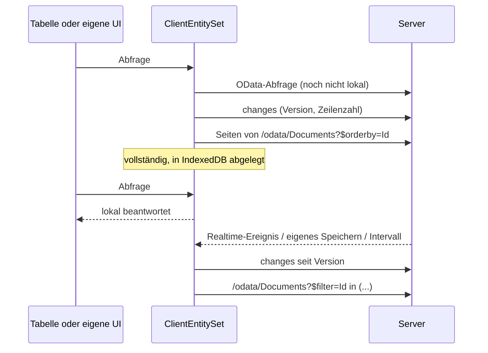

# Client-Entities

Eine Client-Entity ist ein [OData-Set](../web/odata.md), von dem der Browser eine Kopie hält. Solange die Kopie lädt, geht jede Abfrage weiter an den Server; sobald sie vollständig ist, laufen Filter, Suche, Sortierung, Blättern und Facetten im Browser, ohne Umweg über das Netz. Änderungen auf dem Server kommen als kleine Deltas nach.



## Server: Sets auswählen

Markieren Sie die Entity oder nennen Sie sie in den Optionen. Optionen haben Vorrang vor dem Attribut und können eine markierte Entity auch abschalten.

```csharp
[ClientEntity]
public sealed class Document : AuditedEntity, IMultiTenant { ... }
```

```csharp
services.AddCoworkeeClientEntities(o =>
{
    o.Default.MaxRows = 20_000;
    o.For<Product>(s => s.RefreshInterval = TimeSpan.FromMinutes(1));
    o.For<Brand>(s => s.Enabled = false);
});
```

Die Standardwerte können auch aus der Konfiguration kommen (`Coworkee:ClientEntities:Default`).

| Einstellung | Standard | |
|---|---|---|
| `BatchSize` | 1000 | Zeilen pro Seite beim Herunterladen, höchstens `Coworkee:OData:MaxTop` |
| `MaxRows` | 50 000 | größere Sets bleiben auf dem Server; `[ClientEntity(MaxRows = …)]` setzt den Wert pro Entity |
| `RefreshInterval` | 5 Minuten | wie oft Clients nach Änderungen fragen |
| `Enabled` | `true` | `false` lässt eine markierte Entity auf dem Server |

Die Zeilen kommen über das OData-Set selbst. Berechtigung des Sets, Mandanten- und Soft-Delete-Filter, Zeilenfilter (`IODataEntityFilter`) und versteckte Eigenschaften gelten für die Kopie also genau wie für jede Abfrage. Drei kleine Endpunkte ergänzen den Feed:

| Anfrage | Antwort |
|---|---|
| `GET /api/v1/client-entities` | die Sets, die dieser Benutzer spiegeln darf, und ein Partitionsschlüssel pro Benutzer und Mandant |
| `GET /api/v1/client-entities/{set}/changes?since=…` | neue Version, Zahl der sichtbaren Zeilen, geänderte und gelöschte Ids |
| `GET /api/v1/client-entities/{set}/ids` | alle sichtbaren Ids, um unbemerkt verschwundene Zeilen zu finden |

Änderungen erkennt der Server an `IAuditable` (`CreatedAt`, `ModifiedAt`), Löschungen an `ISoftDelete` (`DeletedAt`). Stimmt die Zeilenzahl nach einem Delta nicht mit der des Servers überein, vergleicht der Client die Ids; so verschwinden auch hart gelöschte Zeilen und solche, die der Benutzer nicht mehr sehen darf. Entities ohne `IAuditable` werden bei jeder Aktualisierung neu geladen.

## Client: eine Zeile

Fügen Sie dem WebAssembly-Projekt das Paket `Coworkee.Client.Blazor.ClientEntities` hinzu und registrieren Sie es nach `AddCoworkeeClient`:

```csharp
builder.Services.AddCoworkeeClient(baseAddress, ...);
builder.Services.AddCoworkeeClientEntities();
```

Mehr brauchen `CoworkeeDataTable` und `ODataPicker` nicht: Ihre Abfragen an ein gespiegeltes Set gehen an die lokale Kopie, sobald sie vollständig ist. `ClientEntityIndicator` zeigt den Zustand und meldet der Seite, wenn sich die lokalen Zeilen geändert haben:

```razor
<CoworkeeDataTable @ref="_table" T="DocumentDto" EntitySet="Documents" Expand="DocumentType" ...>
    <ToolBarContent>
        <ClientEntityIndicator EntitySet="Documents" DataChanged="() => _table.ReloadAsync()" />
    </ToolBarContent>
</CoworkeeDataTable>
```

Die Kopie aktualisiert sich

- direkt nachdem dieser Client etwas gespeichert hat (jedes erfolgreiche `POST`, `PUT`, `PATCH` oder `DELETE` über einen `HttpClient` der App),
- wenn die Entity `[Realtime]` trägt und jemand anderes sie geändert hat,
- alle `RefreshInterval`.

Beim Abmelden werden alle Kopien aus dem Browser-Speicher entfernt.

## Eigene Oberflächen

`ClientEntities.SetAsync<T>` liefert die Kopie eines Sets. Sie ist `null`, wenn der Server das Set diesem Benutzer nicht anbietet.

```csharp
[Inject] private ClientEntities Entities { get; set; } = null!;

var documents = await Entities.SetAsync<DocumentDto>("Documents", expand: "DocumentType");
```

| Member | |
|---|---|
| `QueryAsync(ODataQuery)` | eine OData-Abfrage: lokal, sobald vollständig, bis dahin und für das, was lokal nicht geht, auf dem Server |
| `QueryAsync(q => q.Where(…))` | LINQ über die lokalen Zeilen; wartet, bis sie da sind |
| `Items`, `Query()` | die lokalen Zeilen als Liste und als `IQueryable` (leer, bis vollständig) |
| `Status`, `Changed` | Zustand, Fortschritt (`Loaded` von `Total`), Version und eine `Revision`, die mit jeder Änderung der Zeilen wächst |
| `WhenLocalAsync()` | ist erledigt, wenn die Zeilen lokal sind; schlägt fehl für Sets, die auf dem Server bleiben |
| `RefreshAsync()` | jetzt nach Änderungen fragen |

Ein [QuickGrid](https://learn.microsoft.com/aspnet/core/blazor/components/quickgrid) arbeitet direkt auf den lokalen Zeilen:

```razor
<QuickGrid Items="_documents?.Query().Where(d => d.IsPublic)">
    <PropertyColumn Property="d => d.Title" Sortable="true" />
</QuickGrid>
```

oder über einen Items-Provider, der auch während des Ladens funktioniert:

```csharp
private GridItemsProvider<DocumentDto> Provider => async request =>
{
    var page = await _documents!.QueryAsync(new ODataQuery { Filter = _filter, OrderBy = "Title", Skip = request.StartIndex, Top = request.Count }, request.CancellationToken);
    return GridItemsProviderResult.From([.. page.Items], (int)(page.Count ?? 0));
};
```

`ODataLinq.Filter<T>("contains(tolower(Title),'report')")` und `ODataLinq.OrderBy(rows, "Title desc")` machen aus OData-Text LINQ für Zeilen, die Sie selbst halten.

## Was lokal läuft

Die lokale Kopie versteht, was Tabellen, Facetten und Picker senden: `eq ne gt ge lt le and or not in`, Arithmetik, `contains startswith endswith tolower toupper trim length year month day hour minute second`, Pfade wie `DocumentType/Name` (null-sicher) und Literale aller einfachen Typen. `$search`, Lambda-Operatoren (`any`, `all`), ein `$expand`, mit dem die Kopie nicht geladen wurde, und alle anderen Funktionen gehen an den Server. Facetten behalten Gruppen und Optionen des Servers; nur die Anzahlen werden lokal gezählt.

## Speicher und Grenzen

- Die Zeilen liegen im Speicher und, mit gzip komprimiert, in IndexedDB (`coworkee-client-entities`), getrennt nach der Partition des Servers (Benutzer, Mandant), dem Set und seinem Expand. Ändert sich der Zeilentyp, wird die gespeicherte Kopie verworfen. Ersetzen Sie `IClientEntityStorage`, um die Kopien anderswo abzulegen, oder registrieren Sie `NoClientEntityStorage`, um zwischen Besuchen nichts zu behalten.
- Alles ist reines .NET: kein natives SQLite, kein `wasm-tools`-Workload, keine zusätzlichen Dateien. EF Core SQLite in WebAssembly braucht in jeder konsumierenden App den `wasm-tools`-Workload und ein natives Relinken und könnte positionale Record-DTOs mit verschachtelten Objekten nicht abbilden; eine Kopie im Speicher hält die Einrichtung bei einer Zeile.
- Filter laufen als kompilierte Ausdrücke, die WebAssembly interpretiert. Einige zehntausend Zeilen sind im Nu gefiltert; bei sechsstelligen Zeilenzahlen setzen Sie `MaxRows` niedriger oder lassen den Server antworten.
- Clients spiegeln nur die Zeilen, die ein Benutzer sehen darf; eine Kopie enthält also nichts, was eine OData-Abfrage nicht auch liefern würde. Auf dem Gerät ist sie nicht verschlüsselt; Sets mit sensiblen Daten lassen Sie auf dem Server.
- Antwortkomprimierung der API (oder des BFF) verkleinert den Download deutlich; schalten Sie sie im Host ein, wenn Sie große Sets spiegeln.
