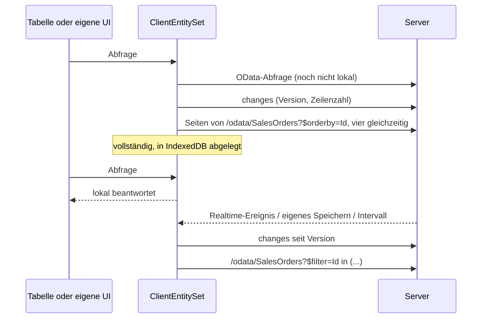

# Client-Entities

Eine Client-Entity ist ein [OData-Set](../web/odata.md), von dem der Browser eine Kopie hält. Solange die Kopie lädt, geht jede Abfrage weiter an den Server; sobald sie vollständig ist, laufen Filter, Suche, Sortierung, Gruppierung, Blättern und Facetten im Browser, ohne Umweg über das Netz. Änderungen auf dem Server kommen als kleine Deltas nach.

**Wozu**: Listen, die Benutzer den ganzen Tag filtern (Aufträge, Kunden, Artikel, Tickets), antworten sofort, der Server sieht einen Download pro Benutzer statt einer Abfrage pro Klick, und die Tabelle bleibt bedienbar, wenn die API langsam ist. **Wann nicht**: Sets mit Millionen Zeilen, Zeilen, die ein Benutzer nicht auf dem Gerät haben darf, Daten, die sich jede Sekunde ändern.

Das Template zeigt es mit 100.000 Aufträgen (*Vertrieb → Aufträge*). Diese Seite geht das Beispiel Schritt für Schritt durch.



## Schritt 1: Entity und OData-Set

Jede Entity mit `Guid`-Schlüssel, die ein OData-Set ist, kann Client-Entity werden. `IAuditable` (aus `AuditedEntity`) erlaubt dem Client, nur Geändertes zu holen; `[Realtime]` bringt Änderungen anderer Benutzer sofort.

```csharp title="MyApp.Sales/Domain/SalesOrder.cs"
[Realtime(SalesPermissions.Orders.View)]
[ClientEntity]
public sealed class SalesOrder : AuditedEntity, IMultiTenant
{
    public required string Number { get; set; }

    [ProvideFacet(Label = "Customer", ValuePath = "CustomerId", LabelPath = "Customer.Name", ValueType = typeof(Guid), Order = 3)]
    public Guid CustomerId { get; set; }

    public Customer? Customer { get; set; }

    [ProvideFacet(Label = "Status", Order = 0)]
    public SalesOrderStatus Status { get; set; }

    [ProvideFacet(Label = "Order date", Type = FacetType.DateRange, Order = 4)]
    public DateTimeOffset OrderDate { get; set; }

    public decimal Total { get; set; }

    public Guid TenantId { get; set; }
    // Channel, Region, Items …
}
```

```csharp title="MyApp.Sales/SalesModule.cs"
services.AddODataEntity<SalesOrder>("SalesOrders", SalesPermissions.Orders.View);
services.AddODataEntity<Customer>("Customers", SalesPermissions.Orders.View);
```

Mehr braucht der Server nicht. Die Zeilen kommen über das OData-Set selbst; Berechtigung des Sets, Mandanten- und Soft-Delete-Filter, Zeilenfilter (`IODataEntityFilter`) und versteckte Eigenschaften gelten für die Kopie also genau wie für jede Abfrage.

## Schritt 2: Einstellungen (optional)

Jedes Set startet mit den Standardwerten, dann wirken das Attribut, die Optionen und zuletzt sein Anwendungsdienst:

| Einstellung | Standard | |
|---|---|---|
| `BatchSize` | 1000 | Zeilen pro Seite beim Herunterladen, höchstens `Coworkee:OData:MaxTop`; der Client lädt vier Seiten gleichzeitig |
| `MaxRows` | 50 000 | größere Sets bleiben auf dem Server; `[ClientEntity(MaxRows = …)]` setzt den Wert pro Entity |
| `RefreshInterval` | 5 Minuten | wie oft Clients nach Änderungen fragen |
| `Enabled` | `true` | `false` lässt eine markierte Entity auf dem Server |

=== "Optionen"

    ```csharp
    services.AddCoworkeeClientEntities(o =>
    {
        o.Default.MaxRows = 20_000;
        o.For<Product>(s => s.RefreshInterval = TimeSpan.FromMinutes(1));   // gespiegelt ohne Attribut
        o.For<Brand>(s => s.Enabled = false);                               // markierte Entity abgeschaltet
    });
    ```

    Die Standardwerte können auch aus der Konfiguration kommen (`Coworkee:ClientEntities:Default`).

=== "Pro Anwendungsdienst"

    Ein [Anwendungsdienst](../web/application-services.md) kann die Entity nennen, die er schreibt, und die Einstellungen ihres Sets mitbringen. Das Template hebt so die Grenze an, denn 100.000 Aufträge sind mehr als die standardmäßigen 50.000:

    ```csharp title="MyApp.Sales/SalesModule.cs"
    services.Configure<ApplicationServiceOptions>(options => options.Configure<ISalesOrderAppService>(service =>
        service.ClientEntity<SalesOrder>(settings => settings.MaxRows = 250_000)));
    ```

    `ClientEntity<TEntity>()` allein spiegelt das Set wie `o.For<TEntity>()`; seine Einstellungen wirken zuletzt. Ein Attribut am Dienst-Interface gibt es bewusst nicht: Das Interface liegt in den Contracts, die die Entity nicht kennen.

## Schritt 3: der Client, eine Zeile

Fügen Sie dem WebAssembly-Projekt das Paket `Coworkee.Client.Blazor.ClientEntities` hinzu und registrieren Sie es nach `AddCoworkeeClient`:

```csharp title="MyApp.Web.Client/Program.cs"
builder.Services.AddCoworkeeClient(baseAddress, ...);
builder.Services.AddCoworkeeClientEntities();
```

Ab jetzt fragt jede `CoworkeeDataTable` und jeder `ODataPicker` bei einem gespiegelten Set die lokale Kopie, sobald sie vollständig ist. Die Seite im Template ist eine gewöhnliche Datentabelle; neu ist nur der Indikator:

```razor title="MyApp.Web.Client/Pages/Sales/SalesOrders.razor"
<CoworkeeDataTable @ref="_table" T="SalesOrderDto" EntitySet="SalesOrders" Expand="Customer" SearchFields="SearchFields" ...>
    <ToolBarContent>
        <ClientEntityIndicator EntitySet="SalesOrders" DataChanged="() => _table.ReloadAsync()" />
    </ToolBarContent>
    <Columns>
        <PropertyColumn Property="o => o.Number" />
        <PropertyColumn Property="o => o.Customer!.Name" />
        ...
    </Columns>
</CoworkeeDataTable>
```

`ClientEntityIndicator` zeigt beim Laden einen Fortschrittsring, danach, ob Abfragen lokal oder auf dem Server laufen, und ruft `DataChanged`, wenn sich die lokalen Zeilen geändert haben. Die Schaltfläche **Vergleichen** daneben führt im Template den aktuellen Filter einmal auf dem Server und einmal im Browser aus und zeigt beide Zeiten.

Die Kopie aktualisiert sich

- direkt nachdem dieser Client etwas gespeichert hat (jedes erfolgreiche `POST`, `PUT`, `PATCH` oder `DELETE` über einen `HttpClient` der App, die generierten Proxies der Anwendungsdienste eingeschlossen),
- wenn die Entity `[Realtime]` trägt und jemand anderes sie geändert hat,
- alle `RefreshInterval`.

Beim Abmelden werden alle Kopien aus dem Browser-Speicher entfernt. Ein Set, das der Benutzer nicht mehr lesen darf (der Server antwortet 403 oder 404), verwirft seine Kopie bei der nächsten Aktualisierung.

## Schritt 4: Schreiben

Eine Client-Entity ist eine Kopie zum Lesen; geschrieben wird wie bisher auf dem Server. Im Template über `ISalesOrderAppService` (siehe [Anwendungsdienste](../web/application-services.md)), dessen generierten Client die Seite injiziert:

```csharp title="MyApp.Web.Client/Pages/Sales/SalesOrders.razor.cs"
[Inject] private ISalesOrderAppService Orders { get; set; } = null!;

private Task CancelAsync(SalesOrderDto order) => Snackbar.RunAsync(() => Orders.CancelAsync(order.Id));
```

Das `POST` gelingt, die Kopie fragt nach den Änderungen seit ihrer Version, holt den geänderten Auftrag per Id, und die Tabelle lädt neu.

## Schritt 5: eigene Oberflächen

`ClientEntities.SetAsync<T>` liefert die Kopie eines Sets. Sie ist `null`, wenn der Server das Set diesem Benutzer nicht anbietet.

```csharp
[Inject] private ClientEntities Entities { get; set; } = null!;

var orders = await Entities.SetAsync<SalesOrderDto>("SalesOrders", expand: "Customer");
var top = await orders!.QueryAsync(q => q.Where(o => o.Status == SalesOrderStatus.Open).OrderByDescending(o => o.Total).Take(10));
```

| Member | |
|---|---|
| `QueryAsync(ODataQuery)` | eine OData-Abfrage: lokal, sobald vollständig, bis dahin und für das, was lokal nicht geht, auf dem Server |
| `QueryAsync(q => q.Where(…))` | LINQ über die lokalen Zeilen; wartet, bis sie da sind |
| `Items`, `Query()` | die lokalen Zeilen als Liste und als `IQueryable` (leer, bis vollständig) |
| `Status`, `Changed` | Zustand, Fortschritt (`Loaded` von `Total`), Version und eine `Revision`, die mit jeder Änderung der Zeilen wächst |
| `WhenLocalAsync()` | ist erledigt, wenn die Zeilen lokal sind; schlägt fehl für Sets, die auf dem Server bleiben |
| `RefreshAsync()` | jetzt nach Änderungen fragen |

Der OData-Client, der an den Kopien vorbeigeht, ist unter einem Schlüssel registriert, etwa zum Vergleichen:

```csharp
[Inject(Key = ClientEntitiesServiceCollectionExtensions.ServerKey)] private IODataClient Server { get; set; } = null!;
```

Ein [QuickGrid](https://learn.microsoft.com/aspnet/core/blazor/components/quickgrid) arbeitet direkt auf den lokalen Zeilen:

```razor
<QuickGrid Items="_orders?.Query().Where(o => o.Region == "Nord")">
    <PropertyColumn Property="o => o.Number" Sortable="true" />
</QuickGrid>
```

oder über einen Items-Provider, der auch während des Ladens funktioniert:

```csharp
private GridItemsProvider<SalesOrderDto> Provider => async request =>
{
    var page = await _orders!.QueryAsync(new ODataQuery { Filter = _filter, OrderBy = "Number", Skip = request.StartIndex, Top = request.Count }, request.CancellationToken);
    return GridItemsProviderResult.From([.. page.Items], (int)(page.Count ?? 0));
};
```

`ODataLinq.Filter<T>("contains(tolower(Number),'42')")` und `ODataLinq.OrderBy(rows, "Total desc")` machen aus OData-Text LINQ für Zeilen, die Sie selbst halten.

## Was lokal läuft

Die lokale Kopie versteht, was Tabellen, Facetten und Picker senden: `eq ne gt ge lt le and or not in`, Arithmetik, `contains startswith endswith tolower toupper trim length year month day hour minute second`, Pfade wie `Customer/Name` (null-sicher) und Literale aller einfachen Typen, Enums eingeschlossen. `$search`, Lambda-Operatoren (`any`, `all`), ein `$expand`, mit dem die Kopie nicht geladen wurde, und alle anderen Funktionen gehen an den Server. Facetten behalten Gruppen und Optionen des Servers; nur die Anzahlen werden lokal gezählt.

## Performance

So bleibt es bei sechsstelligen Zeilenzahlen schnell:

- **Download**: Seiten nach `Id` sortiert, vier Anfragen gleichzeitig, die Zeilen landen direkt in einem Dictionary nach Id. Ein Delta holt geänderte Zeilen per Id, 50 pro Anfrage.
- **Filter**: OData-Text wird einmal zu einem Delegate kompiliert und zwischengespeichert (bis zu 100 Filter).
- **Sortierung**: typisierte Schlüssel und Vergleicher ohne Boxing pro Zeile; Text vergleicht ohne Groß-/Kleinschreibung, wie der Server.
- **Blättern, Gruppieren, Facetten**: Das letzte gefilterte und sortierte Ergebnis und seine Facettenzahlen bleiben erhalten; die nächste Seite, ein Gruppenwechsel oder dieselbe Abfrage noch einmal schneiden nur noch einen Ausschnitt.
- **Facetten**: Die Listenoptionen einer Eigenschaft werden in einem Durchlauf gezählt.

Gemessen mit 100.000 Zeilen in den Tests der Bibliothek (`LargeSetTests`, .NET auf einer Desktop-CPU):

| | erste Abfrage | nächste Seite |
|---|---|---|
| erste Seite mit Facetten | 30 ms | 0,3 ms |
| nach einer Textspalte sortiert | 90–105 ms | < 0,1 ms |
| nach zwei Spalten sortiert (Kunde, dann Summe) | 52–57 ms | < 0,1 ms |
| Suche in drei Textspalten (3.970 Treffer) | 14 ms | < 0,1 ms |
| zwei Facetten gewählt (15.084 Treffer) | 7 ms | < 0,1 ms |
| Download von 100.000 Zeilen ohne Netz | 320 ms | |

WebAssembly interpretiert den größten Teil dieses Codes; im Browser dauert es also ein Mehrfaches. Die Schaltfläche **Vergleichen** im Template zeigt die Zahlen auf Ihrem Rechner. Der Server braucht für jeden Klick einen Roundtrip plus seine Datenbankzeit.

## Speicher und Grenzen

- Die Zeilen liegen im Speicher und, mit gzip komprimiert, in IndexedDB (`coworkee-client-entities`), getrennt nach der Partition des Servers (Benutzer, Mandant), dem Set und seinem Expand. Der nächste Besuch ist sofort lokal und fragt nur nach Änderungen. Ändert sich der Zeilentyp, wird die gespeicherte Kopie verworfen. Ersetzen Sie `IClientEntityStorage`, um die Kopien anderswo abzulegen, oder registrieren Sie `NoClientEntityStorage`, um zwischen Besuchen nichts zu behalten.
- Alles ist reines .NET: kein natives SQLite, kein `wasm-tools`-Workload, keine zusätzlichen Dateien. EF Core SQLite in WebAssembly braucht in jeder konsumierenden App den `wasm-tools`-Workload und ein natives Relinken und könnte positionale Record-DTOs mit verschachtelten Objekten nicht abbilden; die Kopie im Speicher hält die Einrichtung bei einer Zeile und ist für die Abfragen einer Tabelle schnell.
- Arbeitsspeicher: Jede Zeile ist ein .NET-Objekt im Browser-Tab. 100.000 Aufträge mit ihrem Kunden belegen einige zehn MB; halten Sie `MaxRows` im Rahmen und expandieren Sie nur, was Sie anzeigen.
- Der Download ist so groß wie das JSON des Sets; schalten Sie Antwortkomprimierung in der API (oder im BFF) ein, wenn Sie große Sets spiegeln.
- Änderungen erkennt der Server an `IAuditable` (`CreatedAt`, `ModifiedAt`), Löschungen an `ISoftDelete` (`DeletedAt`). Stimmt die Zeilenzahl nach einem Delta nicht mit der des Servers überein, vergleicht der Client die Ids; so verschwinden auch hart gelöschte Zeilen und solche, die nicht mehr sichtbar sind. Entities ohne `IAuditable` werden bei jeder Aktualisierung neu geladen, ebenso ein Set mit mehr als `BatchSize × 10` Änderungen seit der letzten Version.
- Clients spiegeln nur die Zeilen, die ein Benutzer sehen darf; eine Kopie enthält also nichts, was eine OData-Abfrage nicht auch liefern würde. Auf dem Gerät ist sie nicht verschlüsselt; Sets mit sensiblen Daten lassen Sie auf dem Server.

## Endpunkte

| Anfrage | Antwort |
|---|---|
| `GET /api/v1/client-entities` | die Sets, die dieser Benutzer spiegeln darf, mit ihren Einstellungen, und ein Partitionsschlüssel pro Benutzer und Mandant |
| `GET /api/v1/client-entities/{set}/changes?since=…` | neue Version, Zahl der sichtbaren Zeilen, geänderte und gelöschte Ids |
| `GET /api/v1/client-entities/{set}/ids` | alle sichtbaren Ids, um unbemerkt verschwundene Zeilen zu finden |

## Dateien des Beispiels

| Datei | |
|---|---|
| `MyApp.Sales/Domain/SalesOrder.cs` | Entity mit `[ClientEntity]`, `[Realtime]` und Facetten |
| `MyApp.Sales/SalesModule.cs` | OData-Sets und die Client-Entity-Einstellungen des Dienstes |
| `MyApp.Contracts/Sales/ISalesOrderAppService.cs` | das Schreiben, siehe [Anwendungsdienste](../web/application-services.md) |
| `MyApp.Migrations/DemoSales.cs` | 100.000 Aufträge, von Postgres in einer Anweisung erzeugt |
| `MyApp.Web.Client/Pages/Sales/SalesOrders.razor(.cs)` | Tabelle, Indikator und der Vergleich von Server und Browser |
