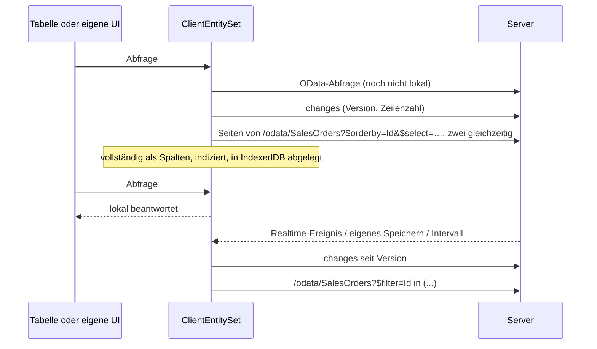

# Client-Entities

Eine Client-Entity ist ein [OData-Set](../web/odata.md), von dem der Browser eine Kopie hält. Solange die Kopie lädt, geht jede Abfrage weiter an den Server; sobald sie vollständig ist, laufen Filter, Suche, Sortierung, Gruppierung, Blättern und Facetten im Browser, ohne Umweg über das Netz. Änderungen auf dem Server kommen als kleine Deltas nach.

**Wozu**: Listen, die Benutzer den ganzen Tag filtern (Aufträge, Kunden, Artikel, Tickets), antworten sofort, der Server sieht einen Download pro Benutzer statt einer Abfrage pro Klick, und die Tabelle bleibt bedienbar, wenn die API langsam ist. **Wann nicht**: Sets mit Millionen Zeilen, Zeilen, die ein Benutzer nicht auf dem Gerät haben darf, Daten, die sich jede Sekunde ändern.

Das Template zeigt es mit 100.000 Aufträgen (*Vertrieb → Aufträge*). Diese Seite geht das Beispiel Schritt für Schritt durch.



## Schritt 1: Entity und OData-Set

Jede Entity mit `Guid`-Schlüssel, die ein OData-Set ist, kann Client-Entity werden. `IAuditable` (aus `AuditedEntity`) erlaubt dem Client, nur Geändertes zu holen; `[Realtime]` bringt Änderungen anderer Benutzer sofort.

```csharp title="MyApp.Sales/Domain/SalesOrder.cs"
[Realtime(SalesPermissions.Orders.View)]
[ClientEntity]
public sealed class SalesOrder : AuditedEntity, IMultiTenant
{
    public required string Number { get; set; }

    [ProvideFacet(Label = "Customer", ValuePath = "CustomerId", LabelPath = "Customer.Name", ValueType = typeof(Guid), Order = 3)]
    public Guid CustomerId { get; set; }

    public Customer? Customer { get; set; }

    [ProvideFacet(Label = "Status", Order = 0)]
    public SalesOrderStatus Status { get; set; }

    [ProvideFacet(Label = "Order date", Type = FacetType.DateRange, Order = 4)]
    public DateTimeOffset OrderDate { get; set; }

    public decimal Total { get; set; }

    public Guid TenantId { get; set; }
    // Channel, Region, Items …
}
```

```csharp title="MyApp.Sales/SalesModule.cs"
services.AddODataEntity<SalesOrder>("SalesOrders", SalesPermissions.Orders.View);
services.AddODataEntity<Customer>("Customers", SalesPermissions.Orders.View);
```

Mehr braucht der Server nicht. Die Zeilen kommen über das OData-Set selbst; Berechtigung des Sets, Mandanten- und Soft-Delete-Filter, Zeilenfilter (`IODataEntityFilter`) und versteckte Eigenschaften gelten für die Kopie also genau wie für jede Abfrage.

## Schritt 2: Einstellungen (optional)

Jedes Set startet mit den Standardwerten, dann wirken das Attribut, die Optionen und zuletzt sein Anwendungsdienst:

| Einstellung | Standard | |
|---|---|---|
| `BatchSize` | 1000 | Zeilen pro Seite beim Herunterladen, höchstens `Coworkee:OData:MaxTop`; der Client lädt zwei Seiten gleichzeitig |
| `MaxRows` | 50 000 | größere Sets bleiben auf dem Server; `[ClientEntity(MaxRows = …)]` setzt den Wert pro Entity |
| `RefreshInterval` | 5 Minuten | wie oft Clients nach Änderungen fragen |
| `Enabled` | `true` | `false` lässt eine markierte Entity auf dem Server |
| `ChangedAt` | keine | Datumseigenschaften, die sagen, wann eine Zeile angelegt oder geändert wurde, für Entities ohne `IAuditable` (Tabellen einer [externen Datenbank](../fundamentals/persistence.md#externe-datenbanken)); ohne sie lädt ein solches Set bei jeder Aktualisierung vollständig |
| `Overlap` | 5 Sekunden | wie weit vor die letzte Aktualisierung jede Aktualisierung erneut schaut, für späte Commits und abweichende Uhren |

=== "Optionen"

    ```csharp
    services.AddCoworkeeClientEntities(o =>
    {
        o.Default.MaxRows = 20_000;
        o.For<Product>(s => s.RefreshInterval = TimeSpan.FromMinutes(1));   // gespiegelt ohne Attribut
        o.For<Brand>(s => s.Enabled = false);                               // markierte Entity abgeschaltet
    });
    ```

    Die Standardwerte können auch aus der Konfiguration kommen (`Coworkee:ClientEntities:Default`).

=== "Pro Anwendungsdienst"

    Ein [Anwendungsdienst](../web/application-services.md) kann die Entity nennen, die er schreibt, und die Einstellungen ihres Sets mitbringen. Das Template hebt so die Grenze an, denn 100.000 Aufträge sind mehr als die standardmäßigen 50.000:

    ```csharp title="MyApp.Sales/SalesModule.cs"
    services.Configure<ApplicationServiceOptions>(options => options.Configure<ISalesOrderAppService>(service =>
        service.ClientEntity<SalesOrder>(settings => settings.MaxRows = 250_000)));
    ```

    `ClientEntity<TEntity>()` allein spiegelt das Set wie `o.For<TEntity>()`; seine Einstellungen wirken zuletzt. Ein Attribut am Dienst-Interface gibt es bewusst nicht: Das Interface liegt in den Contracts, die die Entity nicht kennen.

## Schritt 3: der Client, eine Zeile

Füge dem WebAssembly-Projekt das Paket `Coworkee.Client.Blazor.ClientEntities` hinzu und registriere es nach `AddCoworkeeClient`:

```csharp title="MyApp.Web.Client/Program.cs"
builder.Services.AddCoworkeeClient(baseAddress, ...);
builder.Services.AddCoworkeeClientEntities();
```

Ab jetzt fragt jede `CoworkeeDataTable` und jeder `ODataPicker` bei einem gespiegelten Set die lokale Kopie, sobald sie vollständig ist. Die Seite im Template ist eine gewöhnliche Datentabelle, nichts darauf handelt von Client-Entities:

```razor title="MyApp.Web.Client/Pages/Sales/SalesOrders.razor"
<CoworkeeDataTable @ref="_table" T="SalesOrderDto" EntitySet="SalesOrders" Expand="Customer" SearchFields="SearchFields" ...>
    <Columns>
        <PropertyColumn Property="o => o.Number" />
        <PropertyColumn Property="o => o.Customer!.Name" />
        ...
    </Columns>
</CoworkeeDataTable>
```

### Der Schalter in der Tabelle

Jede Tabelle über einem gespiegelten Set bekommt ein Bedienelement in ihrer Werkzeugleiste (`ClientEntitySwitch`, von `AddCoworkeeClientEntities` hinzugefügt):

- **Symbol**: ein Computer, solange im Browser gesucht wird, eine Wolke, solange auf dem Server gesucht wird.
- **Ring** darum: der Fortschritt des Downloads, drehend, während die Kopie sich aktualisiert, grün, wenn die Kopie aktuell ist, orange für ein Set, das zu groß zum Spiegeln ist, rot, wenn der Abgleich fehlschlug. Der Tooltip sagt dasselbe in Worten.
- **Menü**: *Im Browser suchen* (sobald die Kopie vollständig ist), *Auf dem Server suchen* und *Vergleichen und das Schnellere wählen*: Die aktuelle Abfrage der Tabelle (Filter, Suche, Facetten, Sortierung, eine Seite) läuft auf jeder Seite dreimal; eine Meldung zeigt die Medianzeiten und ob beide gleich viele Zeilen fanden, danach wird die schnellere Seite gewählt.

Die Wahl bleibt je Set in der Benutzereinstellung `Table.ClientEntityModes` und folgt dem Benutzer so auf jedes Gerät. Auch bei der Suche auf dem Server gleicht die Kopie weiter ab, der Wechsel zurück geht also sofort. Ändern sich die lokalen Zeilen, lädt der Schalter seine Tabelle neu. Auch Code kann wählen: `ClientEntities.SetModeAsync("SalesOrders", ClientEntityMode.Server)`.

Die Kopie aktualisiert sich

- direkt nachdem dieser Client etwas gespeichert hat (jedes erfolgreiche `POST`, `PUT`, `PATCH` oder `DELETE` über einen `HttpClient` der App, die generierten Proxies der Anwendungsdienste eingeschlossen),
- wenn die Entity `[Realtime]` trägt und jemand anderes sie geändert hat,
- alle `RefreshInterval`.

Beim Abmelden werden alle Kopien aus dem Browser-Speicher entfernt. Ein Set, das der Benutzer nicht mehr lesen darf (der Server antwortet 403 oder 404), verwirft seine Kopie bei der nächsten Aktualisierung.

## Schritt 4: Schreiben

Eine Client-Entity ist eine Kopie zum Lesen; geschrieben wird wie bisher auf dem Server. Im Template über `ISalesOrderAppService` (siehe [Anwendungsdienste](../web/application-services.md)), dessen generierten Client die Seite injiziert:

```csharp title="MyApp.Web.Client/Pages/Sales/SalesOrders.razor.cs"
[Inject] private ISalesOrderAppService Orders { get; set; } = null!;

private Task CancelAsync(SalesOrderDto order) => Snackbar.RunAsync(() => Orders.CancelAsync(order.Id));
```

Das `POST` gelingt, die Kopie fragt nach den Änderungen seit ihrer Version, holt den geänderten Auftrag per Id, und die Tabelle lädt neu.

## Schritt 5: eigene Oberflächen

`ClientEntities.SetAsync<T>` liefert die Kopie eines Sets. Sie ist `null`, wenn der Server das Set diesem Benutzer nicht anbietet.

```csharp
[Inject] private ClientEntities Entities { get; set; } = null!;

var orders = await Entities.SetAsync<SalesOrderDto>("SalesOrders", expand: "Customer");
var top = await orders!.QueryAsync(q => q.Where(o => o.Status == SalesOrderStatus.Open).OrderByDescending(o => o.Total).Take(10));
```

| Member | |
|---|---|
| `QueryAsync(ODataQuery)` | eine OData-Abfrage: lokal, sobald vollständig, bis dahin und für das, was lokal nicht geht, auf dem Server |
| `QueryAsync(q => q.Where(…))` | LINQ über die lokalen Zeilen; wartet, bis sie da sind |
| `Items`, `Query()` | die lokalen Zeilen als Liste und als `IQueryable` (leer, bis vollständig); als Spalten gehaltene Zeilen werden beim ersten Zugriff zu Objekten, bei großen Sets also besser `QueryAsync(ODataQuery)` |
| `Status`, `Changed` | Zustand, Fortschritt (`Loaded` von `Total`), Version und eine `Revision`, die mit jeder Änderung der Zeilen wächst |
| `WhenLocalAsync()` | ist erledigt, wenn die Zeilen lokal sind; schlägt fehl für Sets, die auf dem Server bleiben |
| `RefreshAsync()` | jetzt nach Änderungen fragen |
| `Mode` | `Client` oder `Server`: wo OData-Abfragen laufen, sobald die Kopie vollständig ist (`ClientEntities.SetModeAsync` merkt es sich auch für den Benutzer) |
| `MeasureAsync(query, side)` | führt eine Abfrage unabhängig vom Modus auf einer Seite aus und liefert Zeit und Zeilenzahl |

Der OData-Client, der an den Kopien vorbeigeht, ist unter einem Schlüssel registriert, etwa zum Vergleichen:

```csharp
[Inject(Key = ClientEntitiesServiceCollectionExtensions.ServerKey)] private IODataClient Server { get; set; } = null!;
```

Ein [QuickGrid](https://learn.microsoft.com/aspnet/core/blazor/components/quickgrid) arbeitet direkt auf den lokalen Zeilen:

```razor
<QuickGrid Items="_orders?.Query().Where(o => o.Region == "Nord")">
    <PropertyColumn Property="o => o.Number" Sortable="true" />
</QuickGrid>
```

oder über einen Items-Provider, der auch während des Ladens funktioniert:

```csharp
private GridItemsProvider<SalesOrderDto> Provider => async request =>
{
    var page = await _orders!.QueryAsync(new ODataQuery { Filter = _filter, OrderBy = "Number", Skip = request.StartIndex, Top = request.Count }, request.CancellationToken);
    return GridItemsProviderResult.From([.. page.Items], (int)(page.Count ?? 0));
};
```

`ODataLinq.Filter<T>("contains(tolower(Number),'42')")` und `ODataLinq.OrderBy(rows, "Total desc")` machen aus OData-Text LINQ für Zeilen, die du selbst hältst.

## Was lokal läuft

Die lokale Kopie versteht, was Tabellen, Facetten und Picker senden: `eq ne gt ge lt le and or not in`, Arithmetik, `contains startswith endswith tolower toupper trim length year month day hour minute second`, Pfade wie `Customer/Name` (null-sicher) und Literale aller einfachen Typen, Enums eingeschlossen. `$search`, Lambda-Operatoren (`any`, `all`), ein `$expand`, mit dem die Kopie nicht geladen wurde, und alle anderen Funktionen gehen an den Server. Facetten behalten Gruppen und Optionen des Servers; nur die Anzahlen werden lokal gezählt.

## Performance

WebAssembly interpretiert .NET-Code; Arbeit pro Zeile ist im Browser also teuer: 35 MB JSON zu lesen dauert über 15 Sekunden, 100.000 Texte zu sortieren fast eine Sekunde. Die lokale Kopie ist deshalb wie ein kleiner Spaltenspeicher gebaut und nicht als Liste von Objekten:

- **Spalten**: Jeder Eigenschaftspfad (`Number`, `Customer/Name`, …) ist ein Array von Werten. Zu Objekten werden Zeilen erst, wenn sie angezeigt werden, 25 pro Seite.
- **Indizes**: Ist die Kopie da, sortiert sich jede Spalte einmal im Hintergrund, eine nach der anderen mit einer Pause für die Seite dazwischen. Die Zeilen tragen dann den Rang ihres Werts, wie bei einem Datenbankindex.
- **Filter** laufen auf den Rängen: `Status eq 'Open'`, `(Total ge 5 and Total lt 10)`, `Options has 'Express'` oder `contains(tolower(Number),'123')` werden einmal pro verschiedenem Wert ausgewertet und ergeben eine Maske über die Zeilen. Vergleiche behalten einen Bereich von Rängen; `contains` durchsucht alle verschiedenen Werte einer Spalte in einem Durchgang statt mit einem Aufruf pro Wert. Nur was kein Vergleich einer Eigenschaft mit einem Literal ist (`length(Name) eq 4`), läuft Zeile für Zeile.
- **Sortierung** läuft den Index der Spalte entlang; mehrere Spalten setzen ihre Ränge zu einer Zahl pro Zeile zusammen. Ein Filter behält diese Reihenfolge, gefilterte und sortierte Zeilen entstehen in einem Durchlauf.
- **Facetten** zählen die Ränge der gefundenen Zeilen: ein Durchlauf pro Facetten-Eigenschaft, egal wie viele Optionen. Wert-, Bereichs- und Flag-Optionen addieren dann die Anzahlen der Ränge, die sie annehmen (Bereiche über Präfixsummen); 35 Monatsbereiche über 100.000 verschiedene Auftragsdaten kosten so nicht mehr als eine Werteliste.
- **Ergebnisse** der letzten 16 Kombinationen aus Filter und Sortierung bleiben erhalten: Die nächste Seite, ein Gruppenwechsel oder die Rückkehr zu einem früheren Filter schneiden nur einen Ausschnitt.
- **Speicher**: Spalten und ihre Sortierungen werden als Binär-Arrays (gzip) in IndexedDB geschrieben. Ein Neuladen liest sie in einigen hundert Millisekunden zurück, Spalte für Spalte mit Pausen dazwischen; bis dahin fragt die Tabelle den Server und zeigt sofort Zeilen.
- **Download**: Nur die Eigenschaften des Zeilentyps kommen über die Leitung (`$select`, verschachteltes `$expand`), zwei Seiten gleichzeitig, in einem Durchgang gelesen.

Gemessen in Chromium mit den 100.000 Aufträgen des Templates (Release-Build, lokaler Rechner; der Server antwortet aus Postgres auf derselben Maschine):

| | vorher | jetzt |
|---|---|---|
| erster Download, bis lokal | 36 s | 14,5 s |
| Neuladen: erste Zeilen sichtbar | 20,6 s | 2,9 s |
| Neuladen: Abfragen lokal | (nach den 20 s) | 0,3 s nach den ersten Zeilen |

Nur die Abfragezeit, *Vergleichen und das Schnellere wählen* des [Schalters](#der-schalter-in-der-tabelle) (Median aus drei Läufen der Tabellenabfrage mit ihren Facetten und 25 Zeilen, je mit einer Bedingung, die verhindert, dass eine Seite ein Ergebnis wiederverwendet). Gemessen am 15.10.2026 mit den Facetten des Templates (Status, Kanal, Flags, Region, Kunde, 35 Monate Auftragsdatum, 16 Summenbereiche, Positionen, bezahlt):

| aktueller Filter | Server | Browser vorher | Browser jetzt |
|---|---|---|---|
| keiner | 216–236 ms | 1.035 ms | 39–56 ms |
| Suche "Hamburg" (3 Textspalten) | 638–661 ms | 516 ms | 152 ms |

"Vorher" ist der Stand vor dem 15.10.2026: Optionsfilter, die kein einfacher Wert sind (`Options has 'Express'`, Bereiche), liefen Zeile für Zeile auf Objekten, und ihre Masken passten nicht in den Zwischenspeicher von 64, sodass jeder neue Filter sie alle erneut bezahlte.

Klick auf eine Option im Spaltenfilter, bis die Tabelle das Ergebnis zeigt (Chromium, 15.10.2026):

| Spalte | Browser | Server |
|---|---|---|
| Status, Kanal, Region, Optionen, Bezahlt, Summe | 240–310 ms | 500–600 ms |
| Auftragsdatum (Monat) | 369 ms | 527 ms |
| Nummer (enthält) | 500–680 ms | 835–897 ms |

Vom Klick bis zur gezeichneten Tabelle, lokale Kopie mit Indizes (die Tabelle braucht für eine Seite etwa 130 ms zum Zeichnen, egal wer antwortet):

| | während des Downloads (Server) | lokal |
|---|---|---|
| nach Summe sortieren | 600 ms | 165 ms |
| nach Kunde sortieren | 584 ms | 135–163 ms |
| nächste Seite | 292 ms | 131–136 ms |
| Suche (nach 300 ms Eingabeverzögerung) | 808 ms | 435–458 ms |
| Suche leeren | 938 ms | 286 ms |

Die erste Sortierung nach einer Spalte direkt nach dem allerersten Download kann bis zu 1,5 s dauern, solange diese Spalte noch indiziert wird; nach einem Neuladen kommen die Indizes aus dem Speicher. Die Server-Zahlen während des Downloads enthalten die Arbeit, die der Browser gleichzeitig für den Download leistet.

Die Tests der Bibliothek (`LargeSetTests`, `LocalTableTests`) prüfen dasselbe mit 100.000 Zeilen in .NET.

## Speicher und Grenzen

- Die Zeilen liegen als Spalten im Speicher und, mit gzip komprimiert, in IndexedDB (`coworkee-client-entities`), getrennt nach der Partition des Servers (Benutzer, Mandant), dem Set und seinem Expand. Der nächste Besuch ist sofort lokal und fragt nur nach Änderungen. Ändert sich der Zeilentyp, wird die gespeicherte Kopie verworfen. Ersetze `IClientEntityStorage`, um die Kopien anderswo abzulegen, oder registriere `NoClientEntityStorage`, um zwischen Besuchen nichts zu behalten.
- Zeilentypen mit Eigenschaften einfacher Typen (Text, Zahlen, Datumswerte, `Guid`, Enums, jeweils auch nullable) und verschachtelten Objekten aus solchen Eigenschaften werden als Spalten gehalten. Andere Zeilentypen (etwa mit Listen) funktionieren auch, werden aber als JSON abgelegt, langsamer wiederhergestellt und Zeile für Zeile gefiltert.
- Alles ist reines .NET: kein natives SQLite, kein `wasm-tools`-Workload, keine zusätzlichen Dateien.
- Arbeitsspeicher: 100.000 Aufträge belegen einige zehn MB im Browser-Tab; halte `MaxRows` im Rahmen und expandiere nur, was du anzeigst.
- Der erste Download eines großen Sets dauert (14,5 s für 100.000 Zeilen) und beschäftigt den Browser; die Tabelle antwortet währenddessen vom Server, langsamer als sonst. Antwortkomprimierung in der API (oder im BFF) hilft bei langsamen Netzen.
- Änderungen erkennt der Server an `IAuditable` (`CreatedAt`, `ModifiedAt`), Löschungen an `ISoftDelete` (`DeletedAt`). Stimmt die Zeilenzahl nach einem Delta nicht mit der des Servers überein, vergleicht der Client die Ids; so verschwinden auch hart gelöschte Zeilen und solche, die nicht mehr sichtbar sind. Entities ohne `IAuditable` werden bei jeder Aktualisierung neu geladen, ebenso ein Set mit mehr als `BatchSize × 10` Änderungen seit der letzten Version.
- Text sortiert ohne Groß-/Kleinschreibung nach der Kultur des Browsers; der Server sortiert nach der Collation seiner Datenbank, Sonderzeichen können also anders einsortiert sein.
- Clients spiegeln nur die Zeilen, die ein Benutzer sehen darf; eine Kopie enthält also nichts, was eine OData-Abfrage nicht auch liefern würde. Auf dem Gerät ist sie nicht verschlüsselt; Sets mit sensiblen Daten lässt du auf dem Server.

## Endpunkte

| Anfrage | Antwort |
|---|---|
| `GET /api/v1/client-entities` | die Sets, die dieser Benutzer spiegeln darf, mit ihren Einstellungen, und ein Partitionsschlüssel pro Benutzer und Mandant |
| `GET /api/v1/client-entities/{set}/changes?since=…` | neue Version, Zahl der sichtbaren Zeilen, geänderte und gelöschte Ids |
| `GET /api/v1/client-entities/{set}/ids` | alle sichtbaren Ids, um unbemerkt verschwundene Zeilen zu finden |

## Dateien des Beispiels

| Datei | |
|---|---|
| `MyApp.Sales/Domain/SalesOrder.cs` | Entity mit `[ClientEntity]`, `[Realtime]` und Facetten |
| `MyApp.Sales/SalesModule.cs` | OData-Sets und die Client-Entity-Einstellungen des Dienstes |
| `MyApp.Contracts/Sales/ISalesOrderAppService.cs` | das Schreiben, siehe [Anwendungsdienste](../web/application-services.md) |
| `MyApp.Migrations/DemoSales.cs` | 100.000 Aufträge, von Postgres in einer Anweisung erzeugt |
| `MyApp.Web.Client/Pages/Sales/SalesOrders.razor(.cs)` | die Tabelle; der Schalter kommt mit ihr |
