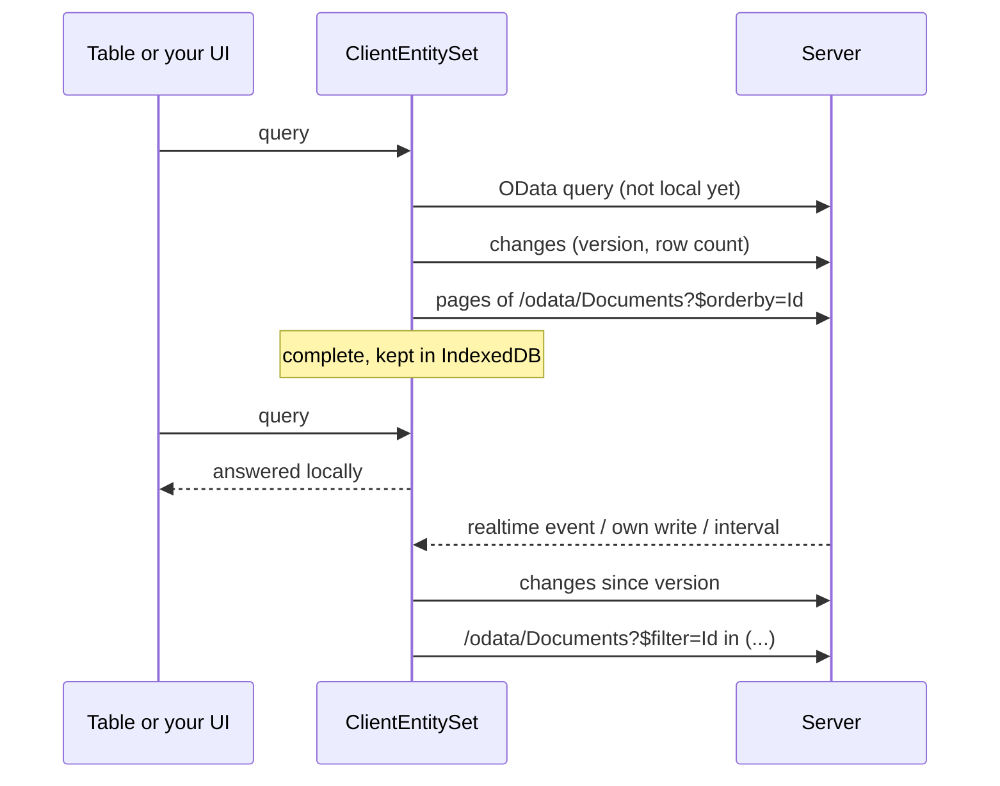

# Client entities

A client entity is an [OData set](../web/odata.md) the browser keeps a copy of. While the copy downloads, every query still goes to the server; as soon as it is complete, filtering, search, sorting, paging and facets run in the browser without a round trip. Changes on the server flow in as small deltas.



## Server: choose the sets

Mark the entity, or name it in the options. Options win over the attribute and can switch an attributed entity off.

```csharp
[ClientEntity]
public sealed class Document : AuditedEntity, IMultiTenant { ... }
```

```csharp
services.AddCoworkeeClientEntities(o =>
{
    o.Default.MaxRows = 20_000;
    o.For<Product>(s => s.RefreshInterval = TimeSpan.FromMinutes(1));
    o.For<Brand>(s => s.Enabled = false);
});
```

The defaults can also come from configuration (`Coworkee:ClientEntities:Default`).

| Setting | Default | |
|---|---|---|
| `BatchSize` | 1000 | rows per page of the download, at most `Coworkee:OData:MaxTop` |
| `MaxRows` | 50 000 | larger sets stay on the server; `[ClientEntity(MaxRows = …)]` sets it per entity |
| `RefreshInterval` | 5 minutes | how often clients ask for changes |
| `Enabled` | `true` | `false` keeps an attributed entity on the server |

The rows travel through the OData set itself, so the set's permission, the tenant and soft delete filters, `IODataEntityFilter` row filters and hidden properties apply to the copy exactly as to every query. Three small endpoints complete the feed:

| Request | Answer |
|---|---|
| `GET /api/v1/client-entities` | the sets this user may mirror and a partition key per user and tenant |
| `GET /api/v1/client-entities/{set}/changes?since=…` | new version, visible row count, changed and deleted ids |
| `GET /api/v1/client-entities/{set}/ids` | all visible ids, to find rows that vanished unseen |

Changes come from `IAuditable` (`CreatedAt`, `ModifiedAt`), deletions from `ISoftDelete` (`DeletedAt`). When the row count after a delta differs from the server's, the client compares ids, so hard deletes and rows that are no longer visible to the user disappear too. Entities without `IAuditable` are downloaded again at each refresh.

## Client: one line

Add the package `Coworkee.Client.Blazor.ClientEntities` to the WebAssembly project and register it after `AddCoworkeeClient`:

```csharp
builder.Services.AddCoworkeeClient(baseAddress, ...);
builder.Services.AddCoworkeeClientEntities();
```

That is all a `CoworkeeDataTable` and an `ODataPicker` need: their queries for a mirrored set go to the local copy as soon as it is complete. `ClientEntityIndicator` shows the state and tells the page when the local rows changed:

```razor
<CoworkeeDataTable @ref="_table" T="DocumentDto" EntitySet="Documents" Expand="DocumentType" ...>
    <ToolBarContent>
        <ClientEntityIndicator EntitySet="Documents" DataChanged="() => _table.ReloadAsync()" />
    </ToolBarContent>
</CoworkeeDataTable>
```

The copy refreshes

- right after this client saved something (any successful `POST`, `PUT`, `PATCH` or `DELETE` through an `HttpClient` of the app),
- when the entity has `[Realtime]` and someone else changed it,
- every `RefreshInterval`.

Signing out removes all copies from the browser storage.

## Your own UI

`ClientEntities.SetAsync<T>` gives you the copy of a set. It is `null` when the server does not offer the set to this user.

```csharp
[Inject] private ClientEntities Entities { get; set; } = null!;

var documents = await Entities.SetAsync<DocumentDto>("Documents", expand: "DocumentType");
```

| Member | |
|---|---|
| `QueryAsync(ODataQuery)` | an OData query: local once complete, the server until then and for what it cannot answer locally |
| `QueryAsync(q => q.Where(…))` | LINQ over the local rows; waits until they are here |
| `Items`, `Query()` | the local rows as list and `IQueryable` (empty until complete) |
| `Status`, `Changed` | state, progress (`Loaded` of `Total`), version and a `Revision` that grows with every change of the rows |
| `WhenLocalAsync()` | completes when the rows are local, fails for sets that stay on the server |
| `RefreshAsync()` | ask for changes now |

A [QuickGrid](https://learn.microsoft.com/aspnet/core/blazor/components/quickgrid) works on the local rows directly:

```razor
<QuickGrid Items="_documents?.Query().Where(d => d.IsPublic)">
    <PropertyColumn Property="d => d.Title" Sortable="true" />
</QuickGrid>
```

or through an items provider that also works while the copy downloads:

```csharp
private GridItemsProvider<DocumentDto> Provider => async request =>
{
    var page = await _documents!.QueryAsync(new ODataQuery { Filter = _filter, OrderBy = "Title", Skip = request.StartIndex, Top = request.Count }, request.CancellationToken);
    return GridItemsProviderResult.From([.. page.Items], (int)(page.Count ?? 0));
};
```

`ODataLinq.Filter<T>("contains(tolower(Title),'report')")` and `ODataLinq.OrderBy(rows, "Title desc")` turn OData text into LINQ for rows you hold yourself.

## What runs locally

The local copy understands what tables, facets and pickers send: `eq ne gt ge lt le and or not in`, arithmetic, `contains startswith endswith tolower toupper trim length year month day hour minute second`, paths like `DocumentType/Name` (null safe) and literals of every simple type. `$search`, lambda operators (`any`, `all`), an `$expand` the copy was not loaded with and every other function go to the server. Facets keep the server's groups and options; only their counts are computed locally.

## Storage and limits

- The rows live in memory and, gzip compressed, in IndexedDB (`coworkee-client-entities`), keyed by the server's partition (user, tenant), the set and its expand. A changed row type discards the stored copy. Replace `IClientEntityStorage` to keep them elsewhere, or register `NoClientEntityStorage` to keep nothing between visits.
- Everything is plain .NET: no native SQLite, no `wasm-tools` workload, no extra files to serve. EF Core SQLite in WebAssembly needs the `wasm-tools` workload and a native relink in every consuming app, and could not map positional record DTOs with nested objects; an in-memory copy keeps the setup to one line.
- Filters run as compiled expressions, which WebAssembly interprets. Some ten thousand rows filter in a blink; for six-digit row counts keep `MaxRows` lower or let the server answer.
- Clients mirror the rows a user may see, so a copy contains nothing an OData query would not return. It is not encrypted on the device; leave sets with sensitive data on the server.
- Response compression of the API (or the BFF) shrinks the download a lot; enable it in the host if you mirror large sets.
