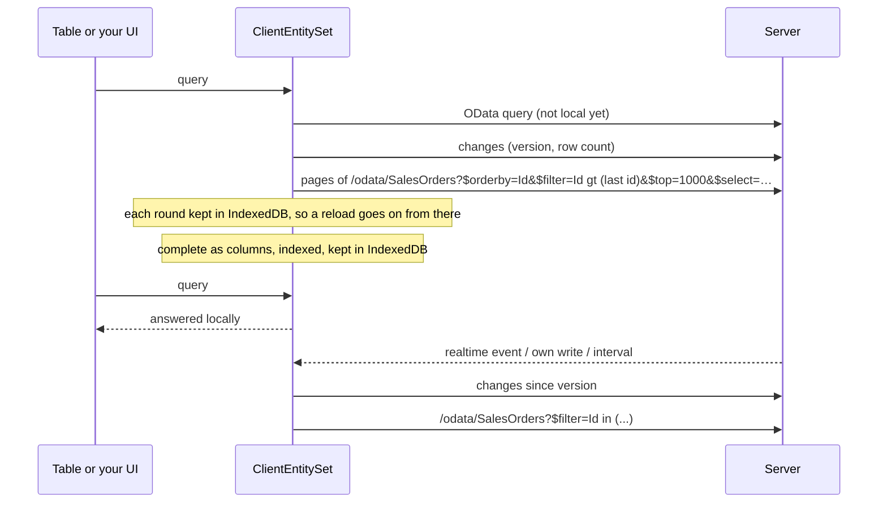

# Client entities

A client entity is an [OData set](../web/odata.md) the browser keeps a copy of. While the copy downloads, every query still goes to the server; as soon as it is complete, filtering, search, sorting, grouping, paging and facets run in the browser without a round trip. Changes on the server flow in as small deltas.

**Why**: list data that users filter all day (orders, customers, articles, tickets) answers at once, the server sees one download per user instead of a query per click, and the table keeps working while the API is slow. **When not**: sets with millions of rows, rows a user must not keep on the device, data that changes every second.

This page walks step by step through a demo app made from the template with a Sales module of 100,000 sales orders (*Sales → Sales Orders*); the module is the demo's, the template has none. The template only wires the client: `--client-entities` (`clientEntities`, off by default; spec entities with `clientEntity` turn it on) adds the package and `AddCoworkeeClientEntities()` of step 3.



## Step 1: entity and OData set

Every entity with a `Guid` key that is an OData set can become a client entity. `IAuditable` (from `AuditedEntity`) lets the client fetch only what changed; `[Realtime]` brings the changes of other users at once.

```csharp title="MyApp.Sales/Domain/SalesOrder.cs"
[Realtime(SalesPermissions.Orders.View)]
[ClientEntity]
public sealed class SalesOrder : AuditedEntity, IMultiTenant
{
    public required string Number { get; set; }

    [ProvideFacet(Label = "Customer", ValuePath = "CustomerId", LabelPath = "Customer.Name", ValueType = typeof(Guid), Order = 3)]
    public Guid CustomerId { get; set; }

    public Customer? Customer { get; set; }

    [ProvideFacet(Label = "Status", Order = 0)]
    public SalesOrderStatus Status { get; set; }

    [ProvideFacet(Label = "Order date", Type = FacetType.DateRange, Order = 4)]
    public DateTimeOffset OrderDate { get; set; }

    public decimal Total { get; set; }

    public Guid TenantId { get; set; }
    // Channel, Region, Items …
}
```

```csharp title="MyApp.Sales/SalesModule.cs"
services.AddODataEntity<SalesOrder>("SalesOrders", SalesPermissions.Orders.View);
services.AddODataEntity<Customer>("Customers", SalesPermissions.Orders.View);
```

`[ClientEntity]` is all the server needs. The rows travel through the OData set itself, so its permission, the tenant and soft delete filters, `IODataEntityFilter` row filters and hidden properties apply to the copy exactly as to every query.

An entity that cannot carry the attribute (a class of another library, the table of an [external database](../fundamentals/persistence.md#external-databases)) is mirrored the same way with `o.For<TEntity>()` in the options or through its [application service](#step-2-settings-optional); all three ways lead to the same copy.

## Step 2: settings (optional)

Each set starts from the defaults, then the attribute, then the options, then its application service apply:

| Setting | Default | |
|---|---|---|
| `BatchSize` | 1000 | rows per download page, at most `Coworkee:OData:MaxTop` |
| `ParallelPages` | 1 | download pages loaded side by side (also the chunks of changed rows). The download pages by the last id; a second page of a round skips the first (`$skip`), so the database reads that one twice. Raise it only where the set's query is cheap and the network is the bottleneck |
| `MaxRows` | 50 000 | larger sets stay on the server; `[ClientEntity(MaxRows = …)]` sets it per entity |
| `Expand` | none | the navigation properties the copy carries, as in `$expand` (`[ClientEntity(Expand = "Customer")]` or the options). Without it the first query of a visit decides; see below |
| `RefreshInterval` | 5 minutes | how often clients ask for changes |
| `Enabled` | `true` | `false` keeps an attributed entity on the server |
| `ChangedAt` | none | date properties that tell when a row was created or changed, for entities without `IAuditable` (tables of an [external database](../fundamentals/persistence.md#external-databases)); without them such a set downloads completely on every refresh |
| `Overlap` | 5 seconds | how far before the last refresh each refresh looks again, for late commits and clock skew |

=== "Options"

    ```csharp
    services.AddCoworkeeClientEntities(o =>
    {
        o.Default.MaxRows = 20_000;
        o.For<Product>(s => s.RefreshInterval = TimeSpan.FromMinutes(1));   // mirrored without the attribute
        o.For<Brand>(s => s.Enabled = false);                               // an attributed entity switched off
    });
    ```

    A table without `IAuditable`, here the shipments of an external hub database that a job rewrites every minute, names the date that tells what changed and looks further back, because a row lands there up to a run after its date:

    ```csharp
    services.AddCoworkeeClientEntities(o => o.For<CalculatedShipment>(s =>
    {
        s.ChangedAt = [nameof(CalculatedShipment.DateUpdatedUtc)];
        s.Overlap = TimeSpan.FromMinutes(5);
    }));
    ```

    The defaults can also come from configuration (`Coworkee:ClientEntities:Default`).

!!! tip "Name the expand"
    A set has one copy per visit. Without `Expand` its expand is the one of the first query that reaches it, so a page asking with another expand than the list (a dashboard widget, a picker) leaves the list on the server for that visit and its copy under another key, which costs a download on the next visit. With `Expand` set, the copy carries those properties whatever asks first, and every query whose expand is part of it is answered locally. Queries with `$select` or `$search` never start a copy: no copy could answer them.

=== "Per application service"

    An [application service](../web/application-services.md) can name the entity it writes and carry the settings of its set. The demo raises the limit this way, because 100,000 orders are more than the default 50,000:

    ```csharp title="MyApp.Sales/SalesModule.cs"
    services.Configure<ApplicationServiceOptions>(options => options.Configure<ISalesOrderAppService>(service =>
        service.ClientEntity<SalesOrder>(settings => settings.MaxRows = 250_000)));
    ```

    `ClientEntity<TEntity>()` alone mirrors the set like `o.For<TEntity>()`; its settings apply last. There is no attribute for the service interface on purpose: the interface lives in the contracts, which do not know the entity.

## Step 3: the client, one line

Add the package `Coworkee.Client.Blazor.ClientEntities` to the WebAssembly project and register it after `AddCoworkeeClient`:

```csharp title="MyApp.Web.Client/Program.cs"
builder.Services.AddCoworkeeClient(baseAddress, ...);
builder.Services.AddCoworkeeClientEntities();
```

From now on every `CoworkeeDataTable` and `ODataPicker` asks the local copy of a mirrored set as soon as it is complete. The page of the demo is an ordinary data table, nothing on it is about client entities:

```razor title="MyApp.Web.Client/Pages/Sales/SalesOrders.razor"
<CoworkeeDataTable @ref="_table" T="SalesOrderDto" EntitySet="SalesOrders" Expand="Customer" SearchFields="SearchFields" ...>
    <Columns>
        <PropertyColumn Property="o => o.Number" />
        <PropertyColumn Property="o => o.Customer!.Name" />
        ...
    </Columns>
</CoworkeeDataTable>
```

### The switch in the table

Every table over a mirrored set gets one control in its tool bar (`ClientEntitySwitch`, added by `AddCoworkeeClientEntities`):

- **Icon**: a computer while searching runs in the browser, a cloud while it runs on the server.
- **Ring** around it: the download progress, turning while the copy updates or arrives as one file (SQLite takes the whole copy as one snapshot, with no rows to count until it is there), green when the copy is current, orange for a set too large to mirror, red when syncing failed. The tooltip says the same in words.
- **Menu**: *Search in the browser* (once the copy is complete), *Search on the server*, and *Compare and choose the faster*: the current query of the table (filter, search, facets, order, one page) runs three times on each side; a message shows the median times and whether both found the same number of rows, then the faster side is chosen. A query the copy cannot answer (a property the row type lacks, a function it does not know) is not compared: the message says so and the table searches on the server, where such queries went anyway; give the row type the property to answer them in the browser.
- **Check mark**: on the side the table's queries go to now. While the browser is chosen but the copy is not local yet (the first download, a restored copy until its first update), *Search on the server* carries it and the other item reads *Search in the browser (loading…)*. A set too large to mirror, a failed download or a paused sync without a copy search on the server as well.

The choice is kept per set in the user setting `Table.ClientEntityModes`, so it follows the user to every device. On the server side the copy keeps syncing, so switching back is instant. When the local rows change, the switch reloads its table. Code can choose as well: `ClientEntities.SetModeAsync("SalesOrders", ClientEntityMode.Server)`.

The copy refreshes

- right after this client saved something (any successful `POST`, `PUT`, `PATCH` or `DELETE` through an `HttpClient` of the app, the generated proxies of application services included),
- when the entity has `[Realtime]` and someone else changed it,
- every `RefreshInterval`.

Signing out removes all copies from the browser storage. A set the user may no longer read (the server answers 403 or 404) drops its copy at the next refresh.

### Kept between visits, and when the copy starts over

The copy is meant to download once per user and group selection and then only take changes:

- **Resume**: the download pages through the set by the last id (`$filter=Id gt …&$orderby=Id`) and keeps every round in the browser storage. A reload, a closed tab or a failed request goes on from the last kept round, not from zero; the progress ring shows the rows already there.
- **Complete stays complete**: the finished copy replaces the rounds. The next visit restores it and only asks for the changes since its version.
- **Changes, not downloads**: the changes come as ids of changed and deleted rows, which the client fetches by id (`ParallelPages` chunks at a time). Many changes at once (a bulk update on the server) come in pages of ids; the copy stays local meanwhile. A row fetched again with every value as the copy holds it (the feed reports changes again within its `Overlap`) is no change: the copy is kept again and its tables reload only when a row was added, removed or a value changed. Only a set without `IAuditable` and without `ChangedAt` downloads again at each refresh.
- **A restored copy answers after its first update**: until the changes since its version arrived (and rows deleted meanwhile or no longer visible to the user are gone), the table asks the server. So the copy never shows rows the user lost access to while the browser was closed.
- **Another user or tenant**: the server's manifest names the owner (user, tenant, client). When it differs from the owner of the stored copies, all of them are deleted from the device before anything is read, also when the previous user did not sign out (an expired session). Copies of an older version, without an owner, count as another user's.
- **Another group selection**: the partition of the copy includes the [group selection](../features/identity.md#group-tree-and-scope), so a new selection never shows rows of the old one. The copies of the last three selections stay in the browser storage: switching back restores that copy and takes only its changes. Every change feed answer carries the caller's current partition; a copy of another partition (a selection changed in another tab, another user signed in meanwhile) is dropped from memory at once and the sets start over with the new one.
- **Starts from zero** only when it must: the row type or the .NET runtime changed (the stored columns no longer fit), the set grew beyond `MaxRows`, the server lost the set or the user's permission (403, 404), or the copy belongs to another user, tenant or a selection older than the last three.

## Step 4: writes

A client entity is a read-only copy; writes go to the server as before. In the demo they go through `ISalesOrderAppService` (see [Application services](../web/application-services.md)), whose generated client the page injects:

```csharp title="MyApp.Web.Client/Pages/Sales/SalesOrders.razor.cs"
[Inject] private ISalesOrderAppService Orders { get; set; } = null!;

private Task CancelAsync(SalesOrderDto order) => Snackbar.RunAsync(() => Orders.CancelAsync(order.Id));
```

The `POST` succeeds, the copy asks for the changes since its version, fetches the changed order by id and the table reloads.

### Changes no date sees

The feed finds changed rows by `ModifiedAt` (or `ChangedAt`). A change that moves no such column, for example a tag put on an order through a link table that the copy shows with `Expand = "Tags"`, would leave the copy stale until its next full download. Report such rows with `IClientEntityChangeLog` (`Coworkee.OData.ClientEntities`) in the command that makes the change:

```csharp
internal sealed class TagOrderHandler(AppDbContext db, IClientEntityChangeLog changes) : IHandler<TagOrder, Result>
{
    public async Task<Result> HandleAsync(TagOrder command, CancellationToken ct)
    {
        db.Add(new OrderTag { OrderId = command.OrderId, TagId = command.TagId });
        changes.Touch<SalesOrder>(command.OrderId);   // saved with the command, in cw.ClientEntityTouches
        return Result.Success();
    }
}
```

The next refresh of every copy reloads these rows, but only those its reader sees (tenant, row filters and group scope apply as for any row); types without a client entity set are ignored. The library's tags, ratings, comments and reactions report the entity themselves when it is registered typed (`Tags<SalesOrder>("SalesOrders")`). Touches are kept for `Coworkee:ClientEntities:ChangeLogLifetime` (30 days, the job `coworkee-client-entity-touches` deletes older ones); a copy last refreshed before that downloads again.

## Step 5: your own UI

`ClientEntities.SetAsync<T>` gives you the copy of a set. It is `null` when the server does not offer the set to this user.

```csharp
[Inject] private ClientEntities Entities { get; set; } = null!;

var orders = await Entities.SetAsync<SalesOrderDto>("SalesOrders", expand: "Customer");
var top = await orders!.QueryAsync(q => q.Where(o => o.Status == SalesOrderStatus.Open).OrderByDescending(o => o.Total).Take(10));
```

| Member | |
|---|---|
| `QueryAsync(ODataQuery)` | an OData query: local once complete, the server until then and for what it cannot answer locally |
| `QueryAsync(q => q.Where(…))` | LINQ over the local rows; waits until they are here |
| `Items`, `Query()` | the local rows as list and `IQueryable` (empty until complete); rows kept as columns become objects on first use, so prefer `QueryAsync(ODataQuery)` for large sets |
| `Status`, `Changed` | state, progress (`Loaded` of `Total`), version and a `Revision` that grows with every change of the rows |
| `WhenLocalAsync()` | completes when the rows are local, fails for sets that stay on the server |
| `RefreshAsync()` | ask for changes now |
| `Mode` | `Client` or `Server`: where OData queries run once the copy is complete (`ClientEntities.SetModeAsync` also keeps it for the user) |
| `MeasureAsync(query, side)` | runs a query on one side whatever the mode and returns the time and the row count |

The OData client that bypasses the copies is registered under a key, for example to compare:

```csharp
[Inject(Key = ClientEntitiesServiceCollectionExtensions.ServerKey)] private IODataClient Server { get; set; } = null!;
```

A [QuickGrid](https://learn.microsoft.com/aspnet/core/blazor/components/quickgrid) works on the local rows directly:

```razor
<QuickGrid Items="_orders?.Query().Where(o => o.Region == "Nord")">
    <PropertyColumn Property="o => o.Number" Sortable="true" />
</QuickGrid>
```

or through an items provider that also works while the copy downloads:

```csharp
private GridItemsProvider<SalesOrderDto> Provider => async request =>
{
    var page = await _orders!.QueryAsync(new ODataQuery { Filter = _filter, OrderBy = "Number", Skip = request.StartIndex, Top = request.Count }, request.CancellationToken);
    return GridItemsProviderResult.From([.. page.Items], (int)(page.Count ?? 0));
};
```

`ODataLinq.Filter<T>("contains(tolower(Number),'42')")` and `ODataLinq.OrderBy(rows, "Total desc")` turn OData text into LINQ for rows you hold yourself.

## What runs locally

A table's search box over a local copy never asks the server (in memory and in SQLite, also over nested objects and computed properties), and it waits 90 ms after the last key instead of 300 ms. The [command palette](../web/global-search.md#local-copies-first) finds records of a local copy before the server answers, when the set has a global search.

The local copy understands what tables, facets and pickers send: `eq ne gt ge lt le and or not in`, arithmetic, `contains startswith endswith tolower toupper trim length year month day hour minute second`, paths like `Customer/Name` (null safe) and literals of every simple type, enums included. `$search`, lambda operators (`any`, `all`), an `$expand` the copy was not loaded with and every other function go to the server. Facets keep the server's groups and options; only their counts are computed locally. The copy keeps the server's facets with its rows and asks for them again at most every 10 minutes, in the background; options of values that appeared meanwhile show up then.

## Performance

WebAssembly interprets .NET code, so per row work is expensive in the browser: parsing 35 MB of JSON takes over 15 seconds, sorting 100,000 texts close to a second. The local copy is therefore built like a small column store rather than a list of objects:

- **Columns**: every property path (`Number`, `Customer/Name`, …) is an array of values. Rows become objects only when they are shown, 25 per page.
- **Indexes**: after the copy arrived, each column sorts once in the background, one column at a time with a pause for the page in between. Rows then carry the rank of their value, like a database index.
- **Filters** run on the ranks: `Status eq 'Open'`, `(Total ge 5 and Total lt 10)`, `Options has 'Express'` or `contains(tolower(Number),'123')` are evaluated once per distinct value and become a mask over the rows. Comparisons keep a range of ranks; `contains` searches all distinct values of a column in one pass instead of one call per value. Only what is not a property compared with a literal (`length(Name) eq 4`) runs row by row.
- **Sorting** walks the index of the column; several columns combine their ranks into one number per row. A filter keeps that order, so filtered and sorted rows come out in one pass.
- **Facets** count ranks of the found rows: one pass per facet property, whatever the number of options. Value, range and flag options then add up the counts of the ranks they accept (ranges with prefix sums), so 35 month ranges over 100,000 distinct order dates cost no more than one value list.
- **Results** of the last 16 filter and sort combinations are kept: the next page, a group change or going back to an earlier filter cuts only a slice.
- **Storage**: columns and their sort orders are written as binary arrays (gzip) to IndexedDB. A reload reads them back in a few hundred milliseconds, column by column with pauses in between; until then the table asks the server, so it shows rows at once.
- **Download**: only the properties of the row type travel (`$select`, nested `$expand`), one page after the other by the last id (`$filter=Id gt …`, never a growing `$skip`, which makes the database read all earlier rows again for every page), read in one pass; packing and unpacking the stored copy pause between columns and slices, so the page stays responsive.

Measured in Chromium with the 100,000 orders of the demo (Release build, local machine; the server answers from Postgres in the same machine):

| | before | now |
|---|---|---|
| first download until local | 36 s | 14.5 s |
| page reload: first rows visible | 20.6 s | 2.9 s |
| page reload: queries local | (after the 20 s) | 0.3 s after the first rows |

Query time only, *Compare and choose the faster* of the [switch](#the-switch-in-the-table) (median of three runs of the table's query with its facets and 25 rows, each with a condition that keeps either side from reusing a result). Measured on 2026-10-15 with the demo's facets (status, channel, flags, region, customer, 35 order date months, 16 total ranges, items, paid):

| current filter | server | browser before | browser now |
|---|---|---|---|
| none | 216-236 ms | 1,035 ms | 39-56 ms |
| search "Hamburg" (3 text columns) | 638-661 ms | 516 ms | 152 ms |

"Before" is the release before 2026-10-15: option filters that are no plain value (`Options has 'Express'`, ranges) ran row by row on objects and their masks did not fit the cache of 64, so every new filter paid for all of them again.

Click on a column filter option until the table shows the result (Chromium, 2026-10-15):

| column | browser | server |
|---|---|---|
| Status, Channel, Region, Options, Paid, Total | 240-310 ms | 500-600 ms |
| Order date (month) | 369 ms | 527 ms |
| Number (contains) | 500-680 ms | 835-897 ms |

Click to rendered table, local copy with indexes (the table needs about 130 ms to render a page whatever answers):

| | while downloading (server) | local |
|---|---|---|
| sort by total | 600 ms | 165 ms |
| sort by customer | 584 ms | 135–163 ms |
| next page | 292 ms | 131–136 ms |
| search (after the 300 ms input delay) | 808 ms | 435–458 ms |
| clear the search | 938 ms | 286 ms |

The first sort on a column right after the very first download can take up to 1.5 s, while that column is still being indexed; after a reload the indexes come from the storage. Server numbers while downloading include the work the browser does for the download at the same time.

The library's tests (`LargeSetTests`, `LocalTableTests`) check the same with 100,000 rows in .NET.

## SQLite in the browser (optional)

By default the copy lives as columns in memory and, gzip compressed, in IndexedDB. That suits row types of simple properties. A row type with a list among its properties (tags, for example) is kept as JSON, and a JSON copy of tens of thousands of rows takes 20 to 30 seconds to parse after every reload, with the browser busy all that time. The package `Coworkee.Client.Blazor.ClientEntities.Sqlite` keeps each copy in its own SQLite database inside the browser instead, and EF Core answers the table's queries with SQL:

```csharp title="MyApp.Web.Client/Program.cs"
builder.Services.AddCoworkeeClientEntities();
builder.Services.AddCoworkeeClientEntitiesSqlite();
```

Nothing changes on the server, on the pages or in the settings of the sets; the switch, the modes, the deltas and the partitions work as described above.

### Which copies

By default only row types the in-memory copy keeps as JSON go to SQLite: those with a list or another type it cannot split into columns among their properties. There SQLite is faster at everything. Row types of simple properties (and nested objects of such) stay columns in memory: their indexes answer facets about ten times faster than SQL. `AllRowTypes` puts every copy into SQLite, which makes their first download and a reload several times faster and their facets slower; the demo does it for its sales orders:

```csharp title="MyApp.Web.Client/Program.cs"
builder.Services.AddCoworkeeClientEntitiesSqlite(o => o.AllRowTypes = true);
```

### What you need

- **The `wasm-tools` workload where the client is built** (developer machines, CI): `dotnet workload install wasm-tools`, once per machine. SQLite is native code, so the build links it into `dotnet.native.wasm`. The package turns on `<WasmBuildNative>true</WasmBuildNative>` in the WebAssembly project by itself; without the workload the build stops with `NETSDK1147` and names the command.
- **Nothing in the browser**: users download the linked file like every other file of the app, on any machine.
- Costs: about 1.7 MB more to download once (brotli: EF Core and SQLite 1.4 MB, the larger `dotnet.native.wasm` 0.3 MB), and a client build that takes about a minute longer.
- A client built without native SQLite (`WasmBuildNative` set to `false`, an app referencing the library's projects instead of the package without setting it) logs a warning in the browser console and keeps its copies in memory as before.

In CI, add the workload before the build:

```yaml
- run: dotnet workload install wasm-tools
```

### How the copy works

- **First download as one file**: instead of pages of JSON the client asks `POST /api/v1/client-entities/{set}/snapshot` with the columns of its table. The server reads the rows through the same OData read as the pages (permission, tenant, soft delete, `IODataEntityFilter` row filters, hidden properties, group selection), writes them into a SQLite file and sends it gzip compressed; the browser only stores and opens it. If that fails (an older server, a property the set hides, more rows than `MaxRows`), the client downloads pages as before.
- **Kept between visits**: the database file goes to IndexedDB as it is. A reload opens it instead of parsing rows, about a second for 23,000 shipments.
- **Changes**: the deltas of the change feed are written into the database (delete and insert by id, in slices so the page can render in between). More than 500 changed rows at once (more than ten chunks of 50) come as a new snapshot instead: every chunk costs the server a read of the set's visible keys, so beyond ten one snapshot of the whole set is faster. The table keeps searching the old file until the new one replaces it. A server without snapshots, or one whose snapshot failed, sends the chunks as before.
- **Queries**: filter, order, page and count are SQL through EF Core on indexed columns. List facets count with one `GROUP BY` per column, whatever the number of options; range facets (dates, amounts) with one statement that puts every row into the interval between the options' bounds it falls in (`CASE`). The values of a filter are parameters, so another search text or choice runs the statements EF Core compiled already. The facets of a copy are counted once in the background after it opened, so the first click does not pay for compiling the queries.
- **Filters SQL cannot read**: a path into a nested object (kept as a JSON column, e.g. `contains(tolower(Customer/Name),'x')` of a table's search) or a property the row type computes runs on the rows in memory instead of the server: the store reads them once and keeps them until the copy changes. `tolower`/`toupper` are SQL's `lower()`/`upper()`, which fold only A–Z (an `Ü` in a value does not match a typed `ü`).
- **What stays with the server**: `$search`, `any`/`all` over lists and grouping in the table go to the server, as do facet options of lists (their counts are the server's).
- **A changed row type** opens a new database: the key of the stored copy includes the columns and their formats, so a new property never reads an old file.

Columns are stored like this; the server writes the snapshot in the same formats:

| Property type | Column |
|---|---|
| text, `char`, enums (by name) | `TEXT` |
| `Guid` | `TEXT`, upper case |
| integers, `bool` | `INTEGER` |
| `decimal`, `double`, `float` | `REAL` (`decimal` compares as `double`) |
| `DateTimeOffset` | `INTEGER`: the UTC instant in 0.1 ms, then the offset, so values of different offsets sort by the instant |
| `DateTime` | `TEXT` `yyyy-MM-dd HH:mm:ss.FFFFFFF` |
| `DateOnly` | `TEXT` `yyyy-MM-dd` |
| `TimeOnly`, `TimeSpan` | `INTEGER`, their ticks |
| lists, nested objects, expanded navigations | `TEXT`, JSON |

The library's tests (`CopyRoundTripTests`, `ClientEntitySnapshotTests`) write every type in the browser and as a server snapshot, read it back and compare filters and orders with the rows themselves.

### Measured

A hub's 23,177 shipments with tags (JSON in memory), Chromium, local machine, SQL Server in Azure:

| | in memory | SQLite |
|---|---|---|
| first copy local after opening the page | 59-80 s | 12-16 s |
| reload until the copy answers | 20-29 s, page blocked | about 1 s |
| filtered count / page | (server, 2-7 s) | 6-40 ms |
| facets of all rows / filtered | (server, 2-5 s) | 1.3 s / 0.25 s |
| longest block of the page | 10-29 s | under 0.7 s |

The demo's 100,000 sales orders, a row type of simple properties, with `AllRowTypes` (Release build, Chromium, local Postgres):

| | in memory | SQLite |
|---|---|---|
| first copy local after opening the page | 33.7 s | 9.4 s |
| reload until the copy answers | 11.5 s | 4.4 s |
| the table's query with its 10 facet groups | 37 ms | about 370 ms |

The server answered the same query in 210 ms. That is why such row types stay in memory unless `AllRowTypes` is set: SQLite has them local sooner, the memory columns answer the clicks faster.

## Storage and limits

- The rows live in memory as columns and, gzip compressed, in IndexedDB (`coworkee-client-entities`), keyed by the server's partition (user, tenant, group selection), the set and its expand. The next visit only asks for changes (see [above](#kept-between-visits-and-when-the-copy-starts-over)). A changed row type discards the stored copy. Replace `IClientEntityStorage` to keep the copies elsewhere, or register `NoClientEntityStorage` to keep nothing between visits; a replacement should also implement `DeleteAsync(prefix)`, which removes the rounds of a finished download and the copies of old group selections (the default removes nothing).
- Row types with properties of simple types (text, numbers, dates, `Guid`, enums, their nullable forms) and nested objects of such properties are kept as columns. Other row types (for example with lists) work too, but are kept as JSON, which is slower to restore, and filter row by row.
- The default copy is plain .NET: no native SQLite, no `wasm-tools` workload, no extra files to serve. [SQLite in the browser](#sqlite-in-the-browser-optional) is the option for large copies and row types with lists.
- Memory: 100,000 orders take some tens of MB in the browser tab; keep `MaxRows` in proportion and expand only what you show.
- The first download of a large set takes a while (14.5 s for 100,000 rows) and keeps the browser busy; the table answers from the server meanwhile, slower than usual. Response compression in the API (or the BFF) helps on slow networks.
- Changes come from `IAuditable` (`CreatedAt`, `ModifiedAt`), deletions from `ISoftDelete` (`DeletedAt`). When the row count after a delta differs from the server's, the client compares ids, so hard deletes and rows that are no longer visible disappear too. Entities without `IAuditable` and without `ChangedAt` are downloaded again at each refresh. Changes that move no date are reported with [`IClientEntityChangeLog`](#changes-no-date-sees).
- Text sorts ignoring case with the culture of the browser; the server sorts with the collation of its database, so the order of special characters can differ.
- Clients mirror the rows a user may see, so a copy contains nothing an OData query would not return. It is not encrypted on the device; leave sets with sensitive data on the server.

## Endpoints

| Request | Answer |
|---|---|
| `GET /api/v1/client-entities` | the sets this user may mirror with their settings, a partition key per user, tenant and group selection and an owner key per user and tenant |
| `GET /api/v1/client-entities/{set}/changes?since=…&skip=…` | new version, visible row count, changed and deleted ids and the caller's partition; with `skip` the changed ids come in pages of `BatchSize × 10` (`more`), without it more than that answers `reset`; also `reset` when `since` is older than `ChangeLogLifetime` |
| `GET /api/v1/client-entities/{set}/ids` | all visible ids, to find rows that vanished unseen |
| `POST /api/v1/client-entities/{set}/snapshot` | with [SQLite in the browser](#sqlite-in-the-browser-optional): the visible rows as a SQLite file (gzip) in the columns the body names, the version in `X-Coworkee-Version`; 400 for a hidden property, 403 without the permission, 413 above `MaxRows` |

## Files of the demo

| File | |
|---|---|
| `MyApp.Sales/Domain/SalesOrder.cs` | entity with `[ClientEntity]`, `[Realtime]` and facets |
| `MyApp.Sales/SalesModule.cs` | OData sets and the client entity settings of the service |
| `MyApp.Contracts/Sales/ISalesOrderAppService.cs` | the writes, see [Application services](../web/application-services.md) |
| `MyApp.Migrations/DemoSales.cs` | 100,000 orders generated by Postgres in one statement |
| `MyApp.Web.Client/Program.cs` | `AddCoworkeeClientEntities()` and `AddCoworkeeClientEntitiesSqlite(o => o.AllRowTypes = true)`: the orders in [SQLite](#sqlite-in-the-browser-optional) |
| `MyApp.Web.Client/Pages/Sales/SalesOrders.razor(.cs)` | the table; the switch comes with it |
