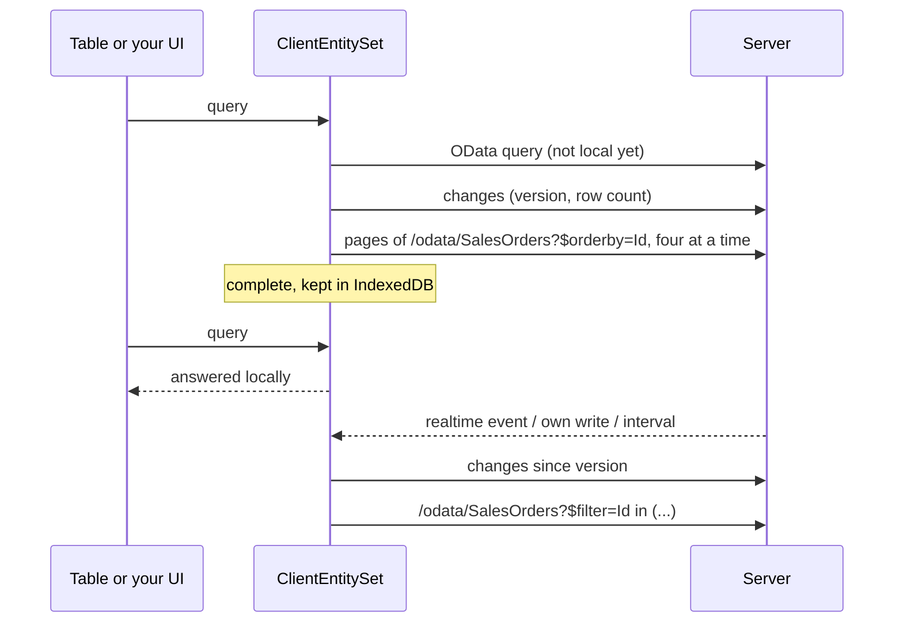

# Client entities

A client entity is an [OData set](../web/odata.md) the browser keeps a copy of. While the copy downloads, every query still goes to the server; as soon as it is complete, filtering, search, sorting, grouping, paging and facets run in the browser without a round trip. Changes on the server flow in as small deltas.

**Why**: list data that users filter all day (orders, customers, articles, tickets) answers at once, the server sees one download per user instead of a query per click, and the table keeps working while the API is slow. **When not**: sets with millions of rows, rows a user must not keep on the device, data that changes every second.

The template shows it with 100,000 sales orders (*Sales → Sales Orders*). This page walks through that sample step by step.



## Step 1: entity and OData set

Every entity with a `Guid` key that is an OData set can become a client entity. `IAuditable` (from `AuditedEntity`) lets the client fetch only what changed; `[Realtime]` brings the changes of other users at once.

```csharp title="MyApp.Sales/Domain/SalesOrder.cs"
[Realtime(SalesPermissions.Orders.View)]
[ClientEntity]
public sealed class SalesOrder : AuditedEntity, IMultiTenant
{
    public required string Number { get; set; }

    [ProvideFacet(Label = "Customer", ValuePath = "CustomerId", LabelPath = "Customer.Name", ValueType = typeof(Guid), Order = 3)]
    public Guid CustomerId { get; set; }

    public Customer? Customer { get; set; }

    [ProvideFacet(Label = "Status", Order = 0)]
    public SalesOrderStatus Status { get; set; }

    [ProvideFacet(Label = "Order date", Type = FacetType.DateRange, Order = 4)]
    public DateTimeOffset OrderDate { get; set; }

    public decimal Total { get; set; }

    public Guid TenantId { get; set; }
    // Channel, Region, Items …
}
```

```csharp title="MyApp.Sales/SalesModule.cs"
services.AddODataEntity<SalesOrder>("SalesOrders", SalesPermissions.Orders.View);
services.AddODataEntity<Customer>("Customers", SalesPermissions.Orders.View);
```

`[ClientEntity]` is all the server needs. The rows travel through the OData set itself, so its permission, the tenant and soft delete filters, `IODataEntityFilter` row filters and hidden properties apply to the copy exactly as to every query.

## Step 2: settings (optional)

Each set starts from the defaults, then the attribute, then the options, then its application service apply:

| Setting | Default | |
|---|---|---|
| `BatchSize` | 1000 | rows per download page, at most `Coworkee:OData:MaxTop`; the client loads four pages at a time |
| `MaxRows` | 50 000 | larger sets stay on the server; `[ClientEntity(MaxRows = …)]` sets it per entity |
| `RefreshInterval` | 5 minutes | how often clients ask for changes |
| `Enabled` | `true` | `false` keeps an attributed entity on the server |

=== "Options"

    ```csharp
    services.AddCoworkeeClientEntities(o =>
    {
        o.Default.MaxRows = 20_000;
        o.For<Product>(s => s.RefreshInterval = TimeSpan.FromMinutes(1));   // mirrored without the attribute
        o.For<Brand>(s => s.Enabled = false);                               // an attributed entity switched off
    });
    ```

    The defaults can also come from configuration (`Coworkee:ClientEntities:Default`).

=== "Per application service"

    An [application service](../web/application-services.md) can name the entity it writes and carry the settings of its set. The template raises the limit this way, because 100,000 orders are more than the default 50,000:

    ```csharp title="MyApp.Sales/SalesModule.cs"
    services.Configure<ApplicationServiceOptions>(options => options.Configure<ISalesOrderAppService>(service =>
        service.ClientEntity<SalesOrder>(settings => settings.MaxRows = 250_000)));
    ```

    `ClientEntity<TEntity>()` alone mirrors the set like `o.For<TEntity>()`; its settings apply last. There is no attribute for the service interface on purpose: the interface lives in the contracts, which do not know the entity.

## Step 3: the client, one line

Add the package `Coworkee.Client.Blazor.ClientEntities` to the WebAssembly project and register it after `AddCoworkeeClient`:

```csharp title="MyApp.Web.Client/Program.cs"
builder.Services.AddCoworkeeClient(baseAddress, ...);
builder.Services.AddCoworkeeClientEntities();
```

From now on every `CoworkeeDataTable` and `ODataPicker` asks the local copy of a mirrored set as soon as it is complete. The page of the template is an ordinary data table; only the indicator is new:

```razor title="MyApp.Web.Client/Pages/Sales/SalesOrders.razor"
<CoworkeeDataTable @ref="_table" T="SalesOrderDto" EntitySet="SalesOrders" Expand="Customer" SearchFields="SearchFields" ...>
    <ToolBarContent>
        <ClientEntityIndicator EntitySet="SalesOrders" DataChanged="() => _table.ReloadAsync()" />
    </ToolBarContent>
    <Columns>
        <PropertyColumn Property="o => o.Number" />
        <PropertyColumn Property="o => o.Customer!.Name" />
        ...
    </Columns>
</CoworkeeDataTable>
```

`ClientEntityIndicator` shows a progress ring while the rows load, then whether queries run locally or on the server, and calls `DataChanged` when the local rows changed. The **Compare** button next to it in the template runs the current filter once on the server and once in the browser and shows both times.

The copy refreshes

- right after this client saved something (any successful `POST`, `PUT`, `PATCH` or `DELETE` through an `HttpClient` of the app, the generated proxies of application services included),
- when the entity has `[Realtime]` and someone else changed it,
- every `RefreshInterval`.

Signing out removes all copies from the browser storage. A set the user may no longer read (the server answers 403 or 404) drops its copy at the next refresh.

## Step 4: writes

A client entity is a read-only copy; writes go to the server as before. In the template they go through `ISalesOrderAppService` (see [Application services](../web/application-services.md)), whose generated client the page injects:

```csharp title="MyApp.Web.Client/Pages/Sales/SalesOrders.razor.cs"
[Inject] private ISalesOrderAppService Orders { get; set; } = null!;

private Task CancelAsync(SalesOrderDto order) => Snackbar.RunAsync(() => Orders.CancelAsync(order.Id));
```

The `POST` succeeds, the copy asks for the changes since its version, fetches the changed order by id and the table reloads.

## Step 5: your own UI

`ClientEntities.SetAsync<T>` gives you the copy of a set. It is `null` when the server does not offer the set to this user.

```csharp
[Inject] private ClientEntities Entities { get; set; } = null!;

var orders = await Entities.SetAsync<SalesOrderDto>("SalesOrders", expand: "Customer");
var top = await orders!.QueryAsync(q => q.Where(o => o.Status == SalesOrderStatus.Open).OrderByDescending(o => o.Total).Take(10));
```

| Member | |
|---|---|
| `QueryAsync(ODataQuery)` | an OData query: local once complete, the server until then and for what it cannot answer locally |
| `QueryAsync(q => q.Where(…))` | LINQ over the local rows; waits until they are here |
| `Items`, `Query()` | the local rows as list and `IQueryable` (empty until complete) |
| `Status`, `Changed` | state, progress (`Loaded` of `Total`), version and a `Revision` that grows with every change of the rows |
| `WhenLocalAsync()` | completes when the rows are local, fails for sets that stay on the server |
| `RefreshAsync()` | ask for changes now |

The OData client that bypasses the copies is registered under a key, for example to compare:

```csharp
[Inject(Key = ClientEntitiesServiceCollectionExtensions.ServerKey)] private IODataClient Server { get; set; } = null!;
```

A [QuickGrid](https://learn.microsoft.com/aspnet/core/blazor/components/quickgrid) works on the local rows directly:

```razor
<QuickGrid Items="_orders?.Query().Where(o => o.Region == "Nord")">
    <PropertyColumn Property="o => o.Number" Sortable="true" />
</QuickGrid>
```

or through an items provider that also works while the copy downloads:

```csharp
private GridItemsProvider<SalesOrderDto> Provider => async request =>
{
    var page = await _orders!.QueryAsync(new ODataQuery { Filter = _filter, OrderBy = "Number", Skip = request.StartIndex, Top = request.Count }, request.CancellationToken);
    return GridItemsProviderResult.From([.. page.Items], (int)(page.Count ?? 0));
};
```

`ODataLinq.Filter<T>("contains(tolower(Number),'42')")` and `ODataLinq.OrderBy(rows, "Total desc")` turn OData text into LINQ for rows you hold yourself.

## What runs locally

The local copy understands what tables, facets and pickers send: `eq ne gt ge lt le and or not in`, arithmetic, `contains startswith endswith tolower toupper trim length year month day hour minute second`, paths like `Customer/Name` (null safe) and literals of every simple type, enums included. `$search`, lambda operators (`any`, `all`), an `$expand` the copy was not loaded with and every other function go to the server. Facets keep the server's groups and options; only their counts are computed locally.

## Performance

How it stays fast with six-digit row counts:

- **Download**: pages ordered by `Id`, four requests at a time, rows go straight into a dictionary by id. A delta fetches the changed rows by id, 50 per request.
- **Filter**: OData text is compiled once into a delegate and cached (up to 100 filters).
- **Sort**: typed keys and comparers without boxing per row; text compares ignoring case, like the server.
- **Paging, grouping, facets**: the last filtered and sorted result and its facet counts are kept, so the next page, a group change or the same query again only cuts a slice.
- **Facets**: the list options of one property are counted in a single pass.

Measured with 100,000 rows in the library's tests (`LargeSetTests`, .NET on a desktop CPU):

| | first query | next page |
|---|---|---|
| first page with facets | 30 ms | 0.3 ms |
| sorted by a text column | 90–105 ms | < 0.1 ms |
| sorted by two columns (customer, then total) | 52–57 ms | < 0.1 ms |
| search in three text columns (3,970 hits) | 14 ms | < 0.1 ms |
| two facets selected (15,084 hits) | 7 ms | < 0.1 ms |
| download of 100,000 rows without network | 320 ms | |

WebAssembly interprets most of this code, so the browser takes several times longer; the **Compare** button of the template shows the numbers on your machine. The server needs a round trip plus its database time for every click.

## Storage and limits

- The rows live in memory and, gzip compressed, in IndexedDB (`coworkee-client-entities`), keyed by the server's partition (user, tenant), the set and its expand. The next visit is local at once and only asks for changes. A changed row type discards the stored copy. Replace `IClientEntityStorage` to keep the copies elsewhere, or register `NoClientEntityStorage` to keep nothing between visits.
- Everything is plain .NET: no native SQLite, no `wasm-tools` workload, no extra files to serve. EF Core SQLite in WebAssembly needs the `wasm-tools` workload and a native relink in every consuming app and could not map positional record DTOs with nested objects; the in-memory copy keeps the setup to one line and is fast for the queries a table sends.
- Memory: every row is a .NET object in the browser tab. 100,000 orders with their customer take some tens of MB; keep `MaxRows` in proportion and expand only what you show.
- The download is as large as the JSON of the set; enable response compression in the API (or the BFF) when you mirror large sets.
- Changes come from `IAuditable` (`CreatedAt`, `ModifiedAt`), deletions from `ISoftDelete` (`DeletedAt`). When the row count after a delta differs from the server's, the client compares ids, so hard deletes and rows that are no longer visible disappear too. Entities without `IAuditable` are downloaded again at each refresh, and so is a set with more than `BatchSize × 10` changes since the last version.
- Clients mirror the rows a user may see, so a copy contains nothing an OData query would not return. It is not encrypted on the device; leave sets with sensitive data on the server.

## Endpoints

| Request | Answer |
|---|---|
| `GET /api/v1/client-entities` | the sets this user may mirror with their settings, and a partition key per user and tenant |
| `GET /api/v1/client-entities/{set}/changes?since=…` | new version, visible row count, changed and deleted ids |
| `GET /api/v1/client-entities/{set}/ids` | all visible ids, to find rows that vanished unseen |

## Files of the sample

| File | |
|---|---|
| `MyApp.Sales/Domain/SalesOrder.cs` | entity with `[ClientEntity]`, `[Realtime]` and facets |
| `MyApp.Sales/SalesModule.cs` | OData sets and the client entity settings of the service |
| `MyApp.Contracts/Sales/ISalesOrderAppService.cs` | the writes, see [Application services](../web/application-services.md) |
| `MyApp.Migrations/DemoSales.cs` | 100,000 orders generated by Postgres in one statement |
| `MyApp.Web.Client/Pages/Sales/SalesOrders.razor(.cs)` | table, indicator and the comparison of server and browser |
