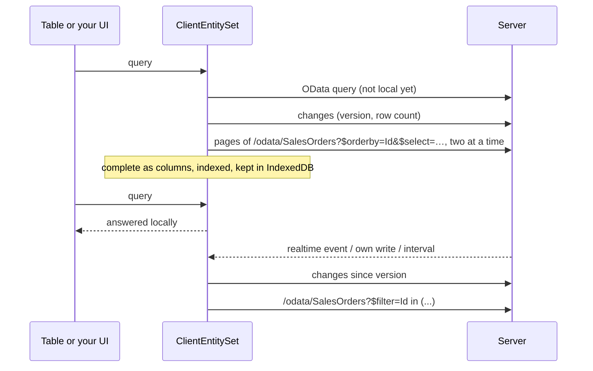

# Client entities

A client entity is an [OData set](../web/odata.md) the browser keeps a copy of. While the copy downloads, every query still goes to the server; as soon as it is complete, filtering, search, sorting, grouping, paging and facets run in the browser without a round trip. Changes on the server flow in as small deltas.

**Why**: list data that users filter all day (orders, customers, articles, tickets) answers at once, the server sees one download per user instead of a query per click, and the table keeps working while the API is slow. **When not**: sets with millions of rows, rows a user must not keep on the device, data that changes every second.

The template shows it with 100,000 sales orders (*Sales → Sales Orders*). This page walks through that sample step by step.



## Step 1: entity and OData set

Every entity with a `Guid` key that is an OData set can become a client entity. `IAuditable` (from `AuditedEntity`) lets the client fetch only what changed; `[Realtime]` brings the changes of other users at once.

```csharp title="MyApp.Sales/Domain/SalesOrder.cs"
[Realtime(SalesPermissions.Orders.View)]
[ClientEntity]
public sealed class SalesOrder : AuditedEntity, IMultiTenant
{
    public required string Number { get; set; }

    [ProvideFacet(Label = "Customer", ValuePath = "CustomerId", LabelPath = "Customer.Name", ValueType = typeof(Guid), Order = 3)]
    public Guid CustomerId { get; set; }

    public Customer? Customer { get; set; }

    [ProvideFacet(Label = "Status", Order = 0)]
    public SalesOrderStatus Status { get; set; }

    [ProvideFacet(Label = "Order date", Type = FacetType.DateRange, Order = 4)]
    public DateTimeOffset OrderDate { get; set; }

    public decimal Total { get; set; }

    public Guid TenantId { get; set; }
    // Channel, Region, Items …
}
```

```csharp title="MyApp.Sales/SalesModule.cs"
services.AddODataEntity<SalesOrder>("SalesOrders", SalesPermissions.Orders.View);
services.AddODataEntity<Customer>("Customers", SalesPermissions.Orders.View);
```

`[ClientEntity]` is all the server needs. The rows travel through the OData set itself, so its permission, the tenant and soft delete filters, `IODataEntityFilter` row filters and hidden properties apply to the copy exactly as to every query.

## Step 2: settings (optional)

Each set starts from the defaults, then the attribute, then the options, then its application service apply:

| Setting | Default | |
|---|---|---|
| `BatchSize` | 1000 | rows per download page, at most `Coworkee:OData:MaxTop`; the client loads two pages at a time |
| `MaxRows` | 50 000 | larger sets stay on the server; `[ClientEntity(MaxRows = …)]` sets it per entity |
| `RefreshInterval` | 5 minutes | how often clients ask for changes |
| `Enabled` | `true` | `false` keeps an attributed entity on the server |
| `ChangedAt` | none | date properties that tell when a row was created or changed, for entities without `IAuditable` (tables of an [external database](../fundamentals/persistence.md#external-databases)); without them such a set downloads completely on every refresh |

=== "Options"

    ```csharp
    services.AddCoworkeeClientEntities(o =>
    {
        o.Default.MaxRows = 20_000;
        o.For<Product>(s => s.RefreshInterval = TimeSpan.FromMinutes(1));   // mirrored without the attribute
        o.For<Brand>(s => s.Enabled = false);                               // an attributed entity switched off
    });
    ```

    The defaults can also come from configuration (`Coworkee:ClientEntities:Default`).

=== "Per application service"

    An [application service](../web/application-services.md) can name the entity it writes and carry the settings of its set. The template raises the limit this way, because 100,000 orders are more than the default 50,000:

    ```csharp title="MyApp.Sales/SalesModule.cs"
    services.Configure<ApplicationServiceOptions>(options => options.Configure<ISalesOrderAppService>(service =>
        service.ClientEntity<SalesOrder>(settings => settings.MaxRows = 250_000)));
    ```

    `ClientEntity<TEntity>()` alone mirrors the set like `o.For<TEntity>()`; its settings apply last. There is no attribute for the service interface on purpose: the interface lives in the contracts, which do not know the entity.

## Step 3: the client, one line

Add the package `Coworkee.Client.Blazor.ClientEntities` to the WebAssembly project and register it after `AddCoworkeeClient`:

```csharp title="MyApp.Web.Client/Program.cs"
builder.Services.AddCoworkeeClient(baseAddress, ...);
builder.Services.AddCoworkeeClientEntities();
```

From now on every `CoworkeeDataTable` and `ODataPicker` asks the local copy of a mirrored set as soon as it is complete. The page of the template is an ordinary data table, nothing on it is about client entities:

```razor title="MyApp.Web.Client/Pages/Sales/SalesOrders.razor"
<CoworkeeDataTable @ref="_table" T="SalesOrderDto" EntitySet="SalesOrders" Expand="Customer" SearchFields="SearchFields" ...>
    <Columns>
        <PropertyColumn Property="o => o.Number" />
        <PropertyColumn Property="o => o.Customer!.Name" />
        ...
    </Columns>
</CoworkeeDataTable>
```

### The switch in the table

Every table over a mirrored set gets one control in its tool bar (`ClientEntitySwitch`, added by `AddCoworkeeClientEntities`):

- **Icon**: a computer while searching runs in the browser, a cloud while it runs on the server.
- **Ring** around it: the download progress, turning while the copy updates, green when the copy is current, orange for a set too large to mirror, red when syncing failed. The tooltip says the same in words.
- **Menu**: *Search in the browser* (once the copy is complete), *Search on the server*, and *Compare and choose the faster*: the current query of the table (filter, search, facets, order, one page) runs three times on each side; a message shows the median times and whether both found the same number of rows, then the faster side is chosen.

The choice is kept per set in the user setting `Table.ClientEntityModes`, so it follows the user to every device. On the server side the copy keeps syncing, so switching back is instant. When the local rows change, the switch reloads its table. Code can choose as well: `ClientEntities.SetModeAsync("SalesOrders", ClientEntityMode.Server)`.

The copy refreshes

- right after this client saved something (any successful `POST`, `PUT`, `PATCH` or `DELETE` through an `HttpClient` of the app, the generated proxies of application services included),
- when the entity has `[Realtime]` and someone else changed it,
- every `RefreshInterval`.

Signing out removes all copies from the browser storage. A set the user may no longer read (the server answers 403 or 404) drops its copy at the next refresh.

## Step 4: writes

A client entity is a read-only copy; writes go to the server as before. In the template they go through `ISalesOrderAppService` (see [Application services](../web/application-services.md)), whose generated client the page injects:

```csharp title="MyApp.Web.Client/Pages/Sales/SalesOrders.razor.cs"
[Inject] private ISalesOrderAppService Orders { get; set; } = null!;

private Task CancelAsync(SalesOrderDto order) => Snackbar.RunAsync(() => Orders.CancelAsync(order.Id));
```

The `POST` succeeds, the copy asks for the changes since its version, fetches the changed order by id and the table reloads.

## Step 5: your own UI

`ClientEntities.SetAsync<T>` gives you the copy of a set. It is `null` when the server does not offer the set to this user.

```csharp
[Inject] private ClientEntities Entities { get; set; } = null!;

var orders = await Entities.SetAsync<SalesOrderDto>("SalesOrders", expand: "Customer");
var top = await orders!.QueryAsync(q => q.Where(o => o.Status == SalesOrderStatus.Open).OrderByDescending(o => o.Total).Take(10));
```

| Member | |
|---|---|
| `QueryAsync(ODataQuery)` | an OData query: local once complete, the server until then and for what it cannot answer locally |
| `QueryAsync(q => q.Where(…))` | LINQ over the local rows; waits until they are here |
| `Items`, `Query()` | the local rows as list and `IQueryable` (empty until complete); rows kept as columns become objects on first use, so prefer `QueryAsync(ODataQuery)` for large sets |
| `Status`, `Changed` | state, progress (`Loaded` of `Total`), version and a `Revision` that grows with every change of the rows |
| `WhenLocalAsync()` | completes when the rows are local, fails for sets that stay on the server |
| `RefreshAsync()` | ask for changes now |
| `Mode` | `Client` or `Server`: where OData queries run once the copy is complete (`ClientEntities.SetModeAsync` also keeps it for the user) |
| `MeasureAsync(query, side)` | runs a query on one side whatever the mode and returns the time and the row count |

The OData client that bypasses the copies is registered under a key, for example to compare:

```csharp
[Inject(Key = ClientEntitiesServiceCollectionExtensions.ServerKey)] private IODataClient Server { get; set; } = null!;
```

A [QuickGrid](https://learn.microsoft.com/aspnet/core/blazor/components/quickgrid) works on the local rows directly:

```razor
<QuickGrid Items="_orders?.Query().Where(o => o.Region == "Nord")">
    <PropertyColumn Property="o => o.Number" Sortable="true" />
</QuickGrid>
```

or through an items provider that also works while the copy downloads:

```csharp
private GridItemsProvider<SalesOrderDto> Provider => async request =>
{
    var page = await _orders!.QueryAsync(new ODataQuery { Filter = _filter, OrderBy = "Number", Skip = request.StartIndex, Top = request.Count }, request.CancellationToken);
    return GridItemsProviderResult.From([.. page.Items], (int)(page.Count ?? 0));
};
```

`ODataLinq.Filter<T>("contains(tolower(Number),'42')")` and `ODataLinq.OrderBy(rows, "Total desc")` turn OData text into LINQ for rows you hold yourself.

## What runs locally

The local copy understands what tables, facets and pickers send: `eq ne gt ge lt le and or not in`, arithmetic, `contains startswith endswith tolower toupper trim length year month day hour minute second`, paths like `Customer/Name` (null safe) and literals of every simple type, enums included. `$search`, lambda operators (`any`, `all`), an `$expand` the copy was not loaded with and every other function go to the server. Facets keep the server's groups and options; only their counts are computed locally.

## Performance

WebAssembly interprets .NET code, so per row work is expensive in the browser: parsing 35 MB of JSON takes over 15 seconds, sorting 100,000 texts close to a second. The local copy is therefore built like a small column store rather than a list of objects:

- **Columns**: every property path (`Number`, `Customer/Name`, …) is an array of values. Rows become objects only when they are shown, 25 per page.
- **Indexes**: after the copy arrived, each column sorts once in the background, one column at a time with a pause for the page in between. Rows then carry the rank of their value, like a database index.
- **Filters** run on the ranks: `Status eq 'Open'`, `(Total ge 5 and Total lt 10)`, `Options has 'Express'` or `contains(tolower(Number),'123')` are evaluated once per distinct value and become a mask over the rows. Comparisons keep a range of ranks; `contains` searches all distinct values of a column in one pass instead of one call per value. Only what is not a property compared with a literal (`length(Name) eq 4`) runs row by row.
- **Sorting** walks the index of the column; several columns combine their ranks into one number per row. A filter keeps that order, so filtered and sorted rows come out in one pass.
- **Facets** count ranks of the found rows: one pass per facet property, whatever the number of options. Value, range and flag options then add up the counts of the ranks they accept (ranges with prefix sums), so 35 month ranges over 100,000 distinct order dates cost no more than one value list.
- **Results** of the last 16 filter and sort combinations are kept: the next page, a group change or going back to an earlier filter cuts only a slice.
- **Storage**: columns and their sort orders are written as binary arrays (gzip) to IndexedDB. A reload reads them back in a few hundred milliseconds, column by column with pauses in between; until then the table asks the server, so it shows rows at once.
- **Download**: only the properties of the row type travel (`$select`, nested `$expand`), two pages at a time, read in one pass.

Measured in Chromium with the 100,000 orders of the template (Release build, local machine; the server answers from Postgres in the same machine):

| | before | now |
|---|---|---|
| first download until local | 36 s | 14.5 s |
| page reload: first rows visible | 20.6 s | 2.9 s |
| page reload: queries local | (after the 20 s) | 0.3 s after the first rows |

Query time only, *Compare and choose the faster* of the [switch](#the-switch-in-the-table) (median of three runs of the table's query with its facets and 25 rows, each with a condition that keeps either side from reusing a result). Measured on 2026-10-15 with the template's facets (status, channel, flags, region, customer, 35 order date months, 16 total ranges, items, paid):

| current filter | server | browser before | browser now |
|---|---|---|---|
| none | 216-236 ms | 1,035 ms | 39-56 ms |
| search "Hamburg" (3 text columns) | 638-661 ms | 516 ms | 152 ms |

"Before" is the release before 2026-10-15: option filters that are no plain value (`Options has 'Express'`, ranges) ran row by row on objects and their masks did not fit the cache of 64, so every new filter paid for all of them again.

Click on a column filter option until the table shows the result (Chromium, 2026-10-15):

| column | browser | server |
|---|---|---|
| Status, Channel, Region, Options, Paid, Total | 240-310 ms | 500-600 ms |
| Order date (month) | 369 ms | 527 ms |
| Number (contains) | 500-680 ms | 835-897 ms |

Click to rendered table, local copy with indexes (the table needs about 130 ms to render a page whatever answers):

| | while downloading (server) | local |
|---|---|---|
| sort by total | 600 ms | 165 ms |
| sort by customer | 584 ms | 135–163 ms |
| next page | 292 ms | 131–136 ms |
| search (after the 300 ms input delay) | 808 ms | 435–458 ms |
| clear the search | 938 ms | 286 ms |

The first sort on a column right after the very first download can take up to 1.5 s, while that column is still being indexed; after a reload the indexes come from the storage. Server numbers while downloading include the work the browser does for the download at the same time.

The library's tests (`LargeSetTests`, `LocalTableTests`) check the same with 100,000 rows in .NET.

## Storage and limits

- The rows live in memory as columns and, gzip compressed, in IndexedDB (`coworkee-client-entities`), keyed by the server's partition (user, tenant), the set and its expand. The next visit is local at once and only asks for changes. A changed row type discards the stored copy. Replace `IClientEntityStorage` to keep the copies elsewhere, or register `NoClientEntityStorage` to keep nothing between visits.
- Row types with properties of simple types (text, numbers, dates, `Guid`, enums, their nullable forms) and nested objects of such properties are kept as columns. Other row types (for example with lists) work too, but are kept as JSON, which is slower to restore, and filter row by row.
- Everything is plain .NET: no native SQLite, no `wasm-tools` workload, no extra files to serve.
- Memory: 100,000 orders take some tens of MB in the browser tab; keep `MaxRows` in proportion and expand only what you show.
- The first download of a large set takes a while (14.5 s for 100,000 rows) and keeps the browser busy; the table answers from the server meanwhile, slower than usual. Response compression in the API (or the BFF) helps on slow networks.
- Changes come from `IAuditable` (`CreatedAt`, `ModifiedAt`), deletions from `ISoftDelete` (`DeletedAt`). When the row count after a delta differs from the server's, the client compares ids, so hard deletes and rows that are no longer visible disappear too. Entities without `IAuditable` are downloaded again at each refresh, and so is a set with more than `BatchSize × 10` changes since the last version.
- Text sorts ignoring case with the culture of the browser; the server sorts with the collation of its database, so the order of special characters can differ.
- Clients mirror the rows a user may see, so a copy contains nothing an OData query would not return. It is not encrypted on the device; leave sets with sensitive data on the server.

## Endpoints

| Request | Answer |
|---|---|
| `GET /api/v1/client-entities` | the sets this user may mirror with their settings, and a partition key per user and tenant |
| `GET /api/v1/client-entities/{set}/changes?since=…` | new version, visible row count, changed and deleted ids |
| `GET /api/v1/client-entities/{set}/ids` | all visible ids, to find rows that vanished unseen |

## Files of the sample

| File | |
|---|---|
| `MyApp.Sales/Domain/SalesOrder.cs` | entity with `[ClientEntity]`, `[Realtime]` and facets |
| `MyApp.Sales/SalesModule.cs` | OData sets and the client entity settings of the service |
| `MyApp.Contracts/Sales/ISalesOrderAppService.cs` | the writes, see [Application services](../web/application-services.md) |
| `MyApp.Migrations/DemoSales.cs` | 100,000 orders generated by Postgres in one statement |
| `MyApp.Web.Client/Pages/Sales/SalesOrders.razor(.cs)` | the table; the switch comes with it |
