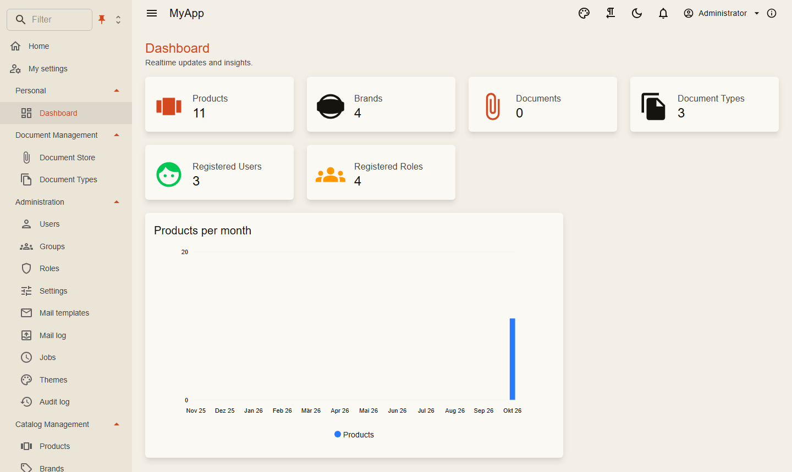
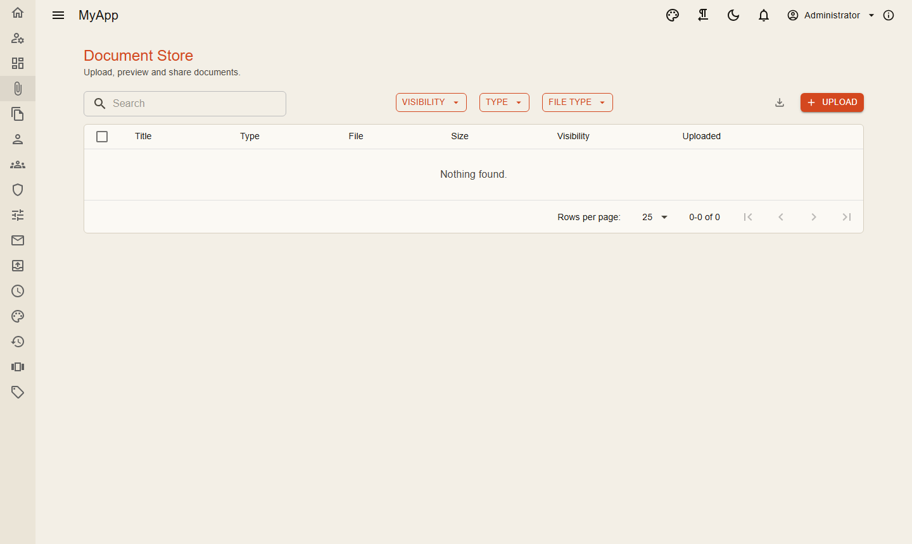
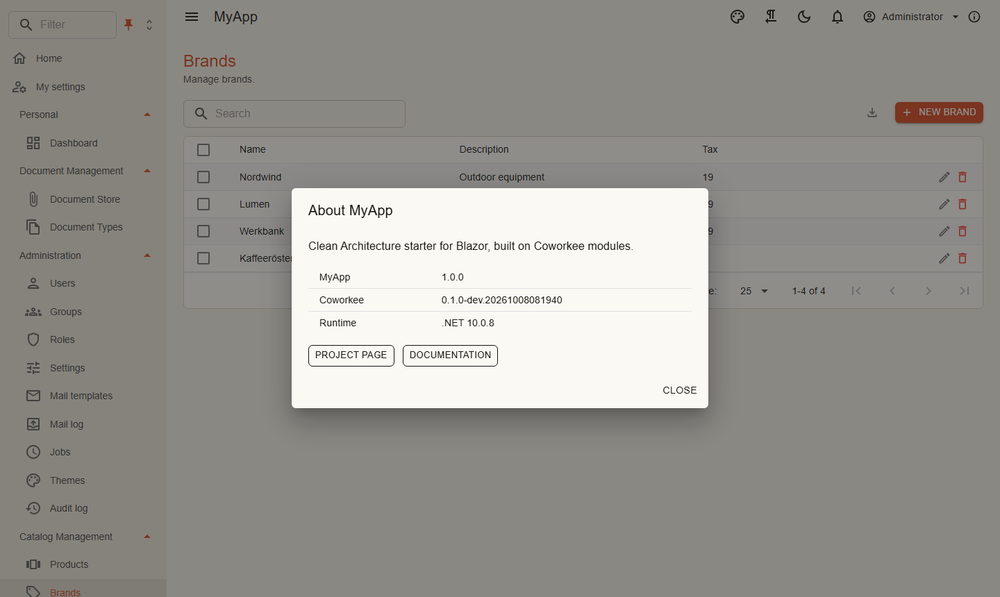
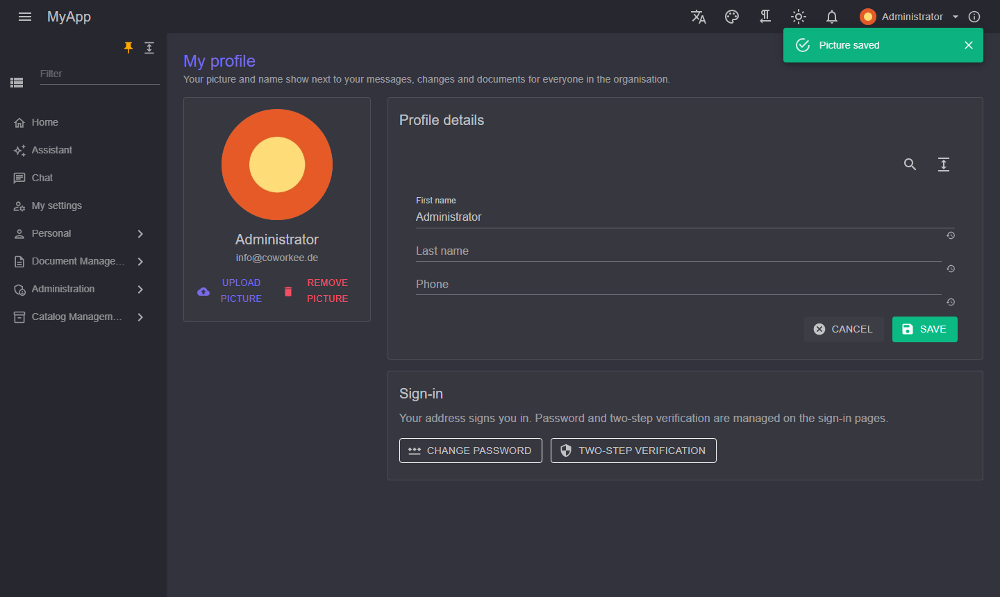

# Client und Layout

`Coworkee.Client.Blazor` ist eine vollständige WebAssembly-Shell: Layout, Navigation, Benutzermenü, Benachrichtigungen, Admin-Seiten für Benutzer, Gruppen, Rollen, Einstellungen, Dienste, Themes, Mail-Vorlagen und Audit-Log. Die App ergänzt ihre Seiten und Menüeinträge.

```csharp title="MyApp.Web.Client/Program.cs"
var builder = WebAssemblyHostBuilder.CreateDefault(args);
var baseAddress = new Uri(builder.HostEnvironment.BaseAddress);
builder.Services.AddCoworkeeClient(baseAddress, options =>
{
    options.AppTitle = "MyApp";
    options.AppDescription = "Modular business app for Blazor, built on Coworkee.";
    options.AboutLinks.Add(new AboutLink("Documentation", "https://fgilde.github.io/CoworkeeLib/"));
});
builder.Services.AddHttpClient<ICatalogApi, CatalogApi>(client => client.BaseAddress = baseAddress);
builder.Services.AddSingleton<INavigationContributor, MyAppNavigation>();
builder.Services.Configure<NavigationMenuOptions>(MyAppNavigation.Order);
var host = builder.Build();
await host.Services.InitializeCoworkeeClientAsync();
await host.RunAsync();
```

```razor title="Routes.razor"
@inject CoworkeeLocalizer L
<Router AppAssembly="typeof(Program).Assembly" AdditionalAssemblies="new[] { typeof(CoworkeeClientOptions).Assembly }">
    <Found Context="routeData">
        <AuthorizeRouteView RouteData="routeData" DefaultLayout="typeof(CoworkeeLayout)">
            <NotAuthorized><NotAllowed PageType="routeData.PageType" /></NotAuthorized>
        </AuthorizeRouteView>
    </Found>
    <NotFound>
        <LayoutView Layout="typeof(CoworkeeLayout)"><MudText>@L["Not found."]</MudText></LayoutView>
    </NotFound>
</Router>
```

{ .shot }

## Navigation

```csharp
internal sealed class MyAppNavigation : INavigationContributor
{
    private const string CatalogManagement = "Catalog Management";

    public static void Order(NavigationMenuOptions menu) => menu
        .OrderGroup("Personal", 0)
        .OrderGroup(NavigationGroups.Administration, 2)
        .OrderGroup(CatalogManagement, 3);

    public IEnumerable<CoworkeeNavItem> Items =>
    [
        new("Dashboard", "/dashboard", Icons.Material.Outlined.Dashboard, CatalogPermissions.Dashboards.View, Group: "Personal"),
        new("Products", "/catalog/products", Icons.Material.Outlined.ViewCarousel, CatalogPermissions.Products.View, Group: CatalogManagement),
        new("Brands", "/catalog/brands", Icons.Material.Outlined.Sell, CatalogPermissions.Brands.View, Group: CatalogManagement, Order: 1),
    ];
}
```

| `NavigationMenuOptions` | |
|---|---|
| `OrderGroup(name, order)` | Position einer Gruppe; unbekannte Gruppen kommen zuletzt, nach Namen |
| `Hide(hrefs)` | entfernt Einträge, auch die eingebauten Admin-Seiten |
| `ShowHome`, `HomeTitle` | der Startseiten-Link oben |
| `IconForGroup(name, icon)` | das Symbol eines Gruppenknotens |
| `Place(href, group, title?, order?)` | verschiebt einen Link der Bibliothek in eine andere Gruppe; ein Gruppenpfad wie `Administration/Localization` verschachtelt |

Die Admin-Seiten der Bibliothek liegen in Gruppen unter **Administration**: `NavigationGroups.Identity` (Benutzer, Gruppen, Rollen, Anwendungen, Scopes), `NavigationGroups.System` (Einstellungen, Mail-Einstellungen, Dienste, Mandanten, Editionen, Sicherungen), `NavigationGroups.Communication` (Mail-Vorlagen, Mail-Log), `NavigationGroups.Localization` (Sprachen, Übersetzungen) `NavigationGroups.Monitoring` (Audit-Log, KI-Werkzeugaufrufe) und `NavigationGroups.UserInterface` (Themes, Kopfzeile). Verschachtelte Gruppen sortieren sich innerhalb ihrer obersten Gruppe, die ihren Platz aus `OrderGroup` behält.

Das Menü ist ein `MudExTreeView`: Gruppen sind Knoten, das Filterfeld hebt Treffer hervor und öffnet ihre Gruppen, und die Ansicht wechselt zwischen Baum, Liste und flacher Liste. Angeheftet bleibt die Leiste als Symbolstreifen unter der App-Leiste, der Menüknopf verbreitert sie; nicht angeheftet öffnet sie sich als Überlagerung und verschwindet wieder. Ob eine oder mehrere Gruppen offen bleiben, ist ein zweiter Schalter. Beides speichert der Browser.

Einträge mit `HostOnly: true` dienen der ganzen Installation und erscheinen nur Benutzern der Systemorganisation; die Bibliothek markiert so Mandanten, Editionen, Anwendungen, Scopes, Dienste und Sicherungen, und die Einstellungsseite zeigt ihre typisierten Reiter und den Reiter System nur dort. Die Organisation kennt der Client aus `/bff/user` (`SystemTenant`, aus dem Claim `system_tenant` des Auth-Servers); Anmeldungen von vor diesem Claim zeigen alles wie bisher.

Für reine Oberflächenfälle entscheidet ein Eintrag selbst: `Visible: sp => sp.GetRequiredService<MyTips>().HasAnyAsync()` blendet ihn aus, wenn der Callback false liefert. Menü und Befehlspalette fragen ihn bei jedem Aufbau (nach der Anmeldung, nach Rechte- und Feature-Änderungen), halte ihn also billig und cache, was er lädt. Er blendet nur aus; muss der Server zustimmen, nimm eine [berechnete Berechtigung](../security/permissions.md#berechnete-berechtigungen).

{ .shot }

## App-Leiste

Die App-Leiste zeigt den Suchknopf der [Befehlspalette](command-palette.md) (Strg+K), Theme-Menü, Rechts-nach-links-Schalter, Dunkelmodus, Benachrichtigungen, Benutzermenü und den Info-Dialog; auf dem Smartphone teilen sich die Nebeneinträge ein Menü, siehe [Smartphones, installierbare App und Push](phones-and-pwa.md). Eigene Komponenten kommen so dazu:

```csharp
internal sealed class LanguageBar : IAppBarContributor
{
    public IEnumerable<AppBarItem> Items => [new AppBarItem(typeof(LanguageSwitch), Order: 10, Id: "language-switch", Title: "Language switch")];
}
```

App-Elemente stehen zwischen Suche und Sprachmenü, sortiert nach `Order`. `Id` ist der Schlüssel des Elements in der Kopfzeilen-Konfiguration (ohne Angabe der Typname der Komponente; stabil halten), `Title` sein Name auf der Admin-Seite.

### Verwaltete Kopfzeile

Unter *Administration → Benutzeroberfläche → Kopfzeile* (`/admin/header`, `Settings.Manage`, nur Systemorganisation) wählt ein Administrator zuerst den Fensterrand der App-Leiste (oben, rechts, unten oder links; links und rechts sind schmale Spalten aus Symbolen) und auf Wunsch eine zweite App-Leiste an einem anderen Rand; ein kleines Bild des Fensters zeigt das Ergebnis. Dann kommt jedes Element der Leisten, die der Bibliothek wie die der Apps, in eine Leiste, deren Überlaufmenü (⋮) oder nirgends hin: per Ziehen innerhalb und zwischen den Bereichen (*App-Leiste*, *Mehr-Menü der App-Leiste*, dasselbe für die zweite Leiste, *Ausgeblendet*) oder mit dem Menü jedes Elements (nach oben oder unten, in einen Bereich, *Sichtbar für…*; Tastatur). *Sichtbar für…* öffnet ein Blatt von rechts, in dem das Element auf Benutzer mit Berechtigungen beschränkt wird: bei mehreren ist wahlweise eine oder sind alle nötig. Ohne Berechtigungen sieht es jeder; die Beschränkung kommt zu den eigenen Regeln eines Elements hinzu (Benachrichtigungen und Assistent brauchen weiterhin einen angemeldeten Benutzer) und folgt Änderungen der Berechtigungen des Benutzers sofort. Das Benutzermenü bleibt immer in der Leiste und für alle sichtbar. *Auf Standard zurücksetzen* stellt die eingebaute Reihenfolge wieder her. Die Wahl ist die globale Einstellung `Header.Items`, eine JSON-Liste in Leistenreihenfolge:

```json
[{"id":"search","placement":"Bar"},{"id":"about","placement":"Overflow","permissions":["Settings.Manage","Audit.View"],"match":"All"},{"id":"rtl","placement":"Hidden"}]
```

`permissions` und `match` (`Any`, der Standard, oder `All`) sind optional; ohne sie gespeicherte Werte gelten weiter.

Die Ids der Bibliothek sind `search`, `language`, `theme`, `rtl`, `dark-mode`, `notifications`, `role`, `user`, `assistant` und `about`; `role` ist der Umschalter der [aktiven Rolle](../modules/realtime.md#aktive-rolle), sichtbar für Benutzer mit mehreren Rollen. Elemente, die die Liste nicht nennt (etwa eine später hinzugefügte App), erscheinen hinter dem Element, das in der Standardreihenfolge vor ihnen steht; Namen verschwundener Elemente werden ignoriert; ein ungültiger Wert ergibt die Standard-Kopfzeile. Gespeicherte Werte erreichen offene Seiten sofort. Ausgeblendet oder im Überlaufmenü behält die Suche Strg+K. Auf Smartphones gibt es eine Leiste oben: Sprache, Design, Schreibrichtung, Farbmodus und Info wandern weiterhin ins Überlaufmenü, die Elemente der zweiten Leiste ebenso. Die Ränder sind die globalen Einstellungen `Header.Position` und `Header.SecondPosition` (`Top`, `Bottom`, `Left`, `Right`; ohne zweite Position keine zweite Leiste), die Plätze in `Header.Items` heißen `Bar`, `Overflow`, `SecondBar`, `SecondOverflow` und `Hidden` (ohne zweite Leiste bleiben ihre Elemente in der ersten). Ohne Leiste quer oben oder mit der Theme-Option `NavBesideAppBar` trägt die Navigation Namen der App und Menüknopf in ihrem Kopf.

Dieselbe Seite legt fest, wo der [Assistent](../modules/ai.md#wo-der-assistent-erscheint) erscheint.

Das Benutzermenü enthält *Mein Profil*, *Meine Einstellungen*, *Passwort und Sicherheit* (die Kontoseiten des Auth-Servers), *App installieren*, solange der Browser es anbietet, und *Abmelden*. Solange jemand [als anderer Benutzer angemeldet](../features/identity.md#als-anderer-benutzer-anmelden) ist, zeigt die App-Leiste *Angemeldet durch …* und das Menü *Zurück zu meinem Konto*.

{ .shot }

## Dialoge

Jeder Dialog der Bibliothek holt seine Optionen (`DialogOptionsEx` von MudBlazor.Extensions) an einer Stelle, `DialogOptionsContributor`, nach Art (`DialogPart`):

| Teil | Für | Standard der Bibliothek |
|---|---|---|
| `SideSheet` | Bearbeitungsformulare (`ShowEditAsync`), `ShowSideSheetAsync`, Dateivorschau, Verlauf | volle Höhe, gleitet von der Seite herein, auf die geklickt wurde |
| `RightSheet` | Info-Dialog, Versionsverlauf, Mail-Vorschau | schmal, volle Höhe, gleitet von rechts herein |
| `Small` | Rückfragen (`ConfirmAsync`) und andere kleine zentrierte Dialoge | klappt herein |
| `Fullscreen` | Code-Editor | ganzer Bildschirm |
| `Progress` | Export-Fortschritt | nicht schließbar |
| `ListItem` | ein Listeneintrag in einem Einstellungsformular | in der Größe veränderbar, verschiebbar |

Eine App ändert Teile, indem sie vom Contributor ableitet und ihn registriert (die Vorlage bringt ein leeres `MyAppDialogOptions` mit):

```csharp
internal sealed class MyAppDialogOptions : DialogOptionsContributor
{
    public override DialogOptionsEx Small() => Perspective(base.Small());
    public override DialogOptionsEx Fullscreen() => Perspective(base.Fullscreen());
    public override DialogOptionsEx Progress() => Perspective(base.Progress());
    public override DialogOptionsEx ListItem() => Perspective(base.ListItem());

    private static DialogOptionsEx Perspective(DialogOptionsEx options)
    {
        options.Animations = [AnimationType.Perspective3d];
        return options;
    }
}

builder.Services.AddSingleton<DialogOptionsContributor, MyAppDialogOptions>();
```

Jede Methode liefert eine neue Instanz. Eigene Dialoge bekommen dieselben Optionen mit `EditDialogExtensions.Small()`, `RightSheet()`, `await SideSheetAsync()` oder `CoworkeeDialogOptions.For(DialogPart.X)`.

### Dialogoptionen für Administratoren

Mit `public override bool AdminEditable => true;` bekommt die Navigation *Administration → Benutzeroberfläche → Dialogoptionen* (`/admin/dialog-options`, `Settings.Manage`, nur Systemorganisation): ein Tab je Teil mit allen Optionen in einem Objekteditor, *Vorschau* öffnet einen Dialog damit, *Auf die Optionen der App zurücksetzen*. Gespeichert werden nur Teile, die von der App abweichen, in der globalen Einstellung `Dialogs.Options` (JSON je Teil, z. B. `{"Small":{"maxWidth":"Large"}}`); ein gespeicherter Teil ersetzt den Teil der App ganz, ein Side-Sheet öffnet sich trotzdem auf der geklickten Seite. Gespeicherte Werte erreichen offene Seiten sofort. Ohne `AdminEditable` (Standard) ist die Seite nicht gelistet und die Einstellung wird ignoriert.

## Head-Skript

Mit `AddCoworkeeHeadScript()` auf dem Server pflegen Administratoren ein Skript wie einen Tag-Manager in einer Einstellung ([Einstellungen](../modules/settings.md#head-skript)), und `CoworkeeLayout` setzt es in die Seite; der Client braucht nichts. Sobald die App gestartet ist (Theme und Client-Einstellungen geladen) und wenn `HeadScript.Enabled` an und `HeadScript.Value` nicht leer ist, übergibt das Layout das HTML einmal pro Seitenaufruf an `coworkee.js`:

- Inline-JavaScript (`<script>` ohne `src`, ohne Typ oder mit einem JavaScript-Typ) läuft per `eval` im globalen Gültigkeitsbereich; ein Fehler landet als Warnung in der Browserkonsole und hält die App nicht an,
- `<script src>` und Skripte anderer Typen werden neue Tags in `<head>` mit ihren Attributen (`async`, `id`, ...),
- `<noscript>` und `<iframe>` kommen ans Ende von `<body>`.

Eine Markierung (`<meta name="cw-head-script">`) begrenzt es auf ein Einfügen pro Seitenaufruf, ein geändertes Skript gilt also nach dem Neuladen. Seiten mit `?embed=1` bekommen es ebenfalls. Das Skript läuft, nachdem die App gerendert hat: Snippets, die sich auf `document.write` oder `document.currentScript` verlassen, funktionieren nicht.

**Content-Security-Policy**: die Richtlinie von `UseCoworkeeSecurityHeaders` erlaubt kein Inline-Skript, aber `'unsafe-eval'` (Blazors Bibliotheken brauchen es); deshalb läuft Inline-Code über `eval`. Ein Skript von einem anderen Host (`https://www.googletagmanager.com`) braucht diesen Host in `script-src`, und was es sendet oder anzeigt, braucht `connect-src`, `img-src` oder `frame-src`: `Coworkee:Bff:SecurityHeaders:Sources`, siehe [Sicherheits-Header der Web-App](../security/authentication.md#sicherheits-header-der-web-app). Eine eigene Richtlinie ohne `'unsafe-eval'` führt kein Inline-Head-Skript aus.

## Eingebettete Seiten

`?embed=1` an der ersten Adresse zeigt nur die Seite: ohne App-Leiste, Menü und Assistent, mit weniger Rand. Fenster eines anderen Clients nutzen das, etwa [Seiten der Web-App in AirWorks](../web/airworks.md#seiten-der-web-app-embedapp). Das Layout behält den Modus, während der Benutzer im Rahmen navigiert.

## Die eigene API aufrufen

Typisierte Clients erben von `ApiClientBase`. Sie senden den CSRF-Header, den der BFF verlangt, und machen aus Problem Details eine `ApiException`:

```csharp
internal sealed class CatalogApi(HttpClient http) : ApiClientBase(http), ICatalogApi
{
    public Task<DashboardDto> GetDashboardAsync(CancellationToken cancellationToken = default) => GetAsync<DashboardDto>("api/v1/dashboard", cancellationToken);

    public Task DeleteBrandsAsync(IReadOnlyList<Guid> ids, CancellationToken cancellationToken = default) =>
        SendAsync(HttpMethod.Post, "api/v1/brands/delete", new IdsRequest(ids), cancellationToken);
}
```

`Snackbar.RunAsync(() => api.SaveAsync(...), "Saved")` führt einen Aufruf aus und zeigt Erfolg oder die Validierungsmeldungen eines Fehlers.

## Aktueller Benutzer

`ClientUser.From(user)` liest den angemeldeten Benutzer aus einem `ClaimsPrincipal` (`IsAuthenticated`, `UserId`, `TenantId`, `Email`, `DisplayName`); mit dem kaskadierenden Authentifizierungszustand braucht eine Seite nicht mehr. Dienste und Seiten ohne ihn injizieren das scoped `CurrentUserInfo` (registriert von `AddCoworkeeClient`):

```csharp
var me = await currentUser.GetAsync();
if (me.UserId is { } userId) { ... }
currentUser.Changed += user => ...; // Anmeldung, Abmeldung, neu ausgestellte Rechte
```

Den Claim `sub` nicht selbst parsen.

## Personen

`UserAvatar` zeigt das Bild eines Benutzers oder seine Initialen mit dem Anwesenheitspunkt (`ShowPresence`), `UserCard` Bild und Name mit optionaler zweiter Zeile. Bei anderen Personen öffnet der Avatar ein Menü mit *Chat* und *Profil*, wenn der Benutzer chatten darf; setze `OfferChat="false"`, wo er in etwas sitzt, das auf Klicks reagiert. Beide laden gebündelt und aktualisieren sich für alle, sobald jemand Name oder Bild auf der Profilseite ändert (Realtime-Topic `tenant:users`).

{ .shot }

```razor
<UserCard UserId="entry.ActorId">@entry.CreatedAt.ToString("g")</UserCard>
<UserAvatar UserId="message.FromUserId" Size="Size.Small" ShowTooltip="true" />
```

## Kontoseite

`/profile` enthält die Tabs Profil (Bild, Name, Telefon, Adresse), Sicherheit, Benachrichtigungen, Einstellungen und Datenschutz (Schlüssel `security`, `notifications`, `settings`, `privacy`); `/profile/{key}` öffnet einen direkt. Mit einem `ProfileTab` fügst du eigene hinzu:

```csharp
builder.Services.AddSingleton(new ProfileTab("Documents", "documents", typeof(MyDocuments), DocumentPermissions.Documents.View));
```

## Bausteine

| Komponente | Zweck |
|---|---|
| `PageHeader` | Titel, Beschreibung, Aktionen rechts; setzt den Browsertitel. Übergib Textschlüssel (`Title="Brands"`), es übersetzt sie selbst; ebenso `CreateText` von `CoworkeeDataTable` |
| `StickyMergeTabs` | umschließt ein `<MudTabs>`: dessen Tab-Leiste klebt unter der App-Leiste und schrumpft auf die Breite der Tabs, sodass eine klebende `MudExObjectEditForm`-Toolbar im Panel daneben sichtbar wird; nicht auf schmalen Bildschirmen |
| `PermissionGate`, `PermissionView` | rendern Inhalt nur mit einer Berechtigung |
| `PermissionPicker` | wählt Berechtigungen aus, siehe unten |
| `FeatureGate` | rendert Inhalt nur, solange ein boolesches Feature an ist (`Disabled` für den anderen Fall) |
| `GroupScopePicker` | lässt Benutzer Listen auf einige ihrer Gruppen eingrenzen, siehe [Gruppenbaum und Geltungsbereich](../features/identity.md#gruppenbaum-und-geltungsbereich) |
| `RealtimeSubscription` | ruft zurück, wenn der Server auf einem Thema veröffentlicht, z. B. `type:Brand` |
| `EntityWatch` | hält eine Detailseite mit ihrem Eintrag gleich, geht zurück, wenn er gelöscht wird |
| `NotAllowed` | was der Router statt einer verbotenen Seite zeigt, mit Wechsel zu einer Rolle, die sie erlaubt |
| `ActiveRoleMenu` | das Kopfzeilen-Element `role`: die [aktive Rolle](../modules/realtime.md#aktive-rolle) (`Nested` im Überlaufmenü) |
| `CoworkeeDataTable<T>` | [Datentabellen](data-table.md) |
| `ShowEditAsync` | aus einem Modell erzeugter Bearbeitungsdialog |
| `AuditTimeline`, `VersionHistory` | Änderungshistorie einer Entity |
| `ResourcePermissionsPanel` | Berechtigungen auf einer einzelnen Ressource |

### Berechtigungsauswahl

`PermissionPicker` listet die Berechtigungsdefinitionen des Servers (`GetPermissionDefinitionsAsync`, dieselben wie auf der Rollenseite, eigene eingeschlossen) nach Gruppe mit ihren Anzeigenamen und einer Suche; die gewählten erscheinen als entfernbare Chips, nicht mehr vorhandene mit ihrem Namen. Mit `ShowMatch` und ab zwei gewählten fragt sie zusätzlich, ob eine oder alle nötig sind. `PermissionStore.HasAsync(permissions, match)` prüft eine solche Auswahl für den angemeldeten Benutzer.

```razor
<PermissionPicker @bind-Value="_permissions" ShowMatch="true" @bind-Match="_match" />

@code {
    private IReadOnlyList<string> _permissions = [];
    private PermissionMatch _match;
}
```