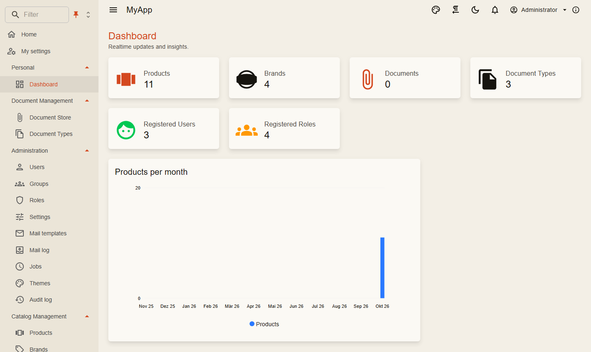
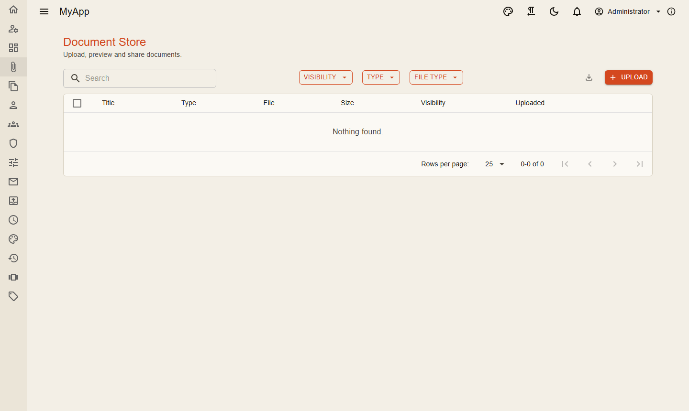
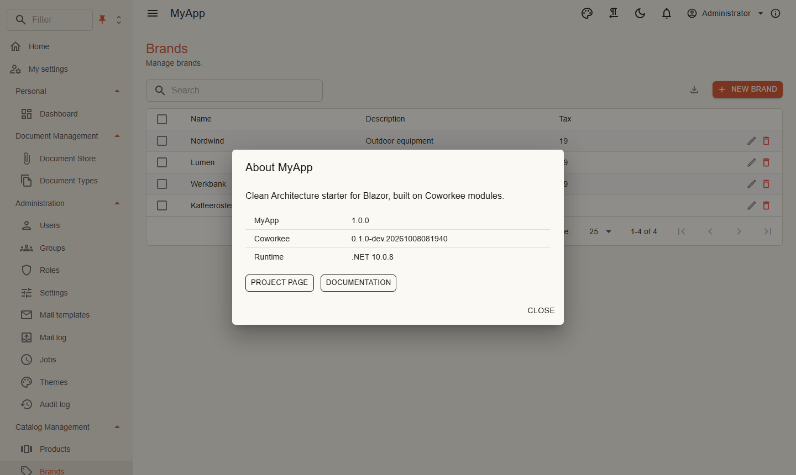
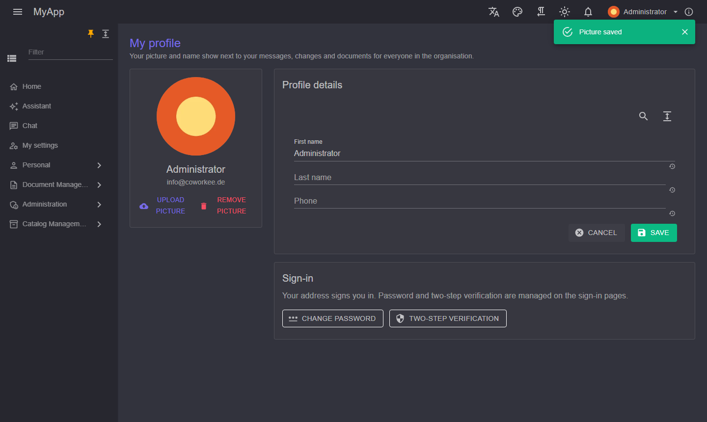

# Client and layout

`Coworkee.Client.Blazor` is a complete WebAssembly shell: layout, navigation, user menu, notifications, admin pages for users, groups, roles, settings, services, themes, mail templates and audit log. The app adds its pages and menu entries.

```csharp title="MyApp.Web.Client/Program.cs"
var builder = WebAssemblyHostBuilder.CreateDefault(args);
var baseAddress = new Uri(builder.HostEnvironment.BaseAddress);
builder.Services.AddCoworkeeClient(baseAddress, options =>
{
    options.AppTitle = "MyApp";
    options.AppDescription = "Clean Architecture starter for Blazor, built on Coworkee modules.";
    options.AboutLinks.Add(new AboutLink("Documentation", "https://fgilde.github.io/CoworkeeLib/"));
});
builder.Services.AddHttpClient<ICatalogApi, CatalogApi>(client => client.BaseAddress = baseAddress);
builder.Services.AddSingleton<INavigationContributor, MyAppNavigation>();
builder.Services.Configure<NavigationMenuOptions>(MyAppNavigation.Order);
var host = builder.Build();
await host.Services.InitializeCoworkeeClientAsync();
await host.RunAsync();
```

```razor title="Routes.razor"
@inject CoworkeeLocalizer L
<Router AppAssembly="typeof(Program).Assembly" AdditionalAssemblies="new[] { typeof(CoworkeeClientOptions).Assembly }">
    <Found Context="routeData">
        <AuthorizeRouteView RouteData="routeData" DefaultLayout="typeof(CoworkeeLayout)">
            <NotAuthorized><NotAllowed PageType="routeData.PageType" /></NotAuthorized>
        </AuthorizeRouteView>
    </Found>
    <NotFound>
        <LayoutView Layout="typeof(CoworkeeLayout)"><MudText>@L["Not found."]</MudText></LayoutView>
    </NotFound>
</Router>
```

{ .shot }

## Navigation

```csharp
internal sealed class MyAppNavigation : INavigationContributor
{
    private const string CatalogManagement = "Catalog Management";

    public static void Order(NavigationMenuOptions menu) => menu
        .OrderGroup("Personal", 0)
        .OrderGroup(NavigationGroups.Administration, 2)
        .OrderGroup(CatalogManagement, 3);

    public IEnumerable<CoworkeeNavItem> Items =>
    [
        new("Dashboard", "/dashboard", Icons.Material.Outlined.Dashboard, CatalogPermissions.Dashboards.View, Group: "Personal"),
        new("Products", "/catalog/products", Icons.Material.Outlined.ViewCarousel, CatalogPermissions.Products.View, Group: CatalogManagement),
        new("Brands", "/catalog/brands", Icons.Material.Outlined.Sell, CatalogPermissions.Brands.View, Group: CatalogManagement, Order: 1),
    ];
}
```

| `NavigationMenuOptions` | |
|---|---|
| `OrderGroup(name, order)` | position of a group; unknown groups come last, by name |
| `Hide(hrefs)` | removes entries, also the built-in admin pages |
| `ShowHome`, `HomeTitle` | the home link at the top |
| `IconForGroup(name, icon)` | the icon of a group node |
| `Place(href, group, title?, order?)` | moves a link of the library into another group; a group path like `Administration/Localization` nests |

The admin pages of the library sit in groups below **Administration**: `NavigationGroups.Identity` (users, groups, roles, applications, scopes), `NavigationGroups.System` (settings, mail settings, services, tenants, editions, themes, backups), `NavigationGroups.Communication` (mail templates, mail log), `NavigationGroups.Localization` (languages, translations) and `NavigationGroups.Monitoring` (audit log, AI tool calls). Nested groups sort within their top level group, which keeps the place `OrderGroup` gives it.

The menu is a `MudExTreeView`: groups are nodes, the filter box highlights matches and opens their groups, and the view can switch between tree, list and flat list. Pinned, the drawer stays as an icon strip under the app bar and the menu button widens it; unpinned, it opens as an overlay and hides again. Whether one group or several stay open is a second toggle. Both choices are stored in the browser.

Entries with `HostOnly: true` serve the whole installation and show only to users of the system organisation; the library marks Tenants, Editions, Applications, Scopes, Services and Backups that way, and the settings page shows its typed tabs and the System tab only there. The client knows the organisation from `/bff/user` (`SystemTenant`, from the `system_tenant` claim of the auth server); sign-ins from before that claim show everything as before.

For pure UI cases an entry can decide itself: `Visible: sp => sp.GetRequiredService<MyTips>().HasAnyAsync()` hides it when the callback answers false. The menu and the command palette ask it whenever they build (after sign-in, permission and feature changes), so keep it cheap and cache what it loads. It only hides; when the server must agree, use a [computed permission](../security/permissions.md#computed-permissions) instead.

{ .shot }

## App bar

The app bar shows the search button of the [command palette](command-palette.md) (Ctrl+K), the theme menu, right to left switch, dark mode, notifications, user menu and the about dialog; on phones the secondary entries share one menu, see [Phones, installable app and push](phones-and-pwa.md). Add your own components:

```csharp
internal sealed class LanguageBar : IAppBarContributor
{
    public IEnumerable<AppBarItem> Items => [new AppBarItem(typeof(LanguageSwitch), Order: 10)];
}
```

The user menu holds *My profile*, *My settings*, *Password and security* (the account pages of the auth server), *Install app* while the browser offers it, and *Sign out*. While someone is [signed in as another user](../features/identity.md#log-in-as-another-user), the app bar shows *Impersonated by …* and the menu *Back to my account*.

{ .shot }

## Head script

With `AddCoworkeeHeadScript()` on the server, administrators keep a script such as a tag manager in a setting ([Settings](../modules/settings.md#head-script)), and `CoworkeeLayout` puts it into the page; the client needs nothing. Once the app has started (theme and client settings loaded) and when `HeadScript.Enabled` is on and `HeadScript.Value` is not empty, the layout hands the HTML to `coworkee.js` once per page load:

- inline JavaScript (`<script>` without `src`, without a type or of a JavaScript type) runs in the global scope through `eval`; an error is written to the browser console as a warning and does not stop the app,
- `<script src>` and scripts of other types become new tags in `<head>` with their attributes (`async`, `id`, ...),
- `<noscript>` and `<iframe>` go to the end of `<body>`.

A marker (`<meta name="cw-head-script">`) keeps it to one injection per page load, so a changed script applies after a reload. Pages opened with `?embed=1` get it as well. The script runs after the app has rendered: snippets that rely on `document.write` or `document.currentScript` do not work.

**Content-Security-Policy**: the policy of `UseCoworkeeSecurityHeaders` allows no inline script, but `'unsafe-eval'` (Blazor's libraries need it), which is why inline code runs through `eval`. A script loaded from another host (`https://www.googletagmanager.com`) needs that host in `script-src`, and whatever it sends or shows needs `connect-src`, `img-src` or `frame-src`: `Coworkee:Bff:SecurityHeaders:Sources`, see [security headers of the web app](../security/authentication.md#security-headers-of-the-web-app). An own policy without `'unsafe-eval'` runs no inline head script.

## Embedded pages

`?embed=1` on the first address shows only the page: no app bar, menu or assistant, less padding. Windows of another client use it, for example [pages of the web app in AirWorks](../web/airworks.md#pages-of-the-web-app-embedapp). The layout keeps the mode while the user navigates inside the frame.

## Calling your API

Typed clients derive from `ApiClientBase`. It sends the CSRF header the BFF requires and turns problem details into `ApiException`:

```csharp
internal sealed class CatalogApi(HttpClient http) : ApiClientBase(http), ICatalogApi
{
    public Task<DashboardDto> GetDashboardAsync(CancellationToken cancellationToken = default) => GetAsync<DashboardDto>("api/v1/dashboard", cancellationToken);

    public Task DeleteBrandsAsync(IReadOnlyList<Guid> ids, CancellationToken cancellationToken = default) =>
        SendAsync(HttpMethod.Post, "api/v1/brands/delete", new IdsRequest(ids), cancellationToken);
}
```

`Snackbar.RunAsync(() => api.SaveAsync(...), "Saved")` runs a call and shows success or the validation messages of a failure.

## Current user

`ClientUser.From(user)` reads the signed-in user from a `ClaimsPrincipal` (`IsAuthenticated`, `UserId`, `TenantId`, `Email`, `DisplayName`); with the cascading authentication state that is all a page needs. Services and pages without it inject the scoped `CurrentUserInfo` (registered by `AddCoworkeeClient`):

```csharp
var me = await currentUser.GetAsync();
if (me.UserId is { } userId) { ... }
currentUser.Changed += user => ...; // sign-in, sign-out, permission reissue
```

Do not parse the `sub` claim yourself.

## People

`UserAvatar` shows a user's picture or initials with the presence dot (`ShowPresence`), `UserCard` picture and name with an optional second line. For other people the avatar opens a menu with *Chat* and *Profile* when the user may chat; set `OfferChat="false"` where it sits in something that reacts to clicks. Both load in batches and update for everyone the moment someone changes name or picture on the profile page (`tenant:users` realtime topic).

{ .shot }

```razor
<UserCard UserId="entry.ActorId">@entry.CreatedAt.ToString("g")</UserCard>
<UserAvatar UserId="message.FromUserId" Size="Size.Small" ShowTooltip="true" />
```

## Account page

`/profile` holds the tabs Profile (picture, name, phone, address), Security, Notifications, Settings and Privacy (keys `security`, `notifications`, `settings`, `privacy`); `/profile/{key}` opens one directly. Register a `ProfileTab` to add your own:

```csharp
builder.Services.AddSingleton(new ProfileTab("Documents", "documents", typeof(MyDocuments), DocumentPermissions.Documents.View));
```

## Building blocks

| Component | Use |
|---|---|
| `PageHeader` | title, description, actions on the right; sets the browser title. Pass text keys (`Title="Brands"`), it translates them itself; so does `CreateText` of `CoworkeeDataTable` |
| `StickyMergeTabs` | wraps a `<MudTabs>`: its tab bar sticks below the app bar and shrinks to its tabs, so a sticky `MudExObjectEditForm` toolbar in the panel shows next to it; not on narrow screens |
| `PermissionGate`, `PermissionView` | render content only with a permission |
| `FeatureGate` | renders content only while a bool feature is on (`Disabled` for the other case) |
| `GroupScopePicker` | lets users narrow lists to some of their groups, see [group tree and scope](../features/identity.md#group-tree-and-scope) |
| `RealtimeSubscription` | calls back when the server publishes on a topic, e.g. `type:Brand` |
| `EntityWatch` | keeps a detail page in step with its entry, goes back when it is deleted |
| `NotAllowed` | what the router shows instead of a forbidden page, with a switch to a role that grants it |
| `ActiveRoleMenu`, `ChatNotifier` | in the user menu: the [active role](../modules/realtime.md#active-role) and chat snackbars |
| `CoworkeeDataTable<T>` | [data tables](data-table.md) |
| `ShowEditAsync` | edit dialog generated from a model |
| `AuditTimeline`, `VersionHistory` | change history of an entity |
| `ResourcePermissionsPanel` | grants on a single resource |
