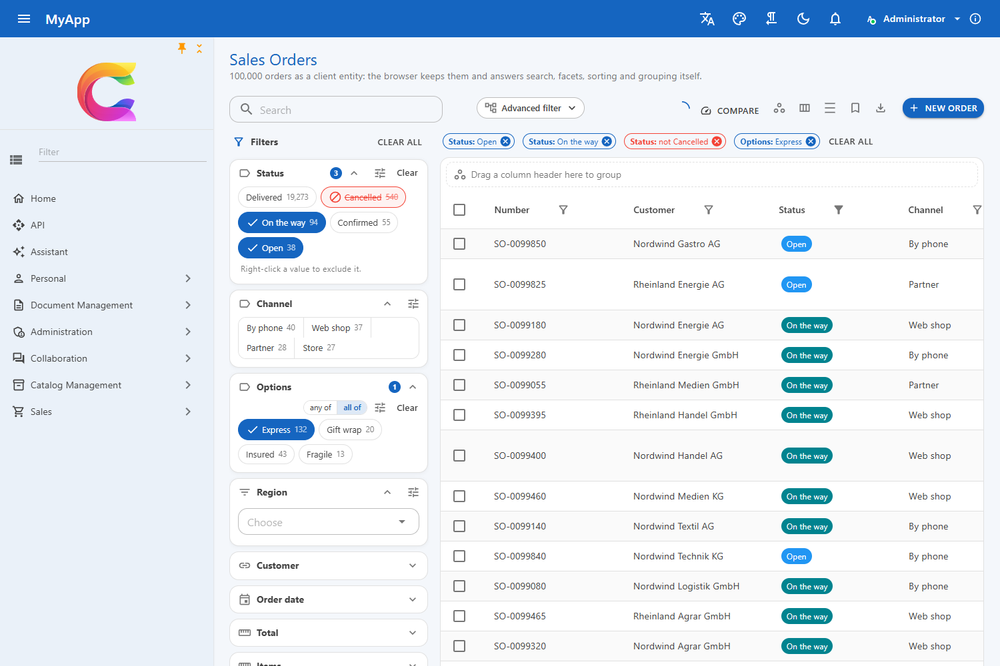
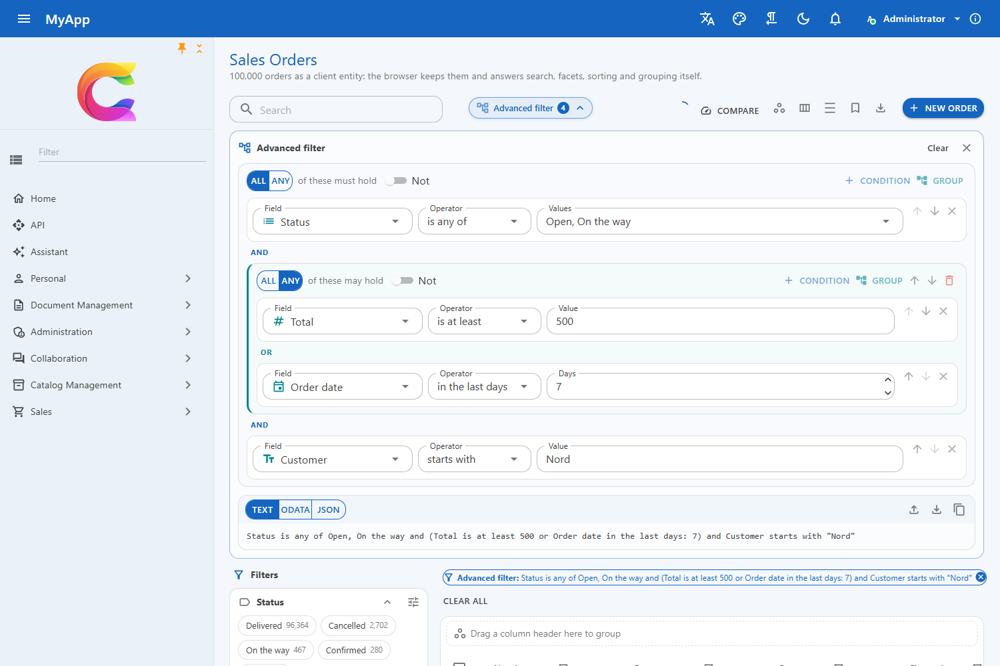
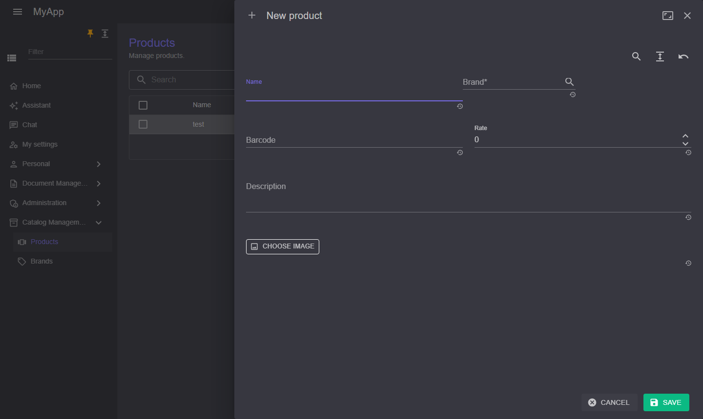

# Data tables

`CoworkeeDataTable<T>` is a MudBlazor data grid on top of an [OData set](../web/odata.md). The server pages, sorts, filters and counts; the table adds search, facets, export, selection and the create, edit and delete buttons with their permissions.

```razor
<CoworkeeDataTable T="ProductDto" EntitySet="Products" Expand="Brand" SearchFields="SearchFields" MultiSelection="true" ExportFileName="products"
                   CreatePermission="@CatalogPermissions.Products.Create" EditPermission="@CatalogPermissions.Products.Edit" DeletePermission="@CatalogPermissions.Products.Delete"
                   OnCreate="CreateAsync" OnEdit="EditAsync" OnDelete="DeleteAsync" DescribeItem="p => p.Name">
    <Columns>
        <PropertyColumn Property="p => p.Name" />
        <PropertyColumn Property="p => p.Brand!.Name" Title="Brand" />
        <PropertyColumn Property="p => p.Rate" Format="0.00" />
    </Columns>
</CoworkeeDataTable>
```

{ .shot }

| Parameter | |
|---|---|
| `EntitySet` | name of the OData set |
| `Columns` | MudBlazor columns; nested properties sort as `Brand/Name` |
| `Expand` | navigation properties to load, e.g. `"Brand"` |
| `Filter` | a fixed OData filter on top of the user's choices |
| `SearchFields` | properties the search box looks in (case insensitive `contains`) |
| `Facets` | show the facet menus (default `true`) |
| `MultiSelection` | check boxes and a *Delete n* button |
| `OnCreate`, `OnEdit`, `OnDelete` | callbacks; the table reloads after each of them |
| `CreatePermission`, `EditPermission`, `DeletePermission` | hide the buttons without the permission |
| `DescribeItem` | text for the delete confirmation |
| `Exportable`, `ExportFileName` | CSV and JSON export of all rows of the current filter |
| `ToolBarContent` | extra buttons in the tool bar |
| `PageSize` | rows per page (25) |
| `Groupable`, `ReorderableColumns`, `ResizableColumns`, `DensityToggle` | grouping, moving columns by drag and drop, resizing columns and the density button (all `true`) |
| `DataSource` | rows from somewhere else than the OData set, see below |
| `ColumnFilters` | a filter in every column header, see [column filters](#column-filters) (default `options.DataTable.ColumnFilters`, `true`) |
| `FacetLayout` | `Bar` (pills above the rows, default) or `Panel` (a side panel with every facet open), see [facets](#facets) |
| `FacetSettings` | the page's say per facet: view, *any of / all of*, exclusion, hiding |
| `AdvancedFilter` | the *Advanced filter* button with the [query builder](query-builder.md) (default `options.DataTable.AdvancedFilter`, `true`) |
| `QueryFields` | the fields of the query builder; by default the property columns and the reference facets |

The table reloads by itself when its `[Realtime]` entity changes (`RealtimeTopic`, see [Realtime](../modules/realtime.md#entity-changes)). `ReloadAsync()` reloads from outside, for example from a `RealtimeSubscription`. `Selection` exposes the facet choices, `CurrentFilter` the OData filter the table sends (fixed filter, facets, column filters and search).

For sets marked as [client entities](client-entities.md) the table filters, searches, sorts and counts in the browser once the rows arrived.

The CSV export escapes values that spreadsheet programs would run as formulas.

## Facets

Facets come from the server (`[ProvideFacet]` on the entity, see [OData and facets](../web/odata.md#facets)) with their values, counts and the OData filter of each value. The table shows each facet in a view that fits its values:

| View | for | default for |
|---|---|---|
| `Checkbox` | a list with counts, a search above long lists and *show more* | text and references |
| `Chips` | chips with counts | enums and flags with up to 8 values |
| `Select` | a dropdown, compact for long lists | |
| `Buttons` | a segmented row, *All* in front for a single choice | radio facets with up to 4 values |
| `Swatches` | colored dots, the color from `[FacetColor]`, a `color` meta value or the value itself | |
| `Tree` | values split at a separator ("image/png" below "image") | |
| `Toggle` | all, yes or no | `bool` |
| `Range` | a histogram over a slider with *from* and *to* fields | numbers with `FacetType.Range` |
| `Dates` | presets (today, this week, last 30 days, ...), a histogram of days, months or years and a custom range | dates |

{ .shot }

Enum values show their `[Display(Name)]`, else their `[Description]`, else the member name in words (`InTransit` reads *In transit*), translated like every other text. The URL, saved views and the OData filter keep the member name, so a new label never breaks a link.

### How values combine

| `FacetCombine` | meaning | OData |
|---|---|---|
| `Any` (default) | rows with any of the chosen values | `(Status eq 'Open' or Status eq 'Shipped')` |
| `All` | rows with all chosen values, for values that can hold together such as `[Flags]` enums | `(Options has 'Express' and Options has 'Insured')` |
| `Single` | one value at a time | `Color eq 'Red'` |

With `AllowExclude` a value can also be excluded: the &#8856; button in lists, a right click on chips. Excluded values join with `not`: `(Status eq 'Open' and not (Status eq 'Cancelled'))`. Groups always join with `and`.

Counts follow the other choices but leave a group's own choice out, the way shop filters do: after picking *Open*, *Shipped* still shows how many rows it would add. The table sends the choice apart from the rest of the filter in the `Coworkee-Facets` header; [client entities](client-entities.md) count the same way in the browser. *All of* groups count with their own choice, since every further value narrows.

### Configuring a facet

On the server, next to `[ProvideFacet]`:

```csharp
[ProvideFacet(Label = "Status")]
[FacetBehavior(View = FacetView.Chips, AllowExclude = true, Switchable = true)]
public SalesOrderStatus Status { get; set; }

[ProvideFacet(Label = "Options")]
[FacetBehavior(Combine = FacetCombine.All, Switchable = true)]
public SalesOrderOptions Options { get; set; }   // [Flags] enum: each flag is a value

[ProvideFacet(Label = "Total", Type = FacetType.Range)]
[FacetBehavior(Buckets = 16)]
public decimal Total { get; set; }
```

or without touching the entity:

```csharp
services.ConfigureFacet<SalesOrder>(o => o.Region, f => { f.View = FacetView.Select; f.AllowExclude = true; });
```

`Switchable` lets users switch between *any of* and *all of* (where values can hold together) and between the views that fit (the tune menu of a facet); their pick is part of saved views. Unset, `MultiSelect = false` on `[ProvideFacet]` means `Single` and `GroupOperator = And` means `All`.

The page has the last word:

```razor
<CoworkeeDataTable T="SalesOrderDto" EntitySet="SalesOrders" FacetLayout="FacetLayout.Panel" FacetSettings="FacetSettings" ...>

@code {
    private static readonly Dictionary<string, FacetSettings> FacetSettings = new()
    {
        ["region"] = new() { View = FacetView.Select, AllowExclude = true },
        ["customer"] = new() { Hidden = true },
    };
}
```

Keys are the facet keys: the property name in camel case (`orderDate`).

**Ranges**: number facets with `FacetType.Range` and date facets get their smallest and largest value and a histogram whose buckets are options with their own filter, so client entities recount them locally. The chosen range is one value, `(Total ge 40 and Total le 100)`. Date presets stay relative: a saved view with *last 7 days* means the last 7 days whenever it opens.

### Facets elsewhere

The facet components work without the table, e.g. beside a chart or in a report:

```razor
<FacetPanel Groups="_groups" Selection="_selection" />           @* or <FacetBar ... /> *@

@code {
    private readonly FacetSelection _selection = new();
    private IReadOnlyList<FacetGroupDto> _groups = [];

    protected override async Task OnInitializedAsync()
    {
        _selection.Changed += () => InvokeAsync(LoadAsync);
        await LoadAsync();
    }

    private async Task LoadAsync()
    {
        var page = await OData.QueryAsync<OrderDto>("SalesOrders", new ODataQuery
        {
            Filter = _selection.ToFilter(), Top = 0, Facets = true, FacetContext = _selection.Context(null, _groups),
        });
        _groups = page.Facets;
        StateHasChanged();
    }
}
```

`FacetGroupView` shows one group (render `FacetStyles` once), `FacetSelection` holds the choice and writes the OData filter (`ToFilter()`, `GroupFilter(key)`), `Facets.View(group)` and `Facets.Combine(group)` tell what a group shows and how it combines.

## Column filters

Like in QuickGrid every column can be filtered: the filter icon in the header (or *Filter* in the column menu) opens a small editor that fits the column's type. A filled icon shows that the column is filtered, and every filter appears as a chip above the table; its &times; removes it, *Clear all* removes filters and facets together.

| Column type | Editor | OData |
|---|---|---|
| text | *contains*, *starts with*, *equals* and a value | `contains(tolower(Name),'dri')`, `startswith(...)`, `Name eq 'Drill'` |
| numbers | *=*, *>*, *<*, *between* | `Rate gt 3`, `Rate ge 3 and Rate le 10` |
| dates | *is*, *after*, *before*, *between* (whole days) | `Added ge 2026-02-01T00:00:00+01:00 and Added lt ...` |
| enums, yes/no | check boxes, several are alternatives | `(Kind eq 'Hand' or Kind eq 'Power')` |
| a column with a facet | the facet's options with their counts | the facet's own filter |

**Facets and column filters are one thing.** When the set has a facet on the column's property, the column filter shows that facet's options and counts, and ticking one there or in the facet menu is the same choice (same chip, same URL). A column on a navigation property uses the facet of its key: `Brand.Name` uses a facet on `BrandId`.

The filters join the table's OData filter with `and`, so the server answers them, and so does the browser for [client entities](client-entities.md): they only use what both understand (`eq`, `ne`, `gt`, `ge`, `lt`, `le`, `and`, `or`, `not`, `contains`, `startswith`, `endswith`, `tolower`). They belong to the table's state: saved views, shared links and the address bar keep them.

### Turning them off and on

Column filters are on by default. Each level can change that:

```razor
@* the whole table *@
<CoworkeeDataTable T="ProductDto" EntitySet="Products" ColumnFilters="false" ...>
    <Columns>
        @* only this column, although the table has them off *@
        <PropertyColumn Property="p => p.Name" Filterable="true" />
        @* never this column *@
        <PropertyColumn Property="p => p.Description" Filterable="false" />
        @* only some operators *@
        <PropertyColumn Property="p => p.Barcode" FilterOperators="@(new() { FilterOperator.String.Equal })" />
    </Columns>
</CoworkeeDataTable>
```

Template columns have no property and are not filterable. For the whole app, per type:

```csharp
builder.Services.AddCoworkeeClient(new Uri(builder.HostEnvironment.BaseAddress), options =>
{
    options.DataTable.ColumnFilters = true;   // default of every table
    options.DataTable.FilterOperators<DateTime>(FilterOperator.DateTime.After, FilterOperator.DateTime.Before, DataTableFilters.Between);
    options.DataTable.FilterOperators<Guid>(); // no operators: Guid columns are not filterable
});
```

The order is: the column's `Filterable`/`FilterOperators`, then the options for the type, then the defaults above.

### Your own editor

`FilterTemplate` on a column replaces the editor. It gets MudBlazor's `FilterContext`; add filter definitions with the column and one of MudBlazor's `FilterOperator`s and the table turns them into OData:

```razor
<PropertyColumn Property="p => p.Rate" Title="Rate">
    <FilterTemplate>
        <MudButton OnClick="@(() => context.Actions.ApplyFilterAsync(new FilterDefinition<ProductDto>
            { Id = Guid.NewGuid(), Column = context.FilterDefinition!.Column, Operator = FilterOperator.Number.GreaterThanOrEqual, Value = 4m }))">
            Rate 4 and up
        </MudButton>
    </FilterTemplate>
</PropertyColumn>
```

`DataTableFilters.ToOData(...)` turns such conditions into OData text yourself, e.g. for an `ITableDataSource`.

**Limits**: one editor per column (two filters for *between*); the filter applies to the property of the column, not to what a `CellTemplate` shows. Dates are filtered by whole days in the browser's time zone.

## Advanced filter

*Advanced filter* opens the [query builder](query-builder.md) above the rows: nested *all / any* groups of conditions on every property column, with operators and value editors that fit the type (enum values as choices, dates with *today*, *this week* or *in the last n days*, lists for *is any of*). The table joins its OData with the other filters, shows it as a chip and keeps it in the URL, saved views and shared links.

{ .shot }

The fields are the property columns plus every reference facet that is no column (e.g. *Customer* as a choice of its facet values). `QueryFields` replaces them, for example to add a lookup that searches a referenced set:

```razor
<CoworkeeDataTable T="SalesOrderDto" EntitySet="SalesOrders" QueryFields="Fields" ...>

@code {
    private IReadOnlyList<QueryField> Fields => [
        new("Number", L["Number"], QueryFieldType.Text),
        new("Total", L["Total"], QueryFieldType.Number),
        new("CustomerId", L["Customer"], QueryFieldType.Guid) { Lookup = SearchCustomersAsync },
    ];
}
```

`Advanced` exposes the query (a `QueryGroup`); `options.DataTable.AdvancedFilter = false` hides the button in every table.

## Edit dialogs

For plain models a generated dialog is enough:

```csharp
if (await Dialogs.ShowEditAsync("Edit brand", model) is { } saved)
{
    await Snackbar.RunAsync(() => Api.SaveBrandAsync(id, saved), "Brand saved");
}
```

Edit dialogs are full height side sheets that slide in from the side the user clicked on, with two columns on wide screens.

{ .shot }
 Pass `meta => ...` to configure the `MudExObjectEditForm` (labels, order, editors). With a save function the dialog stays open and shows the messages of the API when saving fails:

```csharp
await Dialogs.ShowEditAsync(L["New product"], model, saved => Api.SaveProductAsync(id, saved), meta =>
{
    meta.Property(p => p.BrandId).WithLabel(L["Brand"])
        .RenderWith<ODataPicker, Guid>(p => p.Value)
        .WithAdditionalAttribute(nameof(ODataPicker.EntitySet), "Brands");
    meta.Property(p => p.ImageDataUrl).WithLabel(L["Image"]).RenderWith<ImageDataUrlEdit, string?>(p => p.Value);
});
```

| Editor | for |
|---|---|
| `ODataPicker` | a foreign key: searches an OData entity set by a text property |
| `ImageDataUrlEdit` | a picture kept as data URL |

`ShowSideSheetAsync<TDialog>` opens your own dialog component the same way, `ConfirmAsync` asks before something that cannot be undone.

## Columns, grouping and views

Everything the user arranges is part of the table's state and can be saved, shared and reset.

- **Columns**: the column menu shows and hides columns (with *All*, *None* and a search) and reorders them by drag and drop. Column headers can be dragged to another place too, and their right edge resizes the column.
- **Grouping**: drag a column header onto the zone above the headers, use *Group* in the column's own menu or tick columns in the group menu. Several columns group nested, in the order of the chips; a chip's &times; removes its level. Group rows show the value and the number of rows, open and close one by one or all at once, and show the aggregates of the columns (`AggregateDefinition`, e.g. an average) below each group.
- **Sorting**: click several headers to sort by more than one column.
- **Density**: the density button switches between compact and comfortable rows; without a choice the theme decides.
- **Views**: the bookmark menu saves the current state under a name: search, facets (with the views users picked), column filters, the advanced filter, column order, visibility and widths, grouping, sorting, page size and density. A click brings it back, the save button overwrites it with the current state, the star makes it the default that opens with the table. *Reset* returns to the declared columns without filters.
- **Sharing**: the link button copies an address that opens the table exactly as it is, layout included. The address bar itself keeps search, facets, column filters and the advanced filter (`?products=...`), so a filtered list can be reloaded and bookmarked. `UrlState="false"` turns that off, `StateKey` names the parameter when a page shows two tables of one set.

```razor
<CoworkeeDataTable T="ProductDto" EntitySet="Products" Expand="Brand" ...>
    <Columns>
        <PropertyColumn Property="p => p.Name" />
        <PropertyColumn Property="p => p.Brand!.Name" Title="Brand" />
        <PropertyColumn Property="p => p.Rate" Format="0.00" AggregateDefinition="AverageRate" />
    </Columns>
</CoworkeeDataTable>

@code {
    private static readonly AggregateDefinition<ProductDto> AverageRate = new() { Type = AggregateType.Avg, DisplayFormat = "Ø {value}", NumberFormat = "0.00" };
}
```

Columns are named by their property (`Brand.Name`), template columns by their `Title`; columns without either (select, actions) stay where they are. Template columns only group with `Groupable="true"` and a `GroupBy`.

**Grouping and paging**: the server pages, so a page groups the rows it holds. The table sorts by the grouping columns first, so a group continues on the next page instead of being scattered; group counts and aggregates cover the loaded page.

**Where views are kept**: in the user setting `Table.Views` of the [settings module](../modules/settings.md), so they follow the user to every device. Without a signed-in user or without the settings module they stay in the browser's local storage. Replace `ITableViewStore` in DI to keep them somewhere else:

```csharp
builder.Services.AddScoped<ITableViewStore, MyTableViews>();
```

`CurrentState` returns the state as a `DataTableState` (only what differs from the declared layout), e.g. to build your own links; `DataTableState.Encode()` gives the value for the query parameter.

## Other data sources

By default the table queries `EntitySet` through OData. `DataSource` takes any `ITableDataSource<T>` instead, for example rows kept in the browser:

```csharp
public sealed class LocalProducts(ProductStore store) : ITableDataSource<ProductDto>
{
    public Task<ODataPage<ProductDto>> QueryAsync(ODataQuery query, CancellationToken cancellationToken = default) =>
        Task.FromResult(store.Query(query));
}
```

The query carries the OData text the table builds (filter from search and facets, order, `Top`/`Skip`), so the source answers that subset. `EntitySet` still names the views and the URL parameter. CSV and JSON export use the source; Excel export and import stay with OData sets.
