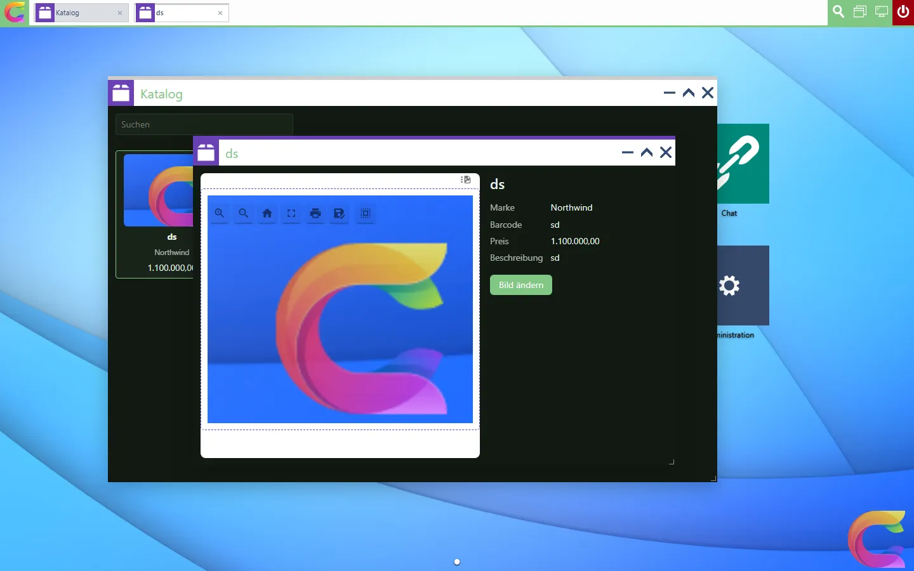
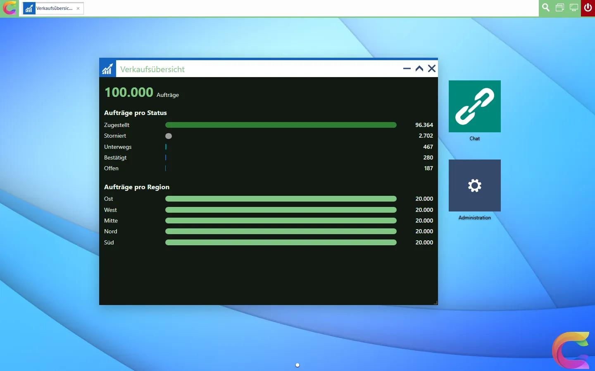

# AirWorks-Client

Eine Coworkee-App kann neben der Blazor-App einen zweiten Client haben: einen Web-Desktop auf Basis von [AirWorks](https://fgilde.github.io/AirWorks/de.html), mit Fenstern, Taskleiste, mehreren Desktops, Ordnern, Suche und Pop-outs. Er meldet sich über denselben Auth-Server an (und damit über denselben Keycloak-Realm), spricht mit derselben API, zeigt Logo und Theme der App und bringt fast alles mit, was die Blazor-App bietet: Einstellungen, Profil, Dateien mit Vorschau, Datentabellen, Chat, Berichte, den KI-Assistenten, Benachrichtigungen und die Administration (Benutzer, Gruppen, Rollen, Anwendungen, Scopes, API-Schlüssel, Themes, Sprachen, Übersetzungen, Mail-Vorlagen, Kampagnen, Empfängerlisten, Mail-Protokoll, Mail- und KI-Einstellungen, Backups, Mandanten, Editionen, Audit-Log). Die Bibliothek liefert die Apps als npm-Pakete; die App setzt sie zusammen und ergänzt eigene.

## Eine App damit erstellen

```bash
coworkee new Shop --airworks
```

In Coworkee Studio ist es die Karte *AirWorks-Client* unter *Allgemein*, mit einem Link zur AirWorks-Dokumentation. Die Solution bekommt das Projekt `Shop.AirWorks` und der AppHost eine Zeile:

```csharp
app.AddWeb<Projects.Shop_Web>();
app.AddAirWorks<Projects.Shop_AirWorks>();
```

Starten Sie den AppHost wie gewohnt und öffnen Sie *shop-airworks* aus dem Aspire-Dashboard. Zum Bauen braucht das Projekt Node.js 22.18 oder neuer: `dotnet build` führt `npm install` und `npm run build` in `ClientApp` aus (überspringen mit `-p:SkipClientBuild=true`). AirWorks selbst wird von GitHub installiert; `ClientApp/.npmrc` erlaubt diese Git-Abhängigkeit (`allow-git=root`), die npm ab Version 12 sonst ablehnt.

Die [Demo-App](https://github.com/fgilde/Coworkee/tree/master) hat einen solchen Client mit eigenen Apps; [Eine eigene AirWorks-App schreiben](#eine-eigene-airworks-app-schreiben) geht sie Schritt für Schritt durch.

## So meldet er sich an

`Shop.AirWorks` ist ein kleiner ASP.NET-Core-Host mit [Coworkee.Bff](../security/clients.md), genau wie der Web-Host der Blazor-App:

- `AddAirWorks` registriert ihn als zweiten Client am Auth-Server (`shop-airworks`, Redirect `/signin-oidc`, Scope `shop_api`) und richtet sein BFF auf die erste API aus.
- Die Anmeldung geht zum Auth-Server, der sein eigenes Formular und Keycloak anbietet, wie es der [Anmeldemodus](../security/authentication.md) vorgibt. Benutzer, Rollen und Berechtigungen sind die der Blazor-App.
- Die Tokens bleiben auf dem Server. Der Browser hält ein Sitzungs-Cookie namens `shop-airworks` (Browser senden Cookies an jeden Port von `localhost`, deshalb brauchen die beiden Clients verschiedene Namen) und schickt bei jeder Änderung `X-CSRF: 1` mit.
- `/api`, `/odata`, `/hubs`, `/openapi` und `/swagger` werden mit dem Access-Token an die API weitergeleitet; so läuft auch der Realtime-Hub über dieselbe Sitzung.

## Die Client-App

`ClientApp/src/main.ts` gehört der App:

```ts
import { adminApps, defaultApps, entityApp, useCoworkee } from '@coworkee/airworks';
import { AirWorks } from '@fgilde/airworks';
import '@fgilde/airworks/style.css';
import '@coworkee/airworks/style.css';
import logo from '../../../Shop.Web.Client/wwwroot/coworkee-icon.svg?url';

const coworkee = await useCoworkee(AirWorks, { title: 'Shop', logo });
await coworkee.register(
  ...defaultApps,
  ...adminApps,
  entityApp({ entitySet: 'Products', liveType: 'Product', icon: 'ratio-product.png', requiredPermissions: ['Catalog.Products.View'] }),
);
document.body.append(document.createElement('air-desktop'));
```

`useCoworkee` liest den Benutzer vom BFF, das Theme von `/api/v1/themes/current` (Farben des Farbmodus des Benutzers als CSS-Variablen `--cw-primary`, `--cw-surface`, `--cw-text`, ..., die Primärfarbe als Systemfarbe von AirWorks, das Logo des Themes oder das übergebene), die Client-Einstellungen und die Texte der Sprache des Benutzers, registriert Anmeldung und Berechtigungen (`/api/v1/identity/permissions/me`) bei AirWorks und konfiguriert es. Optionen von AirWorks selbst (Hintergründe, `initialShortcuts`, `initialApps`, ...) gehören in `airWorks: { ... }`.

### Apps für alle Benutzer (`defaultApps`)

| App | Id | Sichtbar, wenn |
|---|---|---|
| Profil: Name, Telefon, Kontoseiten, Abmelden | `coworkee.profile` | immer |
| Einstellungen: die des Benutzers, der Organisation und des Systems, aus den Einstellungsdefinitionen | `coworkee.settings` | immer; Organisation und System mit `Settings.Manage` |
| Dateien: Ordner, Hochladen (auch per Drag & Drop), Umbenennen, Löschen, Herunterladen | `coworkee.files` | `Files.View` |
| Dateivorschau mit der MudEx-Dateianzeige (PDF, Bilder, Office, Archive, Markdown, Audio, Video) | `coworkee.file-preview` | aus Dateien geöffnet |
| Daten: jedes OData-Entity-Set als blätterbare, sortierbare und durchsuchbare Tabelle | `coworkee.data` | die App hat OData |
| Chat: Personen der Organisation mit Anwesenheit und ungelesenen Nachrichten, Nachrichten kommen live an | `coworkee.chat` | `Chat.Use` und das Chat-Modul |
| Berichte: Liste, Favoriten, Duplizieren, Löschen, ein Bericht mit KPIs, Diagrammen und Tabellen und der Berichtsdesigner | `coworkee.reports`, `coworkee.report`, `coworkee.report-designer` | `Reports.View` und das Reporting-Modul |
| Assistent: Unterhaltungen, Antworten erscheinen beim Schreiben, Bestätigung von Tools, die Daten ändern | `coworkee.assistant` | `Ai.Chat` und das KI-Modul |
| Benachrichtigungen: lesen, als gelesen markieren, löschen; neue erscheinen zusätzlich als Hinweis | `coworkee.notifications` | die App hat das Notifications-Modul |
| API-Dokumentation (Swagger UI) | `coworkee.api-docs` | `ApiDocs.View` |
| `entityApp({ entitySet, ... })`: ein Entity-Set als eigene App; `liveType` lädt bei Änderungen neu | `coworkee.entity.{set}` | ihre `requiredPermissions` |

### Administration (`adminApps`)

Die Administrations-Apps bekommen keine eigene Desktop-Verknüpfung: Die App *Administration* listet sie gruppiert wie das Administrationsmenü der Web-App und erscheint nur, wenn der Benutzer mindestens eine davon öffnen darf. Jede braucht die Berechtigung ihrer Seite in der Blazor-App; Apps mit *System* erscheinen nur für Benutzer der System-Organisation, wie die Host-Seiten.

| Bereich | Apps (Berechtigung) |
|---|---|
| Identität | Benutzer (`Identity.Users.View`; bearbeiten, Rollen, Gruppen, Berechtigungen, Passwort, sperren, Reset-Mail, überall abmelden), Gruppen (`Identity.Groups.View`), Rollen mit ihren Berechtigungen (`Identity.Roles.View`), Anwendungen und Scopes (`Identity.Clients.Manage`, System), API-Schlüssel (`ApiKeys.Manage`) |
| System | Themes (`Themes.Manage`; neu aus einem eingebauten Theme, Paletten, Logo, CSS, Standard, Keycloak-Anmeldeseite), Backups, Dienste, Editionen, Mandanten mit ihren Features (System), KI-Einstellungen mit Verbindungstest (System) |
| Kommunikation | Mail-Vorlagen mit Live-Vorschau und Testmail (`Mail.Templates.Manage`), Mail-Kampagnen mit Empfängervorschau, Test, Planen und Abbrechen, Empfängerlisten (`Mail.Campaigns.Send`), Mail-Protokoll (`Mail.Log.View`), Mail-Einstellungen mit Verbindungstest (`Settings.Manage`) |
| Lokalisierung | Sprachen (ein-/ausschalten, Standard), Übersetzungen mit maschineller Übersetzung der fehlenden Texte (`Localization.Manage`) |
| Überwachung | Audit-Log mit den geänderten Feldern (`Audit.View`), KI-Tool-Aufrufe (`Ai.Audit`) |

Apps lassen Sie weg, indem Sie nur die gewünschten registrieren; ersetzen Sie eine, indem Sie nach `defaultApps` eine eigene App mit derselben Id registrieren. Eigene Apps sind normale AirWorks-Apps (siehe [AirWorks-Dokumentation](https://fgilde.github.io/AirWorks/de.html)); eine Factory bekommt das `coworkee`-Objekt mit dem typisierten API-Client, `request`, dem Realtime-Hub, der Übersetzungsfunktion `t`, dem Benutzer, dem Theme und `notify`:

```ts
const ordersApp = (coworkee: Coworkee): CoworkeeApp => ({
  id: 'shop.orders', title: coworkee.t('Orders'), icon: 'fn-planning.png', requiredPermissions: ['Orders.View'],
  render: async ({ host }) => {
    const orders = await coworkee.request<Order[]>('/api/v1/orders');
    host.innerHTML = `<div class="cw-app">${orders.length} orders</div>`;
  },
});
await coworkee.register(...defaultApps, ordersApp);
```

Listen mit Anlegen, Bearbeiten, Löschen und Zeilenaktionen sind ein Aufruf: `crudApp({ id, title, icon, permissions, load, columns, create, edit, remove, actions })` (die Administrations-Apps sind damit gebaut); `formDialog`, `confirmDialog` und `infoDialog` sind die Dialoge dazu.

### Icons

Als `icon` einer App gilt ein Name aus dem kleinen Icon-Satz von AirWorks (`fn-planning.png`, `ratio-product.png`, ...) oder eine Adresse. Wo dieser Satz nichts Passendes hat (Chat, Benachrichtigungen, Schlüssel, Übersetzungen, ...), liefert das Paket weiße Glyphen von [Material Symbols](https://fonts.google.com/icons) als `data:`-URLs, auf die Kachel zugeschnitten wie die AirWorks-Icons. Sie stehen auch eigenen Apps zur Verfügung (Lizenz der Glyphen: Apache 2.0):

```ts
import { icons } from '@coworkee/airworks';

const alertsApp = (coworkee: Coworkee): CoworkeeApp => ({
  id: 'shop.alerts', title: coworkee.t('Alerts'), icon: icons.notifications, accent: '#a3283d',
  render: ({ host }) => { host.textContent = 'No alerts'; },
});
```

Verfügbar sind `chat`, `sparkles`, `smartToy`, `notifications`, `dataObject`, `adminPanel`, `manageAccounts`, `groups`, `roles`, `apps`, `checklist`, `key`, `language`, `translate`, `backup`, `dns`, `domain`, `history`, `drafts`, `campaign`, `contactMail`, `receiptLong`, `mail`, `build`, `table`, `description` und `dashboardCustomize`.

### Realtime

`coworkee.realtime` verbindet sich beim ersten Abonnement mit dem Realtime-Hub der App (SignalR über das BFF) und abonniert nach einem Wiederverbinden alle gefolgten Topics erneut:

```ts
const stop = coworkee.realtime.subscribe('type:Order', ({ type, payload }) => reload());
```

Der Desktop selbst folgt dem Topic des Benutzers (neue Benachrichtigungen erscheinen als Hinweis, eine anderswo beendete Sitzung meldet ab) und den Berechtigungs-Topics (geänderte Rollen oder Rechte blenden Apps sofort ein und aus). Chat und Anwesenheit, die Benachrichtigungs-App und `entityApp({ liveType })` folgen ihren Topics, solange ihr Fenster offen ist.

### Berichtsdesigner

*Neuer Bericht* in Berichte und *Bearbeiten* in einem geöffneten Bericht (für alle, die ihn ändern dürfen, `Reports.Manage`) öffnen den Designer: die Widget-Palette der Web-App (KPI, Balken, horizontal, gestapelt, Linie, Fläche, Kreis, Ring, Streuung, Netz, Treemap, Heatmap, Tabelle, Datentabelle, Pivot, Text, Bild, Webseite), Widgets auf dem 12-Spalten-Raster (Titel ziehen zum Verschieben, Ecke zum Vergrößern), ein Seitenbereich je Widget mit Datenquelle, Gruppierung und Serien (mit Zeiteinheiten), Werten (Anzahl, Summe, Durchschnitt, Minimum, Maximum, Anzahl verschiedener), Spalten und Sortierung, Top, dem Datumsfeld für den Zeitraum des Berichts, einem OData-Filter und der Darstellung (Zahlenformat, Währung, Zielwert, Vergleich, Verlauf, Legende, Werte im Diagramm, Kreuzfilter, Tabellenansicht, Markdown-Text, Adresse von Bildern und Webseiten). Die Berichtseinstellungen enthalten Name, Beschreibung, Symbol, automatische Aktualisierung und Freigabe (nur ich, Rollen, Organisation; mit `Reports.Share`); Rückgängig und Wiederholen gelten für jede Änderung. Ansicht und Designer wenden den Zeitraum des Berichts auf jedes Widget mit Datumsfeld an.

### Auswahlfelder

Felder, die Benutzer oder Gruppen auswählen (Gruppenmitglieder, die Gruppen eines Benutzers, die Empfänger einer Mail-Kampagne), suchen auf dem Server und blättern durch die Ergebnisse (`type: 'lookup'` in `formDialog`, `userLookup`/`groupLookup`); so funktionieren sie mit beliebig vielen Benutzern.

### Dateivorschau

Die Dateivorschau nutzt die [Web-Komponenten von MudBlazor.Extensions](https://www.mudex.org) in einem eigenen Frame (`mudExFrame`): Die Seitenstyles von MudBlazor bleiben im Frame, Desktop und eigene Apps behalten ihre, und das Schließen des Fensters gibt die .NET-Laufzeit der Vorschau frei. Die Frame-Seite (`@coworkee/airworks/mudex-frame.html`) liegt auf dem Origin der App neben dem Bundle, die Komponente liest die Datei also mit dem Sitzungs-Cookie. Das Template hostet beides: `mudex-webcomponents` ist eine Dev-Abhängigkeit von `ClientApp`, der Vite-Build kopiert es und die Frame-Seite (als `coworkee-frame.html`) nach `wwwroot/mudex`, und der Host liefert die `.dat`-Dateien der .NET-Laufzeit aus. Anderswo übergeben Sie `mudExFrameUrl` an `useCoworkee`.

Der AirWorks-Desktop (Verknüpfungen, offene Fenster, Hintergrund) liegt je Browser im Local Storage, so wie AirWorks es vorsieht.

## Eine eigene AirWorks-App schreiben

Die [Demo-App](https://github.com/fgilde/Coworkee/tree/master) hat neben ihrer Blazor-App einen AirWorks-Client, [`src/MyApp.AirWorks`](https://github.com/fgilde/Coworkee/tree/master/src/MyApp.AirWorks), genau so eingerichtet, wie `--airworks` ihn erzeugt. Neben den Apps der Bibliothek bringt er drei von Hand geschriebene in [`ClientApp/src/apps`](https://github.com/fgilde/Coworkee/tree/master/src/MyApp.AirWorks/ClientApp/src/apps) mit, gebaut auf den Katalog- und Verkaufsdaten der Demo:

| Datei | App | Zeigt |
|---|---|---|
| [`catalog.ts`](https://github.com/fgilde/Coworkee/blob/master/src/MyApp.AirWorks/ClientApp/src/apps/catalog.ts) | *Katalog*: Produkte als Karten mit Bild, Marke und Preis | OData mit `odataPage`, Berechtigung, Desktop-Suche, eine andere App öffnen, Realtime-Aktualisierung |
| [`product.ts`](https://github.com/fgilde/Coworkee/blob/master/src/MyApp.AirWorks/ClientApp/src/apps/product.ts) | Produktfenster: Bild, Details, *Bild ändern* | den eigenen REST-Endpunkt der App, typisiert mit ihrem SDK, Intents, `coworkee.can`, eine MudEx-Web-Komponente, einen Schreibzugriff |
| [`sales-dashboard.ts`](https://github.com/fgilde/Coworkee/blob/master/src/MyApp.AirWorks/ClientApp/src/apps/sales-dashboard.ts) | *Verkaufsübersicht*: 100.000 Aufträge pro Status und Region | Zählen auf dem Server (Facetten), Realtime-Aktualisierung mit Pause |

{ .shot }

### 1. Die App schreiben

Eine App ist eine Funktion, die das `coworkee`-Objekt bekommt und eine AirWorks-App-Definition zurückgibt. Die Demo legt jede App in eine eigene Datei:

```ts
import { esc, type Coworkee, type CoworkeeApp } from '@coworkee/airworks';
import type { AppContext } from '@fgilde/airworks';

export const catalogApp = (coworkee: Coworkee): CoworkeeApp => ({
  id: 'myapp.catalog',
  title: coworkee.t('Catalog'),
  icon: 'ratio-product.png',
  accent: '#6a3fb5',
  width: 960,
  height: 640,
  requiredPermissions: ['Catalog.Products.View'],
  render: ({ host, intent, onIntent, onClose }: AppContext) => {
    host.classList.add('cw-host');
    host.innerHTML = `<div class="cw-app myapp-catalog">...</div>`;
    // ...
  },
});
```

`render` bekommt das Element des Fensters (`host`) und den Kontext des Fensters: `onClose` zum Aufräumen, `setTitle`, `intent`/`onIntent`/`setState` für Daten, die dem Fenster übergeben werden. Symbole sind Dateinamen aus dem Symbolsatz von AirWorks, den das Template unter `/icons/` ausliefert (`ratio-product.png`, `ratio-graph.png`, `fn-dashboard.png`, ...). Die Klassen `cw-host`, `cw-app`, `cw-toolbar`, `cw-muted` und `cw-error` geben der App das Aussehen der Bibliotheks-Apps; eigene Styles gehören in `ClientApp/src/styles.css` und nutzen die CSS-Variablen des Themes (`--cw-primary`, `--cw-surface`, `--cw-text`, ...).

### 2. Registrieren

In `ClientApp/src/main.ts` kommen die Apps nach denen der Bibliothek an `register`:

```ts
await coworkee.register(
  ...defaultApps,
  ...adminApps,
  catalogApp,
  productApp,
  salesDashboardApp,
  entityApp({ entitySet: 'Brands', liveType: 'Brand', icon: 'ratio-shoppingCart.png', requiredPermissions: ['Catalog.Brands.View'] }),
);
```

Jede sichtbare App bekommt eine Desktop-Verknüpfung; `hidden: true` hält eine aus dem Startmenü heraus (das Produktfenster, das sich nur mit einem Produkt öffnet).

### 3. Daten lesen

OData-Entity-Sets laufen über `odataPage` aus `@coworkee/client`; die Zeilen tragen die Eigenschaftsnamen der Entity:

```ts
import { odataPage, searchFilter } from '@coworkee/client';

type ProductRow = { Id: string; Name: string; Rate: number; ImageDataUrl?: string | null; Brand?: { Name: string } | null };

const loadProducts = (text: string, top: number) => odataPage<ProductRow>('Products', {
  select: ['Id', 'Name', 'Rate', 'ImageDataUrl'],
  expand: 'Brand($select=Name)',
  filter: searchFilter(['Name', 'Brand/Name'], text),
  orderBy: 'Name',
  top,
});
```

Eigene Endpunkte der App laufen über `coworkee.request`, das Sitzungs-Cookie und CSRF-Header über das BFF schickt. Die Demo typisiert sie mit den DTOs ihres generierten TypeScript-SDKs (`sdk/typescript`), nur als Typen importiert:

```ts
import type { components } from '../../../../../sdk/typescript/src/schema';

type Product = components['schemas']['ProductDto'];

const product = await coworkee.request<Product>(`/api/v1/products/${encodeURIComponent(id)}`);
```

Die Endpunkte der Bibliothek sind schon typisiert: `coworkee.api.GET('/api/v1/...')`.

### 4. Berechtigungen

`requiredPermissions` blendet eine App für Benutzer ohne diese Rechte aus: keine Verknüpfung, kein Eintrag im Startmenü, keine Suchtreffer. Ändert sich ein Recht, blendet der Desktop die App sofort ein oder aus. Teile einer App prüfen `coworkee.can`; die API prüft die Berechtigung bei jedem Aufruf noch einmal:

```ts
${coworkee.can('Catalog.Products.Edit')
  ? `<label class="myapp-upload"><span>${esc(t('Change image'))}</span><input type="file" accept="image/*" hidden/></label>` : ''}
```

Mit dem Demo-Benutzer ohne Rollen angemeldet, zeigt der Desktop weder *Katalog* noch *Verkaufsübersicht*.

### 5. Eine andere App mit Daten öffnen

Eine App öffnet eine andere mit einem Intent; die geöffnete App liest ihn in `render` und in `onIntent` (das Fenster ist schon offen) und hält ihn mit `setState` fest, damit er nach einem Neuladen wiederkommt:

```ts
// catalog.ts
const open = (id?: string) => id && coworkee.airWorks.openApp(productAppId, { id });

// product.ts
onIntent(show);
void show(intent);
// in show: setTitle(product.name); setState({ id: product.id }, product.name);
```

### 6. Desktop-Suche

`search` ergänzt die Suche des Desktops um Treffer; ein gewählter Treffer öffnet die App mit seinem Intent:

```ts
search: async (query) => (await loadProducts(query, 8)).items.map((product) => ({
  title: product.Name, description: product.Brand?.Name ?? '', icon: 'ratio-product.png', intent: { id: product.Id },
})),
```

### 7. Eine MudEx-Web-Komponente

`mudExFrame` setzt eine [Web-Komponente von MudBlazor.Extensions](https://www.mudex.org) in einen eigenen Frame (siehe [Dateivorschau](#dateivorschau)). Das Produktfenster zeigt das Produktbild in der Dateianzeige, die auch Data-URLs nimmt:

```ts
image.append(mudExFrame('mudex-file-display',
  { url: item.imageDataUrl, 'content-type': contentType, 'file-name': item.name, 'show-file-name': 'false' },
  { frameUrl: coworkee.mudExFrameUrl, dark: coworkee.mode === 'dark', title: item.name }));
```

### 8. Realtime

Entities mit `[Realtime]` melden ihre Änderungen auf dem Topic `type:{Entity}` an alle, die sie lesen dürfen. Folgen Sie dem Topic, solange das Fenster offen ist; `subscribe` gibt die Funktion zurück, die es beendet:

```ts
onClose(coworkee.realtime.subscribe(realtimeTopics.type('Product'), () => void show()));
```

So erscheint ein im Produktfenster gespeichertes neues Bild sofort auf der Karte im Katalog, auch in anderen Browsern.

### 9. Auf dem Server zählen

Die Verkaufsübersicht liest keine Zeilen: OData beantwortet `$top=0&$count=true` mit der Gesamtzahl und, mit dem `Prefer`-Header, mit den Facetten, die die Entity mit `[ProvideFacet]` deklariert, gezählt auf dem Server über alle 100.000 Aufträge:

```ts
const page = await coworkee.request<FacetPage>('/odata/SalesOrders?$top=0&$count=true',
  { headers: { Prefer: 'odata.include-annotations="cn.facets"' } });
// page['@odata.count'], page['@cn.facets']: [{ field: 'Status', options: [{ label, count, meta: { color } }] }, ...]
```

{ .shot }

### 10. Texte

`coworkee.t` schlägt den englischen Text in den Texten nach, die die API für die Sprache des Benutzers liefert: die der Bibliothek, die eigenen der App (`Localization/*.json`, eingebettet in ein Projekt der App, in der Demo `src/MyApp.Contracts/Localization/de.json`) und Übersetzungen unter *Übersetzungen*. Platzhalter funktionieren wie in .NET:

```json
"Catalog": "Katalog",
"Sales dashboard": "Verkaufsübersicht",
"The image must be smaller than {0}.": "Das Bild muss kleiner als {0} sein."
```

```ts
coworkee.notify(t('The image must be smaller than {0}.', '1.5 MB'), 'error');
```

### 11. Bauen und starten

`dotnet build` baut den Client mit npm (`tsc --noEmit` prüft vorher die Typen). Starten Sie den AppHost und öffnen Sie *myapp-airworks* aus dem Aspire-Dashboard; solange der Host läuft, reicht für eine Änderung `npm run build` in `ClientApp`, der Host liefert `wwwroot` so aus, wie es ist. Die Demo nimmt `@coworkee/client` und `@coworkee/airworks` von npm in der Version des Releases, gegen das sie gebaut ist (`0.0.1023`), nicht aus den Tarballs des Templates.

## Die Pakete

| Paket | Inhalt |
|---|---|
| `@coworkee/client` | Aus der OpenAPI-Beschreibung erzeugte Typen der Bibliotheks-API, `createCoworkeeClient()` (openapi-fetch mit Sitzungs-Cookie und CSRF-Header oder mit Bearer-Token), `apiRequest`, `ApiError` mit den Problem Details, `createRealtime()` (SignalR), `postNdjson` für gestreamte Antworten, BFF-Helfer, Theme, Texte und OData-Helfer. Ohne Framework, siehe [SDKs](sdk.md). |
| `@coworkee/airworks` | `useCoworkee`, die Apps oben, `crudApp`, Dialoge und Auswahlfelder, `renderEntityTable`, `renderWidget`, `mudExFrame`, die Styles. Braucht `@fgilde/airworks`. |

Die Quellen liegen in `typescript/` der Bibliothek. Das Template liefert beide als Tarballs mit, und eine erzeugte App nimmt sie aus `ClientApp/vendor` (`file:vendor/*.tgz`): `npm install` braucht dafür keine npm-Registry, eine App funktioniert also direkt nach einem Release und offline aus dem Template. AirWorks selbst kommt von GitHub mit einem festen Commit.

Jedes Release veröffentlicht sie zusätzlich auf npm in der Version des Releases: `a.b.c` bleibt, `a.b.c.d` wird zu `a.b.(c*1000+d)`, weil npm keinen vierten Teil kennt (Release `0.0.1.21` ist auf npm `0.0.1021`). Um sie von npm zu nehmen, erstellen Sie die App mit `coworkee new --airworks --airworks-packages npm` (Studio: *AirWorks-Pakete*, `dotnet new coworkee --airworksPackages npm`); `ClientApp/package.json` verweist dann genau auf die Version des Templates. Eine bestehende App stellen Sie um, indem Sie diese Version in `ClientApp/package.json` eintragen und `ClientApp/vendor` löschen.

`coworkee new --template-source <nupkg>` mit einem lokalen Build (`pwsh build/pack-local.ps1`) trägt den Ordner des Templates als Paketquelle `coworkee-local` in die `nuget.config` der App ein; so stellt die App die Coworkee-Pakete desselben Builds wieder her.
